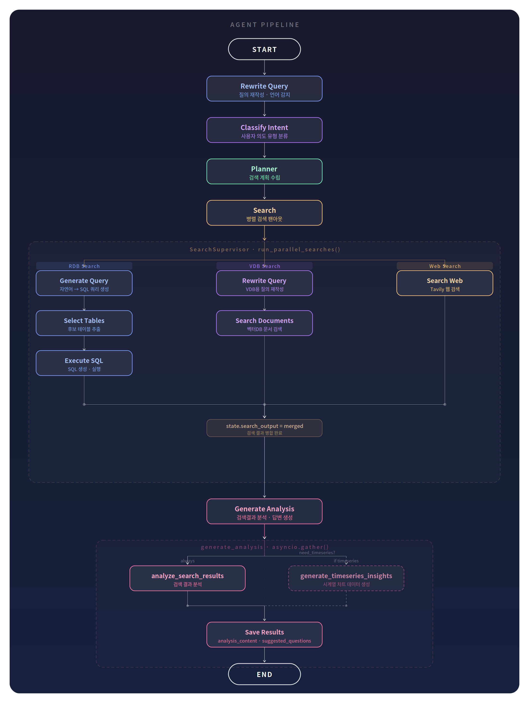

# MI Agent (Market Intelligence Agent)

이 문서는 MI Agent 통합 검색 서비스에 대한 설명 문서입니다. 

***
## 1. 개요

### 1) 프로젝트 소개
이 프로젝트는 사용자 질의 의도를 분석해 다양한 데이터 소스(RDB, 벡터DB, 웹)에서 데이터를 검색하고, 
검색된 내용을 기반으로 답변을 제공하는(텍스트, 챠트) AI Agent입니다.

### 2) 기능
1. 핵심 기능
+ 사용자 질의 재작성
: 다중질의 분리 및 키워드/조건 추출을 통해 RDB·VDB·WEB 검색 모듈별 최적 질의로 재작성

+ 의도 분류
: 사용자 질의를 분석해 의도 유형(예: 단일 수치 조회, 시계열/추세 조회 등)으로 분류하며, 
  분류 결과에 따라 일부 처리 흐름이 분기된다.
  (예: 시계열 질의는 결과를 요약하고 차트를 함께 제공).

+ 다중 소스 병렬 검색 및 결과 통합
: RDB·VDB·WEB 데이터 소스를 병렬로 조회하고, 결과를 정규화·우선순위 적용하여 단일 응답 컨텍스트로 통합
  + RDB 검색(Text2SQL): 정형 데이터 대상으로 조건/집계 중심의 질의를 생성·실행해 수치 결과를 확보
  + VDB 검색(문서): 비정형 데이터 대상으로 유사도, 키워드 기반 검색을 통해 관련 문서 메타데이터 및 컨텐츠(청크) 검색
  + WEB 검색: 최신 이슈/외부 공개 정보 보강이 필요한 경우 웹에서 근거를 수집하고 출처를 함께 제공

+ 답변 생성
  : 통합된 검색 결과를 근거로 핵심 내용을 분석·요약해 최종 답변을 생성하며, 시계열 결과를 차트 데이터로 변환해 텍스트와 함께 제공한다.

2. 부가 기능
+ 스트리밍 응답
  : 사용자 질의 처리 진행 상황을 실시간으로 클라이언트에 스트리밍
+ 토큰 사용량 집계
  : 단일 사용자 질의 처리 과정에서 사용된 LLM 토큰 사용량을 집계·제공

### 3) 기술 스택
+ Language: Python
+ Web Framework: FastAPI
+ Agent Framework: LangGraph
+ Agent Platform: A.X Platform 

## 2. Flow

### 1) 기본 흐름



## 3. Project Structure
### 1) 기본 구조
```
├── apps
│   ├── agents                                                    # [Agent구성]
│   │   ├── event_flow_agent                                        # Event Flow 에이전트,  kmj20260414화
│   │   └── mi_agent                                                # mari 에이전트
│   │       ├── flows                                                 # 메인 그래프 정의 & 런타임 실행 인터페이스
│   │       ├── state                                                 # LangGraph 상태 정의
│   │       ├── schemas                                               # 에이전트 API 입출력 스키마
│   │       ├── nodes                                                 # 메인 그래프 노드 함수
│   │       ├── tools                                                 # Tools
│   │       ├── prompts                                               # LLM 프롬프트 빌더
│   │       ├── orchestration                                         # 병렬 검색 Supervisor·라우터
│   │       ├── components                                            # 정책·컨텍스트·메트릭 공통 컴포넌트
│   │       └── subgraphs                                             # 검색 서브그래프 모음
│   │           ├── rdb_search                                           # RDB(Text2SQL) 검색 서브그래프
│   │           ├── vdb_search                                           # 벡터DB(문서) 검색 서브그래프
│   │           └── web_search                                           # 웹 검색 서브그래프
│   ├── common                                                    # [공통]
│   │   ├── configs                                                   # 환경 변수 기반 설정
│   │   ├── exceptions                                                # 예외 처리
│   │   ├── logging                                                   # 로깅 데코레이터 정의
│   │   ├── runtime                                                   # 외부 연결 자원(MCP Pool, HTTP 클라이언트, 세마포어) 생명주기 관리
│   │   ├── streaming                                                 # 스트리밍 응답 데코레이터 정의
│   │   ├── utils                                                     # 공통 유틸리티 함수
│   │   └── values                                                    # 상수·Enum·에러 코드
│   └── connectors                                                # [Connectors]  - 외부 연동
│       ├── http                                                      # http 통신
│       ├── llm                                                       # LLM 호출 
│       ├── mcp                                                       # MCP 연동
│       ├── vdb                                                       # 벡터DB 연동
│       └── web                                                       # 웹 검색 연동 (Tavily)
├── graph.yaml                                                      
└── pyproject.toml                                                  
```

### 2) 상세 구조
```
├── apps
│   ├── agents                                                    # [Agent구성]
│   │   ├── event_flow_agent                                        # Event Flow Agent,  kmj20260414화
│   │   └── mi_agent                                                # MI Agent
│   │       ├── flows                                               # 1. 그래프 빌드 & 런타임 진입점
│   │       │   ├── mari_agent_graph.py                                 # a. LangGraph 메인 그래프 빌드
│   │       │   ├── mari_agent_adapters.py                              # b. 입출력 스키마 변환
│   │       │   ├── mari_agent_runnable.py                              # c. Runnable(실행 단위)
│   │       │   └── mari_agent_runtime.py                               # d. 런타임 환경 초기화·설정
│   │       ├── schemas                                             # 2. API 입출력 Pydantic 스키마
│   │       │   ├── mari_agent_input.py                                 # a. Agent 입력 스키마
│   │       │   ├── mari_agent_output.py                                # b. Agent 출력 스키마
│   │       │   ├── schemas.py                                          # c. 내부 공통 스키마
│   │       │   ├── search_input.py                                     # d. 검색 입력 스키마
│   │       │   └── search_output.py                                    # e. 검색 결과 통합 컨테이너
│   │       ├── state                                               # 3. LangGraph 상태 정의
│   │       │   ├── state.py                                            # a. 메인 그래프 상태
│   │       │   ├── search_state.py                                     # b. 검색 중간 상태
│   │       │   └── enums.py                                            # c. 분석유형 열거형
│   │       ├── nodes                                               # 4. 메인 그래프 노드 함수
│   │       │   ├── rewrite_query.py                                    # a. 질의 재작성·언어 감지
│   │       │   ├── classify_intent.py                                  # b. 사용자 의도 유형 분류
│   │       │   ├── planner.py                                          # c. 검색 계획 노드
│   │       │   ├── search.py                                           # d. 병렬 검색 팬아웃
│   │       │   └── analyze.py                                          # e. 검색결과 분석·답변 생성
│   │       ├── tools                                               # 5. 노드 비즈니스 로직 툴
│   │       │   ├── rewrite_query.py                                    # a. 질의 재작성 툴
│   │       │   ├── classify_intent.py                                  # b. 질의 의도 분류 툴
│   │       │   ├── search_queries.py                                   # c. 검색쿼리 준비 툴
│   │       │   ├── generate_chart.py                                   # d. 차트 데이터 생성 툴
│   │       │   └── analyze.py                                          # e. 검색결과 분석·요약 툴
│   │       ├── prompts                                             # 6. LLM 프롬프트 빌더
│   │       │   ├── analysis_search_result.py                           # a. 검색결과 분석 프롬프트
│   │       │   ├── builders                                            # b. 프롬프트 조립기
│   │       │   │   └── analysis.py                                         # 가) 분석 프롬프트 조립
│   │       │   ├── chart_similarity_prompt.py                          # c. 유사도 차트 프롬프트
│   │       │   ├── chart_timeseries_prompt.py                          # d. 시계열 차트 프롬프트
│   │       │   ├── classify_analysis_type.py                           # e. 분석유형 분류 프롬프트
│   │       │   ├── language_translation.py                             # f. 언어 번역 프롬프트
│   │       │   ├── loader.py                                           # g. YAML 템플릿 로더
│   │       │   ├── rdb_search_nl_to_sql.py                             # h. 자연어→SQL 프롬프트
│   │       │   ├── rdb_search_rewrite_queries.py                       # i. RDB 질의 재작성 프롬프트
│   │       │   ├── rdb_search_select_target_table.py                   # j. 대상 테이블 선택 프롬프트
│   │       │   ├── rewrite_queries.py                                  # k. 메인 질의 재작성 프롬프트
│   │       │   ├── templates                                           # l. YAML 프롬프트 템플릿
│   │       │   │   ├── analysis.yaml                                         
│   │       │   │   ├── chart.yaml                                            
│   │       │   │   ├── classify.yaml                                         
│   │       │   │   ├── language.yaml                                         
│   │       │   │   ├── nl_to_sql.yaml                                        
│   │       │   │   ├── rdb_queries.yaml                                      
│   │       │   │   ├── rdb_search.yaml                                       
│   │       │   │   ├── rewrite_queries.yaml                                  
│   │       │   │   ├── vdb_queries.yaml                                      
│   │       │   │   └── web_search.yaml                                       
│   │       │   ├── vdb_search_rewrite_queries.py                       # m. VDB 질의 재작성 프롬프트
│   │       │   └── web_search_guide.py                                 # n. 웹 검색 가이드 프롬프트
│   │       ├── orchestration                                       # 7. 병렬 검색 Supervisor·라우터
│   │       │   ├── policies                                            # a. 검색 실행 정책
│   │       │   │   └── search_policy.py                                    # 가) 타임아웃·재시도 정책
│   │       │   └── supervisors                                         # b. 병렬 실행 Supervisor
│   │       │       └── search_supervisor.py                                # 가) 검색(Text2SQL,문서,WEB) 병렬 실행·조기종료
│   │       ├── components                                          # 8. 정책·컨텍스트 공통 컴포넌트
│   │       │   ├── combine.py                                          # a. 다중소스 결과 병합·중복제거
│   │       │   ├── context.py                                          # b. SearchPolicySet 싱글톤 관리
│   │       │   ├── guards.py                                           # c. 타임아웃·재시도 정책 데코레이터
│   │       │   ├── metrics.py                                          # d. 검색 성능 지표 수집
│   │       │   └── policies.py                                         # e. 검색 실행 정책 모델 정의
│   │       └── subgraphs                                           # 9. 검색 서브그래프 모음
│   │           ├── rdb_search                                          # a. RDB(Text2SQL) 서브그래프
│   │           │   ├── subgraph_builder.py                                 # 가) RDB 서브그래프 빌드
│   │           │   ├── subgraph_adapter.py                                 # 나) 메인↔RDB 상태 변환
│   │           │   ├── stages                                              # 다) RDB 검색 단계
│   │           │   │   ├── prepare                                             # i. 준비 단계
│   │           │   │   │   ├── search_queries.py                                   # SQL용 쿼리 준비 노드
│   │           │   │   │   └── candidate_tables.py                                 # 후보 테이블 추출 노드
│   │           │   │   └── execute                                             # ii. 실행 단계
│   │           │   │       └── execute_rdb_search.py                               # SQL 생성·실행 노드
│   │           │   ├── tools                                               # 라) RDB 전용 툴
│   │           │   │   ├── search_candidates.py                                # i. 후보 테이블 추출 툴
│   │           │   │   ├── search_execution.py                                 # ii. SQL 실행 툴
│   │           │   │   └── search_queries.py                                   # iii. 검색쿼리 준비 툴
│   │           │   ├── schemas.py                                          # 마) RDB 입출력 모델
│   │           │   └── state.py                                            # 바) RDB 검색 상태
│   │           ├── vdb_search                                        # b. VDB 문서검색 서브그래프
│   │           │   ├── subgraph_builder.py                               # 가) VDB 서브그래프 빌드
│   │           │   ├── subgraph_adapter.py                               # 나) 메인↔VDB 상태 변환
│   │           │   ├── stages                                            # 다) VDB 검색 단계 노드
│   │           │   │   ├── execute                                             # i. 실행 단계
│   │           │   │   │   └── search_documents_node.py                            # 벡터DB 검색 노드
│   │           │   │   ├── plan                                                # ii. 계획 단계 (예비)
│   │           │   │   └── prepare                                             # iii. 준비 단계
│   │           │   │       └── rewrite_query_node.py                               # VDB용 질의 재작성 노드
│   │           │   ├── tools                                             # 라) VDB 전용 툴
│   │           │   │   ├── search_documents.py                               # i. 벡터DB 문서 검색 툴
│   │           │   │   └── search_queries.py                                 # ii. VDB 쿼리 준비 툴
│   │           │   ├── schemas.py                                        # 마) VDB 입출력 모델
│   │           │   └── state.py                                          # 바) VDB 검색 상태
│   │           └── web_search                                        # c. WEB 검색 서브그래프
│   │               ├── subgraph_adapter.py                               # 가) 메인↔Web 상태 변환
│   │               ├── subgraph_builder.py                               # 나) WEB 검색 서브그래프 빌드
│   │               ├── stages                                            # 다) WEB 검색 단계 노드
│   │               │   └── execute                                           # i. 실행 단계
│   │               │       └── search_web_node.py                                # Tavily 웹검색 노드
│   │               ├── tools                                             # 라) WEB 검색 전용 툴
│   │               │   └── web_search.py                                     # i. Tavily 웹검색 툴
│   │               ├── schemas.py                                        # 마) WEB 검색 입출력 모델
│   │               └── state.py                                          # 바) WEB 검색 상태
│   ├── common                                                    # [공통]
│   │   ├── configs                                                 # 1. 환경 변수 설정
│   │   │   └── settings.py                                             # a. pydantic_settings 설정 클래스
│   │   ├── exceptions                                              # 2. 도메인 커스텀 예외
│   │   │   └── custom.py                                               # a. 커스텀 예외 정의
│   │   ├── logging                                                 # 3. 로거 설정 & 데코레이터
│   │   │   ├── decorators.py                                           # a. @log_node/tool/connector
│   │   │   └── logger_config.py                                        # b. loguru 로거 설정
│   │   ├── middleware                                              # 4. FastAPI 미들웨어
│   │   │   └── exception_handler.py                                    # a. 전역 예외 핸들러
│   │   ├── runtime                                                 # 5. RuntimeContext 싱글톤 관리
│   │   │   ├── runtime.py                                              # a. 리소스 접근 모듈 함수
│   │   │   ├── runtime_context.py                                      # b. 싱글톤 생명주기 관리
│   │   │   ├── shutdown_hooks.py                                       # c. 종료 훅 등록
│   │   │   └── usage_context.py                                        # d. LLM 토큰 누적 추적
│   │   ├── streaming                                               # 6. 스트리밍 응답
│   │   │   ├── decorators.py                                           # a. @stream_step 데코레이터
│   │   │   └── texts.py                                                # b. 스트리밍 텍스트 상수
│   │   ├── utils                                                   # 7. 공통 유틸리티
│   │   │   ├── time_utils.py                                           # a. 시간 측정 유틸
│   │   │   └── timeseries_similarity_utils.py                          # b. 시계열 유사도 유틸
│   │   └── values                                                  # 8. 상수·열거형
│   │       ├── constants.py                                             # a. 전역 상수
│   │       ├── enums.py                                                 # b. ModelPreference, SearchSource 등
│   │       └── error_codes.py                                           # c. 에러 코드 정의
│   └── connectors                                                # [외부 연동 모듈]
│       ├── http                                                    # 1. httpx 비동기 HTTP 클라이언트
│       │   ├── http_client.py                                           # a. httpx 요청 래퍼
│       │   └── http_client_manager.py                                   # b. HTTP 세션 풀 관리
│       ├── llm                                                     # 2. LLM 호출 클라이언트
│       │   └── llm_client.py                                            # a. 구조화 출력·함수호출
│       ├── mcp                                                     # 3. MCP 클라이언트 풀 (RDB)
│       │   ├── mcp_adapter.py                                           # a. MCP 요청·응답 변환
│       │   ├── mcp_client_manager.py                                    # b. MCP 세션 관리
│       │   └── mcp_client_pool.py                                       # c. MCP 커넥션 풀
│       ├── vdb                                                     # 4. 벡터DB 클라이언트
│       │   ├── vector_db.py                                             # a. 벡터DB 검색 인터페이스
│       │   ├── config_loader.py                                         # b. VDB 설정 로더
│       │   ├── configs                                                  # c. VDB 저장소별 설정
│       │   │   ├── default.yaml                                             # 가) 기본 VDB 검색 옵션 설정
│       │   │   ├── gartner.yaml                                             # 나) Gartner VDB 검색 옵션  설정
│       │   │   └── omdia.yaml                                               # 다) Omdia VDB 검색 옵션 설정
│       │   ├── constants.py                                             # d. VDB 상수
│       │   ├── enums.py                                                 # e. VDB 열거형
│       │   └── schemas.py                                               # f. VDB 입출력 스키마
│       └── web                                                     # 5. 웹검색 프로바이더
│           ├── base.py                                                  # a. 웹검색 추상 인터페이스
│           ├── factory.py                                               # b. 프로바이더 팩토리
│           └── tavily_provider.py                                       # c. Tavily API 구현체
├── docs                                
├── graph.yaml                                                          
├── pyproject.toml                                                      
├── Dockerfile                                                          
└── requirements.txt                                                    
```

## 4. 개발자 가이드

### 1) 모듈 단위

- 새 Agent 추가 시 → `apps/agents/mi_agent`와 같은 depth(`apps/agents/`)에 추가
- 공통 로직 (예외 처리, 로깅 등) → `apps/common/`
- 외부 연동 모듈 → `apps/connectors/`
- 단순 유틸리티 함수 → `apps/common/utils/`
  - 예) 시간 관련 유틸은 `apps/common/utils/time_utils.py`에 구현되어 있습니다.
  - 시간 정보가 필요한 경우 `datetime.now()`를 직접 호출하지 않고 아래 함수를 사용해 타임존과 포맷을 통일합니다.
    ```python
    from apps.common.utils.time_utils import now, today, prior_year_period

    now()                            # "2026-04-11T10:23:45.123456+09:00"
    today()                          # "2026-04-11"
    prior_year_period("2026-01-01")  # ("2025-01-01", "2025-12-31")
    ```

### 2) Graph / SubGraph / Node / Tool / Connector — 역할 및 의존 관계

- **(1) 레이어별 역할**

    | 레이어 | 관점 | 역할 |
    |--------|------|------|
    | **Graph** | 전체 파이프라인 | 에이전트의 최상위 실행 흐름. 노드 간 순서·분기·조건을 StateGraph로 정의. 외부(FastAPI)에서 Runnable로 호출됨 |
    | **SubGraph** | 독립 처리 단위 | 특정 기능(RDB 검색, VDB 검색 등)을 독립된 StateGraph로 캡슐화. 자체 State·Schema·Node를 가지며, 메인 그래프와 adapter를 통해 입출력 변환 |
    | **Node** | 라우팅 | 그래프 흐름 제어. 상태(State)를 받아 다음 노드로 전달. 비즈니스 로직 없이 Tool 호출만 담당 |
    | **Tool** | 비즈니스 로직 | 실제 도메인 처리 (쿼리 재작성, 분석, SQL 생성 등). State 객체 대신 명시적 값을 파라미터로 받음 |
    | **Connector** | 외부 연동 | LLM·MCP·VDB·HTTP·WEB 등 외부 시스템과의 통신만 전담. 도메인 로직 포함 금지 |

- **(2) 의존 방향 구조**

    ```
    Graph (메인 파이프라인)
     └── Node                # 라우팅: 그래프의 각 단계
          ├── SubGraph        # 독립 처리 단위: 별도 State·Node를 가진 캡슐화된 서브 파이프라인
          │    └── Node       # 서브그래프 내부 노드
          │         └── Tool  # 비즈니스 로직
          └── Tool            # 비즈니스 로직: 상태 객체를 받지 않고 명시적 값만 파라미터로
               └── Connector  # 외부 연동: 외부 시스템 호출 (LLM, MCP, VDB, HTTP, WEB)
                    └── External Service  # Claude API, RDB(MCP), VectorDB, Tavily 등
    ```

    - Node → Tool → Connector → External 단방향만 허용. 역방향 import 금지.
    - `apps/common/`은 어느 레이어에서도 import 가능.

- **(3) SubGraph로 분리하는 기준**

    아래 조건 중 하나라도 해당하면 SubGraph 분리를 고려합니다.
    
    (단일 노드 + 단일 Tool 호출로 끝나는 단순 처리는 메인 그래프 노드로 유지합니다.)

    | 기준 | 설명 | 예시 |
    |------|------|------|
    | 독립적인 State 필요 | 메인 그래프 State와 다른 전용 상태가 필요한 경우 | SQL 실행 결과, 후보 테이블 목록 등 |
    | 복수 노드의 순차 처리 | 내부적으로 2개 이상의 노드가 순서를 갖고 동작하는 경우 | prepare → execute 2단계 처리 |
    | 병렬 실행 단위 | Supervisor가 동시에 팬아웃하는 독립 실행 단위인 경우 | RDB / VDB / WEB 병렬 검색 |
    | 재사용·교체 가능성 | 동일 인터페이스로 다른 구현체로 교체될 수 있는 경우 | VDB 벤더 교체, 웹 검색 프로바이더 교체 |
    | 메인 State 격리 필요 | 서브 처리 중간 상태가 메인 State를 오염시키면 안 되는 경우 | VDB raw 청크, SQL 중간 결과 등 |


- **(4) 호출 흐름**

    **1) 메인 그래프**
    ```
    MariAgentRunnable.ainvoke / astream
     └── ensure_runtime()              # 런타임 자원 초기화
     └── _mari_agent (StateGraph)
          ├── rewrite_query_node       # 질의 재작성 → rewrite_query.py (tool) → invoke_llm
          ├── classify_intent_node     # 의도 분류   → classify_intent.py (tool) → invoke_llm
          ├── planner_node             # 검색 계획   → search_queries.py (tool) → invoke_llm
          ├── search_node              # 병렬 검색 팬아웃
          │    └── SearchSupervisor.run_parallel_searches()
          │         ├── run_rdb(state) ── RDB 서브그래프
          │         ├── run_vdb(state) ── VDB 서브그래프
          │         └── run_web(state) ── WEB 서브그래프
          └── generate_analysis        # 분석·답변 생성
               └── analyze_search_results (tool) → invoke_llm
    ```

    **2) SubGraph 내부 흐름 (RDB 예시)**
    ```
    run_rdb(agent_state)
     └── subgraph_adapter.to_state()    # MariAgentState → RDBSearchState 변환
     └── RDB StateGraph
          ├── search_queries_node        # 자연어 → SQL 쿼리 준비 (tool → invoke_llm)
          ├── candidate_tables_node      # 후보 테이블 추출    (tool → invoke_llm)
          └── execute_rdb_search_node    # SQL 실행            (tool → MCP connector → RDB)
     └── subgraph_adapter.to_output()   # RDBSearchState → RDBSearchOutput 변환
    ```

- **(5) 입출력 스키마 & 어댑터 패턴**

    외부 호출자(FastAPI)와 그래프 내부 사이에 **어댑터 레이어**를 두어 입출력을 명확히 분리합니다.

    | 단계 | 함수 | 역할 |
    |------|------|------|
    | 입력 변환 | `to_state(raw)` | 외부 JSON → `MariAgentInput` 검증 → `MariAgentState` 변환 |
    | 출력 변환 | `to_output(state_dict)` | `MariAgentState` → `MariAgentOutput` 변환 후 호출자에게 반환 |

    ```
    외부 호출자 (FastAPI)
      │  JSON payload
      ▼
    to_state()                    # MariAgentInput.model_validate() → MariAgentState
      │
      ▼
    Graph / SubGraph 실행
      │
      ▼
    to_output()                   # MariAgentState → MariAgentOutput
      │  정형화된 응답
      ▼
    외부 호출자 (FastAPI)
    ```

    - **`MariAgentInput`** — 호출자가 전달하는 입력 계약 (company_code, user_query, search_sources, 권한 정보 등). Pydantic `model_validator`로 필수값·형식 검증.
    - **`MariAgentOutput`** — 호출자가 수신하는 출력 계약 (answer, evidence, usage). FastAPI `/docs`에 스키마·예시가 자동 노출됨.
    - **서브그래프도 동일 패턴 적용** — 각 서브그래프의 `subgraph_adapter.py`에 `to_state()` / `to_output()`을 구현하여 메인 그래프 State ↔ 서브그래프 전용 State 간 변환을 담당.

    > 어댑터 덕분에 그래프 내부 State 구조가 변경되어도 외부 계약(Input/Output 스키마)은 유지되며, Swagger UI에서 입출력 형식을 바로 확인·테스트할 수 있습니다.

- **(6) 병렬 처리 가이드**

    이 프로젝트의 병렬 처리는 **스레드 없이 `asyncio` 기반 비동기**로 구현합니다.

    > **원칙**: LLM 호출·DB 쿼리·HTTP 요청처럼 I/O 대기가 대부분인 작업은 스레드를 생성할 필요가 없습니다. 스레드는 생성·스케줄링 비용이 있고, Python GIL 특성상 CPU 병렬성도 확보되지 않습니다. `asyncio`로 충분히 동시성을 확보할 수 있습니다.

    | 상황 | 권장 방식 |
    |------|-----------|
    | I/O 대기 작업 (LLM·MCP·VDB·HTTP) | `asyncio.create_task()` / `asyncio.gather()` |
    | 단순 동시 실행 + 전체 완료 대기 | `asyncio.gather(*coros)` |
    | 완료 순서대로 처리 / 조기 종료 필요 | `asyncio.create_task()` + `asyncio.wait()` |
    | 타임아웃 적용 | `asyncio.wait_for(coro, timeout=N)` |
    | 블로킹 동기 함수 (파일 I/O 등) | `asyncio.to_thread(sync_fn)` — 불가피한 경우만 |
    | CPU 집약 연산 (이미지 처리 등) | `loop.run_in_executor(ProcessPoolExecutor, fn)` |

    **패턴 1 — 단순 fan-out (결과 순서 무관)**
    ```python
    results = await asyncio.gather(
        run_rdb(state),
        run_vdb(state),
        run_web(state),
        return_exceptions=True,   # 개별 실패가 전체를 중단하지 않도록
    )
    ```

    **패턴 2 — 완료 순서 처리 + 조기 종료 (SearchSupervisor 방식)**
    ```python
    tasks = {src: asyncio.create_task(runner(state), name=f"search:{src}") for src, runner in runners.items()}

    pending = set(tasks.values())
    while pending:
        done, pending = await asyncio.wait(pending, timeout=0.1, return_when=asyncio.FIRST_COMPLETED)
        for task in done:
            # 완료된 태스크 결과 즉시 처리
            ...
        if early_exit_condition:
            for t in pending:
                t.cancel()          # 불필요한 태스크 취소
            break
    ```

    > `SearchSupervisor.run_parallel_searches()`는 패턴 2를 사용합니다. 필수 소스가 모두 완료되면 나머지 태스크를 즉시 취소(`task.cancel()`)하여 불필요한 대기를 제거하고, 전체 팬아웃 데드라인(`search_exec_fanout_deadline_sec`)을 초과하면 전체 취소합니다.

    **주의 사항**
    - `asyncio.sleep(0)` 또는 `asyncio.wait(timeout=0.1)` 루프 내 짧은 대기로 이벤트 루프 블로킹을 방지합니다.
    - `time.sleep()` 사용 금지 → `asyncio.sleep()` 사용.
    - `threading.Thread` 직접 생성 금지 — I/O 작업은 `async def` + `await`로 처리합니다.

- **(7) 로깅 규칙**

    비즈니스 로직과 로깅의 혼합을 방지하기 위해 로깅은 데코레이터로 분리되어 있습니다. Node·Tool·Connector 구현 시 함수 위에 아래 데코레이터를 붙입니다.

    | 레이어 | 데코레이터 |
    |--------|-----------|
    | Node | `@log_node`, 스트리밍 필요 시 `@stream_step(step_key="...")` 추가 |
    | Tool | `@log_tool` |
    | Connector | `@log_connector(connector_type="LLM\|MCP\|VDB\|HTTP\|WEB")` |

## 5. 실행

### 전제 조건

MCP 서버(`skmip_mcp_server`)가 먼저 실행되어 있어야 합니다.

### 실행 순서

**1) conda 환경 생성 및 활성화**
```bash
conda create -n skmip_mi_agent python=3.13.0 -y
conda activate skmip_mi_agent
```

**2) 의존성 설치**
```bash
poetry lock
poetry install
```

**3) 에이전트 실행**

VS Code에서 `F5` 또는 실행 패널에서 **`[🌱]adxp-cli run (single)`** 구성을 선택하여 실행합니다.

> 해당 구성은 `.vscode/launch.json`에 정의되어 있으며, `0.0.0.0:3002`로 서버가 기동됩니다.

**4) API 문서 접속**
```
http://localhost:3002/docs
```

**5) API 호출**

| 엔드포인트 | 설명 |
|-----------|------|
| `/invoke` | 동기 호출 — 전체 응답을 한 번에 반환 |
| `/stream` | 스트리밍 호출 — 처리 단계별 실시간 응답 반환 |
