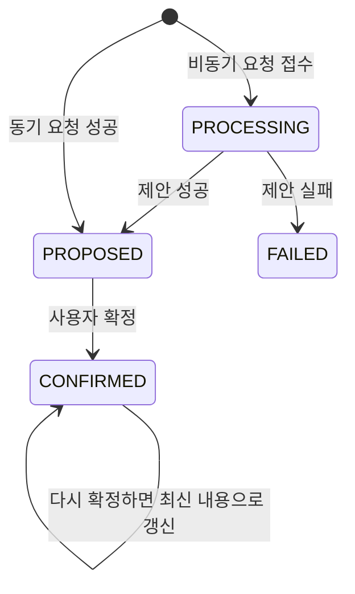

# Model Parameter Agent DB 안내

## 한눈에 보기

| 질문 | 답 |
|---|---|
| DB에는 무엇이 있나요? | 파라미터 기준, 상황과 파라미터의 연결 규칙, 제안·확정 결과가 있습니다. |
| Agent는 어떻게 사용하나요? | 앞의 두 기준표는 읽고, 제안 결과표에는 처리 결과를 저장합니다. |
| 현재 사용하는 파라미터는 몇 개인가요? | master 21개 중 canonical 10개입니다. |
| 이 문서의 범위는 무엇인가요? | 기능 이해에 필요한 관계와 주요 데이터 모양을 설명합니다. |

> 아래 내용은 2026-08-07 외부개발 DB snapshot과 `model-parameter-canonical-v1`을 기준으로 합니다. ID, 사용자 정보, 제안값과 근거는 가렸습니다.

## 1. 세 테이블을 한 문장으로 이해하기

| 테이블 | 역할 | Agent 사용 방식 |
|---|---|---|
| `tmm_mi_model_param_m` | “어떤 파라미터를 어느 모델 위치에 넣는가?”를 정한 파라미터 사전 | 읽기 |
| `tmm_mi_model_param_dimension_map` | “이 사건과 영향 항목에는 어떤 파라미터를 검토하는가?”를 정한 연결표 | 읽기 |
| `tmm_mi_model_param_proposal_m` | Agent의 제안과 사용자의 최종 확정을 보관하는 작업 결과표 | 읽기·쓰기 |

업무 흐름으로 보면 다음과 같습니다.


연결표는 파라미터 사전의 항목을 가리킵니다. 결과표는 파라미터 사전과 직접 연결되지 않고, 당시 이름과 값을 JSON 이력으로 보관합니다.

## 2. 파라미터 사전: 무엇을 조정할지 알려주는 표

`tmm_mi_model_param_m`에는 파라미터의 이름, 설명, 값을 넣을 모델 파일·시트·테이블, Basecase를 읽는 기준이 있습니다.
Agent는 현재 사용 중이며 삭제되지 않은 항목만 읽습니다.
전체 21개 중 현재 활성 항목은 다음 10개입니다.

| 파라미터 | 적용 대상 | 주요 좌표 | Basecase 읽기 방식 |
|---|---|---|---|
| `GDP` | Demand / GDPPopulationAdjustment | 국가, 연도 | 행마다 정해진 열을 읽음 |
| `PMI` | Demand / PMIAdjustment | 국가, 연도, 월 | 행마다 정해진 열을 읽음 |
| `PowerMix` | Demand / PowerMixAdjustment | 국가, 연도, 에너지원 | 행마다 정해진 열을 읽음 |
| `Temperature` | Demand / WeatherAdjustment | 국가, 연도, 월 | 행마다 정해진 열을 읽음 |
| `Population` | Demand / GDPPopulationAdjustment | 국가, 연도 | 행마다 정해진 열을 읽음 |
| `HurricaneIntensity` | Supply / {USA}Hurricanes | 연도, 월 | 행마다 정해진 열을 읽음 |
| `LiqProdAdjustment` | Supply / LiqProdAdjustment | 국가, LNG 플랜트·트레인, 연도, 월 | 가로로 펼쳐진 월별 값을 읽음 |
| `LiqUtilAdjustment` | Supply / LiqUtilAdjustment | 국가, LNG 플랜트·트레인, 연도, 월 | 가로로 펼쳐진 월별 값을 읽음 |
| `PipelineAdjustment` | Supply / PipelineAdjustment | 파이프라인, From·To 국가, 연도, 월 | 행마다 정해진 열을 읽음 |
| `SupplyDisruption` | Supply / VolumeAdjustment | 국가, 연도, 월 | 행마다 정해진 열을 읽음 |

“주요 좌표”는 값을 구별하는 주소입니다. 예를 들어 `GDP`의 `대한민국 / 2027년`과 `대한민국 / 2028년`은 서로 다른 입력 위치입니다.
Basecase와 LUT를 읽는 자세한 기준은 [Basecase/LUT 문서](05_MODEL_PARAMETER_AGENT_BASECASE_LUT_PARSING.md)를 참고합니다.

이 표의 `parameter_hint` 컬럼은 Excel을 파싱하는 설정이 아니라, LLM에 “이 값의 의미·단위·스케일과 제안 시 제약”을 알려 주는 설명입니다. routing 후보 선택, slot 선택, value 제안 단계에 같은 파라미터 설명으로 들어갑니다.

## 3. 연결표: 어떤 파라미터를 검토할지 알려주는 표

`tmm_mi_model_param_dimension_map`은 사건 유형과 영향 항목을 파라미터에 연결합니다.
현재 연결 129건은 모두 활성 상태입니다. 기존 128건 중 13건을 승인된 파라미터로 복구하고 Population routing 1건을 추가했습니다.
연결 방법인 `mapping_method`는 다음 네 종류입니다.

중요하게도 이 테이블은 **어떤 파라미터를 후보로 삼을지만** 정합니다. Excel의 몇 행·몇 열을 읽을지는 이 테이블이 아니라 앞 절의 `tmm_mi_model_param_m` Basecase 설정이 정하고, LUT CSV의 열과 계산 방식은 `config.yaml`이 정합니다.

| 방법 | 현재 건수 | 설명 | 제안 후보가 되나요? |
|---|---:|---|---|
| `direct` | 35 | 이 영향 항목이면 정해진 파라미터를 바로 사용 | 예 |
| `routing` | 6 | 가능한 파라미터가 여럿일 수 있어 상황에 맞는 항목을 선택 | 예 |
| `indirect` | 55 | 값을 직접 바꾸지는 않지만 판단에 참고할 배경 정보 | 아니요 |
| `na` | 33 | 모델 입력 파라미터와 직접 연결되지 않는 항목 | 아니요 |

정확한 21행 master와 129행 mapping은 `scripts/model_parameter/model-parameter-canonical-v1.json`이 기계 판정 기준이고, 사람이 읽는 전체 표는 [canonical mapping 문서](../resources/Model_Parameter_Base_Case_Mapping.md), 업무용 표는 [canonical mapping Excel](../resources/mapping/260807_시나리오가정_MI수급모델_input_매핑_model-parameter-canonical-v1.xlsx)에 있습니다. 적용 스크립트는 생성 감사 컬럼과 기존 비대상 mapping을 보존하며, 활성 이름·method count·FK·scenario template key·model_param_id가 있는 natural key 중복을 commit 전에 검사합니다.

정적 SQL은 격리된 MySQL 8.0에서 첫 적용, 두 번째 재실행, 강제 master precondition 실패 rollback, canonical DML 이후 template invariant 실패 rollback을 검증한다. 재검증기는 `tests/manual/model_parameter_agent/verify_canonical_sql_mysql.py`이며, database 이름이 `model_parameter_sql_verify*`인 격리 환경에서만 destructive seed를 허용한다.

`direct`는 연결표가 가리키는 항목이 곧 후보입니다. 같은 영향 항목에 `routing` 후보가 여러 개면 LLM이 적합한 후보를 고르지만, 연결표에 없는 새 파라미터를 만들 수는 없습니다.

연결표의 `comment` 컬럼도 prompt 지침으로 사용합니다. `direct`·`routing`이면 `mapping_comment`라는 이름으로 “이 dimension과 파라미터를 연결하고 값을 산정할 때 어떤 근거를 우선할지” 알려 줍니다. `indirect`이면 후보 선택 문구가 아니라 보조정보의 `reason`으로 들어가며, `na` comment는 prompt에 넣지 않습니다. 단계별 JSON 위치와 실제 GDP 예시는 [Flow 문서의 hint/comment 설명](04_MODEL_PARAMETER_AGENT_FLOW.md#hint-and-mapping-comment)을 참고합니다.

후보 선정부터 Basecase/LUT 파싱까지 설정이 이어지는 순서는 [Basecase/LUT 문서의 설정 역할 구분](05_MODEL_PARAMETER_AGENT_BASECASE_LUT_PARSING.md#21-db와-configyaml은-각각-무엇을-정하나)에서 확인할 수 있습니다.

## 4. 결과표: 제안부터 확정까지 남기는 표

`tmm_mi_model_param_proposal_m`은 한 번의 제안 작업을 한 행으로 관리합니다.
주요 내용은 대상 scenario, 처리 상태, 제안 JSON, 확정 JSON, 오류와 callback 결과입니다.



| 상태 | 의미 |
|---|---|
| `PROCESSING` | 비동기 제안 작업이 진행 중 |
| `PROPOSED` | 제안값 생성과 저장이 끝남 |
| `CONFIRMED` | 사용자가 검토한 최종값이 저장됨 |
| `FAILED` | 제안 중 오류가 발생함 |

비동기 callback 상태는 `PENDING`(전송 전), `SUCCEEDED`(성공), `FAILED`(실패)이며, 동기 요청은 `SKIPPED`입니다.

## 5. 실제 저장 구조를 짧게 보기

아래는 실제 DB에서 확인한 JSON 필드 구조이며, 업무 데이터와 수치는 `<masked>`로 표시했습니다.

### 제안 JSON (`proposal_parameters`)

```json
[
  {"parameterName": "PMI",
   "modelTarget": {"modelFile": "Demand", "modelSheet": "PMIAdjustment", "tableName": "table1", "valueFieldNames": ["PMI"], "slotAxesFieldNames": ["Country", "Year", "Month"]},
   "rationale": "<masked>",
   "values": [{"Country": "<masked>", "Year": "<masked>", "Month": "<masked>",
     "basecaseValue": "<masked>", "proposedValue": "<masked>", "rationale": "<masked>"}]}
]
```

`basecaseValue`는 같은 slot에 실제 Basecase 값이 있을 때만 채워집니다. Basecase가 없어서 LUT를 기준으로 사용한 경우에도 DB의 `basecaseValue`는 `null`이며, 동기 제안 응답에서는 별도 `lutValue`로 LUT 값을 확인할 수 있습니다.
`proposedValue`는 사건 영향을 반영해 Agent가 제안한 값입니다.

### 확정 JSON (`confirmation_parameters`)

```json
[
  {"parameterName": "PMI",
   "modelTarget": {"modelFile": "Demand", "modelSheet": "PMIAdjustment", "tableName": "table1", "valueFieldNames": ["PMI"], "slotAxesFieldNames": ["Country", "Year", "Month"]},
   "rationale": "<masked>",
   "values": [{"Country": "<masked>", "Year": "<masked>", "Month": "<masked>",
     "basecaseValue": "<masked>", "proposedValue": "<user-confirmed value>", "rationale": "<masked>"}]}
]
```

확정 JSON은 제안 JSON과 같은 모양입니다. 사용자가 수정했다면 `proposedValue`에 수정값이 들어가며, 후속 조회에서는 확정값을 우선 사용합니다.

## 6. 운영자가 기억할 점

- 새 파라미터를 추가하려면 이름만 등록하는 것으로 끝나지 않습니다. 모델 위치, Basecase 읽기 기준, 사건·영향 항목 연결이 함께 맞아야 합니다.
- `direct`와 `routing`만 실제 제안 후보가 됩니다. `indirect`와 `na`는 파라미터 값 자체를 만들지 않습니다.
- 같은 좌표에서는 Basecase 값이 LUT 값보다 우선합니다. DB는 어느 파일과 위치를 읽을지 정하고, 실제 참고값은 Basecase/LUT에서 얻습니다.
- 확정은 새 결과 행을 추가하지 않고 기존 제안 행을 `CONFIRMED`로 갱신합니다. 다시 확정하면 이전 확정 내용이 최신 요청으로 바뀝니다.
- 실패 원인은 결과표의 오류 정보에 남고, 비동기 요청은 callback 상태도 함께 확인해야 합니다.

## 관련 문서

| 궁금한 내용 | 문서 |
|---|---|
| Basecase·LUT의 파일별 읽기 규칙과 우선순위 | [Basecase/LUT 문서](05_MODEL_PARAMETER_AGENT_BASECASE_LUT_PARSING.md) |
| API 요청·응답 | [API 문서](02_MODEL_PARAMETER_AGENT_API_SPEC.md) |
| 제안과 확정의 전체 순서 | [Flow 문서](04_MODEL_PARAMETER_AGENT_FLOW.md) |
| 새 파라미터의 master·mapping 등록 순서 | [파라미터 추가 가이드](06_MODEL_PARAMETER_AGENT_PARAMETER_ADDITION_GUIDE.md) |
