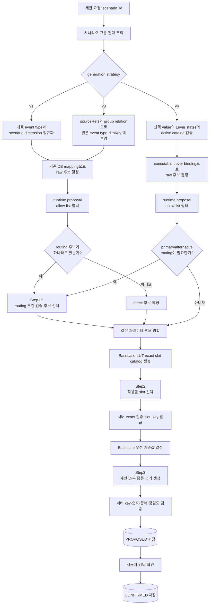
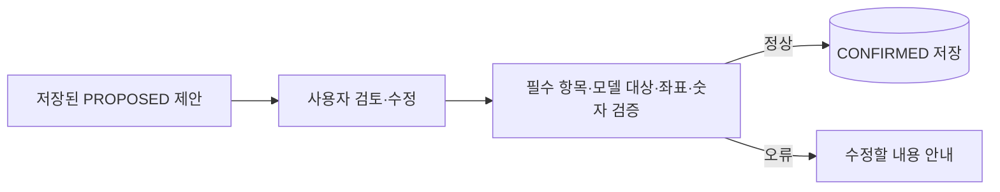
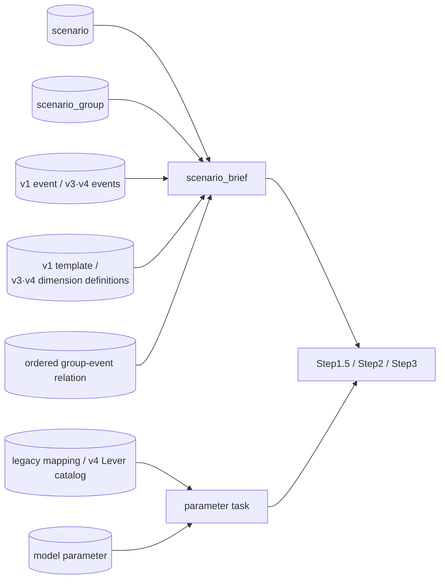
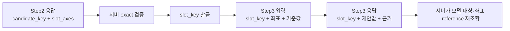

# Model Parameter Agent 기능 흐름

## 한눈에 보기

- v1/v3는 legacy DB mapping으로 raw 후보 10개, v4는 선택 value의 Lever state와 active catalog binding으로 raw 후보 16개에 도달할 수 있다.
- 모든 버전은 raw matching 후 `GDP`, `PMI`, `PowerMix`, `Temperature`, `LiqUtilAdjustment` 5개 runtime proposal allow-list를 Step1.5·LLM·persistence 전에 적용한다.
- LLM 판단은 조건부 Step1.5, Step2, Step3으로 나뉘며 각 단계의 역할과 출력이 다르다.
- Step2는 “어디를 바꿀지”, Step3는 “얼마로 바꾸고 왜 그런지”를 판단한다.
- 최종 확인은 LLM을 다시 호출하지 않고 서버 검증 후 `CONFIRMED`로 저장한다.

이 문서는 먼저 전체 로직과 prompt 계약을 설명하고, 이어서 scenario `595` 실제 테스트를 보여 준다. DB 활용 컬럼, compact catalog, token 절감 방식은 실제 사례 뒤의 부가 설명에 모았다.

## 1. 이 문서에서 쓰는 말

| 용어 | 의미 | 예시 |
|---|---|---|
| 시나리오 | 모델에 반영하려는 사건과 조건 | 특정 국가의 2026년 경기 둔화 |
| 파라미터 후보 | 시나리오의 영향을 받을 수 있는 모델 입력 항목 | `GDP`, `PMI` |
| slot | 값을 적용할 정확한 위치 | `Country=China`, `Year=2026` |
| 기준값 | 새 값을 제안할 때 비교하는 현재 값 | GDP 성장률 `0.042` |
| 제안값 | 시나리오를 반영해 LLM이 제안한 값 | GDP 성장률 `0.041` |
| composite dimension | v3에서 여러 event/source dimension을 조합해 만든 scenario dimension | `복합 공급 압력` |
| source lineage | composite dimension을 원본 event·template·dimension으로 연결하는 근거 | `sourceEventIds`, `sourceRefs` |
| Lever provenance | v4 선택 value를 dimension·event·Lever·binding으로 연결하는 근거 | `lever_states`, binding role/applicability |

`candidate_key`와 `slot_key`는 처리 중 항목을 안전하게 연결하는 서버 식별자다. 사용자가 직접 만들 필요는 없다.

## 2. 전체 처리 흐름



| 단계 | 실행 주체 | 핵심 입력 | 핵심 출력 |
|---|---|---|---|
| 문맥 조회 | 서버 | `scenario_id` | scenario, group strategy, ordered event, dimension과 lineage/Lever provenance |
| raw 후보 결정 | 서버 | v1/v3 legacy key 또는 v4 selected Lever state | direct/routing 또는 executable primary/alternative raw 후보 |
| runtime 범위 필터 | 서버 | raw 후보, proposal allow-list 5개 | Step1.5·LLM·저장으로 전달할 후보 |
| Step1.5 | LLM, 조건부 | legacy routing 또는 v4 primary/alternative와 관련 시나리오 문맥 | 허용된 `candidate_key` 0개 이상 선택 |
| reference 준비 | 서버 | 확정 후보, Basecase, LUT | 값이 존재하는 exact slot catalog |
| Step2 | LLM | 시나리오 문맥, 파라미터별 slot catalog | `candidate_key + slot_axes` |
| 기준값 결정 | 서버 | Step2 좌표 | `slot_key + coordinates + reference_value` |
| Step3 | LLM | 확정 slot, 기준값, hint/comment | 제안값, 파라미터 근거, slot별 근거 |
| 저장 | 서버 | 검증된 Step3 결과 | `PROPOSED` proposal |
| 확인 | 사용자·서버 | 검토·수정한 전체 값 | `CONFIRMED` proposal |

Basecase/LUT 파일 자체를 읽는 기준은 [Basecase·LUT 문서](./05_MODEL_PARAMETER_AGENT_BASECASE_LUT_PARSING.md)를 참고한다.

## 3. 단계별 핵심 로직과 prompt

### 3.1 시나리오 문맥 조회와 파라미터 후보 결정

서버는 `scenario_id`로 scenario와 scenario group을 읽고 `generation_strategy`에 따라 context adapter를 선택한다.

- v1 `single_event_template_dimensions`는 group의 대표 event, event type L2와 scenario dimension template을 읽는다. 현재 scenario dimension key를 기존 `(event_type_l2_id, dimension_key)` DB mapping에 직접 대입한다.
- v3 `multi_event_composite_dimensions`는 2~5개 group-event relation을 `display_order` 순서로 읽고 모든 event의 핵심 정보를 로드한다. 각 `dimensionDefinitions[].sourceRefs[]`의 `scenarioDimensionTemplateId`를 relation template ID에 연결하고, definition의 `sourceEventIds`와 교집합인 relation에서 `event_type_l2_id`를 복원한다. source ref의 `dimKey`와 합친 `(event_type_l2_id, dimKey)`를 같은 DB mapping에 대입한다. 선택 dimension lineage에서 참조되지 않은 group event가 있으면 LLM 호출 전에 실패한다.
- v4 `multi_event_model_lever_dimensions`는 Scenario, Group, ordered Group–Event 관계, active Lever catalog와 active parameter definition만 조회한다. `dimension_values`가 선택한 value 하나의 `lever_states`만 추출하고 legacy dimension mapping, Event Type, `lever_mappings`·`lever_refs`·`impact_lever_refs`를 후보 source나 fallback으로 사용하지 않는다.

v4 loader는 group API version/strategy와 catalog checksum, dimension/value/primary Lever 존재, `source_event_ids`의 group event 부분집합, Lever code/ID 일치와 primary state 포함 여부를 strict 검증한다. checksum 불일치, 미등록 code, ID 불일치, primary 누락은 LLM 호출 전에 `INVALID_REQUEST`로 실패한다. catalog checksum이 바뀐 기존 v4 Scenario는 재해석하지 않고 현재 catalog로 다시 생성해야 한다.

v4 selector는 executable binding만 raw 후보화한다. `price_only`, binding 없음, 비활성 parameter와 catalog unsupported는 제외 reason을 내부 state/trace에 보존한다. `direction=unchanged`는 변화 후보가 아니라 supporting context다. parameter별 중복 raw 후보는 dimension, 선택 value, ordered Event, Lever state와 binding provenance를 모두 보존해 하나로 병합한다.

전략별 raw matching 직후 서버는 공통 runtime allow-list를 적용한다. allow-list 밖의 active parameter는 `PROPOSAL_SCOPE_EXCLUDED` 진단 근거와 warning으로 분리하고 Step1.5·Step2·Step3 prompt에 보내지 않는다. 허용 후보가 하나도 없으면 동기·비동기 모두 `INVALID_REQUEST`로 접수를 거절하고, 비동기 API도 `PROCESSING` row를 만들지 않는다.

v3 adapter는 composite `scenario_dimension_key`·label·선택 value와 원본 `mapping_dimension_key`·`event_type_l2_id`를 분리한다. 또한 `source_event_ids`, `source_refs`, 선택 value의 description·derivation rationale·pressure contribution, 승인 projection과 mapping readiness를 lineage에 보존한다. 선택 value가 definition의 `valueId` 또는 label과 일치하면 해당 metadata를 사용하고, 정의에 없는 자유 value이면 raw composite value를 유지한다.

모든 `sourceEventId`는 group relation에 존재해야 하며 각 source ref template은 해당 source event relation과 연결되어야 한다. group 밖 event나 relation 없는 template은 LLM 호출 전에 `INVALID_REQUEST`로 실패한다. relation은 유효하지만 복원한 key에 DB mapping이 없으면 전체 요청을 실패시키지 않고 그 source만 제외하고 warning을 남긴다.

같은 composite dimension/value의 `status=approved` source projection이 있으면 LLM의 보조 근거로 사용한다. projection이 없거나 pending/rejected여도 proposal은 계속하며 warning과 trace에 기록한다. `parameter_mapping_ready=false`는 승인 projection 가용성 표시일 뿐 실행 gate가 아니다.

| mapping 방식 | 서버 처리 |
|---|---|
| `direct` | 연결된 활성 파라미터를 raw 후보로 만든 뒤 allow-list에 있으면 확정 |
| `routing` 1개 이상 | raw 후보에 allow-list를 적용한 뒤 남은 항목만 Step1.5 LLM 조건 검증으로 전달 |
| `indirect` | 파라미터 후보로 만들지 않고 Step2·Step3의 보조 dimension으로 유지 |
| `na` | 파라미터·slot·값 판단 prompt에서 제외 |

이 단계에서는 Basecase 값이나 LUT 값으로 파라미터 필요성을 판단하지 않는다. v1/v3는 활성 mapping 밖, v4는 catalog binding 밖의 파라미터를 새로 만들지 않으며, 두 경로 모두 runtime allow-list 밖의 항목을 downstream으로 전달하지 않는다.

다음 후보 확장·수렴 정책은 v1/v3 legacy 경로에서 같다.

- 한 scenario/composite dimension이 여러 direct/routing 파라미터에 매핑되면 raw 후보를 모두 유지한 뒤 runtime allow-list를 적용한다.
- 여러 dimension 또는 서로 다른 event type이 동일한 model file·sheet·parameter로 수렴하면 하나의 parameter task로 병합하고 모든 source dimension과 event lineage를 보존한다.
- 같은 v3 source ref가 여러 event relation에 반복되면 후보는 중복 생성하지 않지만 관련 event ID는 모두 보존한다.
- allow-list를 통과한 direct 후보는 Step1.5를 거치지 않고 자동 통과한다. routing만 composite scenario dimension 단위로 검증하며 dimension당 최대 2개를 유지한다.

v1의 기존 candidate key 형식은 유지한다. 병합된 v3/v4 parameter task는 단일 event ID에 의존하지 않는 안정적인 key를 사용한다.

#### Step1.5·Step2·Step3의 `scenario_brief`

세 LLM 단계는 같은 버전별 brief 원칙을 사용하되 현재 candidate와 관련된 composite/direct/routing dimension, 그리고 필요한 indirect dimension만 남긴다. `na`와 무관한 scenario dimension은 제외한다.

| 구분 | event 문맥 | dimension 문맥 |
|---|---|---|
| v1 | 기존 단일 `event` | 관련 scenario value와 dimension template |
| v3 | group relation `display_order` 순서의 `events` 배열 | composite dimension, 원본 mapping dimension, source event/ref lineage와 승인 projection |
| v4 | group relation `display_order` 순서의 `events` 배열 | 선택 value와 전체 Lever state·binding provenance, parameter hint·semantic axes |

v3/v4 event 항목에는 event ID, title, one-line summary, 제한된 핵심 정보만 넣고 `display_order`를 유지한다. 이 제한과 dimension 필터는 prompt byte guard 이전에 적용한다. Step2의 slot catalog에는 값·기준값이 없고, Step3에는 exact 좌표별 단일 `reference_value`와 병합된 전체 Lever provenance가 들어간다.

### 3.2 Step1.5: routing 조건 검증·후보 선택

Step1.5는 runtime allow-list를 통과한 legacy routing 후보 또는 v4 primary/alternative 판단이 필요할 때만 호출한다. v4에서 허용된 단일 primary binding은 결정적으로 통과시키며, 허용된 primary와 alternative가 함께 있으면 primary를 기본 우선하되 applicability와 Scenario/Event/Lever 맥락에 따라 alternative 또는 양쪽을 선택할 수 있다. 예를 들어 `liquefaction_availability`의 raw binding에는 `LiqProdAdjustment` alternative가 남아 있지만 runtime에서 제외되므로, 신규 proposal은 허용된 `LiqUtilAdjustment` primary만 결정적으로 전달한다. system prompt `CANDIDATE_VALIDATION_SYSTEM`의 핵심 역할은 다음과 같다.

- scenario, ordered events, 현재 dimension/value와 source 또는 Lever provenance를 비교해 허용 후보 중 적합한 파라미터만 선택한다.
- `parameter_hint`로 후보의 의미와 적용 제약을 이해한다.
- `mapping_comment`를 필수 조건으로 판단하고, 명시적 근거가 없으면 해당 후보를 제외한다.
- dimension task별로 0개부터 설정된 최대 개수까지 선택할 수 있다.
- 후보 밖의 파라미터나 key를 만들지 않고 Basecase 존재 여부를 선택 근거로 쓰지 않는다.

v4 task에는 `parameter_hint`, semantic axes, binding role/applicability와 선택 value의 모든 Lever state가 들어간다. Lever `direction`, `pressure_contribution` 또는 domain을 숫자 부호로 직접 변환하지 않는다.

실제 user message prefix는 다음과 같다.

```text
아래 JSON만 근거로 Step1.5 수급모델 routing 후보를 선택하십시오.
```

현재 prompt 입력 계약은 다음 모양이다.

```json
{
  "scenario_brief": {
    "scenario_id": "<scenario_id>",
    "selected_dimensions": [
      {"dimension_key": "<routing dimension>", "dimension_value": "<현재 값>"}
    ]
  },
  "routing_tasks": [
    {
      "dimension_key": "<routing dimension>",
      "dimension_label": "<표시명>",
      "dimension_value": "<현재 값>",
      "candidates": [
        {
          "candidate_key": "<허용 candidate_key>",
          "parameter_name": "<파라미터명>",
          "parameter_hint": "<의미·제약>",
          "semantic_axes": "<좌표 의미>",
          "scenario_dimension_key": "<composite dimension>",
          "mapping_dimension_key": "<원본 dimKey>",
          "event_type_l2_id": "<원본 event type>",
          "source_event_ids": ["<source event ID>"],
          "source_refs": [{"scenario_dimension_template_id": "<template ID>", "dim_key": "<원본 dimKey>"}],
          "mapping_comment": "<연결 판단 기준>"
        }
      ]
    }
  ]
}
```

응답은 선택 key만 받는다.

```json
{
  "routing_decisions": [
    {
      "dimension_key": "<입력 dimension_key>",
      "selected_candidate_keys": ["<입력에 있던 candidate_key>"]
    }
  ]
}
```

system prompt는 dimension별 선택 개수를 0개부터 최대 2개 사이로 제한한다. 조건을 충족하는 후보가 없으면 `selected_candidate_keys=[]`를 반환한다. 응답 후 서버는 입력 task에 없던 dimension·candidate key, 누락·중복된 routing task, dimension별 선택 상한 초과를 검사하고 위반 후보를 제외한다. Step1.5 이후 같은 모델 파라미터가 여러 dimension이나 event type에서 중복 선택됐으면 모든 source lineage를 보존한 하나의 후속 task로 병합한다. 승인 projection은 보조 근거지만 readiness 또는 projection 부재만으로 routing 후보를 탈락시키지 않는다. Step1.5 compact JSON도 LLM 호출 전에 byte 상한을 검사하고 trace에 prompt 크기를 기록한다.

### 3.3 Basecase·LUT reference와 slot catalog 준비

이 단계는 LLM을 호출하지 않는다.

1. 확정된 파라미터별 Basecase를 DB 파싱 설정으로 읽는다.
2. LUT-backed parameter이면 같은 파라미터의 LUT를 읽는다. Basecase-only 6개에는 LUT fallback을 만들지 않는다.
3. 설정 기간 안에서 값이 존재하는 Basecase와 LUT exact 좌표의 합집합을 만든다.
4. 같은 좌표가 양쪽에 있어도 Step2 선택 좌표는 하나로 만든다.
5. Step2에는 값과 출처를 빼고 선택 가능한 좌표 catalog만 전달한다.

좌표를 compact하게 묶는 상세 방식은 뒤의 [compact slot catalog](#53-compact-slot-catalog)에 설명한다.

LUT-backed 10개와 Basecase-only 6개 규칙은 canonical resource capability와 startup 검증을 위해 유지한다. 현재 신규 proposal Flow의 이 단계에 도달하는 파라미터는 allow-list의 LUT-backed 5개뿐이다.

### 3.4 Step2: 적용할 exact slot 선택

system prompt `SLOT_PROPOSAL_SYSTEM`은 “값을 판단하지 말고 실제 catalog 안에서 적용 좌표만 고른다”는 역할이다.

- 이전 단계에서 확정된 파라미터의 필요성을 다시 판단하지 않는다.
- v1/v3 lineage 또는 v4 ordered events·선택 value·Lever provenance에 관련된 exact slot만 선택한다.
- `parameter_hint`와 `mapping_comment`는 국가·시설·기간·route 같은 좌표 의미를 해석하는 데 쓴다.
- 승인 projection은 좌표 해석의 보조 근거로만 쓰고 readiness가 false라는 이유로 task를 생략하지 않는다.
- catalog에 없는 값, nearest 좌표, 서로 다른 hierarchy branch를 섞은 좌표를 만들지 않는다.
- 관련성이 약한 slot로 최대 개수를 채우지 않는다.

실제 user message prefix는 다음과 같다.

```text
아래 JSON만 근거로 Step2 수급모델 parameter slot 축을 제안하십시오.
```

| 입력 최상위 항목 | 기능 |
|---|---|
| `scenario_brief` | 관련 scenario group·scenario·dimension과 v1 event 또는 ordered v3/v4 events 문맥 |
| `period_resolution_policy` | “3개월” 같은 표현을 현재 연월 이후 기간으로 해석하는 규칙 |
| `slot_selection_limits` | 파라미터별 반환 slot 상한과 우선순위 |
| `parameter_slot_tasks` | 파라미터, 선택·보조 dimension, 실제 slot catalog |

응답은 각 선택 좌표의 `candidate_key`와 `slot_axes`만 받는다.

```json
{
  "parameter_slots": [
    {
      "candidate_key": "<입력 candidate_key>",
      "slot_axes": [
        {"axis_name": "Country", "axis_value": "China"},
        {"axis_name": "Year", "axis_value": 2026}
      ]
    }
  ]
}
```

서버는 모든 축이 빠짐없이 있는지, catalog의 exact 좌표인지, 중복·모호한 값·상한 초과가 없는지 검사한다. 유효한 좌표에만 다음 단계에서 `slot_key`를 발급한다.

### 3.5 exact 기준값 결정

이 단계도 LLM을 호출하지 않는다. Step2에서 선택된 정확한 좌표마다 다음 규칙을 적용한다.

| Basecase | LUT | Step3 `reference_value` |
|---|---|---|
| 값 있음 | 값 있음 또는 없음 | Basecase 값 |
| 값 없음 | 값 있음 | LUT 값 |
| 값 없음 | 값 없음 | 해당 slot 제외 |

Basecase-only parameter는 두 번째 행의 LUT fallback 대상이 아니므로 Basecase가 없으면 제외한다.

서버는 각 유효 slot에 현재 요청의 파라미터 task 안에서만 사용하는 `slot_key`를 발급하고, Step3에 `slot_key + coordinates + reference_value`를 전달한다. Basecase와 LUT의 두 값이나 source 이름을 동시에 보내지 않는다.

### 3.6 Step3: 제안값과 근거 생성

system prompt `VALUE_PROPOSAL_SYSTEM`은 “확정된 slot과 기준값을 바꾸지 말고 실제 모델 입력값과 근거를 만든다”는 역할이다.

- `parameter_hint`로 값의 의미·단위·스케일·산정 제약을 해석한다.
- legacy `mapping_comment` 또는 v4 binding applicability와 모든 dimension·event·Lever provenance로 적용 방향을 판단한다.
- indirect dimension은 기간·강도·대상 해석에만 쓰고 후보나 slot을 확장하지 않는다.
- 여러 dimension/event의 방향·강도·기간·대상이 다르면 그 관계와 충돌을 하나의 최종값과 근거로 종합한다.
- 서버가 dimension별 결과를 합산·평균하는 공식을 적용하지 않으며, LLM이 parameter task 전체를 보고 slot별 최종 절대값 하나를 반환한다.
- 서로 반대 방향의 Lever가 같은 parameter로 병합되면 양쪽 provenance를 보존하고 상쇄 관계를 설명하되 slot별 최종값은 하나만 반환한다. Lever direction·pressure/domain을 숫자 부호로 직접 변환하지 않고 parameter hint, 단위, applicability와 기준값으로 산정한다.
- 모든 입력 slot에 유효한 숫자 하나와 slot별 근거 하나를 반환한다.
- 입력에 없던 `candidate_key`나 `slot_key`를 만들지 않는다.

실제 user message prefix는 다음과 같다.

```text
아래 JSON만 근거로 Step3 수급모델 parameter slot 값을 제안하십시오.
```

| 입력 항목 | 기능 |
|---|---|
| `scenario_brief` | 값의 방향·강도·기간을 판단할 관련 문맥 |
| `parameter_value_tasks[].parameter` | 파라미터명, hint, semantic axes |
| `selection_dimensions` | legacy selection source 또는 v4 dimension/value/Event/Lever/binding provenance 전체 |
| `supporting_dimensions` | 값 산정을 보조하는 indirect dimension과 reason |
| `slots` | 서버가 확정한 `slot_key`, 좌표, 단일 기준값 |

현재 응답 계약은 다음과 같다.

```json
{
  "parameter_adjustments": [
    {
      "candidate_key": "<입력 candidate_key>",
      "rationale_ko": "<파라미터 전체 근거>",
      "slot_values": [
        {
          "slot_key": "<입력 slot_key>",
          "proposed_value": 0.041,
          "rationale_ko": "<해당 slot의 기준값과 제안값 근거>"
        }
      ]
    }
  ]
}
```

Step3는 같은 호출에서 두 종류의 근거를 만든다.

| 구분 | 파라미터 근거 | slot별 value 근거 |
|---|---|---|
| 답하는 질문 | 왜 이 파라미터를 이 시나리오에 적용했는가? | 왜 이 정확한 좌표의 기준값을 이 값으로 바꿨는가? |
| 생성 개수 | 파라미터당 1개 | 입력 slot당 1개 |
| 작성 범위 | 전체 적용 기간·대상·배분 원칙·제약 | 좌표, 기준값→제안값 해석 |
| 피해야 할 내용 | 개별 slot 계산 나열 | 파라미터 전체 근거 반복 |
| LLM 응답 필드 | `parameter_adjustments[].rationale_ko` | `slot_values[].rationale_ko` |

prompt는 파라미터 근거에 개별 slot 값을 나열하지 말고, slot 근거에는 `reference_value`와 hint/comment/dimension을 어떻게 해석했는지 짧게 설명하도록 요구한다. 여러 source가 수렴한 task의 파라미터 근거에는 event·dimension 간 상호작용과 방향·강도·기간·대상 충돌을 어떻게 종합했는지 설명한다. 두 근거 모두 내부 key나 구현 용어를 사용자 설명에 노출하지 않는다.

### 3.7 서버 검증과 proposal 저장

서버는 Step3 응답을 그대로 저장하지 않는다.

- 입력에 없거나 중복된 `candidate_key`와 `slot_key`를 제외한다.
- 요청한 slot 누락, `null`, 무한대, 숫자가 아닌 제안값을 검사한다.
- 제안값에 설정된 소수 자릿수와 정밀도 규칙을 적용한다.
- 서버가 보관한 좌표, Basecase/LUT reference, 모델 대상을 key로 다시 결합한다.
- 유효한 slot이 남은 결과만 proposal JSON으로 만든다.

의미 검증에 실패한 개별 항목은 제외하되 다른 유효 항목은 유지한다. raw 후보가 없거나 runtime allow-list 필터 후 허용 후보가 하나도 없으면 동기·비동기 요청 모두 `INVALID_REQUEST`로 접수 자체를 거절하고 proposal row를 만들지 않는다. 따라서 excluded-only 비동기 요청은 `PROCESSING` row나 callback을 남기지 않는다. 허용 후보가 있어 비동기 `PROCESSING` proposal을 만든 뒤 후속 단계에서 최종 유효 slot·제안값이 모두 사라지거나 오류가 발생하면 그 proposal을 `FAILED`로 갱신한다. 동기 요청은 빈 `PROPOSED`를 저장하지 않고 `INVALID_REQUEST`로 실패한다.

숫자 검증은 proposal과 confirmation에 공통으로 적용하던 유한 숫자·정밀도 정규화를 그대로 사용한다. v4 도입으로 public JSON 필드나 parameter별 min/max, 정수 여부 또는 단위 validator를 추가하지 않는다.

동기 요청은 처리가 끝난 `PROPOSED` 결과를 바로 반환한다. 비동기 요청은 먼저 `PROCESSING`을 반환하고 백그라운드 성공 시 `PROPOSED`, 실패 시 `FAILED`로 갱신한 뒤 callback을 보낸다. 두 방식의 후보·slot·값 판단 규칙은 같다.

저장 식별자는 버전에 따라 다르다. v1은 proposal의 `mi_event_id`에 대표 event ID를 저장한다. v3/v4는 여러 event 중 하나를 대표값으로 선택하지 않고 `mi_event_id=NULL`로 저장하며 `scenario_group_id`를 authoritative link로 사용한다. 기존 API와 callback의 optional `eventId`도 v3/v4에서 `null`로 반환한다.

### 3.8 사용자 확인



확인 단계에서는 LLM을 호출하지 않는다. 사용자가 보낸 파라미터명, 모델 대상, slot 축, 기준값, 제안값과 근거의 구조를 확인한 뒤 같은 proposal 행을 `CONFIRMED`로 갱신한다. 이미 확정된 건도 유효한 전체 payload로 다시 확정할 수 있다. runtime allow-list는 신규 proposal 생성에만 적용하며 기존 저장 행이나 confirmation을 추가로 제한하지 않는다. canonical master에 없는 custom parameter도 기존 공통 구조 검증을 통과하면 확정할 수 있다.

<a id="actual-test-sample"></a>

## 4. 실제 v1 테스트 기반 샘플: scenario 595

### 4.1 실행 조건과 파라미터 선정

2026-07-21에 DB의 v1 `scenario_id=595`를 실행해 제안부터 확정까지 확인했다. 이미 Object Storage에서 동기화되어 있던 로컬 `current` release를 재사용했으며 원격 최신성은 다시 확인하지 않았다. 아래 candidate key와 단일 event 예시는 v1 호환 동작이며 v3의 ordered `events`·multi-source lineage 예시가 아니다.

| 항목 | 실제 값 |
|---|---|
| 시나리오 | `단기 전면 수요 둔화로 아시아 현물 프리미엄이 눌린다` |
| 식별 정보 | scenario `595`, group `98`, event type L2 `21`, proposal `344` |
| 선택 dimension | `period=3개월`, `economic_intensity=보통`, `demand_impact=100%` |
| 실행 결과 | 54.123초, retry `0`, `ERROR_COUNT=0`, 최종 `CONFIRMED` |
| 품질 평가 | 전체 실행 `PASS`; 파라미터·slot·근거·저장·confirmation `PASS`, Value 산정 `REVIEW` |

Value 산정의 `REVIEW`는 실행 실패가 아니다. 8개 값의 형식·방향·저장 검증은 통과했지만 event에 GDP·PMI 정량 전망이 직접 제시되지 않아, 최종 조정 폭은 도메인 담당자의 검토가 필요하다는 의미다.

| dimension | mapping | 실제 처리 |
|---|---|---|
| `economic_intensity` | direct → `PMI`, direct → `GDP` | 두 파라미터를 바로 후보로 확정 |
| `period` | indirect | 3개월 기간을 해석하는 보조정보 |
| `demand_impact` | na | prompt에서 제외 |

이 2026-07-21 실행 시점과 2026-08-13 변경 전 snapshot에는 Population routing이 없었다. 따라서 당시에는 `routing_tasks=0`이었고 Step1.5 prompt와 LLM 호출 없이 `PMI`, `GDP`가 바로 Step2로 넘어갔다. 현재 shared mapping에는 Population routing 1건이 있어 raw mapping-reachable set에는 포함되지만 runtime allow-list 밖이므로 Step1.5와 신규 proposal에서는 제외된다. 위 실행 결과는 역사 증적이므로 재기록하지 않는다.

### 4.2 실제 Step2 입력과 선택 결과

당시 서버 catalog에는 PMI 국가 leaf 84개, GDP 국가 leaf 163개가 있었다. 아래는 현재 period group/hierarchy 계약으로 표현한 2026년 대표 branch 발췌다. 전체 prompt에는 모든 활성 국가·기간과 관련 scenario/event 설명, hint/comment가 포함된다.

§4의 prompt JSON은 읽기 쉽도록 들여썼다. 실제 LLM user message에서는 같은 내용을 공백과 줄바꿈이 없는 compact JSON 한 줄로 보냈다.

```json
{
  "scenario_brief": {
    "scenario_id": 595,
    "title": "단기 전면 수요 둔화로 아시아 현물 프리미엄이 눌린다",
    "selected_dimensions": [
      {"dimension_key": "period", "dimension_value": "3개월"},
      {"dimension_key": "economic_intensity", "dimension_value": "보통"}
    ]
  },
  "period_resolution_policy": {"current_year": 2026, "current_month": 7},
  "slot_selection_limits": {
    "maxParameterSlots": 100,
    "applicationScope": "independent_per_parameter_task"
  },
  "parameter_slot_tasks": [
    {
      "parameter": {
        "candidate_key": "21|economicintensity|pmi|demand|pmiadjustment",
        "parameter_name": "PMI"
      },
      "slot_catalog": {
        "key_axes": ["Country", "Year", "Month"],
        "fixed_axis_names": ["Country"],
        "time_axis_names": ["Year", "Month"],
        "period_groups": [{
          "period_group_id": "period-group-1",
          "available_periods": [
            {"Year": 2026, "Months": [1,2,3,4,5,6,7,8,9,10,11,12]}
          ]
        }],
        "fixed_axis_hierarchy": [
          {"axis_value": "China", "period_group_id": "period-group-1"}
        ]
      }
    },
    {
      "parameter": {
        "candidate_key": "21|economicintensity|gdp|demand|gdppopulationadjustment",
        "parameter_name": "GDP"
      },
      "slot_catalog": {
        "key_axes": ["Country", "Year"],
        "fixed_axis_names": ["Country"],
        "time_axis_names": ["Year"],
        "period_groups": [{
          "period_group_id": "period-group-1",
          "available_periods": [{"Year": 2026}]
        }],
        "fixed_axis_hierarchy": [
          {"axis_value": "China", "period_group_id": "period-group-1"}
        ]
      }
    }
  ]
}
```

Step2가 선택하고 서버 exact 검증을 통과한 slot은 8개였다.

| 파라미터 | 국가 | 연도 | 월 | 개수 |
|---|---|---:|---|---:|
| PMI | China | 2026 | 7, 8, 9 | 3 |
| PMI | Japan | 2026 | 7, 8, 9 | 3 |
| GDP | China | 2026 | 해당 없음 | 1 |
| GDP | Japan | 2026 | 해당 없음 | 1 |

### 4.3 실제 기준값, Step3 입력과 제안값

| 파라미터와 slot | Basecase | LUT | Step3 기준값 | 실제 제안값 |
|---|---:|---:|---:|---:|
| PMI · China · 2026년 7~9월(각 월) | 49.5 | 50 | 49.5 | 49.0 |
| PMI · Japan · 2026년 7~9월(각 월) | 없음 | 50 | 50 | 49.6 |
| GDP · China · 2026년 | 0.042 | 0.0407 | 0.042 | 0.041 |
| GDP · Japan · 2026년 | 0.00601 | 0.00486 | 0.00601 | 0.0058 |

Japan PMI는 DB에 저장되는 `basecaseValue`가 `null`이지만, Step3는 같은 좌표의 LUT 값 `50`을 단일 기준값으로 받았다.

아래는 실제 Step3 입력 8건 중 Basecase 우선과 LUT 대체를 보여 주는 대표 항목 발췌다. 긴 hint/comment, supporting dimension의 policy/reason, GDP task에서 반복되는 selection/supporting dimension 블록은 문서에서만 생략했다.

```json
{
  "scenario_brief": {
    "scenario_id": 595,
    "title": "단기 전면 수요 둔화로 아시아 현물 프리미엄이 눌린다"
  },
  "parameter_value_tasks": [
    {
      "parameter": {
        "candidate_key": "21|economicintensity|pmi|demand|pmiadjustment",
        "parameter_name": "PMI"
      },
      "selection_dimensions": [
        {
          "dimension_key": "economic_intensity",
          "dimension_value": "보통",
          "mapping_method": "direct"
        }
      ],
      "supporting_dimensions": [
        {"dimension_key": "period", "dimension_value": "3개월", "mapping_method": "indirect"}
      ],
      "slots": [
        {
          "slot_key": "slot-1",
          "coordinates": {"Country": "China", "Year": 2026, "Month": 7},
          "reference_value": 49.5
        },
        {
          "slot_key": "slot-4",
          "coordinates": {"Country": "Japan", "Year": 2026, "Month": 7},
          "reference_value": 50
        }
      ]
    },
    {
      "parameter": {
        "candidate_key": "21|economicintensity|gdp|demand|gdppopulationadjustment",
        "parameter_name": "GDP"
      },
      "slots": [
        {
          "slot_key": "slot-1",
          "coordinates": {"Country": "China", "Year": 2026},
          "reference_value": 0.042
        },
        {
          "slot_key": "slot-2",
          "coordinates": {"Country": "Japan", "Year": 2026},
          "reference_value": 0.00601
        }
      ]
    }
  ]
}
```

LLM은 8개 입력 slot 모두에 값과 근거를 반환했고 서버 검증을 통과했다.

### 4.4 실제 파라미터 근거와 slot 근거

| 실제 결과 | 생성된 근거의 범위 |
|---|---|
| GDP 파라미터 근거 | 아시아 LNG 수요 둔화를 중국·일본의 2026년 연간 성장률에 보수적으로 반영하되, 시나리오가 3개월·보통 강도이고 GDP 전망치가 직접 제시되지 않아 제한적 하방만 적용했다고 설명 |
| China 2026 GDP slot 근거 | 기준 성장률 4.2%에 산업 수요 약세를 반영하되 단기·보통 강도이므로 4.1%로 소폭 낮췄다고 설명 |
| Japan 2026 GDP slot 근거 | 기존 성장률이 낮은 점을 고려해 크게 훼손하지 않고 0.601%에서 0.58%로 완만하게 낮췄다고 설명 |

파라미터 근거는 두 국가와 전체 연간 적용 원칙을 설명하고, slot 근거는 해당 국가의 기준값과 제안값 차이를 설명했다.

### 4.5 실행 시간, 저장과 confirmation 결과

| 단계 | 시간 | 입력 token | 출력 token | 합계 |
|---|---:|---:|---:|---:|
| Step1.5 | 호출 없음 | 0 | 0 | 0 |
| Step2 | 26.490초 | 25,269 | 1,485 | 26,754 |
| Step3 | 24.838초 | 3,914 | 1,538 | 5,452 |
| LLM 호출 합계 | 51.328초 | 29,183 | 3,023 | 32,206 |

전체 proposal 처리는 54.123초, retry 0회, error count 0이었다. 2개 파라미터의 8개 값이 proposal `344`에 저장됐다.

| confirmation 확인 내용 | 실제 결과 |
|---|---|
| 빈 확인 목록 전송 | `INVALID_REQUEST`, DB row 변경 없음 — PASS |
| 정확한 8개 전체 값 확정 | `CONFIRMED`, payload 일치 — PASS |
| 같은 값으로 재확정 | 확정 시각 갱신 — PASS |
| `PROCESSING` 시험 row 확정 시도 | `INVALID_REQUEST`, row 변경 없음 — PASS |

전체 시나리오·prompt 발췌·값·근거는 [공식 실행 리포트](../../../../tests/reports/model_parameter_agent/model_parameter_single_scenario_595_20260721_222450.md)에서 확인할 수 있다.

## 5. 부가 설명

### 5.1 실제 적용 중인 token 절감 방식

| 구간 | 실제 적용 방식 |
|---|---|
| Step1.5 | legacy routing 또는 v4 primary/alternative applicability 판단이 필요할 때만 호출 |
| 관련 문맥 | 각 단계와 현재 후보에 필요한 dimension/value/Event/Lever만 남기고 무관 정보와 상태·감사 컬럼 제외 |
| 후보 task | 같은 파라미터의 여러 source를 한 task로 병합하고 legacy lineage 또는 v4 Lever provenance 보존 |
| Step2 입력 | Basecase/LUT 원본 행·값·출처·metadata를 제외하고 compact 좌표 catalog만 전달 |
| Step2 응답 | `candidate_key + slot_axes`만 수신 |
| Step3 입력 | Step2 exact 검증을 통과한 slot만 `slot_key + coordinates + reference_value`로 전달 |
| Step3 응답 | 좌표·기준값·출처를 다시 받지 않고 `slot_key + proposed_value + rationale`만 수신 |
| JSON 표현 | prompt JSON을 들여쓰기와 불필요한 공백이 없는 한 줄로 직렬화 |
| 크기 보호 | 요청 전체 slot 수와 Step1.5·Step2·Step3 compact JSON byte 상한을 넘으면 LLM 호출 전에 task별 크기를 포함해 실패 |

### 5.2 실제 DB 활용 컬럼과 prompt 위치

Agent가 업무 문맥을 조회하는 핵심 키는 `scenario_id`다. DB 행 전체를 LLM에 보내지 않고 아래 정보 중 필요한 항목만 prompt JSON으로 다시 구성한다.



| DB 테이블 | 실제로 읽는 주요 컬럼 | prompt 또는 서버 사용 위치 |
|---|---|---|
| `tmm_mi_scenario_m` | `scenario_id`, `title`, `narrative`, `dimension_values`, `impact_jkm`, `impact_ttf`, `impact_hh` | `scenario_brief` |
| `tmm_mi_scenario_group_m` | `title`, `summary`, `description`, `dimension_selected`, `api_version`, `generation_strategy`, `dimension_definitions`, catalog checksum | adapter 분기, v3 lineage 또는 v4 selected value·Lever 검증 |
| `tmm_mi_scenario_group_event_m` | `mi_event_id`, `event_type_l2_id`, `scenario_dimension_template_id`, `display_order` | v3는 source ref 역투영, v4는 `mi_event_id`·`display_order` 관계만 사용 |
| `tmm_mi_scenario_dimension_template_m` | `scenario_dimension_template_id`, `template_json` | v1 관련 dimension과 v3 source ref relation 검증 |
| `tmm_mi_dimension_value_mapping_m` | `dimension_id`, `display_value`, `source_projections`, `status`, `mapping_version` | 같은 v3 자유 value의 approved projection 보조 근거와 warning |
| `tmm_mi_mievent_m` | `mi_event_id`, `event_type_l2_id`, `event_title`, `one_line_summary`, `key_bullets_json`, `detail_analysis`, `tags_json` | v1 `scenario_brief.event` 또는 제한된 v3 `scenario_brief.events[]` |
| `tmm_mi_model_param_dimension_map` | `event_type_l2_id`, `dimension_key`, `dimension_label`, `mapping_method`, `model_param_id`, `comment` | v1/v3 후보 선정, selection/supporting dimension. v4는 조회하지 않음 |
| `tmm_mi_model_impact_lever_m` | Lever code/ID, domain, binding, applicability, active/catalog version | v4 catalog checksum·code/ID 검증과 executable 후보 선정 |
| `tmm_mi_model_param_m` | `parameter_name`, `parameter_hint`, `semantic_axes`, `model_file`, `model_sheet`, `model_table`, `basecase_*` | parameter task, 모델 대상, 서버 Basecase·slot catalog 생성 |
| `tmm_mi_event_type_l1_m` | `event_type_l1_id`, `level_1_code`, `level_1_label` | event type 문맥 조회 |
| `tmm_mi_event_type_l2_m` | `event_type_l2_id`, `event_type_l1_id`, `level_2_code`, `level_2_label` | v1/v3 legacy mapping 문맥. v4 후보 선정에는 사용하지 않음 |

prompt에 넣지 않는 대표 정보는 scenario의 상태·확률·baseline 여부, group의 상태·단계·사용자 정보, event의 일자·감사 컬럼, model parameter의 Excel 행·열 설정 원문이다. v3에서는 lineage grounding을 위해 event ID/type을 예외적으로 `events[]`에 포함한다.

<a id="hint-and-mapping-comment"></a>

#### parameter hint와 mapping comment

| DB 컬럼 | prompt에서의 의미 |
|---|---|
| `tmm_mi_model_param_m.parameter_hint` | 파라미터 값의 의미·단위·스케일·산정 제약 |
| `tmm_mi_model_param_dimension_map.comment` | 현재 dimension과 파라미터가 연결되는 이유와 우선 판단 근거 |
| `tmm_mi_model_impact_lever_m` binding applicability | v4 Lever와 primary/alternative parameter를 연결하는 적용 조건 |

| 단계 | `parameter_hint` 위치 | mapping `comment` 위치 |
|---|---|---|
| Step1.5 | `routing_tasks[].candidates[].parameter_hint` | legacy `mapping_comment` 또는 v4 binding applicability |
| Step2 | `parameter_slot_tasks[].parameter.parameter_hint` | selection provenance의 legacy comment 또는 v4 applicability |
| Step3 | `parameter_value_tasks[].parameter.parameter_hint` | 전체 selection/Lever provenance와 applicability |

`indirect` comment는 `supporting_dimensions[].reason`으로 들어가고, `na` comment는 prompt에 넣지 않는다.

실제 scenario 595의 GDP task에서는 다음 의미로 주입됐다. 긴 원문은 핵심만 줄였다.

```json
{
  "parameter": {
    "parameter_name": "GDP",
    "parameter_hint": "국가·연도별 실질 GDP 전년 대비 성장률의 최종 입력값이다. 0.042는 4.2%이며 증감폭이 아니라 적용할 성장률 자체를 제안한다."
  },
  "selection_dimensions": [
    {
      "dimension_key": "economic_intensity",
      "dimension_value": "보통",
      "mapping_method": "direct",
      "mapping_comment": "event의 국가별 GDP 성장률 전망과 전망치 수정폭을 우선 사용해 최종 성장률을 산정한다."
    }
  ],
  "supporting_dimensions": [
    {
      "dimension_key": "period",
      "dimension_value": "3개월",
      "mapping_method": "indirect",
      "usage_policy": "parameter_value_hint",
      "reason": "파라미터의 시간축으로 사용될 수 있다(PMI:Year/Month, GDP:Year)."
    }
  ]
}
```

### 5.3 compact slot catalog

Step2는 설정 기간 안에서 값이 존재하는 Basecase와 LUT exact 좌표의 합집합을 보내되, 전체 record는 서버 cache/index에만 유지한다. 각 좌표를 행처럼 반복하지 않고 다음 규칙으로 압축한다.

1. `key_axes`를 `Year`·`Month`와 Country·시설 같은 고정축으로 나눈다.
2. 동일한 기간 목록을 공유하는 leaf는 `period_groups` 하나를 참조한다. 반복되는 2026~2030 연·월 목록은 group별 한 번만 직렬화한다.
3. Country→Plant→Train 같은 고정축은 `fixed_axis_hierarchy`에 level 순서대로 중첩해 상위 값을 한 번만 적는다.
4. hierarchy terminal의 `period_group_id`와 해당 group의 `available_periods`를 결합해야만 exact 좌표가 된다.
5. `Year + Month`이면 같은 연도의 월을 `Months` 배열 하나로 묶는다.
6. 값, 원본 행, reference ID, source, metadata는 Step2 catalog에서 제외한다.

scenario 595의 실제 PMI catalog에서 China 2026년 월별 좌표는 다음처럼 들어갔다.

```json
{
  "parameter_name": "PMI",
  "key_axes": ["Country", "Year", "Month"],
  "fixed_axis_names": ["Country"],
  "time_axis_names": ["Year", "Month"],
  "period_groups": [
    {
      "period_group_id": "period-group-1",
      "available_periods": [
        {"Year": 2026, "Months": [1,2,3,4,5,6,7,8,9,10,11,12]}
      ]
    }
  ],
  "fixed_axis_hierarchy": [
    {"axis_value": "China", "period_group_id": "period-group-1"}
  ]
}
```

서로 다른 hierarchy branch의 축과 period group을 섞어 새 좌표를 만들 수 없다. `maxParameterSlots`는 입력 catalog를 자르는 값이 아니라 LLM이 파라미터별로 반환할 slot 수의 상한이다. 요청 전체 선택 slot은 `model_parameter_max_total_selected_slots`로 제한한다. Step1.5와 Step2 prompt는 `model_parameter_max_step2_prompt_bytes`, Step3 prompt는 `model_parameter_max_step3_prompt_bytes`를 사용해 LLM 호출 전에 제한한다.

LiqUtil 단독의 과거 평면 Step2 catalog는 약 129KB·약 40K input token 규모였다. LiqProd와 함께 원본 record를 평면 전송하지 않도록 period group/hierarchy를 적용하며, 실제 실행 리포트에는 provider가 보고한 input/output/total token과 prompt byte를 기록한다.

### 5.4 dimension 필터와 key 기반 재조합

| 단계 | prompt에 남기는 dimension |
|---|---|
| v1/v3 Step1.5 | routing 조건 검증에 필요한 composite scenario dimension과 원본 source lineage |
| v1/v3 Step2·Step3 | 후보를 만든 direct·routing composite/source dimension과 값 산정에 필요한 indirect dimension |
| v4 모든 단계 | 선택 value의 dimension/Event/Lever/binding provenance와 unchanged supporting context |
| 모든 단계 | 현재 후보에 무관한 dimension은 제외 |

v1은 같은 allow-list를 scenario의 `dimension_values`, group의 `dimension_selected`, dimension template에 적용한다. v3는 scenario composite value, group `dimension_definitions`, source refs/event IDs와 승인 projection을 함께 필터링하되 선택된 source lineage는 잘라내지 않는다.

v4는 scenario `dimension_values`가 선택한 value만 찾고 그 value의 `lever_states` 전체를 보존한다. 미선택 value의 state 합집합, legacy `lever_mappings` 계열, Event Type/dimension mapping fallback은 포함하지 않는다. unchanged state는 supporting context에만 남긴다.

LLM 응답은 서버 key로 원본과 다시 조합한다.



실제 GDP China 2026 좌표에서 Step2는 `candidate_key + Country + Year`를 반환했다. 서버가 이를 검증해 `slot-1`을 발급했고, Step3는 좌표를 다시 반환하지 않고 다음 정보만 돌려줬다.

```json
{
  "candidate_key": "21|economicintensity|gdp|demand|gdppopulationadjustment",
  "slot_values": [
    {
      "slot_key": "slot-1",
      "proposed_value": 0.041,
      "rationale_ko": "2026년 중국의 기준 성장률 4.2%를 단기 수요 둔화에 맞춰 4.1%로 소폭 조정했습니다."
    }
  ]
}
```

서버는 `candidate_key`로 파라미터와 모델 대상을, `slot_key`로 좌표와 reference를 찾아 최종 API/DB 결과를 조립한다.

### 5.5 호환성 경계와 배포 전제

- public proposal/confirmation request·response·callback와 저장 JSON shape은 바뀌지 않는다. v3/v4는 기존 optional `eventId`를 `null`로 반환하고 `scenarioGroupId`를 authoritative 식별자로 사용한다.
- v1/v3는 shared 129행 mapping의 direct/routing으로 raw 10개에 도달하고, v4는 Lever-native executable binding으로 raw 16개에 도달할 수 있다. 두 경로 모두 runtime allow-list 5개를 적용한 뒤에만 Basecase 우선/LUT fallback과 LLM 단계로 진입한다.
- v4 canonical master는 21행·활성 16개이고, LUT-backed 10개·Basecase-only 6개다. shared mapping은 129행·35/6/55/33이지만 v4는 이 테이블을 조회하지 않는다. runtime allow-list는 DB master·mapping, Lever catalog/checksum, config·resource, canonical JSON/SQL/workbook을 변경하지 않는다.
- parameter master와 Lever catalog는 한 transaction으로 적용한다. catalog checksum이 바뀌면 신규 v4 Scenario를 생성하며 기존 v4 Scenario를 새 catalog로 재해석하지 않는다. Agent runtime은 DDL이나 canonical DML을 실행하지 않는다.
- 시작 시 schema validation이 필수 테이블·컬럼과 nullable 계약을 검사한다. 누락된 schema를 임의로 우회하지 않고 startup 또는 context load에서 명확히 실패시킨다.
- confirmation의 custom parameter 허용, 기존 저장 데이터와 proposal/confirmation의 기존 유한 숫자·정밀도 정규화는 유지한다. parameter별 min/max·정수·단위 validator는 이 기능의 범위가 아니다.

## 관련 문서

- API 호출 방법과 응답: [API 문서](./02_MODEL_PARAMETER_AGENT_API_SPEC.md)
- DB 관계와 저장 구조: [DB 문서](./03_MODEL_PARAMETER_AGENT_DB_SPEC.md)
- Basecase/LUT와 Object Storage 구조: [Basecase·LUT 문서](./05_MODEL_PARAMETER_AGENT_BASECASE_LUT_PARSING.md)
