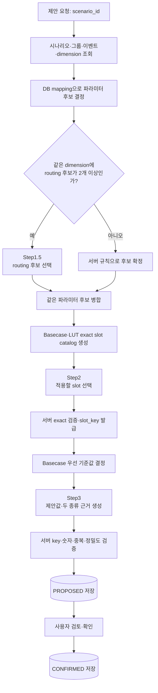
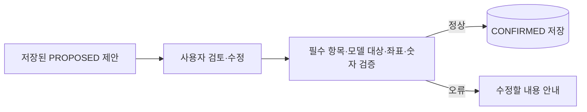
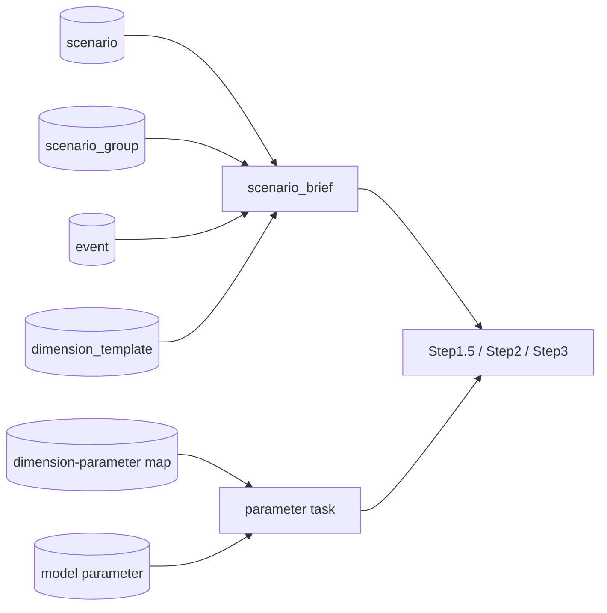
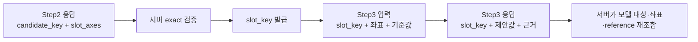

# Model Parameter Agent 기능 흐름

## 한눈에 보기

- 시나리오 문맥을 읽고, DB에 등록된 파라미터 후보와 실제 Basecase/LUT 좌표 안에서 값을 제안한다.
- LLM 판단은 조건부 Step1.5, Step2, Step3으로 나뉘며 각 단계의 역할과 출력이 다르다.
- Step2는 “어디를 바꿀지”, Step3는 “얼마로 바꾸고 왜 그런지”를 판단한다.
- 최종 확인은 LLM을 다시 호출하지 않고 서버 검증 후 `CONFIRMED`로 저장한다.

이 문서는 먼저 전체 로직과 prompt 계약을 설명하고, 이어서 scenario `595` 실제 테스트를 보여 준다. DB 활용 컬럼, compact catalog, token 절감 방식은 실제 사례 뒤의 부가 설명에 모았다.

## 1. 이 문서에서 쓰는 말

| 용어 | 의미 | 예시 |
|---|---|---|
| 시나리오 | 모델에 반영하려는 사건과 조건 | 특정 국가의 2026년 경기 둔화 |
| 파라미터 후보 | 시나리오의 영향을 받을 수 있는 모델 입력 항목 | `GDP`, `PMI` |
| slot | 값을 적용할 정확한 위치 | `Country=China`, `Year=2026` |
| 기준값 | 새 값을 제안할 때 비교하는 현재 값 | GDP 성장률 `0.042` |
| 제안값 | 시나리오를 반영해 LLM이 제안한 값 | GDP 성장률 `0.041` |

`candidate_key`와 `slot_key`는 처리 중 항목을 안전하게 연결하는 서버 식별자다. 사용자가 직접 만들 필요는 없다.

## 2. 전체 처리 흐름



| 단계 | 실행 주체 | 핵심 입력 | 핵심 출력 |
|---|---|---|---|
| 문맥 조회 | 서버 | `scenario_id` | scenario, group, event, dimension 정보 |
| 후보 결정 | 서버 | event type L2, dimension mapping | direct/routing 후보와 indirect 보조정보 |
| Step1.5 | LLM, 조건부 | 복수 routing 후보와 관련 시나리오 문맥 | 허용된 `candidate_key` 선택 |
| reference 준비 | 서버 | 확정 후보, Basecase, LUT | 값이 존재하는 exact slot catalog |
| Step2 | LLM | 시나리오 문맥, 파라미터별 slot catalog | `candidate_key + slot_axes` |
| 기준값 결정 | 서버 | Step2 좌표 | `slot_key + coordinates + reference_value` |
| Step3 | LLM | 확정 slot, 기준값, hint/comment | 제안값, 파라미터 근거, slot별 근거 |
| 저장 | 서버 | 검증된 Step3 결과 | `PROPOSED` proposal |
| 확인 | 사용자·서버 | 검토·수정한 전체 값 | `CONFIRMED` proposal |

Basecase/LUT 파일 자체를 읽는 기준은 [Basecase·LUT 문서](./05_MODEL_PARAMETER_AGENT_BASECASE_LUT_PARSING.md)를 참고한다.

## 3. 단계별 핵심 로직과 prompt

### 3.1 시나리오 문맥 조회와 파라미터 후보 결정

서버는 `scenario_id`로 시나리오, scenario group, event, dimension template을 읽는다. 이어서 event type L2와 현재 scenario에 존재하는 dimension key를 DB mapping과 대조한다. dimension 값은 후보 선택 조건이 아니라 candidate payload와 LLM 판단 문맥으로 전달한다.

| mapping 방식 | 서버 처리 |
|---|---|
| `direct` | 연결된 활성 파라미터를 바로 후보로 확정 |
| `routing` 1개 | 비교 대상이 없으므로 해당 후보를 서버가 바로 확정 |
| 같은 dimension의 `routing` 2개 이상 | Step1.5 LLM 판단 대상으로 전달 |
| `indirect` | 파라미터 후보로 만들지 않고 Step2·Step3의 보조 dimension으로 유지 |
| `na` | 파라미터·slot·값 판단 prompt에서 제외 |

이 단계에서는 Basecase 값이나 LUT 값으로 파라미터 필요성을 판단하지 않는다. 활성 mapping에 없는 파라미터도 새로 만들지 않는다.

### 3.2 Step1.5: 복수 routing 후보 선택

Step1.5는 **같은 dimension에 routing 후보가 2개 이상일 때만** 호출한다. system prompt `CANDIDATE_VALIDATION_SYSTEM`의 핵심 역할은 다음과 같다.

- scenario, event, 현재 dimension 값을 비교해 허용 후보 중 적합한 파라미터만 선택한다.
- `parameter_hint`로 후보의 의미와 적용 제약을 이해한다.
- `mapping_comment`로 현재 dimension과 후보가 연결되는 조건을 판단한다.
- 후보 밖의 파라미터나 key를 만들지 않고 Basecase 존재 여부를 선택 근거로 쓰지 않는다.

실제 user message prefix는 다음과 같다.

```text
아래 JSON만 근거로 Step1.5 수급모델 routing 후보를 선택하십시오.
```

현재 prompt 입력 계약은 다음 모양이다.

```json
{
  "scenario_brief": {
    "scenario_id": "<scenario_id>",
    "selected_dimensions": [
      {"dimension_key": "<routing dimension>", "dimension_value": "<현재 값>"}
    ]
  },
  "routing_tasks": [
    {
      "dimension_key": "<routing dimension>",
      "dimension_label": "<표시명>",
      "dimension_value": "<현재 값>",
      "candidates": [
        {
          "candidate_key": "<허용 candidate_key>",
          "parameter_name": "<파라미터명>",
          "parameter_hint": "<의미·제약>",
          "semantic_axes": "<좌표 의미>",
          "mapping_comment": "<연결 판단 기준>"
        }
      ]
    }
  ]
}
```

응답은 선택 key만 받는다.

```json
{
  "routing_decisions": [
    {
      "dimension_key": "<입력 dimension_key>",
      "selected_candidate_keys": ["<입력에 있던 candidate_key>"]
    }
  ]
}
```

system prompt는 dimension별 선택 개수를 설정된 범위 안으로 제한하도록 요구한다. 응답 후 서버는 입력 task에 없던 dimension·candidate key와 누락된 routing task를 검사한다. Step1.5 이후 같은 모델 파라미터가 여러 dimension에서 중복 선택됐으면 하나의 후속 task로 병합한다.

### 3.3 Basecase·LUT reference와 slot catalog 준비

이 단계는 LLM을 호출하지 않는다.

1. 확정된 파라미터별 Basecase를 DB 파싱 설정으로 읽는다.
2. LUT가 활성화돼 있으면 같은 파라미터의 LUT를 읽는다.
3. 설정 기간 안에서 값이 존재하는 Basecase와 LUT exact 좌표의 합집합을 만든다.
4. 같은 좌표가 양쪽에 있어도 Step2 선택 좌표는 하나로 만든다.
5. Step2에는 값과 출처를 빼고 선택 가능한 좌표 catalog만 전달한다.

좌표를 compact하게 묶는 상세 방식은 뒤의 [compact slot catalog](#53-compact-slot-catalog)에 설명한다.

### 3.4 Step2: 적용할 exact slot 선택

system prompt `SLOT_PROPOSAL_SYSTEM`은 “값을 판단하지 말고 실제 catalog 안에서 적용 좌표만 고른다”는 역할이다.

- 이전 단계에서 확정된 파라미터의 필요성을 다시 판단하지 않는다.
- scenario/event/dimension과 관련된 exact slot만 선택한다.
- `parameter_hint`와 `mapping_comment`는 국가·시설·기간·route 같은 좌표 의미를 해석하는 데 쓴다.
- catalog에 없는 값, nearest 좌표, 서로 다른 leaf를 섞은 좌표를 만들지 않는다.
- 관련성이 약한 slot로 최대 개수를 채우지 않는다.

실제 user message prefix는 다음과 같다.

```text
아래 JSON만 근거로 Step2 수급모델 parameter slot 축을 제안하십시오.
```

| 입력 최상위 항목 | 기능 |
|---|---|
| `scenario_brief` | 관련 scenario group, scenario, dimension template, event 문맥 |
| `period_resolution_policy` | “3개월” 같은 표현을 현재 연월 이후 기간으로 해석하는 규칙 |
| `slot_selection_limits` | 파라미터별 반환 slot 상한과 우선순위 |
| `parameter_slot_tasks` | 파라미터, 선택·보조 dimension, 실제 slot catalog |

응답은 각 선택 좌표의 `candidate_key`와 `slot_axes`만 받는다.

```json
{
  "parameter_slots": [
    {
      "candidate_key": "<입력 candidate_key>",
      "slot_axes": [
        {"axis_name": "Country", "axis_value": "China"},
        {"axis_name": "Year", "axis_value": 2026}
      ]
    }
  ]
}
```

서버는 모든 축이 빠짐없이 있는지, catalog의 exact 좌표인지, 중복·모호한 값·상한 초과가 없는지 검사한다. 유효한 좌표에만 다음 단계에서 `slot_key`를 발급한다.

### 3.5 exact 기준값 결정

이 단계도 LLM을 호출하지 않는다. Step2에서 선택된 정확한 좌표마다 다음 규칙을 적용한다.

| Basecase | LUT | Step3 `reference_value` |
|---|---|---|
| 값 있음 | 값 있음 또는 없음 | Basecase 값 |
| 값 없음 | 값 있음 | LUT 값 |
| 값 없음 | 값 없음 | 해당 slot 제외 |

서버는 각 유효 slot에 현재 요청의 파라미터 task 안에서만 사용하는 `slot_key`를 발급하고, Step3에 `slot_key + coordinates + reference_value`를 전달한다. Basecase와 LUT의 두 값이나 source 이름을 동시에 보내지 않는다.

### 3.6 Step3: 제안값과 근거 생성

system prompt `VALUE_PROPOSAL_SYSTEM`은 “확정된 slot과 기준값을 바꾸지 말고 실제 모델 입력값과 근거를 만든다”는 역할이다.

- `parameter_hint`로 값의 의미·단위·스케일·산정 제약을 해석한다.
- `mapping_comment`와 direct/routing dimension으로 적용 방향을 판단한다.
- indirect dimension은 기간·강도·대상 해석에만 쓰고 후보나 slot을 확장하지 않는다.
- 모든 입력 slot에 유효한 숫자 하나와 slot별 근거 하나를 반환한다.
- 입력에 없던 `candidate_key`나 `slot_key`를 만들지 않는다.

실제 user message prefix는 다음과 같다.

```text
아래 JSON만 근거로 Step3 수급모델 parameter slot 값을 제안하십시오.
```

| 입력 항목 | 기능 |
|---|---|
| `scenario_brief` | 값의 방향·강도·기간을 판단할 관련 문맥 |
| `parameter_value_tasks[].parameter` | 파라미터명, hint, semantic axes |
| `selection_dimensions` | 파라미터를 직접 선택한 direct/routing dimension과 comment |
| `supporting_dimensions` | 값 산정을 보조하는 indirect dimension과 reason |
| `slots` | 서버가 확정한 `slot_key`, 좌표, 단일 기준값 |

현재 응답 계약은 다음과 같다.

```json
{
  "parameter_adjustments": [
    {
      "candidate_key": "<입력 candidate_key>",
      "rationale_ko": "<파라미터 전체 근거>",
      "slot_values": [
        {
          "slot_key": "<입력 slot_key>",
          "proposed_value": 0.041,
          "rationale_ko": "<해당 slot의 기준값과 제안값 근거>"
        }
      ]
    }
  ]
}
```

Step3는 같은 호출에서 두 종류의 근거를 만든다.

| 구분 | 파라미터 근거 | slot별 value 근거 |
|---|---|---|
| 답하는 질문 | 왜 이 파라미터를 이 시나리오에 적용했는가? | 왜 이 정확한 좌표의 기준값을 이 값으로 바꿨는가? |
| 생성 개수 | 파라미터당 1개 | 입력 slot당 1개 |
| 작성 범위 | 전체 적용 기간·대상·배분 원칙·제약 | 좌표, 기준값→제안값 해석 |
| 피해야 할 내용 | 개별 slot 계산 나열 | 파라미터 전체 근거 반복 |
| LLM 응답 필드 | `parameter_adjustments[].rationale_ko` | `slot_values[].rationale_ko` |

prompt는 파라미터 근거에 개별 slot 값을 나열하지 말고, slot 근거에는 `reference_value`와 hint/comment/dimension을 어떻게 해석했는지 짧게 설명하도록 요구한다. 두 근거 모두 내부 key나 구현 용어를 사용자 설명에 노출하지 않는다.

### 3.7 서버 검증과 proposal 저장

서버는 Step3 응답을 그대로 저장하지 않는다.

- 입력에 없거나 중복된 `candidate_key`와 `slot_key`를 제외한다.
- 요청한 slot 누락, `null`, 무한대, 숫자가 아닌 제안값을 검사한다.
- 제안값에 설정된 소수 자릿수와 정밀도 규칙을 적용한다.
- 서버가 보관한 좌표, Basecase/LUT reference, 모델 대상을 key로 다시 결합한다.
- 유효한 slot이 남은 결과만 proposal JSON으로 만든다.

의미 검증에 실패한 개별 항목은 제외하되 다른 유효 항목은 유지한다. 최초 DB mapping 후보가 하나도 없으면 동기·비동기 요청 모두 `INVALID_REQUEST`로 접수 자체를 거절한다. 후보가 있어 비동기 `PROCESSING` proposal을 만든 뒤 후속 단계에서 최종 유효 slot·제안값이 모두 사라지거나 오류가 발생하면 그 proposal을 `FAILED`로 갱신한다. 동기 요청은 빈 `PROPOSED`를 저장하지 않고 `INVALID_REQUEST`로 실패한다. 구조화 응답 자체를 파싱하지 못한 LLM 오류도 해당 단계 전체 실패로 처리한다.

동기 요청은 처리가 끝난 `PROPOSED` 결과를 바로 반환한다. 비동기 요청은 먼저 `PROCESSING`을 반환하고 백그라운드 성공 시 `PROPOSED`, 실패 시 `FAILED`로 갱신한 뒤 callback을 보낸다. 두 방식의 후보·slot·값 판단 규칙은 같다.

### 3.8 사용자 확인



확인 단계에서는 LLM을 호출하지 않는다. 사용자가 보낸 파라미터명, 모델 대상, slot 축, 기준값, 제안값과 근거의 구조를 확인한 뒤 같은 proposal 행을 `CONFIRMED`로 갱신한다. 이미 확정된 건도 유효한 전체 payload로 다시 확정할 수 있다.

<a id="actual-test-sample"></a>

## 4. 실제 테스트 기반 샘플: scenario 595

### 4.1 실행 조건과 파라미터 선정

2026-07-21에 DB의 `scenario_id=595`를 실행해 제안부터 확정까지 확인했다. 이미 Object Storage에서 동기화되어 있던 로컬 `current` release를 재사용했으며 원격 최신성은 다시 확인하지 않았다.

| 항목 | 실제 값 |
|---|---|
| 시나리오 | `단기 전면 수요 둔화로 아시아 현물 프리미엄이 눌린다` |
| 식별 정보 | scenario `595`, group `98`, event type L2 `21`, proposal `344` |
| 선택 dimension | `period=3개월`, `economic_intensity=보통`, `demand_impact=100%` |
| 실행 결과 | 54.123초, retry `0`, `ERROR_COUNT=0`, 최종 `CONFIRMED` |
| 품질 평가 | 전체 실행 `PASS`; 파라미터·slot·근거·저장·confirmation `PASS`, Value 산정 `REVIEW` |

Value 산정의 `REVIEW`는 실행 실패가 아니다. 8개 값의 형식·방향·저장 검증은 통과했지만 event에 GDP·PMI 정량 전망이 직접 제시되지 않아, 최종 조정 폭은 도메인 담당자의 검토가 필요하다는 의미다.

| dimension | mapping | 실제 처리 |
|---|---|---|
| `economic_intensity` | direct → `PMI`, direct → `GDP` | 두 파라미터를 바로 후보로 확정 |
| `period` | indirect | 3개월 기간을 해석하는 보조정보 |
| `demand_impact` | na | prompt에서 제외 |

이 사례에는 복수 routing 후보가 없어 `routing_tasks=0`이었다. 따라서 Step1.5 prompt와 LLM 호출은 없었고 `PMI`, `GDP`가 바로 Step2로 넘어갔다.

### 4.2 실제 Step2 입력과 선택 결과

실제 catalog에는 PMI 국가 leaf 84개, GDP 국가 leaf 163개가 있었다. 아래는 실제 Step2 입력에서 2026년과 대표 leaf만 남긴 발췌다. 전체 prompt에는 모든 활성 국가·기간과 관련 scenario/event 설명, hint/comment가 포함됐다.

§4의 prompt JSON은 읽기 쉽도록 들여썼다. 실제 LLM user message에서는 같은 내용을 공백과 줄바꿈이 없는 compact JSON 한 줄로 보냈다.

```json
{
  "scenario_brief": {
    "scenario_id": 595,
    "title": "단기 전면 수요 둔화로 아시아 현물 프리미엄이 눌린다",
    "selected_dimensions": [
      {"dimension_key": "period", "dimension_value": "3개월"},
      {"dimension_key": "economic_intensity", "dimension_value": "보통"}
    ]
  },
  "period_resolution_policy": {"current_year": 2026, "current_month": 7},
  "slot_selection_limits": {
    "maxParameterSlots": 100,
    "applicationScope": "independent_per_parameter_task"
  },
  "parameter_slot_tasks": [
    {
      "parameter": {
        "candidate_key": "21|economicintensity|pmi|demand|pmiadjustment",
        "parameter_name": "PMI"
      },
      "slot_catalog": {
        "key_axes": ["Country", "Year", "Month"],
        "leaves": [
          {
            "fixed_axes": {"Country": "China"},
            "available_periods": [
              {"Year": 2026, "Months": [1,2,3,4,5,6,7,8,9,10,11,12]}
            ]
          }
        ]
      }
    },
    {
      "parameter": {
        "candidate_key": "21|economicintensity|gdp|demand|gdppopulationadjustment",
        "parameter_name": "GDP"
      },
      "slot_catalog": {
        "key_axes": ["Country", "Year"],
        "leaves": [
          {
            "fixed_axes": {"Country": "China"},
            "available_periods": [{"Year": 2026}]
          }
        ]
      }
    }
  ]
}
```

Step2가 선택하고 서버 exact 검증을 통과한 slot은 8개였다.

| 파라미터 | 국가 | 연도 | 월 | 개수 |
|---|---|---:|---|---:|
| PMI | China | 2026 | 7, 8, 9 | 3 |
| PMI | Japan | 2026 | 7, 8, 9 | 3 |
| GDP | China | 2026 | 해당 없음 | 1 |
| GDP | Japan | 2026 | 해당 없음 | 1 |

### 4.3 실제 기준값, Step3 입력과 제안값

| 파라미터와 slot | Basecase | LUT | Step3 기준값 | 실제 제안값 |
|---|---:|---:|---:|---:|
| PMI · China · 2026년 7~9월(각 월) | 49.5 | 50 | 49.5 | 49.0 |
| PMI · Japan · 2026년 7~9월(각 월) | 없음 | 50 | 50 | 49.6 |
| GDP · China · 2026년 | 0.042 | 0.0407 | 0.042 | 0.041 |
| GDP · Japan · 2026년 | 0.00601 | 0.00486 | 0.00601 | 0.0058 |

Japan PMI는 DB에 저장되는 `basecaseValue`가 `null`이지만, Step3는 같은 좌표의 LUT 값 `50`을 단일 기준값으로 받았다.

아래는 실제 Step3 입력 8건 중 Basecase 우선과 LUT 대체를 보여 주는 대표 항목 발췌다. 긴 hint/comment, supporting dimension의 policy/reason, GDP task에서 반복되는 selection/supporting dimension 블록은 문서에서만 생략했다.

```json
{
  "scenario_brief": {
    "scenario_id": 595,
    "title": "단기 전면 수요 둔화로 아시아 현물 프리미엄이 눌린다"
  },
  "parameter_value_tasks": [
    {
      "parameter": {
        "candidate_key": "21|economicintensity|pmi|demand|pmiadjustment",
        "parameter_name": "PMI"
      },
      "selection_dimensions": [
        {
          "dimension_key": "economic_intensity",
          "dimension_value": "보통",
          "mapping_method": "direct"
        }
      ],
      "supporting_dimensions": [
        {"dimension_key": "period", "dimension_value": "3개월", "mapping_method": "indirect"}
      ],
      "slots": [
        {
          "slot_key": "slot-1",
          "coordinates": {"Country": "China", "Year": 2026, "Month": 7},
          "reference_value": 49.5
        },
        {
          "slot_key": "slot-4",
          "coordinates": {"Country": "Japan", "Year": 2026, "Month": 7},
          "reference_value": 50
        }
      ]
    },
    {
      "parameter": {
        "candidate_key": "21|economicintensity|gdp|demand|gdppopulationadjustment",
        "parameter_name": "GDP"
      },
      "slots": [
        {
          "slot_key": "slot-1",
          "coordinates": {"Country": "China", "Year": 2026},
          "reference_value": 0.042
        },
        {
          "slot_key": "slot-2",
          "coordinates": {"Country": "Japan", "Year": 2026},
          "reference_value": 0.00601
        }
      ]
    }
  ]
}
```

LLM은 8개 입력 slot 모두에 값과 근거를 반환했고 서버 검증을 통과했다.

### 4.4 실제 파라미터 근거와 slot 근거

| 실제 결과 | 생성된 근거의 범위 |
|---|---|
| GDP 파라미터 근거 | 아시아 LNG 수요 둔화를 중국·일본의 2026년 연간 성장률에 보수적으로 반영하되, 시나리오가 3개월·보통 강도이고 GDP 전망치가 직접 제시되지 않아 제한적 하방만 적용했다고 설명 |
| China 2026 GDP slot 근거 | 기준 성장률 4.2%에 산업 수요 약세를 반영하되 단기·보통 강도이므로 4.1%로 소폭 낮췄다고 설명 |
| Japan 2026 GDP slot 근거 | 기존 성장률이 낮은 점을 고려해 크게 훼손하지 않고 0.601%에서 0.58%로 완만하게 낮췄다고 설명 |

파라미터 근거는 두 국가와 전체 연간 적용 원칙을 설명하고, slot 근거는 해당 국가의 기준값과 제안값 차이를 설명했다.

### 4.5 실행 시간, 저장과 confirmation 결과

| 단계 | 시간 | 입력 token | 출력 token | 합계 |
|---|---:|---:|---:|---:|
| Step1.5 | 호출 없음 | 0 | 0 | 0 |
| Step2 | 26.490초 | 25,269 | 1,485 | 26,754 |
| Step3 | 24.838초 | 3,914 | 1,538 | 5,452 |
| LLM 호출 합계 | 51.328초 | 29,183 | 3,023 | 32,206 |

전체 proposal 처리는 54.123초, retry 0회, error count 0이었다. 2개 파라미터의 8개 값이 proposal `344`에 저장됐다.

| confirmation 확인 내용 | 실제 결과 |
|---|---|
| 빈 확인 목록 전송 | `INVALID_REQUEST`, DB row 변경 없음 — PASS |
| 정확한 8개 전체 값 확정 | `CONFIRMED`, payload 일치 — PASS |
| 같은 값으로 재확정 | 확정 시각 갱신 — PASS |
| `PROCESSING` 시험 row 확정 시도 | `INVALID_REQUEST`, row 변경 없음 — PASS |

전체 시나리오·prompt 발췌·값·근거는 [공식 실행 리포트](../../../../tests/reports/model_parameter_agent/model_parameter_single_scenario_595_20260721_222450.md)에서 확인할 수 있다.

## 5. 부가 설명

### 5.1 실제 적용 중인 token 절감 방식

| 구간 | 실제 적용 방식 |
|---|---|
| Step1.5 | 복수 routing 후보가 있을 때만 호출하고 direct·단일 routing은 서버가 처리 |
| 관련 문맥 | 각 단계와 현재 후보에 필요한 dimension만 남기고 `na`, 무관 dimension, 상태·감사 컬럼 제외 |
| 후보 task | 같은 파라미터의 여러 mapping을 한 task로 병합 |
| Step2 입력 | Basecase/LUT 원본 행·값·출처·metadata를 제외하고 compact 좌표 catalog만 전달 |
| Step2 응답 | `candidate_key + slot_axes`만 수신 |
| Step3 입력 | Step2 exact 검증을 통과한 slot만 `slot_key + coordinates + reference_value`로 전달 |
| Step3 응답 | 좌표·기준값·출처를 다시 받지 않고 `slot_key + proposed_value + rationale`만 수신 |
| JSON 표현 | prompt JSON을 들여쓰기와 불필요한 공백이 없는 한 줄로 직렬화 |

### 5.2 실제 DB 활용 컬럼과 prompt 위치

Agent가 업무 문맥을 조회하는 핵심 키는 `scenario_id`다. DB 행 전체를 LLM에 보내지 않고 아래 정보 중 필요한 항목만 prompt JSON으로 다시 구성한다.



| DB 테이블 | 실제로 읽는 주요 컬럼 | prompt 또는 서버 사용 위치 |
|---|---|---|
| `tmm_mi_scenario_m` | `scenario_id`, `title`, `narrative`, `dimension_values`, `impact_jkm`, `impact_ttf`, `impact_hh` | `scenario_brief` |
| `tmm_mi_scenario_group_m` | `title`, `summary`, `description`, `dimension_selected` | `scenario_brief.scenario_group` |
| `tmm_mi_scenario_dimension_template_m` | `template_json` | 관련 dimension만 남긴 template와 표시 label |
| `tmm_mi_mievent_m` | `event_title`, `one_line_summary`, `key_bullets_json`, `detail_analysis`, `tags_json` | `scenario_brief.event` |
| `tmm_mi_model_param_dimension_map` | `event_type_l2_id`, `dimension_key`, `dimension_label`, `mapping_method`, `model_param_id`, `comment` | 후보 선정, selection/supporting dimension |
| `tmm_mi_model_param_m` | `parameter_name`, `parameter_hint`, `semantic_axes`, `model_file`, `model_sheet`, `model_table`, `basecase_*` | parameter task, 모델 대상, 서버 Basecase·slot catalog 생성 |
| `tmm_mi_event_type_l1_m` | `event_type_l1_id`, `level_1_code`, `level_1_label` | event type 문맥 조회. code·label은 prompt 본문에 직접 넣지 않음 |
| `tmm_mi_event_type_l2_m` | `event_type_l2_id`, `event_type_l1_id`, `level_2_code`, `level_2_label` | mapping 조회. L2 ID는 `candidate_key`에 간접 포함되며 code·label은 prompt 본문에 직접 넣지 않음 |

prompt에 넣지 않는 대표 정보는 scenario의 상태·확률·baseline 여부, group의 상태·단계·사용자 정보, event의 ID·일자·감사 컬럼, model parameter의 Excel 행·열 설정 원문이다.

<a id="hint-and-mapping-comment"></a>

#### parameter hint와 mapping comment

| DB 컬럼 | prompt에서의 의미 |
|---|---|
| `tmm_mi_model_param_m.parameter_hint` | 파라미터 값의 의미·단위·스케일·산정 제약 |
| `tmm_mi_model_param_dimension_map.comment` | 현재 dimension과 파라미터가 연결되는 이유와 우선 판단 근거 |

| 단계 | `parameter_hint` 위치 | mapping `comment` 위치 |
|---|---|---|
| Step1.5 | `routing_tasks[].candidates[].parameter_hint` | `routing_tasks[].candidates[].mapping_comment` |
| Step2 | `parameter_slot_tasks[].parameter.parameter_hint` | `selection_dimensions[].mapping_comment` |
| Step3 | `parameter_value_tasks[].parameter.parameter_hint` | `selection_dimensions[].mapping_comment` |

`indirect` comment는 `supporting_dimensions[].reason`으로 들어가고, `na` comment는 prompt에 넣지 않는다.

실제 scenario 595의 GDP task에서는 다음 의미로 주입됐다. 긴 원문은 핵심만 줄였다.

```json
{
  "parameter": {
    "parameter_name": "GDP",
    "parameter_hint": "국가·연도별 실질 GDP 전년 대비 성장률의 최종 입력값이다. 0.042는 4.2%이며 증감폭이 아니라 적용할 성장률 자체를 제안한다."
  },
  "selection_dimensions": [
    {
      "dimension_key": "economic_intensity",
      "dimension_value": "보통",
      "mapping_method": "direct",
      "mapping_comment": "event의 국가별 GDP 성장률 전망과 전망치 수정폭을 우선 사용해 최종 성장률을 산정한다."
    }
  ],
  "supporting_dimensions": [
    {
      "dimension_key": "period",
      "dimension_value": "3개월",
      "mapping_method": "indirect",
      "usage_policy": "parameter_value_hint",
      "reason": "파라미터의 시간축으로 사용될 수 있다(PMI:Year/Month, GDP:Year)."
    }
  ]
}
```

### 5.3 compact slot catalog

Step2는 설정 기간 안에서 값이 존재하는 Basecase와 LUT exact 좌표의 합집합 전체를 보낸다. 각 좌표를 행처럼 반복하지 않고 다음 규칙으로 묶는다.

1. `key_axes`를 `Year`·`Month`와 Country·시설 같은 고정축으로 나눈다.
2. 고정축 조합이 같은 좌표를 leaf 하나로 묶어 `fixed_axes`에 한 번만 적는다.
3. 해당 leaf에 실제로 존재하는 시간만 `available_periods`에 넣는다.
4. `Year + Month`이면 같은 연도의 월을 `Months` 배열 하나로 묶는다.
5. 값, 원본 행, reference ID, source, metadata는 Step2 catalog에서 제외한다.

scenario 595의 실제 PMI catalog에서 China 2026년 월별 좌표는 다음처럼 들어갔다.

```json
{
  "parameter_name": "PMI",
  "key_axes": ["Country", "Year", "Month"],
  "fixed_axis_names": ["Country"],
  "time_axis_names": ["Year", "Month"],
  "leaves": [
    {
      "fixed_axes": {"Country": "China"},
      "available_periods": [
        {"Year": 2026, "Months": [1,2,3,4,5,6,7,8,9,10,11,12]}
      ]
    }
  ]
}
```

서로 다른 leaf의 축과 기간을 섞어 새 좌표를 만들 수 없다. `maxParameterSlots`는 입력 catalog를 자르는 값이 아니라 LLM이 파라미터별로 반환할 slot 수의 상한이다.

### 5.4 dimension 필터와 key 기반 재조합

| 단계 | prompt에 남기는 dimension |
|---|---|
| Step1.5 | 복수 routing 판단에 필요한 dimension |
| Step2·Step3 | 후보를 만든 direct·routing dimension과 값 산정에 필요한 indirect dimension |
| 모든 단계 | `na`와 현재 후보에 무관한 dimension은 제외 |

같은 allow-list를 scenario의 `dimension_values`, group의 `dimension_selected`, dimension template에 적용한다.

LLM 응답은 서버 key로 원본과 다시 조합한다.



실제 GDP China 2026 좌표에서 Step2는 `candidate_key + Country + Year`를 반환했다. 서버가 이를 검증해 `slot-1`을 발급했고, Step3는 좌표를 다시 반환하지 않고 다음 정보만 돌려줬다.

```json
{
  "candidate_key": "21|economicintensity|gdp|demand|gdppopulationadjustment",
  "slot_values": [
    {
      "slot_key": "slot-1",
      "proposed_value": 0.041,
      "rationale_ko": "2026년 중국의 기준 성장률 4.2%를 단기 수요 둔화에 맞춰 4.1%로 소폭 조정했습니다."
    }
  ]
}
```

서버는 `candidate_key`로 파라미터와 모델 대상을, `slot_key`로 좌표와 reference를 찾아 최종 API/DB 결과를 조립한다.

## 관련 문서

- API 호출 방법과 응답: [API 문서](./02_MODEL_PARAMETER_AGENT_API_SPEC.md)
- DB 관계와 저장 구조: [DB 문서](./03_MODEL_PARAMETER_AGENT_DB_SPEC.md)
- Basecase/LUT와 Object Storage 구조: [Basecase·LUT 문서](./05_MODEL_PARAMETER_AGENT_BASECASE_LUT_PARSING.md)
