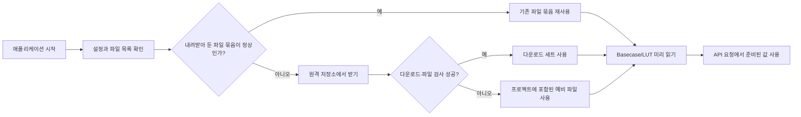
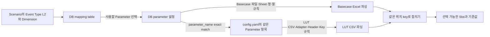
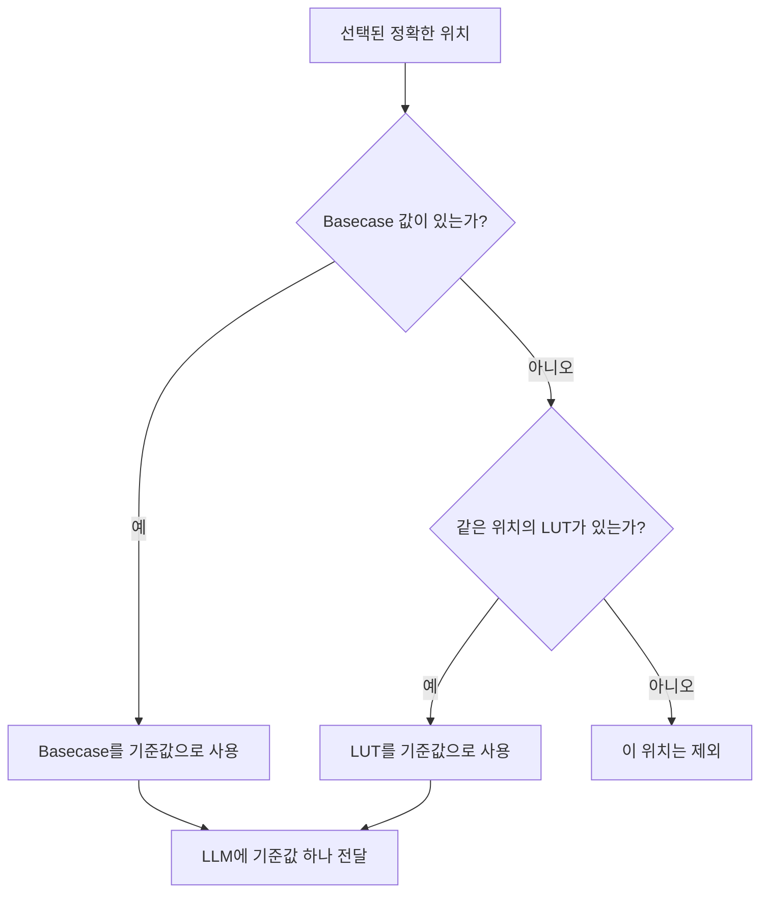

# Basecase와 LUT를 읽고 사용하는 방법

## 한눈에 보기

| 질문 | 답 |
|---|---|
| Basecase란? | 현재 수급모델 Excel에 들어 있는 실제 기준값 |
| LUT란? | Basecase에 값이 없을 때 사용할 수 있는 기본 참고값 목록 |
| 무엇을 읽을지 누가 정하나? | DB mapping이 파라미터를 고르고, DB 파라미터 설정과 `config.yaml`이 파일을 읽는 방법을 정함 |
| 같은 위치에 두 값이 모두 있으면? | Basecase 값이 우선 |
| LLM에는 무엇을 보내나? | 선택된 위치와 최종 기준값 하나만 보냄 |

이 문서에서는 현재 실제로 사용하는 파라미터 5개를 중심으로 설명한다.

## 1. 전체 흐름

파일은 API 요청이 들어올 때마다 내려받지 않는다. 전용 애플리케이션이 시작할 때 필요한 파일을 준비하고 검사한 뒤, 요청에서는 이미 준비하고 미리 읽어 둔 값을 사용한다.



어느 경로에서 준비됐든 이후 읽기 절차에는 같은 Basecase/LUT 폴더 모양으로 전달된다. 따라서 값 제안 단계는 원격에서 받은 파일인지 프로젝트의 예비 파일인지 따로 구분하지 않는다.

### 1.1 S3 호환 Object Storage에서 파일을 준비하는 구조

여기서 S3는 AWS S3만을 뜻하지 않는다. S3 방식의 API를 제공하는 Object Storage를 같은 구조로 사용할 수 있다. 파일 준비는 **API 요청마다가 아니라 각 worker/process가 시작할 때 한 번** 수행된다. 여러 worker가 함께 시작해도 공용 lock과 `current`를 이용해 같은 파일을 중복으로 내려받지 않는다.

`config.yaml`의 `model_parameter_resource_storage`는 저장소 접속과 로컬 보관 방법을 정한다.

배포 환경에서 같은 이름의 환경변수를 지정하면 `config.yaml` 값보다 우선할 수 있다. 따라서 설정 문제를 확인할 때는 YAML과 실행 환경변수를 함께 확인한다.

| 설정 항목 | 기능 |
|---|---|
| `enabled` | `true`이면 원격 저장소 동기화를 시도하고, `false`이면 프로젝트에 포함된 파일을 바로 사용 |
| `endpoint_url`, `region_name`, `signature_version` | 어떤 S3 호환 저장소에 어떤 방식으로 접속할지 지정 |
| `bucket` | 파일이 들어 있는 bucket 지정 |
| `access_key_id`, `secret_access_key` | 저장소 인증 정보. 문서·로그에 실제 값을 남기면 안 됨 |
| `local_root` | 내려받은 파일 묶음과 현재 사용 중인 묶음을 보관할 로컬 기준 폴더 |
| `connect_timeout_seconds`, `read_timeout_seconds` | 연결·다운로드 대기시간 |
| `max_attempts`, `bootstrap_timeout_seconds` | 재시도 횟수와 전체 준비 제한시간 |
| `lock_timeout_seconds` | 여러 프로세스가 동시에 시작될 때 파일 준비 순서를 기다리는 시간 |
| `download_chunk_size_bytes` | 큰 파일을 나누어 받을 때 한 번에 읽는 크기. 생략하면 기본값 사용 |

각 파일의 실제 위치는 `model_parameter_resources` 아래에서 정한다.

| 파일 종류 | `path` | `object_storage_path` |
|---|---|---|
| Basecase | 로컬 `basecase` 폴더에서 사용할 파일명 | bucket 안의 정확한 Excel object key |
| LUT | 로컬 `lut` 폴더에서 사용할 파일명 | bucket 안의 정확한 CSV object key |

폴더나 접두어를 검색해 최신 파일을 고르는 방식은 아니다. 설정된 `object_storage_path`를 그대로 `HEAD`로 확인하고 `GET`으로 내려받는다.

아래는 `enabled=true`일 때 생길 수 있는 로컬 구조의 예시다. `false`이면 이 구조로 동기화하지 않고 프로젝트의 packaged 폴더를 직접 사용한다.

```text
<local_root>/
├── .bootstrap.lock
├── current -> releases/<현재 활성 묶음>/
└── releases/
    ├── remote-<fingerprint>/
    │   ├── .complete.json
    │   ├── basecase/
    │   └── lut/
    └── packaged-<fingerprint>/
        ├── .complete.json
        ├── basecase/
        └── lut/
```

시작할 때 진행되는 절차는 다음과 같다.

1. 여러 프로세스가 같은 파일을 동시에 바꾸지 않도록 `.bootstrap.lock`을 잡는다.
2. `current`가 가리키는 묶음의 출처·설정·파일 목록·파일 크기가 marker와 맞는지 확인한다. 재사용 시 저장된 SHA-256을 다시 계산하지는 않는다.
3. 정상이라면 그 묶음을 그대로 재사용한다. 이때는 Object Storage에 다시 최신 여부를 묻지 않는다.
4. 재사용할 수 없으면 Basecase object key를 확인해 임시 폴더에 내려받고, `model_parameter_lut_enabled=true`일 때만 LUT key도 함께 처리한다.
5. 다운로드 전후 파일 크기와 원격 정보가 바뀌지 않았는지 확인하고, Excel과 활성화된 LUT가 실제로 열리고 파싱되는지 검사한다.
6. 모두 성공하면 `.complete.json`을 기록하고 `current`를 새 원격 묶음으로 안전하게 전환한다.
7. 원격 동기화가 끝내 실패하면 프로젝트에 포함된 예비 파일을 검사한 뒤 `packaged-...` 묶음으로 전환한다. 예비 파일도 잘못되면 애플리케이션 시작 자체를 실패시킨다.

> **운영 시 주의:** 원격 파일로 만든 묶음뿐 아니라 packaged fallback 묶음도 정상 `current`이면 다음 시작에서 그대로 재사용한다. 따라서 같은 object key의 내용 변경이나 원격 장애 복구만으로는 자동 재동기화·원격 복귀하지 않는다. 실행 중인 worker는 시작할 때 확정한 release와 cache를 계속 사용하므로 활성 폴더나 symlink를 직접 삭제하지 않는다. 새 versioned object key 또는 관련 schema 설정을 배포하고 통제된 재기동을 하는 운영 절차가 안전하다. 인증정보나 timeout만 바꾸는 것은 새 다운로드 조건이 아니며, 이전 `releases`는 자동 정리되지 않으므로 별도 보존·용량 정책도 필요하다.

## 2. 현재 사용하는 파일

### Basecase Excel

| 모델 구분 | 파일 | 주요 대상 |
|---|---|---|
| Demand | `Demand Model_Input.xlsm` | GDP, PMI, PowerMix, Temperature |
| Supply | `Supply Model_Input.xlsm` | LiqUtilAdjustment |
| Trade | `Trade Model_Input.xlsm` | 현재 활성 파라미터는 없지만 필수 Basecase 파일로 준비 |

### LUT CSV

| Parameter | 파일 | 용도 |
|---|---|---|
| GDP | `Demand_Model_LUT_BCInput_value_based_t2.csv` | 국가·연도별 GDP 성장률 계산 |
| PMI | `Demand_Model_Input_PMIInput_value_based_t2.csv` | 국가·연도·월별 PMI |
| PowerMix | `Demand_Model_LUT_BCInput_value_based_t3.csv` | 국가·연도·에너지원별 발전 비중 |
| Temperature | `...WeatherInput_value_based_t1.csv`, `...t2.csv` | HDD/CDD로 국가·연도·월별 기온 계산 |
| LiqUtilAdjustment | `BCLiquefaction.csv` | 액화 Plant Train의 월별 가동률 |

각 파일의 정확한 원격 저장 경로는 `config.yaml`의 `object_storage_path`에서 확인한다.

## 2.1 DB와 config.yaml은 각각 무엇을 정하나

가장 헷갈리는 부분은 **mapping table이 Excel 열까지 정하는 것이 아니라는 점**이다. 역할은 아래처럼 나뉜다.



| 정보 위치 | 참고 항목 | 하는 일 |
|---|---|---|
| `tmm_mi_model_param_dimension_map` | `event_type_l2_id`, `dimension_key`, `dimension_label`, `mapping_method`, `model_param_id`, `comment` | Scenario의 이벤트·차원에 맞는 후보 선택. label은 표시명 보완, comment는 prompt 판단 지침으로 사용 |
| `tmm_mi_model_param_m` | `parameter_name`, `model_file`, `model_sheet`, `basecase_*` | 선택된 파라미터의 Basecase Excel을 어느 행·열 규칙으로 읽을지 결정 |
| `config.yaml > model_parameter_resources.basecase` | 모델별 `path`, `object_storage_path` | Basecase의 로컬 파일명과 원격 object key 결정. Sheet·열 파싱은 정하지 않음 |
| `config.yaml > model_parameter_resources.lut.<Parameter>` | `adapter`, `layout`, `files`, `key_axes`, `metadata_axes` | 같은 이름의 파라미터가 사용할 LUT 파일·CSV header·계산법·위치 key 결정 |
| `config.yaml` 공통 설정 | 사용 기간과 숫자 정밀도 | Basecase와 LUT를 같은 기간·숫자 규칙으로 맞춤 |

공통 설정은 다음 항목을 실제로 참고한다.

| `config.yaml` 항목 | 적용 내용 |
|---|---|
| `model_parameter_lut_enabled` | LUT 사용 여부. `false`이면 시작 시 Basecase만 준비하고 LUT catalog를 만들지 않음 |
| `model_parameter_lut_horizon_start_year`, `model_parameter_lut_horizon_end_year` | Basecase와 LUT에서 최종 선택지로 인정할 연도 범위 |
| `model_parameter_basecase_value_max_decimal_places`, `model_parameter_basecase_value_precision_mode` | 이름에는 Basecase가 들어가지만, 최종 Basecase·LUT 기준값 모두에 적용하는 소수 자릿수 규칙 |
| `model_parameter_proposed_value_max_decimal_places`, `model_parameter_proposed_value_precision_mode` | 파일을 읽는 규칙이 아니라 Step3가 만든 제안값을 정리하는 규칙 |

두 DB 테이블 모두 `use_yn='Y'`이고 `del_yn='N'`인 행만 읽는다. mapping 행과 그 행이 가리키는 parameter 정의가 모두 활성 상태여야 실제 후보가 된다.

실제 처리 순서는 다음과 같다.

1. Scenario Group의 `event_type_l2_id`와 Scenario의 `dimension_values`를 mapping table과 맞춘다.
2. `mapping_method`가 `direct` 또는 `routing`이고 활성 파라미터가 연결된 행만 후보로 사용한다. `indirect`는 보조정보이고 `na`는 제외한다.
3. 후보의 `model_param_id`로 DB 파라미터 설정을 찾아 Basecase 파일·Sheet·읽기 방식을 정한다.
4. DB의 `basecase_*` 규칙으로 Excel을 읽어 위치와 값을 만든다.
5. DB의 `parameter_name`과 정확히 같은 `config.yaml` LUT 항목을 찾아 CSV와 adapter를 정한다. 현재 활성 5개는 모두 등록되어 있으며, 일반적으로 LUT 항목이 없으면 Basecase만 사용한다.
6. `key_axes` 순서로 Basecase와 LUT의 위치를 같은 모양으로 맞춘다.
7. 값이 있는 Basecase 위치와 LUT 위치의 합집합을 Step2 선택지로 만든다.
8. Step2에서 고른 정확한 위치에 Basecase 값이 있으면 우선 사용하고, 없으면 LUT 값을 Step3 기준값으로 사용한다.

예를 들어 `GDP`는 mapping table이 “GDP 파라미터를 사용한다”고 정한다. DB 파라미터 설정은 `model_file=Demand`와 `GDPPopulationAdjustment` Sheet·행·열 규칙을 정하고, `config.yaml > basecase.demand.path`가 실제 로컬 Excel 파일명을 정한다. `config.yaml`의 `lut.GDP`는 GDP CSV와 `gdp_growth` 계산법, 최종 위치 순서인 `[Country, Year]`를 정한다.

## 3. Basecase는 어떻게 읽나

DB의 `tmm_mi_model_param_m`에는 다음 Basecase 읽기 정보가 들어 있다.

| DB 컬럼 | 기능 |
|---|---|
| `parameter_name` | mapping 결과와 `config.yaml` LUT 항목을 이어 주는 파라미터 이름 |
| `model_file`, `model_sheet` | 읽을 Basecase 모델 파일과 Sheet |
| `basecase_read_mode` | 한 행에서 읽을지(`fixed_columns`), 가로 시간축 표로 읽을지(`matrix_time_columns`) 결정 |
| `basecase_header_row` | 원본 header 위치 정보. 현재 활성 두 읽기 방식의 실제 시작점은 `basecase_data_start_row`와 시간 header 행 설정이 결정 |
| `basecase_data_start_row` | 실제 데이터 읽기를 시작할 행 |
| `basecase_column_roles` | Excel 열 문자와 Country·Year·Month·value 같은 역할 연결 |
| `basecase_row_filter` | 특정 값인 행만 남기는 조건. 여러 조건이 있으면 모두 일치해야 함 |
| `basecase_year_row`, `basecase_month_row`, `basecase_period_row` | matrix 방식에서 각 값 열의 연도·월·기간을 읽을 머리글 행 |
| `basecase_value_start_col`, `basecase_value_end_col` | matrix 방식에서 실제 값이 들어 있는 열 범위 |
| `basecase_stop_rule` | 주요 위치 열이 모두 비면 읽기를 멈추는 규칙 |

`parameter_hint`와 `semantic_axes`는 LLM이 파라미터 의미와 단위를 이해하도록 돕지만, Excel의 행·열을 직접 파싱하는 규칙은 아니다. `model_table`은 최종 제안의 수급모델 대상 table 이름으로 응답과 확정 검증에 쓰인다. Excel named table을 찾아 파싱하거나 그 table에 Agent가 직접 저장하는 값은 아니다.

현재 활성 파라미터는 두 방식으로 읽는다.

### 방식 A: 한 행에 값 하나가 있는 표

각 행에서 위치를 나타내는 열과 값 열을 함께 읽는다. 내부 설정에서는 이 방식을 `fixed_columns`라고 부른다.

| Parameter | Sheet | 한 행에서 읽는 위치 | 값 |
|---|---|---|---|
| GDP | `GDPPopulationAdjustment` | Country, Year | `% change (+/-)` |
| PMI | `PMIAdjustment` | Country, Year, Month | `PMI` |
| PowerMix | `PowerMixAdjustment` | Country, Year, Energy Source | `% Power Mix` |
| Temperature | `WeatherAdjustment` | Country, Year, Month | `Temperature (°C)` |

현재 DB 설정을 Excel 열까지 펼치면 다음과 같다.

| Parameter | 시작 행 | 위치 열 | 값 열 |
|---|---:|---|---|
| GDP | 12 | `B=Year`, `C=Country` | `F=% change (+/-)` |
| PMI | 13 | `B=Year`, `C=Month`, `D=Country` | `F=PMI` |
| PowerMix | 12 | `B=Year`, `C=Country`, `D=Energy Source` | `F=% Power Mix` |
| Temperature | 12 | `K=Year`, `L=Month`, `M=Country` | `O=Temperature (°C)` |

예를 들어 GDP 행이 다음과 같으면 하나의 기준값 항목이 된다.

```json
{
  "Country": "United States",
  "Year": 2026,
  "value": 0.019
}
```

### 방식 B: 가로 방향에 월별 값이 이어지는 표

LiqUtilAdjustment는 한 행이 Plant Train 하나를 나타내고, 오른쪽 열들이 Year/Month별 값을 가진다. 내부 설정에서는 이 방식을 `matrix_time_columns`라고 부른다.

| 행에서 읽는 정보 | 열 머리글에서 읽는 정보 | 행과 열이 만나는 칸의 값 |
|---|---|---|
| Country, LNG Plant, LNG Plant Train, Life Cycle, Capacity | Year, Month, Period | 가동률 |

현재 LiqUtilAdjustment 설정은 11행부터 읽는다. `B~F` 열은 각각 Country, LNG Plant, LNG Plant Train, Life Cycle Category, Nameplate Capacity를 나타낸다. 시간 정보는 7행의 Year, 8행의 Month, 9행의 Period에서 읽고, 실제 가동률 값은 `G~DA` 범위에서 읽는다.

최종 위치는 `Country + LNG Plant + LNG Plant Train + Year + Month`가 모두 같아야 한다. `Period`, `Life Cycle Category`, `Nameplate Capacity (MTPA)`는 화면과 저장 결과에 함께 전달할 부가정보로 유지한다.

## 4. LUT는 어떻게 읽나

LUT는 단순히 CSV 값을 복사하는 경우도 있고, 계산해서 새 값을 만드는 경우도 있다.

`config.yaml > model_parameter_resources.lut.<Parameter>`에서 참고하는 항목은 다음과 같다.

| 설정 항목 | 기능 |
|---|---|
| `<Parameter>` | DB의 `parameter_name`과 정확히 같은 LUT 설정 선택 |
| `adapter` | CSV를 그대로 읽을지, GDP 성장률·기온·가동률처럼 계산할지 결정 |
| `layout` | `adapter: tabular`일 때 연도가 각 행에 있는지(`row`), 연도별 열로 펼쳐졌는지(`year_columns`) 결정 |
| `files.<역할>.path` | 준비된 로컬 LUT 파일명 |
| `files.<역할>.object_storage_path` | 시작 시 내려받을 원격 object key. CSV 파싱에는 사용하지 않음 |
| `required_columns` | 계산 adapter가 반드시 찾아야 하는 CSV header |
| `axis_columns` | Country·Month 같은 공통 위치 이름을 실제 CSV header에 연결 |
| `value_column`, `year_value_column` | 값 열 또는 연도별 값 열 이름 지정 |
| `key_axes` | 한 위치를 정확히 구분하는 key와 Step2에 보여 줄 축 순서 |
| `metadata_axes` | 위치 key는 아니지만 결과에 함께 보존할 부가정보 |

예를 들어 PMI는 `layout: year_columns`이므로 Country·Month를 행에서 읽고, `{year}`가 들어간 연도별 열 이름에서 값을 꺼낸다. PowerMix는 `layout: row`이므로 Country·Year·Energy Source와 값을 같은 행에서 읽는다.

| Parameter | 위치를 찾는 key | 값 만드는 방법 |
|---|---|---|
| GDP | Country, Year | 정확한 전년도 행이 있고 전년도 GDP가 0보다 클 때만 `올해 GDP / 전년도 GDP - 1` 계산 |
| PMI | Country, Year, Month | 해당 연도의 CSV 열에서 값을 읽음 |
| PowerMix | Country, Year, Energy Source | 해당 행의 Power Mix를 읽음 |
| Temperature | Country, Year, Month | HDD가 양수면 `18-HDD/30`, 아니면 CDD가 양수면 `18+CDD/30`, 둘 다 0이면 `18` |
| LiqUtilAdjustment | Country, LNG Plant, LNG Plant Train, Year, Month | Closed 시설을 제외하고 utilisation을 읽음 |

공통 규칙은 다음과 같다.

- 현재 사용 기간은 2026~2030년이다.
- Year, Month, Period는 정수로 맞춘다.
- 숫자는 현재 설정에 따라 소수 5자리에서 0 방향으로 자른다. 예: `1.234567 → 1.23456`, `-1.234567 → -1.23456`이며 반올림과 다르다.
- 위치를 매칭할 때 문자열의 앞뒤 공백을 제거하지만, 철자와 대소문자가 달라지면 다른 위치로 본다.
- 같은 위치가 중복되고 값이 다르면 안전하게 실패한다.

## 5. Basecase와 LUT 중 무엇을 선택하나

두 자료를 합칠 때 “비슷한 위치”를 찾지 않는다. Country, Year, Month 등 위치를 이루는 항목이 모두 정확히 같은 경우만 비교한다.

| Basecase | LUT | LLM에 보내는 기준값 | API `basecaseValue` |
|---|---|---|---|
| 값 있음 | 값 있음 | Basecase 값 | Basecase 값 |
| 값 있음 | 없음 | Basecase 값 | Basecase 값 |
| 값 없음 | 값 있음 | LUT 값 | `null` |
| 둘 다 없음 | 없음 | 선택할 수 없는 위치 | 결과 없음 |



## 6. 실제 파일로 확인한 예시

아래 값은 `2026-07-21` 테스트에서 현재 로컬에 준비된 동일 리소스 묶음으로 다시 확인했다. 이 실행은 이미 동기화된 `current` 묶음을 재사용했으며, 원격 원본을 새로 내려받아 대조한 것은 아니다.

### 예시 1: GDP — Basecase 우선

| 자료 | 실제 확인값 |
|---|---:|
| Basecase: United States, 2026 | `0.019` |
| LUT 계산값 | `0.02063` |
| LLM 기준값 | **`0.019`** |

GDP는 비율 단위이므로 `0.019`는 `1.9%`, LUT의 `0.02063`은 `2.063%`를 뜻한다.

```json
{
  "slot_key": "slot-1",
  "coordinates": {"Country": "United States", "Year": 2026},
  "reference_value": 0.019
}
```

### 예시 2: Temperature — LUT만 있음

Algeria의 2026년 1월 HDD는 `305.72370967741915`, CDD는 `0.0`이었다. 계산과 정밀도 적용 결과는 `7.8092°C`이며, 같은 위치의 Basecase가 없어 이 LUT 값이 LLM 기준값이 된다.

### 예시 3: LiqUtilAdjustment — matrix 값 우선

정확한 위치는 `Algeria / Arzew GL1Z / Arzew GL1Z T1-T6 / 2026년 1월`이다.

| 자료 | 실제 확인값 |
|---|---:|
| Basecase 원본 cell | `0.19018404907975456` |
| 정밀도 적용 Basecase | `0.19018` |
| 같은 위치의 LUT | `0.27974` |
| LLM 기준값 | **`0.19018`** |

이 위치에는 `Period=97`, `Life Cycle Category=Operational`, `Nameplate Capacity (MTPA)=7.9`도 함께 유지된다. LiqUtil 값은 0~1 비율이므로 `0.19018`은 약 `19.018%`다.

## 7. LLM에는 어떻게 보이나

Step2에는 값 없이 선택 가능한 위치 목록만 보낸다.

```json
{
  "parameter_name": "GDP",
  "key_axes": ["Country", "Year"],
  "leaves": [
    {
      "fixed_axes": {"Country": "United States"},
      "available_periods": [
        {"Year": 2026}, {"Year": 2027}, {"Year": 2028}, {"Year": 2029}, {"Year": 2030}
      ]
    }
  ]
}
```

Step3에는 Step2에서 고른 위치와 최종 기준값 하나만 보낸다. Basecase와 LUT의 원본 식별자, 두 값의 비교 내역, 부가정보는 LLM에 보내지 않는다.

```json
{
  "slots": [
    {
      "slot_key": "slot-1",
      "coordinates": {"Country": "United States", "Year": 2026},
      "reference_value": 0.019
    }
  ]
}
```

LLM은 이 기준값과 scenario 설명을 보고 `proposed_value`를 제안한다. 입출력 예시는 [Flow 문서](04_MODEL_PARAMETER_AGENT_FLOW.md)를 참고한다.

## 8. 인수인계 때 꼭 기억할 것

1. 어떤 parameter를 사용할지는 DB mapping이 먼저 정한다. Basecase/LUT가 parameter를 새로 만들지는 않는다.
2. Basecase는 현재 실제값이고 LUT는 빈 위치를 보완하는 참고값이다.
3. 같은 정확한 위치에 Basecase 값이 있으면 항상 Basecase가 우선이다.
4. LLM은 파일 전체를 보지 않고 선택 가능한 위치와 기준값 하나만 본다.
5. 원격 저장소를 확인하지 못해도 검증된 packaged 파일로 시작할 수 있다.

현재 미사용 `LiqProdAdjustment`를 LUT-only로 추가할 때 확인할 DB 값, hint/comment 보강, `BCLiquefaction.csv` 공유, `월 생산능력 × 이용률` 계산 adapter와 LUT YAML 등록 형태는 [파라미터 추가 가이드](06_MODEL_PARAMETER_AGENT_PARAMETER_ADDITION_GUIDE.md)를 참고한다.
