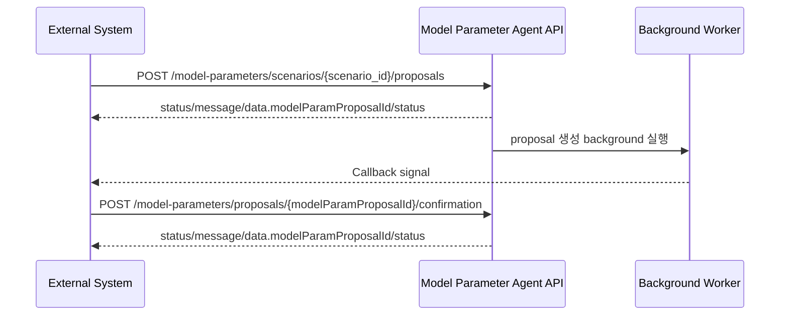

# 수급모델 파라미터 Agent API Spec

- 작성일: 2026-07-01
- 기준 방향: DB 저장 및 callback 도입 후 목표 API
- 참고 코드:
  - `apps/agents/scenario_group_agent/api.py`
  - `apps/agents/scenario_group_agent/schemas/common.py`
  - `apps/agents/model_parameter_agent/flows/propose_parameters/api_schema.py`

## 1. 개요

수급모델 파라미터 제안 API는 scenario group agent와 같은 비동기 처리 방식을 따른다.

1. 외부 시스템이 파라미터 제안을 요청한다.
2. Agent API는 proposal row를 생성하고 즉시 응답한다.
3. Agent가 background에서 proposal을 생성한다.
4. 완료 후 외부 시스템 callback URL로 proposal 생성 완료 신호를 전달한다.
5. Backend/사용자는 저장된 proposal을 조회해 수정/확정한 뒤 confirmation API로 전달한다.

## 2. 공통 규칙

### 2.1 JSON key

모든 JSON key는 camelCase를 사용한다.

예:

- `model_param_proposal_id` -> `modelParamProposalId`
- `scenario_group_id` -> `scenarioGroupId`
- `proposal_parameters` -> `proposalParameters`
- `confirmation_parameters` -> `confirmationParameters`

### 2.2 Response wrapper

요청/확정 API의 HTTP response는 scenario group agent와 동일하게 아래 wrapper를 사용한다.

```json
{
  "status": "success",
  "message": "성공",
  "data": {}
}
```

| Field | Type | Required | 설명 |
|---|---|---:|---|
| `status` | string | Y | `success` 또는 `error` |
| `message` | string | Y | 처리 결과 메시지 |
| `data` | object/null | Y | 성공 시 결과 payload. 오류 시 `null` 또는 빈 object |

오류 응답은 최소 형식으로 유지한다.

```json
{
  "status": "error",
  "message": "요청한 리소스를 찾을 수 없습니다 - Scenario context not found: scenario_id=309",
  "data": null
}
```

외부 연동 클라이언트는 error response의 `data` 내부 field에 의존하지 않는다.

### 2.3 Proposal status

`data.status`는 파라미터 제안 row의 처리 상태다. top-level `status`와 의미가 다르다.

| Status | 의미 |
|---|---|
| `PROCESSING` | 요청 접수 후 background 생성 중 |
| `PROPOSED` | proposal 생성 완료 |
| `CONFIRMED` | 사용자가 확정 완료 |
| `FAILED` | proposal 생성 또는 저장 실패 |

## 3. API Flow



## 4. 파라미터 제안 요청 API

### 4.1 Endpoint

```http
POST /model-parameters/scenarios/{scenario_id}/proposals
```

scenario ID를 기준으로 proposal 생성 작업을 요청한다. API는 proposal row를 생성하고 즉시 응답한다. 실제 `proposalParameters` 생성은 background에서 수행한다.

### 4.2 Request

Path parameter:

| Field | Type | Required | 설명 |
|---|---|---:|---|
| `scenario_id` | integer | Y | 파라미터 제안을 수행할 scenario ID |

Request body는 선택 사항이다.

```json
{
  "userId": 10001
}
```

| Field | Type | Required | 설명 |
|---|---|---:|---|
| `userId` | integer | N | 요청 사용자 ID. 미입력 시 proposal row의 `request_usr_id`는 `NULL`로 저장한다. |

### 4.3 Immediate response

```json
{
  "status": "success",
  "message": "accepted",
  "data": {
    "modelParamProposalId": 10001,
    "status": "PROCESSING"
  }
}
```

| Field | Type | Required | 설명 |
|---|---|---:|---|
| `data.modelParamProposalId` | integer | Y | 생성된 파라미터 제안 row ID |
| `data.status` | string | Y | `PROCESSING` |

## 5. 파라미터 제안 완료 Callback

### 5.1 Direction

Agent가 외부 시스템의 callback endpoint로 호출한다.

callback URL은 운영 설정으로 관리한다. scenario group agent처럼 `callbackBaseUrl + callbackPath` 조합을 사용하는 방식을 권장한다.

Callback path:

```http
POST /api/v1/mi/next-gen/scenarios/{scenario_id}/model-param-proposals/callback
```

Agent는 proposal 테이블 commit 이후 callback을 발행한다. Backend는 callback을 완료 신호로만 사용하고,
path의 `scenario_id` 기준으로 Agent proposal 테이블을 재조회한다.

### 5.2 Callback request

```http
POST {callbackUrl}
Content-Type: application/json
Authorization: Bearer {callback-token}
```

성공 callback:

```json
{
  "status": "success",
  "message": "model parameter proposal completed",
  "data": {
    "modelParamProposalId": 10001,
    "scenarioId": 309,
    "scenarioGroupId": 61,
    "eventId": 1378,
    "status": "PROPOSED"
  }
}
```

실패 callback:

```json
{
  "status": "error",
  "message": "Scenario context not found: scenario_id=309",
  "data": null
}
```

### 5.3 Callback data schema

| Field | Type | Required | 설명 |
|---|---|---:|---|
| `data.modelParamProposalId` | integer | N | 파라미터 제안 row ID. 교차검증용 |
| `data.scenarioId` | integer | N | 요청 scenario ID. path의 `{scenario_id}`와 일치해야 함 |
| `data.scenarioGroupId` | integer | N | scenario group ID. 교차검증용 |
| `data.eventId` | integer | N | MI event ID. 교차검증용 |
| `data.status` | string | N | 성공 시 `PROPOSED`, 실패 시 `FAILED`. 없으면 wrapper `status`로 판정 |
| `data.proposalParameters` | array | N | Backend는 재조회하므로 생략 가능 |

## 6. Proposal parameter schema

`proposalParameters`와 `confirmationParameters`는 동일한 형식을 사용한다.

### 6.1 `proposalParameters[]`

| Field | Type | Required | 설명 |
|---|---|---:|---|
| `parameterName` | string | Y | 수급모델 파라미터명 |
| `modelTarget` | object | Y | 모델 파일/sheet/value/slot 축 정보 |
| `rationale` | string | Y | parameter 1개당 선정 근거 |
| `values` | array | Y | parameter에 적용할 slot별 제안값 목록 |

`rationale`에는 해당 parameter가 왜 선택됐는지만 설명한다.

### 6.2 `modelTarget`

| Field | Type | Required | 설명 |
|---|---|---:|---|
| `modelFile` | string | Y | 수급모델 파일 또는 모델 영역 |
| `modelSheet` | string | Y | 수급모델 입력 sheet |
| `tableName` | string | Y | model sheet 내 table 구분 |
| `valueFieldNames` | string[] | Y | 실제 값을 입력할 value field 이름 목록. DB `basecase_column_roles`에서 식별한 value 컬럼명을 우선 사용하고, 식별할 수 없으면 파라미터명을 사용 |
| `slotAxesFieldNames` | string[] | Y | `values[]`에서 slot 좌표로 해석해야 하는 field 이름 목록 |

### 6.3 `values[]`

`values[]`는 flat key-value 구조를 사용한다. slot 좌표는 별도 `slot` object로 감싸지 않고, `slotAxesFieldNames`에 적힌 field명을 그대로 key로 사용한다.

| Field | Type | Required | 설명 |
|---|---|---:|---|
| `{slot axis}` | any | Y | `slotAxesFieldNames`에 포함된 slot 축 값. 예: `Country`, `Year`, `Month` |
| `basecaseValue` | any/null | Y | basecase에서 확인한 기존 값. basecase가 없으면 `null` |
| `proposedValue` | any | Y | basecase와 같은 단위/스케일/형식의 Agent 최종 입력 제안값 |
| `rationale` | string | Y | value 1개당 값 산정 근거 |

제외 field:

| Field | 제외 이유 |
|---|---|
| `unit` | 최소 응답 형식 유지. 단위가 필요하면 value별 `rationale` 또는 추후 `modelTarget` 확장으로 다룬다. |
| `slotKey` | flat slot 구조를 유지하므로 별도 key를 두지 않는다. |
| `slot` | slot 좌표를 nested object로 감싸지 않는다. |

slot axis 이름은 아래 예약 field와 충돌하지 않아야 한다.

- `basecaseValue`
- `proposedValue`
- `rationale`

## 7. 파라미터 확정 API

### 7.1 Endpoint

```http
POST /model-parameters/proposals/{modelParamProposalId}/confirmation
```

사용자가 저장된 `proposalParameters`를 검토/수정한 뒤 최종 확정값을 전달한다. 이 API는 sync로 동작한다.
`status=PROPOSED` 또는 `CONFIRMED`인 proposal에 대해 호출할 수 있으며, 이미 `CONFIRMED`인 proposal은
기존 `confirmationParameters`를 새 요청값으로 덮어쓴다.

### 7.2 Request

Path parameter:

| Field | Type | Required | 설명 |
|---|---|---:|---|
| `modelParamProposalId` | integer | Y | 확정할 파라미터 제안 row ID |

Request body:

```json
{
  "userId": 10002,
  "data": {
    "confirmationParameters": [
      {
        "parameterName": "Temperature",
        "modelTarget": {
          "modelFile": "Demand",
          "modelSheet": "WeatherAdjustment",
          "tableName": "WeatherAdjustment",
          "valueFieldNames": ["Temperature"],
          "slotAxesFieldNames": ["Country", "Year", "Month"]
        },
        "rationale": "한파 강도가 기온 하락으로 직접 표현되므로 Temperature 조정 대상입니다.",
        "values": [
          {
            "Country": "Germany",
            "Year": 2027,
            "Month": 1,
            "basecaseValue": 1.2,
            "proposedValue": -3.5,
            "rationale": "사용자 검토 후 Germany 2027년 1월 제안값을 -3.5로 확정했습니다."
          }
        ]
      }
    ]
  }
}
```

| Field | Type | Required | 설명 |
|---|---|---:|---|
| `userId` | integer | N | 확정 사용자 ID. 입력 시 proposal row의 `mod_usr_logn_id`에 저장한다. |
| `data.confirmationParameters` | array | Y | 사용자가 최종 확정한 파라미터 전체 set. 형식은 `proposalParameters`와 동일 |

### 7.3 Success response

```json
{
  "status": "success",
  "message": "model parameter proposal confirmed",
  "data": {
    "modelParamProposalId": 10001,
    "status": "CONFIRMED"
  }
}
```

| Field | Type | Required | 설명 |
|---|---|---:|---|
| `data.modelParamProposalId` | integer | Y | 확정된 파라미터 제안 row ID |
| `data.status` | string | Y | `CONFIRMED` |

### 7.4 상태 처리

- `PROPOSED` 상태에서 성공하면 `confirmationParameters`를 저장하고 `CONFIRMED`로 전이한다.
- `CONFIRMED` 상태에서 다시 성공하면 같은 row의 `confirmationParameters`, 확정 시각, 수정자를 새 요청 기준으로 갱신하고 `CONFIRMED`를 유지한다.
- `PROCESSING`, `FAILED` 상태는 confirm을 거부한다.
- confirm 요청이 validation 오류, 허용되지 않은 상태, DB 오류 등으로 실패하면 transaction rollback 후 기존 proposal 상태와 저장 payload를 유지한다.

## 8. 처리 규칙

### 8.1 Proposal 생성 규칙

내부 flow는 callback payload 생성 전 검증 단계에서 아래 value cell을 제외하거나, 해당 parameter를 최종 응답 대상에서 제외할 수 있다.
`proposed_value`는 basecase와 같은 단위/스케일/형식의 최종 입력값이며, basecase 대비 변화분/변화율/보정률로 해석하지 않는다.

- `proposed_value`가 `null`인 cell
- 동일 parameter/slot에 서로 다른 value가 충돌해 review 대상으로 분류된 parameter

### 8.2 빈 결과 및 매핑 실패

시나리오 context가 없거나 DB 매핑 기준으로 direct/routing 수급모델 input parameter 후보를 찾지 못한 경우는 성공으로 보지 않는다. callback형 proposal API는 background 실행 전에 실패를 반환하고, sync proposal API도 동일하게 `ENTITY_NOT_FOUND` 또는 `INVALID_REQUEST`로 실패한다. 이 경우 proposal row를 만들지 않고 callback도 전송하지 않는다.

DB 매핑 후보는 있었지만 LLM/후처리 단계에서 최종 `proposalParameters`가 비면 접수된 proposal row를 `FAILED`로 전이하고 실패 callback을 전송한다. 실패 callback의 `data`는 `null`로 전송한다.

```json
{
  "status": "error",
  "message": "[INVALID_REQUEST] 요청이 유효하지 않습니다. - No valid model parameter proposal parameters generated for scenario_id=309",
  "data": null
}
```

### 8.3 근거 작성 규칙

근거는 두 단계만 유지한다.

| 위치 | 의미 |
|---|---|
| `proposalParameters[].rationale` | parameter 선정 근거 |
| `proposalParameters[].values[].rationale` | value 1개당 slot/value 산정 근거 |
| `confirmationParameters[].rationale` | 사용자가 확정한 parameter 근거. 수정하지 않으면 proposal 근거를 유지할 수 있음 |
| `confirmationParameters[].values[].rationale` | 사용자가 확정한 value 근거. 수정하지 않으면 proposal 근거를 유지할 수 있음 |

근거 문장에는 내부 개발 단계나 평가 목적을 드러내는 표현을 쓰지 않는다.

## 9. 현재 구현과의 차이

현재 repository의 model parameter API는 아직 동기 응답 구조다. 이 문서는 callback 및 DB 저장 도입 후 목표 spec이다.

| 항목 | 현재 구현 | 목표 spec |
|---|---|---|
| 제안 요청 응답 | 동기 실행 후 proposal 전체 반환 | 즉시 `modelParamProposalId`, `status=PROCESSING` 반환 |
| proposal 저장 | 없음 | proposal row 생성 |
| callback | 없음 | background 완료 후 proposal 생성 완료 신호 callback |
| 확정 API | 없음 | `confirmationParameters`를 sync로 저장하고, `CONFIRMED` 재호출 시 overwrite |
| `modelParamProposalId` | 현재 응답에서는 `null` | proposal row 생성 후 integer |
