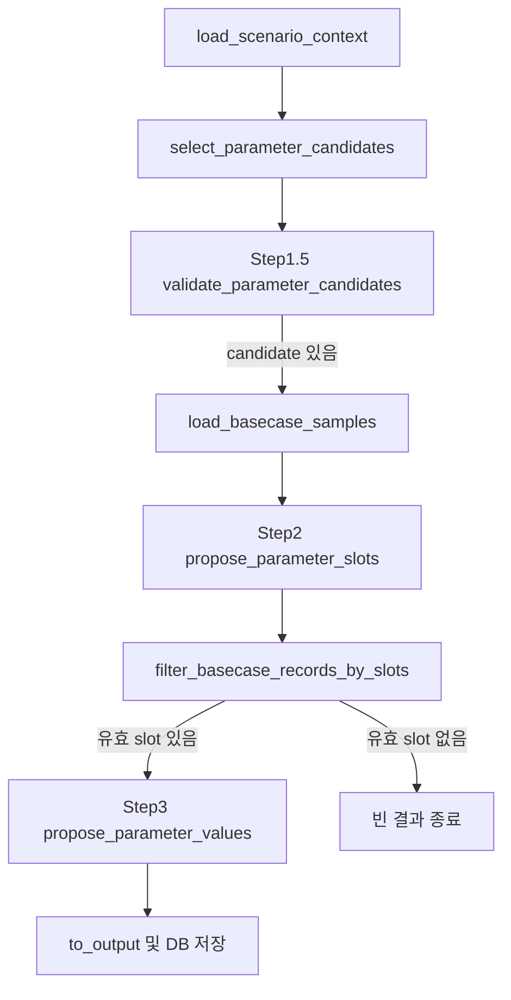

# 수급모델 파라미터 제안 Agent Flow

> 기준 소스: `apps/agents/model_parameter_agent/flows/propose_parameters/`

## 1. 목적

`model_parameter_agent`는 scenario/event/dimension 맥락과 DB parameter mapping,
Basecase 및 선택적 LUT를 이용해 모델 input parameter의 적용 좌표와 값을 제안한다.

- sync 테스트 API: `POST /model-parameters/scenarios/{scenario_id}/proposals/sync`
- 운영 접수 API: `POST /model-parameters/scenarios/{scenario_id}/proposals`
- 최종 저장값: `proposalParameters[]`
- LLM 내부 식별자인 `candidate_key`, `slot_key`는 운영 응답에 노출하지 않는다.
- sync와 callback 응답에는 별도 `diagnostics` 구조를 제공하지 않는다. 제외 사유는 서버 로그와
  기존 `validation_warnings`에 남긴다.
- 테스트용 sync API의 `values[]`에만 `lutValue`를 추가한다. DB 저장값과 운영 callback에는
  `lutValue`를 넣지 않는다.

## 2. Graph 순서



## 3. Step 1: DB 후보 생성

`select_parameter_candidates`는 다음 두 DB resource를 이용한다.

- `tmm_mi_model_param_dimension_map`: event type과 dimension을 parameter에 연결
- `tmm_mi_model_param_m`: parameter의 model target, hint, Basecase 읽기 규칙 제공

`mapping_method=direct` 또는 `routing`인 항목만 candidate가 된다. `indirect`는 Step 2/3의
보조 맥락으로 유지하고 `na`는 LLM 판단 근거에서 제외한다.

주요 candidate 필드:

```json
{
  "candidate_key": "...",
  "dimension_key": "affected_facility_type",
  "source_dimension_value": "수입 시설",
  "mapping_method": "routing",
  "mapping_comment": "...",
  "parameter_name": "RegasAdjustment",
  "parameter_hint": "...",
  "semantic_axes": "...",
  "model_file": "Supply",
  "model_sheet": "RegasAdjustment"
}
```

## 4. Step 1.5: routing 후보 선택

### 호출 조건

- `direct`: LLM에 보내지 않고 그대로 통과
- 같은 dimension의 `routing` 후보가 1개: LLM에 묻지 않고 그대로 통과
- 같은 dimension의 `routing` 후보가 2개 이상: LLM 판단 대상
- 여러 routing dimension이 있어도 한 요청의 `routing_tasks[]`로 묶어 LLM은 최대 한 번 호출

### LLM 입력

```json
{
  "scenario_brief": {},
  "routing_tasks": [
    {
      "dimension_key": "affected_facility_type",
      "dimension_value": "수입 시설",
      "candidates": [
        {
          "candidate_key": "route-a",
          "parameter_name": "RegasAdjustment",
          "parameter_hint": "...",
          "semantic_axes": "...",
          "mapping_comment": "..."
        }
      ]
    }
  ]
}
```

### LLM 출력

```json
{
  "routing_decisions": [
    {
      "dimension_key": "affected_facility_type",
      "selected_candidate_keys": ["route-a"]
    }
  ]
}
```

- task마다 최소 1개, 최대 `model_parameter_max_routing_candidates_per_dimension`개를
  선택하도록 프롬프트에 명시한다(기본값 2).
- 서버는 이 수를 다시 채우거나 자르지 않는다.
- 알 수 없는 dimension/candidate key만 제외한다.
- `rationale`, `confidence`, `warnings`는 LLM 출력에 받지 않는다.
- routing comment로 LLM 결정을 다시 덮어쓰지 않는다.

## 5. Basecase/LUT 좌표 catalog

`load_basecase_samples`는 Basecase workbook을 읽어 요청 단위 `BasecaseIndex`를 만들고,
LUT가 활성화되어 있으면 immutable `LutCatalog`와 합쳐 값 없는 exact `SlotCatalog`를 만든다.

- Step 2에는 좌표 catalog만 전달하며 value는 전달하지 않는다.
- full Basecase/LUT row는 serialized graph state에 저장하지 않는다.
- Step 2가 선택한 좌표는 exact membership을 통과해야 Step 3으로 간다.
- 실제 Basecase 값이 있으면 Basecase가 기준값이고, 없으면 같은 exact 좌표의 LUT 값이 기준값이다.

## 6. Step 2: exact slot 좌표 선택

이 단계는 좌표만 선택한다. 기준값과 proposed value, 변경 방향·폭은 판단하지 않는다.

### LLM 입력

parameter별 task는 다음 구조다.

```json
{
  "parameter": {
    "candidate_key": "candidate-a",
    "parameter_name": "PMI",
    "parameter_hint": "...",
    "semantic_axes": "...",
    "allowed_slot_axes_field_names": ["Country", "Year", "Month"]
  },
  "limits": {
    "maxParameterSlots": 100,
    "instruction": "관련된 slot만 선택하며 최대치를 채울 필요는 없음"
  },
  "selection_dimensions": [],
  "supporting_dimensions": [],
  "slot_catalog": {
    "key_axes": ["Country", "Year", "Month"],
    "fixed_axis_names": ["Country"],
    "time_axis_names": ["Year", "Month"],
    "leaves": []
  }
}
```

### 선택 수

- scenario/event/dimension과 연관된 exact slot이 있으면 parameter별 최소 1개
- 연관된 slot만 선택
- parameter별 최대 100개
- 100개는 hard maximum일 뿐 목표나 권장 개수가 아님

### LLM 출력

```json
{
  "parameter_slots": [
    {
      "candidate_key": "candidate-a",
      "slot_axes": [
        {"axis_name": "Country", "axis_value": "Japan"},
        {"axis_name": "Year", "axis_value": 2026},
        {"axis_name": "Month", "axis_value": 7}
      ]
    }
  ]
}
```

- 반환하는 항목은 모두 실제 사용할 slot이다. `selected` 필드는 없다.
- Step 2는 `candidate_key`와 `slot_axes`만 반환하고 근거 문장은 생성하지 않는다.
- catalog에 없는 exact 좌표, 축 누락, 중복, 모호한 값은 서버가 제외하고 로그를 남긴다.
- 유효 slot이 0개인 parameter는 Step 3 입력 candidate에서 제외한다.
- 다른 parameter에 유효 slot이 하나라도 있으면 남은 parameter만 Step 3으로 진행한다.

## 7. Step 2.5: exact reference와 slotKey 부여

`filter_basecase_records_by_slots`가 Step 2 좌표를 active Basecase/LUT union에서 exact 검증한다.
검증에 성공한 slot에는 candidate 내부에서 유일한 `slot_key`를 서버가 부여한다.
축 schema, exact 존재 여부와 중복을 먼저 검증한 뒤 parameter별 최대 100개를 적용한다.
유효 slot이 상한을 넘으면 앞선 100개만 Step 3으로 전달하고 초과 개수는 validation warning에 남긴다.

```json
{
  "slot_key": "slot-1",
  "coordinates": {"Country": "Japan", "Year": 2026, "Month": 7},
  "reference_value": 50.2
}
```

`slot_key`는 좌표 정보를 대신하지 않는다. LLM 입력에는 좌표가 함께 들어가며, LLM 출력과 서버 좌표를
안전하게 연결하기 위한 요청 내부 ID다.

## 8. Step 3: slot별 value 제안

### LLM 입력

유효 slot이 하나 이상인 parameter만 `parameter_value_tasks[]`에 포함한다.

```json
{
  "scenario_brief": {},
  "parameter_value_tasks": [
    {
      "parameter": {
        "candidate_key": "candidate-a",
        "parameter_name": "PMI",
        "parameter_hint": "...",
        "semantic_axes": "..."
      },
      "selection_dimensions": [],
      "supporting_dimensions": [],
      "slots": [
        {
          "slot_key": "slot-1",
          "coordinates": {"Country": "Japan", "Year": 2026, "Month": 7},
          "reference_value": 50.2
        }
      ]
    }
  ]
}
```

- slot마다 actual Basecase 또는 LUT 중 하나의 `reference_value`만 제공한다.
- provenance와 reference ID는 LLM에 주지 않는다.
- 값의 의미를 전역적으로 절대값/변화량/변화율/승수 중 하나로 고정하지 않는다.
- `parameter_hint`, `mapping_comment`, dimension 맥락, reference value의 형식을 함께 참고한다.

### LLM 출력

```json
{
  "parameter_adjustments": [
    {
      "candidate_key": "candidate-a",
      "rationale_ko": "사용자에게 보여줄 상세한 parameter-level 설명",
      "slot_values": [
        {
          "slot_key": "slot-1",
          "proposed_value": 53.1,
          "rationale_ko": "좌표 선택 이유와 값 산정 근거를 보여주는 짧은 설명"
        }
      ]
    }
  ]
}
```

- 입력 slot 1개당 출력 `slot_values` 1개를 요구한다.
- 출력에는 좌표와 reference ID를 다시 받지 않는다.
- `proposed_value=null`, 누락, 알 수 없는/중복 `slot_key`는 제외한다.
- 누락 시 LLM을 재호출하지 않고 서버가 값을 생성해 채우지도 않는다.
- 같은 parameter에 유효 값이 하나라도 남으면 그 값으로 진행한다.
- 유효 값이 0개인 parameter는 최종 제안에서 제외한다.
- 모든 parameter에서 유효 값이 없으면 최종 proposal 생성은 실패한다.

### rationale 역할

- Parameter-level `rationale_ko`
  - 화면 최상단에 표시
  - parameter 선택 이유와 scenario dimension의 관계 설명
  - 전체 적용 기간, 대상 범위, 배분 원칙, 주요 제약을 충분히 설명
  - 글자 수 제한 없음
  - 내부 candidate/slot/reference/LLM 용어 사용 금지
- Slot-level `slot_values[].rationale_ko`
  - slot tooltip에 표시
  - 확정된 좌표와 scenario/event/dimension을 바탕으로 해당 slot 선택 이유를 설명
  - reference value를 바탕으로 한 값 산정 근거를 간결하게 설명

## 9. 최종 변환

서버는 유효한 `slot_key`를 authoritative reference 좌표로 되돌려 내부 `value_grid`를 구성한다.
`presentation.py`는 이를 `(model_file, model_sheet, parameter_name)` 단위로 묶어
`proposalParameters[]`를 만든다.

- 실제 Basecase가 있으면 `basecaseValue`에 표시한다.
- LUT spec에 `metadata_axes`가 있는 parameter의 Basecase value 셀이 비어 있으면 `basecaseValue=null`과
  LUT value를 사용한다. 이때 `Year`/`Month`/`Period`를 제외한 key 축이 같은 Basecase 행의 비기간
  metadata를 유지하며, 같은 비기간 축의 Basecase 행 자체가 없을 때만 LUT metadata를 사용한다.
- LUT-only reference는 값 산정 기준으로 쓰지만 운영 `basecaseValue`는 `null`이다.
- 테스트용 sync 응답은 exact slot의 LUT default를 `lutValue`로 함께 표시한다. LUT가 없는
  slot은 `lutValue=null`이다.
- slot tooltip rationale은 각 `values[].rationale`에 표시한다.
- parameter-level rationale은 `proposalParameters[].rationale`에 표시한다.

## 10. LLM 호출 수

| 단계 | 호출 조건 | 요청당 횟수 | 출력 schema |
|---|---|---:|---|
| Step 1.5 | routing 후보가 같은 dimension에 2개 이상일 때 | 0 또는 1 | `LLMCandidateValidationResponse` |
| Step 2 | 검증된 candidate가 있을 때 | 1 | `LLMSlotProposalResponse` |
| Step 3 | exact 검증을 통과한 slot이 있을 때 | 1 | `LLMValueProposalResponse` |

LLM 호출 자체가 실패하면 fallback 응답을 만들지 않고 예외를 전파한다.

## 11. DEBUG 요약 로그

`log_level=DEBUG`일 때 단계별 prompt 전문이나 LLM 전달 input 전체는 기록하지 않는다.
단계별 결과 로그는 다음 다섯 종류만 기록한다.
모든 JSON payload는 한글을 유지한 `indent=2` 다중 행 형식으로 출력한다.

- `load_scenario_context.result`: scenario/event ID·제목과 scenario dimension 값
- `select_parameter_candidates.result`: Step 1에서 선택된 parameter 이름
- `step1.5.result`: Step 1.5를 통과한 최종 parameter 이름
- `step2.result`: sanitizer를 통과한 parameter별 slot 좌표
- `step3.result`: 최종 slot 좌표와 proposed value
- 각 LLM 호출 직전: output schema, model name, `stream`, `reasoning_effort`,
  `timeout_sec`, `connect_timeout_sec`, `max_retries`
- sync 실행은 DB에는 없는 테스트용 `lutValue`를 포함한 최종 output을 여러 줄 pretty JSON으로 한 번 출력
- background 실행은 persistence service에 전달하기 직전의 최종 `proposalParameters`를 여러 줄
  pretty JSON으로 한 번 출력

LUT startup 로그는 전체 LUT row를 반복 출력하지 않고 version, horizon, 전체/파라미터별 record 수를
한 번만 기록한다.
