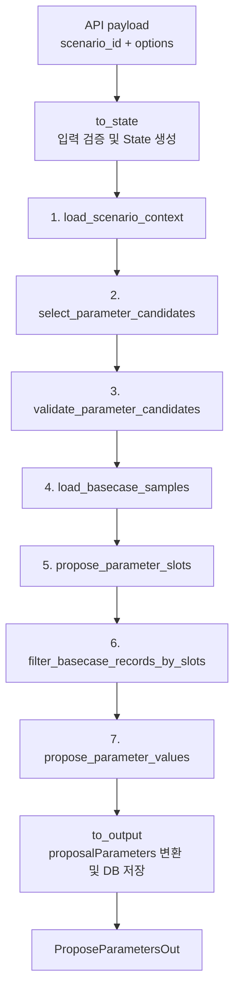
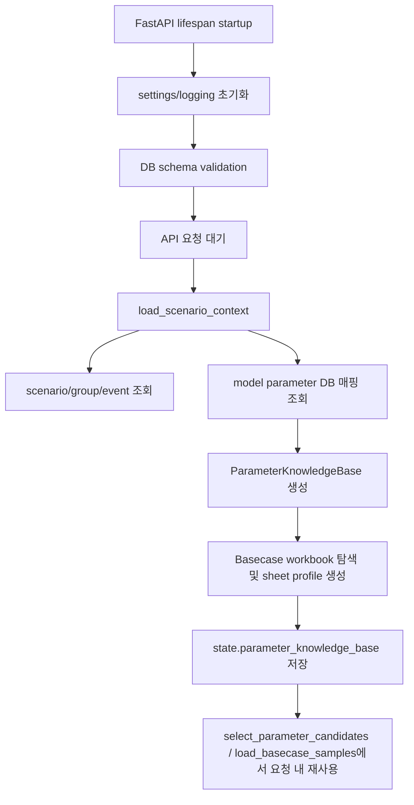

# 수급모델 파라미터 제안 Agent Flow

> 기준 소스: `apps/agents/model_parameter_agent/flows/propose_parameters/flow.py`
>
> 이 문서는 현재 코드의 LangGraph 노드 순서를 단계 기준으로 삼는다. `to_state()`와 `to_output()`은
> `build_runnable_graph()`의 전후 변환이며, 그래프 내부 단계에는 포함하지 않는다.

## 1. 목적

`model_parameter_agent`는 `scenario_id`로 시나리오, 이벤트, dimension 맥락을 조회한 뒤
DB 매핑 정보와 LNG 수급모델 Basecase 입력시트를 근거로 Demand/Supply/Trade 모델 input parameter 조정안을 제안한다.

- API: `POST /model-parameters/scenarios/{scenario_id}/proposals`
- 실행 파이프: `to_state` → `build_graph()` → `to_output`
- 그래프 출력: `parameter_adjustments`
- API 출력: `ProposeParametersOut.data.proposalParameters[]`
- 저장 여부: 제안 결과는 `tmm_mi_model_param_proposal_m`에 저장한 뒤 `modelParamProposalId`를 응답한다.

## 2. 현재 Graph Flow

`flow.py`의 `build_graph()`는 조건 edge가 없는 선형 그래프다.

`build_graph()` 기준 entry point는 `load_scenario_context`, finish point는 `propose_parameter_values`다.
`to_output()`은 그래프 종료 후 `RunnableLambda`로 실행된다.

## 3. App Load / Request Resource Load

현재 코드 기준으로 model parameter DB 매핑 정보와 Basecase profile은 앱 startup에서 preload하지 않는다.
`main.py`의 FastAPI `lifespan()`은 DB schema validation만 수행한다.

실제 API 요청이 들어오면 `load_scenario_context` 단계에서 scenario/group/event context와 함께
아래 DB 매핑 테이블을 같은 세션에서 조회한다.

- `tmm_mi_model_param_m`
- `tmm_mi_model_param_dimension_map`

이후 해당 요청의 state에 `ParameterKnowledgeBase`를 담아 `select_parameter_candidates`와
`load_basecase_samples`에서 재사용한다. 새 요청이 들어오면 DB 매핑 정보는 다시 조회한다.

로딩 절차의 핵심:

- `ModelInputService.load_context()`: scenario context와 model parameter DB 매핑 row를 함께 조회한다.
- `get_parameter_knowledge_base_from_resources()`: 조회된 DB row를 `ParameterKnowledgeBase`로 변환한다.
- `_resolve_basecase_dir()`: 명시 폴더가 있으면 해당 폴더를 사용하고, 없으면 이름에 `Basecase_20260610`이 포함된 리소스 폴더를 찾는다.
- `_load_basecase_profiles()`: Demand/Supply/Trade Basecase `.xlsm` 파일을 찾고, 매핑된 sheet의 존재 여부와 샘플/profile 정보를 만든다.
- 반환값은 `ParameterKnowledgeBase`이며, 같은 요청 안에서 후보 매칭과 Basecase record 추출에 재사용한다.

정리하면 DB 매핑과 Basecase profile은 startup에서 warm-up하지 않고 요청 시점에 구성한다.
새 요청이 오면 DB 매핑 row를 다시 읽는다.

## 4. 전후 변환

### `to_state`

요청 path에서 `scenario_id`를 필수로 받고, 선택 body는 `ProposeParametersRequest`로 검증한다.
현재 public proposal body는 시나리오 그룹 agent와 동일한 `user_id`(`userId`)만 받는다. 값이 있으면 proposal row의
`request_usr_id`, `crt_usr_logn_id`, 초기 `mod_usr_logn_id`에 저장하고, 미입력 시 `request_usr_id`는 `NULL`로 저장한다.
confirmation body의 `user_id`(`userId`)는 proposal row의 `mod_usr_logn_id`에 저장한다.

그래프 실행 상태(`ModelParameterProposalState`)에는 로컬 테스트/검증용 옵션도 포함된다.

- 매핑 정보는 매 요청 시 DB의 `tmm_mi_model_param_m`, `tmm_mi_model_param_dimension_map`에서 조회한다.
- `basecase_dir_path`: 기본 Basecase 경로 대신 사용할 경로
- `max_candidates`: 후보 최대 개수
- `max_basecase_sample_rows`, `max_basecase_cols`: Basecase profile 샘플링 옵션
- `allow_llm_fallback`: LLM 실패 시 fallback 허용 여부
- `model_name`: LLM 모델 지정

### `to_output`

그래프가 만든 `parameter_adjustments`를 API 응답용 `ProposalParameter` 목록으로 그룹화한다.
그룹 기준은 `(model_file, model_sheet, parameter_name)`이다.

출력 정리 규칙:

- `selected=false` adjustment는 제외
- `proposed_value is None`인 cell 제외
- 동일 좌표/값은 dedup하고 rationale을 병합
- `modelTarget.valueFieldNames`, `modelTarget.slotAxesFieldNames`, `values[]`를 응답 형태로 재구성
  - `valueFieldNames`는 DB `basecase_column_roles`에서 식별한 value 컬럼명을 우선 사용하고, 없으면 파라미터명을 사용
- DB 저장 후 생성된 `modelParamProposalId`를 응답에 포함

현재 코드 기준으로 특정 `event_type_l2_id`를 `to_output()`에서 강제 억제하지 않는다.

## 5. 단계별 핵심 로직

### 1. `load_scenario_context`

`ModelInputService().load_context(state.scenario_id)`로 시나리오 실행 맥락을 읽는다.

주요 context:

- `scenario`: scenario id, title, narrative, dimension values
- `scenario_group`: event type, scenario group 설명
- `event_type`: L2 이벤트 타입 정보
- `event`: 원 이벤트 제목, 요약, 상세, 발생 시점
- `dimension_template`: dimension key/label 정의
- `parameter_mapping_resources`: model parameter DB 매핑 row

이 단계는 DB 읽기 전용이다. 이후 모든 노드는 이 context와 요청 단위 `ParameterKnowledgeBase`를 기준으로 후보, slot, value를 산정한다.

### 2. `select_parameter_candidates`

매핑 지식베이스를 로드하고 scenario dimension을 수급모델 parameter 후보로 연결한다.

호출 흐름:

- `state.parameter_knowledge_base`
- `match_parameter_candidates(kb, scenario_context, max_candidates=...)`

매핑 소스:

- `tmm_mi_model_param_dimension_map`: `event_type_l2_id` + `dimension_key`를 parameter로 연결
- `tmm_mi_model_param_m`: parameter를 model file, sheet, unit, semantic axes, Basecase 읽기 스펙으로 연결
- Basecase workbook profile: candidate가 참조할 실제 sheet 존재 여부 확인

후보 생성 조건:

- scenario context에서 `event_type_l2_id`를 찾을 수 있어야 한다.
- scenario dimension key 또는 template key가 DB 매핑 rule과 일치해야 한다.
- `mapping_method`가 `direct` 또는 `routing`이어야 한다.
- `tmm_mi_model_param_m`에 model target이 있어야 한다.

후보에 포함되는 주요 값:

- `candidate_key`
- `event_type_l2_id`, `dimension_key`, `source_dimension_value`
- `mapping_method`, `mapping_comment`
- `model_file`, `model_sheet`, `canonical_parameter_name`, `parameter_name`
- `unit`, `semantic_axes`
- `basecase_read_mode`, `basecase_column_roles`, `basecase_row_filter`, `basecase_value_*`
- `basecase_available`

모델 input으로 직접 연결되지 않는 항목은 `non_input_items`로 분리한다.

### 3. `validate_parameter_candidates`

Step1.5 LLM 후보 검증 단계다. DB mapping rule로 만들어진 후보 안에서 다음 단계로 넘길 candidate만 선택한다.

LLM 입력:

- `scenario_brief`
- `candidate_validation_tasks`
- Basecase record는 아직 전달하지 않음

`scenario_brief`에는 아래 source context가 들어간다.

- `scenario_group`: `title`, `summary`, `description`, `dimension_selected`
- `scenario`: `title`, `narrative`, `dimension_values`, `impact_jkm`, `impact_ttf`, `impact_hh`
- `dimension_template`: `template_json`
- `event`: `event_title`, `one_line_summary`, `key_bullets_json`, `detail_analysis`, `tag_json`
- 호환용 top-level field: `scenario_id`, `title`, `selected_dimensions`

핵심 규칙:

- 후보 밖의 parameter, workbook, sheet, candidate key 생성 금지
- direct 후보는 DB 매핑에서 명시된 input이므로 서버 sanitizer가 유지한다.
- routing 후보는 LLM 판단 후 bridge comment와 DB dimension 값 매칭으로 한 번 더 보정한다.

서버 보정:

- `_sanitize_parameter_candidate_group_decisions()`
  - 알 수 없는 candidate key 제거
  - direct 후보는 LLM이 누락하거나 `selected=false`를 반환해도 유지
  - routing 후보는 LLM 응답 누락 또는 `selected=false`면 제외
- `_apply_routing_comment_overrides()`
  - routing comment가 dimension value와 명확히 맞으면 해당 후보를 선택
  - 같은 routing 그룹의 비일치 후보는 제외

후보가 없으면 이후 LLM 단계는 early return으로 빈 결과를 만든다.

### 4. `load_basecase_samples`

노드명은 samples지만 현재 핵심 동작은 Basecase record 추출이다.

호출 흐름:

- `state.parameter_knowledge_base`
- `build_basecase_records(kb, state.candidate_mappings, state.scenario_context)`

각 record 구조:

- `candidate_key`
- `model_file`, `sheet_name`, `parameter_name`
- `reference_id`: `Model:Sheet:R{row}C{col}`
- `axes`: Country, Year, Month, Plant 등 좌표 축
- `value_name`, `value`, `unit`
- `source_row`, `source_col`

Basecase 추출 방식:

- `fixed_columns`: `tmm_mi_model_param_m`의 column role, row filter, stop rule 기준으로 행/값 추출
- `matrix_time_columns`: 축 컬럼과 Year/Month/Period 헤더 행을 조합해 시간축 matrix 값을 추출
- 자동 matrix 탐지: 명시 스펙이 없으면 초기 행에서 Base Case block을 탐지

이 단계는 후보별 record 수를 로그로 남기고, 추출 실패는 `validation_warnings`에 누적한다.

### 5. `propose_parameter_slots`

Step2 LLM slot 산정 단계다. 여기서는 값을 제안하지 않고 모델 input 좌표 축만 정한다.

LLM 입력:

- scenario/event context
- 검증된 `candidate_mappings`
- `non_input_items`
- `period_resolution_policy`
- `_build_basecase_slot_options(state.basecase_records)`

`basecase_slot_options`는 raw row/value 전체가 아니라 candidate별 축 후보 요약이다.

- `record_count`
- `axis_names`
- `axis_values`
- `value_names`

핵심 규칙:

- 후보 밖 parameter/sheet 생성 금지
- slot 축 이름과 값은 Basecase slot option을 우선 사용
- Basecase에 없더라도 scenario/event에 명확한 input 축 값이 있으면 사용 가능
- 값 산정은 금지하고 Step3으로 넘김
- 기간 표현은 `period_resolution_policy`로 Year/Month/Period 변환

서버 보정:

- `_sanitize_llm_slots()`가 모호한 slot 값을 차단한다.
- `미정`, `후보`, `추정`, `?`, `또는`, `or`, 세미콜론 결합, 미변환 기간 표현은 `selected=false`, `needs_user_review=true`로 보정한다.

### 6. `filter_basecase_records_by_slots`

Step2에서 선택된 slot과 일치하는 Basecase record만 Step3에 전달한다.

동작:

- `selected=false` slot은 제외
- candidate key별로 slot을 묶음
- record의 `axes`와 slot의 `slot_axes`를 정규화 비교
- 비교 가능한 축이 하나 이상 있고 값이 모두 일치하면 통과

slot이 없는 candidate record는 통과하지 않는다. 다만 Step3 prompt는 Basecase record가 비어 있어도
scenario/event/dimension에 명확한 수치가 있으면 proposed value를 산정하도록 지시한다.

### 7. `propose_parameter_values`

Step3 LLM value 산정 단계다. Step2 slot과 필터된 Basecase record를 근거로 최종 `value_grid`를 만든다.

LLM 입력:

- scenario/event context
- 검증된 `candidate_mappings`
- `non_input_items`
- slot 필터를 통과한 `basecase_records`
- `parameter_slots`
- `period_resolution_policy`

LLM 출력:

- `parameter_adjustments[]`
- 각 adjustment의 `slot_axes`
- 각 cell의 `coordinates`, `basecase_value`, `proposed_value`, rationale, `basecase_reference_ids`

서버 보정:

- `_sanitize_llm_adjustments()`
  - 알 수 없는 candidate key 제거
  - `model_file`, `model_sheet`, `parameter_name`을 candidate 값으로 강제 치환
  - 모호 좌표 cell 제거
  - `proposed_value=null` cell 제거
  - 유효 cell이 없으면 `selected=false`
  - LLM 응답에서 누락된 candidate는 `selected=false`, `needs_user_review=true`로 보강
  - `basecase_reference_ids`가 있으면 `_patch_basecase_value()`로 기준값 보강
- `_backfill_rule_based_adjustments()`
  - LLM이 명확한 value grid를 만들지 못한 일부 parameter에 대해 scenario dimension 기반 규칙 보정값을 생성
  - 대상 예: `Temperature`, `CDD`, `HDD`, `PowerMix`, `SupplyDisruption`, `VolumeCancelled`,
    `ShippingCost`, `RegasAdjustment`, `LiqUtilAdjustment`, `LiqProdAdjustment`, `User-Adjusted Gas Demand`

## 6. LLM 호출 구조

LLM 호출은 세 번이다.

| 단계 | 함수 | 목적 | 출력 schema |
|---|---|---|---|
| Step1.5 | `validate_parameter_candidates` | 후보 검증 | `LLMCandidateValidationResponse` |
| Step2 | `propose_parameter_slots` | slot 축 결정 | `LLMSlotProposalResponse` |
| Step3 | `propose_parameter_values` | value grid 산정 | `LLMValueProposalResponse` |

공통 설정:

- `invoke_llm_structured_output`
- `ModelPreference.QUALITY`
- `temperature=0.0`
- `max_retries=2`

`allow_llm_fallback=False`가 기본값이다. 이 경우 LLM 호출 실패는 예외로 전파된다.
`allow_llm_fallback=True`일 때만 각 단계별 fallback 응답을 만든다.

## 7. 주요 가드레일

- 후보 범위 고정: 모든 LLM 단계는 기존 `candidate_mappings` 안의 candidate key만 사용할 수 있다.
- direct 후보 유지: Step1.5에서 direct 후보는 LLM 누락/거절과 무관하게 유지된다.
- routing 보정: bridge comment와 DB dimension value가 명확히 일치하면 routing 후보를 결정적으로 보정한다.
- Basecase 근거 보존: `reference_id`, `source_row`, `source_col`로 실제 기준값 위치를 추적한다.
- 모호한 축/좌표 차단: 미정, 후보, 추정, 복수값 결합, 과거 Year/Month 좌표 등을 제거하거나 검토 필요로 보정한다.
- 최종 출력 정리: selected adjustment와 실제 적용 가능한 value cell만 `proposalParameters`에 포함한다.
- 저장: 최종 `proposalParameters`를 `tmm_mi_model_param_proposal_m.proposal_parameters`에 저장한다.

## 8. 핵심 소스

- `api.py`: FastAPI endpoint
- `flows/propose_parameters/flow.py`: LangGraph node 순서, `to_state`, `to_output`, proposal parameter 그룹화 및 저장
- `flows/propose_parameters/nodes.py`: 각 graph node, LLM prompt, sanitizer, fallback, rule-based backfill
- `mapping.py`: DB 매핑 resource 변환, candidate 매칭, Basecase profile/record 추출
- `state.py`: `ModelParameterProposalState`
- `schemas/propose_parameters.py`: API/LLM 구조화 schema
- `persistence/model_input/service.py`, `repository.py`: scenario context 및 model parameter DB 매핑 조회, proposal 저장
- `tests/test_model_parameter_agent_contract.py`: graph 구성, 후보 검증, Basecase 추출, sanitizer, 출력 계약 테스트
