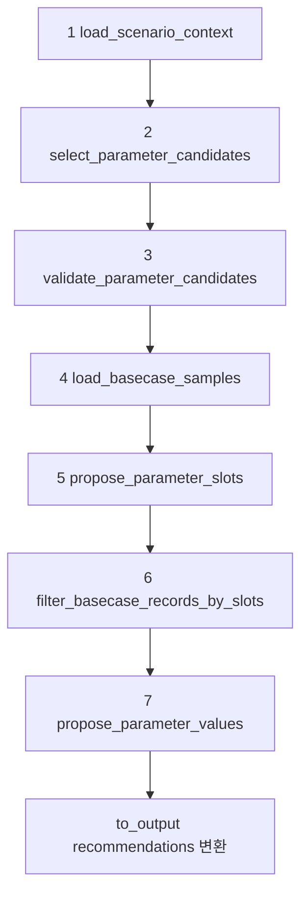
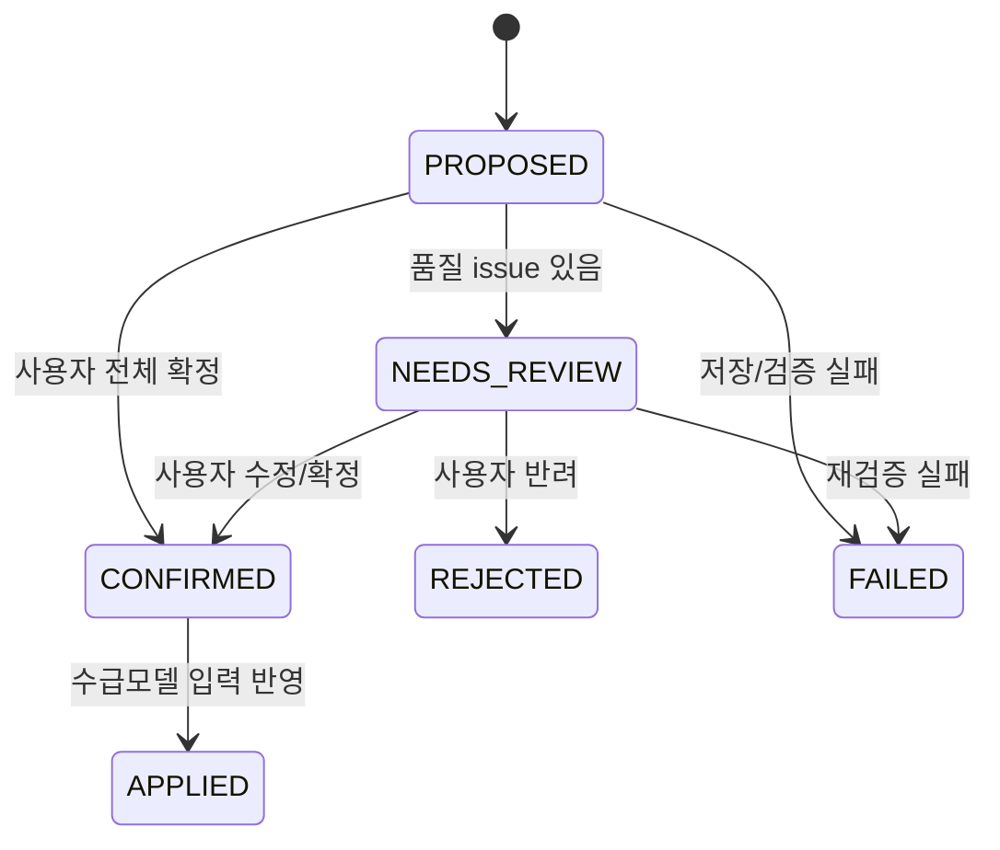

# 수급모델 파라미터 Agent 개선 제안

- 작성일: 2026-07-01
- 결과 파일: `apps/agents/model_parameter_agent/reports/model_parameter_proposal_evaluation_event_types_6_7_20260630_233109.md`
- 기준 코드: `flows/propose_parameters/flow.py`, `flows/propose_parameters/nodes.py`, `mapping.py`, `scripts/evaluate_proposals.py`
- 협업 방식: Codex가 결과 JSON과 현재 코드를 재검증했고, Claude가 동일 파일을 독립 리뷰한 초안(`.codex/claude/model_parameter_agent_improvement_review.md`)을 작성했다. 최종 문서는 양쪽 의견을 합치되, 결과 파일에서 확인된 사실과 현재 코드 기준으로 보정했다.

## 1. 결론 요약

현재 테스트는 API/graph 실행 관점에서는 24개 scenario 모두 `OK`, `ERROR_COUNT=0`이지만, 수급모델 입력 품질 관점에서는 그대로 PASS로 보기 어렵다.

| 구분 | 결과 파일에서 확인된 현상 | 개선 필요성 |
|---|---:|---|
| 빈 추천 | scenario 307, 324 총 2건 | 후보는 검증됐지만 final recommendation이 비어도 평가가 PASS로 남음 |
| value type 혼재 | scenario 308/309의 `Temperature`에서 `delta`와 `absolute` 혼재 | 같은 파라미터/slot 흐름의 입력 의미가 달라져 모델 반영 방식이 불명확 |
| 대량 slot fan-out | scenario 309/319에서 `HDD/CDD`, `Temperature`가 각 42개 value 생성 | 장기/다국가 scenario에서 비용과 검토 부담 증가 |
| 완전 동일 slot 중복 | 파싱 기준 0건 | 다만 현재 dedupe key가 value까지 포함해 같은 slot의 값 충돌은 차단하지 못함 |
| 근거 중복 | parameter 근거와 slot/value 근거가 일부 같은 내용을 반복 | 설명 품질 저하, 사용자가 왜/어디/얼마나 바꾸는지 분리해 보기 어려움 |
| 성능 | 총 38:19.051, 최장 scenario 309 06:22.676 | LLM 3단계 호출과 slot 수 증가에 성능이 크게 영향받음 |

## 2. 현재 Flow 기준 문제 지점

`flow.py`의 graph 단계는 아래 순서다.



주요 병목과 품질 리스크는 Step 5~7 및 `to_output()`에 몰려 있다.

- Step 5 `propose_parameter_slots`: `SLOT_PROPOSAL_SYSTEM`은 basecase에 없는 slot도 scenario 의미가 명확하면 추가하도록 허용한다. 이 정책은 유연하지만, 장기/다국가 scenario에서 slot이 크게 늘어나는 원인이 된다.
- Step 7 `propose_parameter_values`: `VALUE_PROPOSAL_SYSTEM`은 `basecase_records`가 없어도 명확한 수치가 있으면 값을 산정하도록 한다. 이 때문에 weather 계열은 basecase anchor 없이 LLM/규칙 해석에 의존할 수 있다.
- `nodes.py`의 `_sanitize_llm_adjustments()`는 null value, unknown operation, 모호한 좌표는 제외하지만, 동일 slot의 value 충돌이나 파라미터별 operation 일관성은 검사하지 않는다.
- `flow.py`의 `_value_key()`는 `rationale`만 제외하고 `operation`, `basecaseValue`, `proposedValue`를 포함해 dedupe한다. 따라서 같은 slot 좌표가 서로 다른 value type/value로 두 번 나오면 중복이 아니라 서로 다른 value로 남을 수 있다.

## 3. 기준별 문제점과 개선안

### 3.1 Slot/value가 scenario에 따라 정확하게 선택되어야 함

문제:
- 결과 파일에서 scenario 307, 324는 expected parameter가 있었지만 final recommendation이 비었다.
- `scripts/evaluate_proposals.py`의 `_review_selected_parameters()`는 selected가 없어도 unknown selected만 없으면 PASS로 반환한다. 즉 "비어 있음"은 메시지로만 남고 실패 조건이 아니다.
- weather parameter(`HDD`, `CDD`, `Temperature`, `PowerMix`)는 `_build_rule_based_adjustment()`의 fallback 대상에 없다. LLM Step3가 값을 확정하지 못하면 보정 없이 빈 결과로 끝날 수 있다.

개선안:
- 빈 recommendation은 평가 실패 또는 최소한 `needs_user_review=true`가 포함된 명시적 실패 상태로 처리한다.
- weather 계열에도 deterministic fallback을 추가한다. 예: `cold_wave_intensity -> Temperature delta`, `heatwave_intensity -> Temperature delta`, `period -> Year/Month expansion`, `HDD/CDD -> temperature shock 기반 변환`.
- region/country/month 확장은 별도 정책 함수로 분리한다. LLM이 임의로 slot을 확장하기보다, scenario dimension과 mapping table에서 가능한 slot 후보를 먼저 결정하고 LLM은 선택/검토만 하도록 축소한다.

### 3.2 Value는 scenario에 따라 적절하게 차이가 나야 함

문제:
- 약/중/강, 3개월/6개월 등 scenario 간 차이는 일부 반영된다. 예: 장기/강한 유럽 한파 scenario 309는 `HDD`, `Temperature`가 42개 value로 확장된다.
- 그러나 같은 scenario 내부에서 국가별 값이 모두 동일하게 반복되는 경우가 많다. 국가별 차등 근거가 없는 상태에서 country 축만 늘어나면 정보량보다 출력량이 늘어난다.
- `Temperature`는 basecase 유무에 따라 operation이 바뀐다. scenario 308은 `delta` 7개, `absolute` 14개이고, scenario 309는 `delta` 21개, `absolute` 21개다. 같은 parameter 안에서 입력 방식이 섞이면 모델 적용 의미가 불명확하다.

개선안:
- 파라미터별 operation 정책을 정의한다. 예: `Temperature`는 scenario shock 입력이면 전 slot `delta`로 통일하고, 절대값 입력이 필요하면 모든 slot을 basecase 기준 `absolute`로 변환한다.
- value monotonicity 평가를 추가한다. 같은 이벤트 유형에서 강도/기간이 증가하면 관련 값의 크기나 value 수가 기대 방향으로 증가해야 한다.
- 국가별 차등 근거가 없으면 region 단위 또는 대표 slot으로 묶고, 국가별 값이 모두 동일한 fan-out은 경고한다.

### 3.3 동일 파라미터에 slot이 반복되면 안 됨

확인 결과:
- 현재 결과 파일을 final response 기준으로 파싱했을 때, 같은 parameter 안에서 완전히 동일한 slot 좌표가 반복된 건은 0건이었다.
- 다만 현재 코드 구조는 같은 slot 좌표에 value type/value가 다르게 나오는 충돌을 막지 못한다. `_value_key()`가 slot 좌표뿐 아니라 `operation`, `proposedValue`, `basecaseValue`까지 포함하기 때문이다.

개선안:
- `to_output()` 이전, 가능하면 `_sanitize_llm_adjustments()` 단계에서 canonical slot key를 만든다.
- canonical slot key는 `scenario_id`, `candidate_key`, `parameter_name`, `model_file`, `model_sheet`, 정규화된 `coordinates`만 포함하고, `operation/proposedValue/basecaseValue/rationale`은 제외한다.
- 같은 canonical slot key가 2개 이상이면 아래처럼 처리한다.
  - operation/value가 완전히 같으면 rationale만 병합한다.
  - operation 또는 proposed value가 다르면 해당 parameter를 `needs_user_review=true`로 표시하거나 실패 처리한다.
  - 파라미터별 operation 혼재가 허용되는 예외가 필요하면 별도 allowlist 정책에 명시한다.

### 3.4 근거는 parameter 근거와 slot/value 근거가 분리되어야 함

문제:
- `VALUE_PROPOSAL_SYSTEM`은 `parameter_selection_rationale_ko`, `value_selection_rationale_ko`, `proposed_value_rationale_ko`를 나누지만, 모두 scenario/basecase를 언급하도록 유도해 내용이 겹치기 쉽다.
- `flow.py`의 `_value_rationale()`은 `value_selection_rationale_ko`와 `proposed_value_rationale_ko`를 단순 연결한다.
- `_apply_slot_coordinates_to_cells()`는 모든 value rationale 앞에 "Step2에서 확정한 slot 좌표를 우선 적용했습니다."를 주입해 반복 문구가 늘어난다.

개선안:
- 출력 근거를 아래처럼 역할별로 제한한다.
  - parameter rationale: 왜 이 parameter가 선택됐는지, 전체 변환 로직이 무엇인지
  - slot rationale: 왜 이 축 좌표가 선택됐는지
  - value rationale: 왜 이 값과 operation이 선택됐는지
- slot rationale에는 candidate mapping, parameter 선택 이유, 전체 이벤트 영향 경로를 반복하지 않도록 lint를 둔다.
- final response 생성 시 parameter rationale은 대표 문장 1~2개로 요약하고, value rationale은 slot/value 산정 근거만 남긴다.

### 3.5 성능

확인 결과:
- 24개 scenario 총 wall-clock은 38:19.051이고, concurrency는 2다.
- 최장 scenario는 309로 06:22.676, 다음으로 319가 05:27.442, 310이 04:57.509다.
- 장기/다국가 scenario에서 value 수가 크게 늘며 LLM 응답과 후처리 시간이 증가한다. scenario 309/319는 주요 weather parameter가 각각 42개 value를 생성했다.

개선안:
- deterministic 단계와 LLM 단계를 분리한다. direct mapping, period expansion, region-country expansion은 코드/정책으로 먼저 계산하고 LLM은 애매한 선택만 처리한다.
- Step 3/5/7 전체 LLM 호출을 항상 수행하지 말고, direct rule로 확정 가능한 경우 validation/value LLM 호출을 생략하거나 축소한다.
- `maxParameterSlots=100` 외에 `parameter별 max cells`, `country x month fan-out 상한`, `장기 scenario 월별/분기별 축약 정책`을 둔다.
- 평가 report에 scenario별 token, selected slot 수, final value 수, basecase record 수를 함께 기록해 latency 원인을 추적한다.

### 3.6 LRU, mapping Excel DB화 등 구조 개선

현재 구조:
- `main.py` startup에서 `preload_parameter_knowledge_base()`를 `asyncio.to_thread()`로 실행해 기본 mapping Excel/Basecase profile을 warm-up한다.
- `mapping.py`의 `_load_parameter_knowledge_base()`는 `@lru_cache(maxsize=8)`로 cache된다.
- 다만 cache key는 file path와 sample 옵션 중심이고, 파일 변경 감지/버전 관리/운영 중 refresh 정책은 명시되어 있지 않다.
- `build_basecase_records()`는 요청 중 basecase record를 추출한다. profile cache는 있지만, slot/value 조회에 최적화된 normalized index는 없다.

개선안:
- mapping Excel을 운영 DB table로 import한다. Excel은 source artifact로 유지하되 runtime source of truth는 versioned DB로 둔다.
- 권장 table 예시:
  - `model_parameter_mapping_rule`: event_type/dimension -> canonical parameter 매핑
  - `model_parameter_definition`: parameter -> model file/sheet/axis/value column 정의
  - `model_basecase_profile`: workbook/sheet/range/header metadata
  - `model_basecase_record`: normalized axis/value record
  - `model_parameter_value_policy`: parameter별 operation, fallback formula, value bounds
  - `model_mapping_version`: 활성 버전, import 시각, source file checksum
- cache는 `mapping_version` 기준으로 잡고, admin refresh 또는 app reload 없이 활성 버전을 교체할 수 있게 한다.
- basecase record는 요청 시 Excel을 훑기보다 ETL로 materialize하고 `(parameter, axis values, year, month)` index 조회로 바꾼다.

### 3.7 Startup mapping Excel에 추가 정의하면 좋은 항목

현재 `Parameter Excel Mapping`은 모델 파일/sheet, 축, Basecase 읽기 범위를 잘 정의하지만, slot/value 선택 정책은 대부분 prompt와 후처리에 남아 있다. 아래 항목을 startup load 대상 Excel에 추가하면 LLM이 추론하던 판단을 deterministic policy로 옮길 수 있다.

| 추가 정의 항목 | 권장 sheet/column 예시 | 용도 | 이번 결과와의 연결 |
|---|---|---|---|
| Parameter value policy | `Parameter Value Policy` sheet: `canonical_parameter_name`, `default_operation`, `allowed_operations`, `operation_consistency_scope` | parameter별 허용 operation과 기본 적용 방식을 명시 | `Temperature`의 `delta/absolute` 혼재를 사전에 차단 |
| Value formula/fallback | `formula_key`, `source_dimension_keys`, `range_resolution_rule`, `basecase_missing_policy`, `fallback_formula` | basecase가 없을 때도 동일 산식으로 value 산정 | scenario 307/324 빈 추천과 weather fallback 부재 보완 |
| Value bounds/unit conversion | `min_value`, `max_value`, `unit_conversion_rule`, `rounding_rule` | 비정상 수치, 단위 불일치, 과도한 제안값 방지 | LLM 산정값을 모델 입력 허용 범위 안으로 제한 |
| Slot policy | `Parameter Slot Policy` sheet: `required_axes`, `optional_axes`, `slot_conflict_key_axes`, `max_cells_per_parameter` | 어떤 축이 필수인지, 같은 slot을 어떻게 판정할지 정의 | 같은 slot에 다른 value type/value가 나오는 구조적 리스크 차단 |
| Region/axis expansion policy | `axis_name`, `source_value`, `target_values`, `aggregation_level`, `fanout_policy` | Europe/Asia 같은 region을 국가 목록으로 펼칠지, region으로 묶을지 결정 | 309/319의 42개 value fan-out을 정책적으로 제어 |
| Period expansion policy | `period_value`, `resolution`, `month_count`, `start_month_rule`, `peak_pattern_rule` | 3개월/6개월/1년을 Year/Month 좌표로 전개하는 기준 명시 | 장기 scenario의 월별 slot 수와 시작월을 일관화 |
| Dimension normalization | `event_type_l2_id`, `dimension_key`, `raw_value_pattern`, `normalized_value`, `severity_rank`, `numeric_value` | `-3~-5℃`, `+3℃ 이상` 같은 범위/정성 값을 숫자와 강도 등급으로 변환 | value 차별화와 monotonicity 평가의 기준 확보 |
| Candidate selection policy | `event_type_l2_id`, `dimension_key`, `canonical_parameter_name`, `priority`, `required_when`, `exclusive_group` | direct/routing 후보가 여러 개일 때 우선순위와 필수 여부 결정 | expected parameter 누락/과잉 선택을 Excel 정책으로 검증 |
| Rationale policy | `parameter_rationale_template`, `slot_rationale_template`, `value_rationale_template`, `forbidden_terms_in_slot_rationale` | parameter/slot/value 근거의 역할을 분리 | slot 근거에 parameter 선택 이유가 반복되는 문제 완화 |
| Quality gate policy | `empty_recommendation_policy`, `conflict_policy`, `basecase_null_warn_threshold`, `fanout_warn_threshold` | final response 전 품질 게이트를 Excel 정책으로 제어 | 실행 OK지만 품질 FAIL인 케이스를 자동 탐지 |
| Version/ownership metadata | `mapping_version`, `effective_from`, `source_checksum`, `owner`, `change_reason` | startup cache invalidation, 운영 추적, 변경 승인 관리 | LRU cache가 파일 변경/버전 의미를 모르는 문제 보완 |

우선 추가하면 효과가 큰 최소 세트는 아래다.

1. `Parameter Value Policy`: `Temperature.default_operation=delta`, `operation_consistency_scope=scenario_parameter`, `allowed_operations=delta`처럼 parameter별 operation 기준을 둔다.
2. `Parameter Slot Policy`: `Temperature.slot_conflict_key_axes=Country,Year,Month`, `PowerMix.slot_conflict_key_axes=Country,Energy Source,Year`처럼 중복/충돌 판정 키를 명시한다.
3. `Dimension Normalization`: 한파/폭염 강도 dimension을 `numeric_value`, `severity_rank`, `direction`으로 정규화한다.
4. `Value Formula/Fallback`: `cold_wave_intensity -> Temperature delta`, `heatwave_intensity -> Temperature delta`, `Temperature delta -> HDD/CDD delta` 같은 weather 변환식을 명시한다.
5. `Quality Gate Policy`: empty recommendation, mixed operation, slot conflict를 FAIL 또는 review required로 처리하는 기준을 둔다.

### 3.8 Response format 개선

현재 API response schema는 `ProposeParametersOut` 기준으로 최상위에 `scenarioId`, `recommendations[]`만 반환한다. `ApiModel`이 camelCase alias를 적용하므로 실제 JSON key는 `scenarioId`, `modelFile`, `axisFields`처럼 내려간다. 이 구조는 간단하지만, 결과를 검토하는 사용자가 "어떤 scenario group/event에서 나온 추천인지", "품질 검증 상태가 어떤지", "slot과 value가 어떤 관계인지"를 바로 보기 어렵다.

개선 방향:
- 최상위에 `scenario`, `scenarioGroup`, `event`, `review`를 추가한다.
- `recommendations` 내부는 parameter 단위로 유지하되, `values` 대신 `proposedValues`처럼 의미가 분명한 이름을 쓴다.
- `axisFields`, `valueFields`는 실제 입력 대상이라는 의미가 약하므로 `slotAxes`, `valueFieldNames`로 바꾼다.
- 각 value row에는 `slot`, `basecase`, `proposal`, `evidence`를 나눠 넣어 slot/value/basecase/근거를 분리한다.
- conflict나 empty recommendation이 있으면 response 본문에서도 확인 가능하도록 `review.messages[]`에 표준 코드로 포함한다.

권장 v2 구조 예시:

```json
{
  "scenario": {
    "scenarioId": 309,
    "scenarioGroupId": 61,
    "title": "[model_parameter_agent_weather_ext_20260630] 유럽 6개월 강한 한파",
    "dimensionValues": {
      "period": "6개월",
      "coldWaveIntensity": "-5℃ 이하: 강",
      "peakTimingPattern": "지속 피크"
    }
  },
  "scenarioGroup": {
    "scenarioGroupId": 61,
    "title": "[model_parameter_agent_weather_ext_20260630] 유럽 한파 확장 검증",
    "eventTypeL2Id": 6,
    "eventTypeL2Label": "겨울 한파"
  },
  "event": {
    "miEventId": 1281,
    "eventTitleKo": "유럽 한파 수요 증가",
    "occurredAt": "2026-03-04",
    "latestRecordFirstCreated": "2026-03-04T00:00:00"
  },
  "review": {
    "status": "NEEDS_REVIEW",
    "reviewRequired": true,
    "messages": [
      {
        "code": "MIXED_OPERATION",
        "level": "ERROR",
        "parameterName": "Temperature",
        "message": "동일 scenario/parameter 안에서 delta와 absolute가 혼재했습니다."
      }
    ],
    "summary": {
      "recommendationCount": 3,
      "proposedValueCount": 98,
      "emptyRecommendation": false,
      "slotConflictCount": 0,
      "mixedOperationCount": 1,
      "basecaseNullValueCount": 63
    }
  },
  "recommendations": [
    {
      "parameterName": "Temperature",
      "modelTarget": {
        "modelFile": "Demand",
        "modelSheet": "WeatherAdjustment",
        "valueFieldName": "Temperature",
        "unit": "℃"
      },
      "selectionReason": "한파 강도가 기온 하락으로 직접 표현되므로 Temperature 조정 대상입니다.",
      "slotAxes": ["Country", "Year", "Month"],
      "operationPolicy": {
        "defaultOperation": "delta",
        "allowedOperations": ["delta"],
        "consistencyScope": "scenarioParameter"
      },
      "proposedValues": [
        {
          "slot": {
            "Country": "Germany",
            "Year": 2027,
            "Month": 1
          },
          "basecase": {
            "value": 1.2,
            "referenceIds": ["Demand|WeatherAdjustment|..."],
            "source": {
              "modelFile": "Demand",
              "modelSheet": "WeatherAdjustment",
              "row": 123,
              "column": "O"
            }
          },
          "proposal": {
            "operation": "delta",
            "value": -5.0,
            "unit": "℃"
          },
          "reason": {
            "slotReason": "유럽 6개월 한파 기간을 2026년 10월~2027년 3월로 전개한 월별 slot입니다.",
            "valueReason": "강한 한파 기준인 -5℃ 이하를 보수적으로 -5℃ delta로 적용했습니다."
          }
        }
      ]
    }
  ]
}
```

필수로 추가하는 것이 좋은 key:

| 위치 | key | 이유 |
|---|---|---|
| `scenario` | `scenarioId`, `scenarioGroupId`, `title`, `dimensionValues` | 결과가 어떤 scenario 가정에서 나온 것인지 response만 보고 추적 가능 |
| `scenarioGroup` | `scenarioGroupId`, `title`, `eventTypeL2Id`, `eventTypeL2Label` | event type/group 단위 검증과 UI grouping에 필요 |
| `event` | `miEventId`, `eventTitleKo`, `occurredAt`, `latestRecordFirstCreated` | 원 이벤트 근거와 추천 결과를 연결 |
| `review` | `status`, `reviewRequired`, `messages[]`, `summary` | empty recommendation, mixed operation, slot conflict를 API 소비자가 즉시 감지 |
| `recommendations[].modelTarget` | `modelFile`, `modelSheet`, `valueFieldName`, `unit` | 모델 입력 대상과 값 컬럼을 한 묶음으로 표현 |
| `recommendations[].operationPolicy` | `defaultOperation`, `allowedOperations`, `consistencyScope` | value type 혼재 여부를 response에서 검증 가능 |
| `proposedValues[].slot` | 축 좌표 dict | slot을 value metadata와 분리 |
| `proposedValues[].basecase` | `value`, `referenceIds`, `source` | basecase 근거와 null 여부를 명확히 표현 |
| `proposedValues[].proposal` | `operation`, `value`, `unit` | 실제 모델 입력값만 직관적으로 확인 |
| `proposedValues[].reason` | `slotReason`, `valueReason` | 근거 중복을 줄이고 역할을 분리 |

기존 response와의 호환성이 필요하면 바로 breaking change를 만들기보다 `responseVersion: "v2"`를 추가하고, 기존 `recommendations[].values`는 유지하되 신규 구조를 병행 제공하는 migration 기간을 두는 편이 안전하다.

### 3.9 결과 저장 DB 테이블 설계

현재 model parameter 제안 결과는 API response로만 반환되고 저장되지 않는다. 단순 운영을 우선한다면 parameter/slot/value를 상세 테이블로 분리하지 않고, 추천 결과와 사용자 확정 결과를 JSON 컬럼에 담는 단일 테이블 구조가 적합하다.

필수 컬럼은 모두 같은 테이블에 둔다. 여기서 `구분id`는 현재 report와 scenario group에서 쓰는 `event_type_l2_id`를 기준으로 두는 것이 자연스럽다. 컬럼명은 업무 용어를 살려 `category_id`로 두고, 설명에 `event_type_l2_id` 기준임을 명시한다.

#### 3.9.1 단일 저장 테이블

권장 테이블명: `tmm_mi_model_param_proposal_m`

| 컬럼 | 타입 예시 | 필수 | 설명 |
|---|---|---:|---|
| `model_param_proposal_id` | BIGINT UNSIGNED PK AUTO_INCREMENT | Y | 결과 저장 row의 PK |
| `category_id` | INT UNSIGNED | Y | 구분 ID. 현재 기준으로 `event_type_l2_id` 저장. 예: 6 한파, 7 폭염 |
| `scenario_group_id` | BIGINT UNSIGNED | Y | 시나리오 그룹 ID |
| `mi_event_id` | BIGINT UNSIGNED | Y | 이벤트 ID |
| `scenario_id` | BIGINT UNSIGNED | Y | 시나리오 ID |
| `recommended_parameters` | JSON | Y | agent가 추천한 parameter 전체. parameter, slot, value, 근거를 모두 포함 |
| `confirmed_parameters` | JSON NULL | Y | 사용자가 최종 확정한 parameter 전체. 확정 전은 null 또는 `[]` |
| `status` | VARCHAR(30) | Y | `PROPOSED`, `NEEDS_REVIEW`, `CONFIRMED`, `REJECTED`, `APPLIED`, `FAILED` |
| `response_version` | VARCHAR(20) | N | response format 버전. 예: `v1`, `v2` |
| `quality_status` | VARCHAR(30) | N | 품질 판정. 예: `PASS`, `WARN`, `FAIL`, `NEEDS_REVIEW` |
| `quality_issues` | JSON NULL | N | mixed operation, empty recommendation, slot conflict 등 issue 목록 |
| `metrics_json` | JSON NULL | N | recommendation/value 수, latency, conflict 수 등 요약 metric |
| `scenario_snapshot_json` | JSON | N | 실행 시점의 scenario/event/dimension snapshot |
| `mapping_version` | VARCHAR(50) NULL | N | 사용한 mapping Excel/DB 버전 |
| `basecase_version` | VARCHAR(50) NULL | N | 사용한 basecase 버전 |
| `model_name` | VARCHAR(100) NULL | N | LLM/model 실행 정보 |
| `elapsed_seconds` | DECIMAL(10,3) NULL | N | 총 소요시간 |
| `requested_by` | VARCHAR(100) NULL | N | 요청자 |
| `confirmed_by` | VARCHAR(100) NULL | N | 확정자 |
| `confirmed_at` | DATETIME NULL | N | 확정 시각 |
| `created_by` | VARCHAR(100) NULL | N | 생성자 또는 agent |
| `created_at` | DATETIME | Y | 생성 시각 |
| `updated_by` | VARCHAR(100) NULL | N | 마지막 수정자 |
| `updated_at` | DATETIME | Y | 마지막 수정 시각 |

권장 DDL 예시:

```sql
CREATE TABLE tmm_mi_model_param_proposal_m (
    model_param_proposal_id BIGINT UNSIGNED NOT NULL AUTO_INCREMENT COMMENT '수급모델 파라미터 제안 결과 ID',
    category_id INT UNSIGNED NOT NULL COMMENT '구분 ID. 현재 event_type_l2_id 기준',
    scenario_group_id BIGINT UNSIGNED NOT NULL COMMENT '시나리오 그룹 ID',
    mi_event_id BIGINT UNSIGNED NOT NULL COMMENT 'MI 이벤트 ID',
    scenario_id BIGINT UNSIGNED NOT NULL COMMENT '시나리오 ID',
    recommended_parameters JSON NOT NULL COMMENT 'Agent 추천 파라미터 JSON',
    confirmed_parameters JSON NULL COMMENT '사용자 확정 파라미터 JSON',
    status VARCHAR(30) NOT NULL DEFAULT 'PROPOSED' COMMENT 'PROPOSED/NEEDS_REVIEW/CONFIRMED/REJECTED/APPLIED/FAILED',
    response_version VARCHAR(20) NOT NULL DEFAULT 'v1' COMMENT '응답 포맷 버전',
    quality_status VARCHAR(30) NULL COMMENT '품질 상태',
    quality_issues JSON NULL COMMENT '품질 이슈 목록',
    metrics_json JSON NULL COMMENT '실행/품질 요약 지표',
    scenario_snapshot_json JSON NULL COMMENT '실행 시점 scenario/event/dimension snapshot',
    mapping_version VARCHAR(50) NULL COMMENT 'Mapping Excel/DB 버전',
    basecase_version VARCHAR(50) NULL COMMENT 'Basecase 버전',
    model_name VARCHAR(100) NULL COMMENT 'LLM/model 이름',
    elapsed_seconds DECIMAL(10,3) NULL COMMENT '소요시간',
    requested_by VARCHAR(100) NULL COMMENT '요청자',
    confirmed_by VARCHAR(100) NULL COMMENT '확정자',
    confirmed_at DATETIME NULL COMMENT '확정 시각',
    created_by VARCHAR(100) NULL COMMENT '생성자',
    created_at DATETIME NOT NULL DEFAULT CURRENT_TIMESTAMP COMMENT '생성 시각',
    updated_by VARCHAR(100) NULL COMMENT '수정자',
    updated_at DATETIME NOT NULL DEFAULT CURRENT_TIMESTAMP ON UPDATE CURRENT_TIMESTAMP COMMENT '수정 시각',
    PRIMARY KEY (model_param_proposal_id),
    KEY idx_tmm_mi_model_param_proposal_m_01 (scenario_group_id, status),
    KEY idx_tmm_mi_model_param_proposal_m_02 (mi_event_id),
    KEY idx_tmm_mi_model_param_proposal_m_03 (category_id, status),
    KEY idx_tmm_mi_model_param_proposal_m_04 (scenario_id, created_at)
) COMMENT='수급모델 파라미터 추천 및 사용자 확정 결과';
```

#### 3.9.2 JSON 구조

`recommended_parameters`는 agent가 제안한 원본을 저장하고, `confirmed_parameters`는 사용자가 수정/확정한 최종안을 저장한다. 두 컬럼은 같은 구조를 쓰는 것이 비교와 UI 처리에 유리하다.

```json
[
  {
    "parameterName": "Temperature",
    "modelTarget": {
      "modelFile": "Demand",
      "modelSheet": "WeatherAdjustment",
      "valueFieldName": "Temperature",
      "unit": "℃"
    },
    "status": "PROPOSED",
    "selectionReason": "한파 강도가 기온 하락으로 직접 표현되므로 Temperature 조정 대상입니다.",
    "slotAxes": ["Country", "Year", "Month"],
    "values": [
      {
        "slotKey": "Country=Germany|Year=2027|Month=1",
        "slot": {
          "Country": "Germany",
          "Year": 2027,
          "Month": 1
        },
        "basecaseValue": 1.2,
        "operation": "delta",
        "value": -5.0,
        "slotReason": "유럽 6개월 한파 기간의 월별 slot입니다.",
        "valueReason": "강한 한파 기준을 -5℃ delta로 적용했습니다."
      }
    ]
  }
]
```

`confirmed_parameters`에는 사용자가 확정한 최종 값만 저장한다. 사용자가 일부 parameter를 제외하거나 값을 수정하면 해당 JSON에만 반영한다. 원 추천과 사용자 확정의 diff는 필요할 때 application에서 `recommended_parameters`와 `confirmed_parameters`를 비교해 계산한다.

#### 3.9.3 상태 흐름



이 단일 테이블 구조는 검색 조건이 `scenario_group_id`, `mi_event_id`, `scenario_id`, `status` 중심일 때 충분하다. parameter별 통계나 slot 단위 검색이 강하게 필요해지는 시점에만 별도 상세 테이블을 추가하는 것이 좋다.

### 3.10 외부 연동 API Spec 제안

현재 model parameter API는 `POST /model-parameters/scenarios/{scenario_id}/proposals` 동기 응답 구조다. 외부 연동에서는 실행 시간이 길 수 있으므로, 시나리오 그룹 생성 API처럼 "즉시 ACK 응답 -> 백그라운드 실행 -> 완료 callback" 구조를 권장한다.

공통 원칙:
- JSON key는 기존 `ApiModel` 규칙에 맞춰 `camelCase`를 사용한다.
- 외부 최초 요청은 job 생성/접수만 수행하고 즉시 응답한다.
- 실제 parameter 추천 결과는 callback request body로 전달한다.
- 사용자는 callback에서 받은 `recommendedParameters`와 같은 형식을 유지해 수정 후 `confirmedParameters`로 다시 전달한다.
- `recommendedParameters`와 `confirmedParameters`는 파라미터/slot/value 전체를 담는 JSON 배열이다.

#### 3.10.1 파라미터 제안 요청 API

외부 시스템이 MI Agent에 파라미터 제안을 요청하는 API다. 즉시 응답만 반환하고 실제 결과는 callback으로 보낸다.

Endpoint:

```http
POST /model-parameters/proposals
Content-Type: application/json
Authorization: Bearer {token}
```

Request:

| Field | Type | Required | 설명 |
|---|---|---:|---|
| `scenarioId` | number | Y | 파라미터 제안을 수행할 시나리오 ID |
| `userId` | string/number | Y | 요청 사용자 ID |

`categoryId`, `scenarioGroupId`, `miEventId`, `dimensionValues`는 요청으로 받지 않고 서버가 `scenarioId`로 DB context를 조회해 채운다. callback URL, model/basecase option도 운영 설정과 기본값을 사용한다.

Request 예시:

```json
{
  "scenarioId": 309,
  "userId": "messiah"
}
```

Immediate Response:

```json
{
  "status": "success",
  "message": "accepted",
  "data": {
    "proposalJobId": "MPJ-20260701-0001",
    "scenarioId": 309,
    "userId": "messiah",
    "categoryId": 6,
    "scenarioGroupId": 61,
    "miEventId": 1281,
    "status": "ACCEPTED",
    "acceptedAt": "2026-07-01T10:00:00+09:00"
  }
}
```

Immediate Response는 결과가 아니라 접수 확인이다. `status=ACCEPTED` 이후 callback이 성공/실패 결과를 전달한다.

#### 3.10.2 파라미터 제안 완료 Callback API

MI Agent가 외부 시스템의 callback URL로 호출하는 API다. 이 payload가 실제 파라미터 제안 결과다.

callback은 시나리오그룹 agent의 공통 응답 형태처럼 `status/message/data` wrapper를 사용한다. 단, 시나리오그룹 agent에서만 의미가 있는 `stage`, scenario table 생성/검증 전용 필드는 넣지 않는다.

| 용어 | 의미 |
|---|---|
| `status` | callback 처리 결과. 공통 wrapper 값으로 `success` 또는 `error` |
| `message` | callback 처리 메시지. 실패 시 오류 요약 |
| `data.status` | 생성된 제안 결과의 현재 상태. `PROPOSED`, `NEEDS_REVIEW`, `FAILED` |
| `data.reviewRequired` | 사용자가 확인해야 하는 이슈가 있는지 여부 |
| `data.reviewMessages` | 사용자가 확인해야 하는 이유 목록 |

외부 callback payload에서는 의미가 모호한 `quality`, `result`, 단일 scenario 요청에 맞지 않는 `results[]`, `errors[]`는 사용하지 않는다.

Callback Request:

```http
POST {callbackUrl}
Content-Type: application/json
Authorization: Bearer {callback-token}
```

| Field | Type | Required | 설명 |
|---|---|---:|---|
| `status` | string | Y | `success` 또는 `error` |
| `message` | string | Y | 처리 메시지 |
| `data` | object/null | Y | 실제 파라미터 제안 결과. 실패 시 가능한 범위만 포함 |

`data` 주요 field:

| Field | Type | Required | 설명 |
|---|---|---:|---|
| `proposalJobId` | string | Y | 파라미터 제안 job ID |
| `modelParamProposalId` | number/null | Y | 저장된 파라미터 제안 결과 ID. 실패 시 null |
| `categoryId` | number | Y | 구분 ID |
| `scenarioGroup` | object | Y | 시나리오 그룹 요약 |
| `event` | object | Y | 이벤트 요약 |
| `scenario` | object | Y | 시나리오 요약과 dimension 값 |
| `status` | string | Y | 제안 상태. `PROPOSED`, `NEEDS_REVIEW`, `FAILED` |
| `reviewRequired` | boolean | Y | 사용자 검토 필요 여부 |
| `reviewMessages` | object[] | N | 사용자 검토가 필요한 이유 목록 |
| `summary` | object/null | N | 추천 건수, slot/value 수 등 요약 |
| `recommendedParameters` | object[] | Y | agent 추천 파라미터 JSON |
| `confirmedParameters` | object[]/null | Y | 사용자 확정 전이므로 null |

Callback Request 예시:

```json
{
  "status": "success",
  "message": "model parameter proposal completed",
  "data": {
    "proposalJobId": "MPJ-20260701-0001",
    "modelParamProposalId": 10001,
    "categoryId": 6,
    "scenarioGroup": {
      "scenarioGroupId": 61,
      "title": "[model_parameter_agent_weather_ext_20260630] 유럽 한파 확장 검증",
      "eventTypeL2Id": 6,
      "eventTypeL2Label": "겨울 한파"
    },
    "event": {
      "miEventId": 1281,
      "eventTitleKo": "유럽 한파 수요 증가",
      "occurredAt": "2026-03-04"
    },
    "scenario": {
      "scenarioId": 309,
      "scenarioGroupId": 61,
      "title": "[model_parameter_agent_weather_ext_20260630] 유럽 6개월 강한 한파",
      "dimensionValues": {
        "period": "6개월",
        "coldWaveIntensity": "-5℃ 이하: 강",
        "peakTimingPattern": "지속 피크"
      }
    },
    "status": "NEEDS_REVIEW",
    "reviewRequired": true,
    "reviewMessages": [
      {
        "code": "MIXED_OPERATION",
        "level": "ERROR",
        "parameterName": "Temperature",
        "message": "동일 scenario/parameter 안에서 delta와 absolute가 혼재했습니다."
      }
    ],
    "summary": {
      "recommendationCount": 3,
      "proposedValueCount": 98,
      "slotConflictCount": 0,
      "mixedOperationCount": 1
    },
    "recommendedParameters": [
      {
        "parameterName": "Temperature",
        "modelTarget": {
          "modelFile": "Demand",
          "modelSheet": "WeatherAdjustment",
          "valueFieldName": "Temperature",
          "unit": "℃"
        },
        "status": "PROPOSED",
        "selectionReason": "한파 강도가 기온 하락으로 직접 표현되므로 Temperature 조정 대상입니다.",
        "slotAxes": ["Country", "Year", "Month"],
        "values": [
          {
            "slotKey": "Country=Germany|Year=2027|Month=1",
            "slot": {
              "Country": "Germany",
              "Year": 2027,
              "Month": 1
            },
            "basecaseValue": 1.2,
            "operation": "delta",
            "value": -5.0,
            "slotReason": "유럽 6개월 한파 기간의 월별 slot입니다.",
            "valueReason": "강한 한파 기준을 -5℃ delta로 적용했습니다."
          }
        ]
      }
    ],
    "confirmedParameters": null
  }
}
```

Callback Failure 예시:

```json
{
  "status": "error",
  "message": "Scenario context not found: scenario_id=309",
  "data": {
    "proposalJobId": "MPJ-20260701-0001",
    "modelParamProposalId": null,
    "categoryId": 6,
    "scenarioGroup": {
      "scenarioGroupId": 61
    },
    "event": {
      "miEventId": 1281
    },
    "scenario": {
      "scenarioId": 309
    },
    "status": "FAILED",
    "reviewRequired": true,
    "reviewMessages": [
      {
        "code": "SCENARIO_CONTEXT_NOT_FOUND",
        "level": "ERROR",
        "message": "Scenario context not found: scenario_id=309"
      }
    ],
    "summary": null,
    "recommendedParameters": [],
    "confirmedParameters": null
  }
}
```

Callback Response:

외부 시스템은 callback 수신 성공 여부만 반환한다.

```json
{
  "status": "success",
  "message": "received",
  "data": {
    "proposalJobId": "MPJ-20260701-0001"
  }
}
```

#### 3.10.3 파라미터 사용자 수정 API

외부 시스템 또는 UI가 callback 결과를 사용자에게 보여준 뒤, 사용자가 수정/확정한 파라미터를 MI Agent에 다시 전달하는 API다. `confirmedParameters`는 callback의 `recommendedParameters`와 같은 형식을 유지해야 한다.

Endpoint:

```http
PUT /model-parameters/proposals/{modelParamProposalId}/confirmed-parameters
Content-Type: application/json
Authorization: Bearer {token}
```

Request:

| Field | Type | Required | 설명 |
|---|---|---:|---|
| `modelParamProposalId` | number | Y | callback에서 받은 결과 저장 ID. path 값과 일치해야 함 |
| `categoryId` | number | Y | 구분 ID |
| `scenarioGroupId` | number | Y | 시나리오 그룹 ID |
| `miEventId` | number | Y | 이벤트 ID |
| `scenarioId` | number | Y | 시나리오 ID |
| `status` | string | Y | `CONFIRMED` 또는 `REJECTED` |
| `confirmedParameters` | object[] | Y | 사용자가 확정한 파라미터 JSON. callback의 `recommendedParameters`와 같은 구조 |
| `modifiedBy` | string | Y | 수정/확정 사용자 |
| `comment` | string | N | 사용자 코멘트 |

Request 예시:

```json
{
  "modelParamProposalId": 10001,
  "categoryId": 6,
  "scenarioGroupId": 61,
  "miEventId": 1281,
  "scenarioId": 309,
  "status": "CONFIRMED",
  "modifiedBy": "messiah",
  "comment": "Temperature는 delta 기준으로 통일하고 PowerMix는 원안 유지",
  "confirmedParameters": [
    {
      "parameterName": "Temperature",
      "modelTarget": {
        "modelFile": "Demand",
        "modelSheet": "WeatherAdjustment",
        "valueFieldName": "Temperature",
        "unit": "℃"
      },
      "status": "CONFIRMED",
      "selectionReason": "한파 강도가 기온 하락으로 직접 표현되므로 Temperature 조정 대상입니다.",
      "slotAxes": ["Country", "Year", "Month"],
      "values": [
        {
          "slotKey": "Country=Germany|Year=2027|Month=1",
          "slot": {
            "Country": "Germany",
            "Year": 2027,
            "Month": 1
          },
          "basecaseValue": 1.2,
          "operation": "delta",
          "value": -5.0,
          "slotReason": "유럽 6개월 한파 기간의 월별 slot입니다.",
          "valueReason": "사용자 검토 후 Temperature 입력은 모든 slot에 delta로 통일했습니다."
        }
      ]
    }
  ]
}
```

Response:

```json
{
  "status": "success",
  "message": "confirmed parameters saved",
  "data": {
    "modelParamProposalId": 10001,
    "categoryId": 6,
    "scenarioGroupId": 61,
    "miEventId": 1281,
    "scenarioId": 309,
    "status": "CONFIRMED",
    "confirmedAt": "2026-07-01T10:30:00+09:00"
  }
}
```

Validation rule:
- `modelParamProposalId`, `categoryId`, `scenarioGroupId`, `miEventId`, `scenarioId`는 저장된 제안 결과와 일치해야 한다.
- `confirmedParameters[].parameterName`, `modelTarget`, `slotAxes`, `values[].slotKey`, `values[].slot` 형식은 callback의 `recommendedParameters`와 동일해야 한다.
- 값을 수정할 수 있는 필드는 기본적으로 `status`, `operation`, `value`, `valueReason`, 사용자 comment 계열로 제한한다.
- 기존 slot을 수정할 때는 `slotKey`를 유지한다. 새 slot을 추가할 수 있게 할 경우에는 서버가 canonical `slotKey`를 재계산해 중복을 검증해야 한다.
- `status=REJECTED`이면 `confirmedParameters`는 빈 배열을 허용하되 `comment`를 필수로 두는 것이 좋다.

## 4. 평가 기준 제안

현재 report는 실행 성공과 일부 정성 PASS 중심이다. 수급모델 입력 품질을 보려면 아래 지표를 자동화해야 한다.

| 평가 항목 | 기대 기준 |
|---|---|
| Parameter coverage | expected parameter 대비 selected precision/recall |
| Empty recommendation | expected parameter가 있는데 final recommendation이 비면 FAIL |
| Slot uniqueness | canonical slot key 중복 0건 |
| Slot conflict | 같은 slot의 operation/proposedValue 충돌 0건 |
| Operation consistency | 같은 parameter 내 operation 혼재 0건. 예외는 policy에 명시 |
| Value differentiation | 강도/기간 변화에 따른 값의 단조성 또는 변화율 검증 |
| Fan-out quality | 국가/월 확장 수와 값 분산을 함께 검토. 동일 값 대량 반복은 warning |
| Basecase anchoring | `basecaseValue=null` 비율과 null 상태에서 사용된 fallback formula 추적 |
| Rationale separation | slot rationale 내 parameter 선택 근거 반복, boilerplate 문구 출현율 |
| Performance SLA | scenario별 latency, LLM 호출 수, token, value cell 수 상한 |

우선 regression set으로는 이번 결과에서 드러난 아래 케이스를 고정하는 것이 좋다.

- scenario 307: expected parameter가 있는데 empty recommendation 발생
- scenario 308: `Temperature` operation이 `delta`와 `absolute`로 혼재
- scenario 309: 최장 latency, `Temperature` operation 혼재, 42개 value fan-out
- scenario 319: 42개 value fan-out과 높은 latency
- scenario 324: expected parameter가 있는데 empty recommendation 발생

## 5. 우선순위

| 우선순위 | 개선 항목 | 이유 |
|---|---|---|
| P0 | empty recommendation FAIL 처리, canonical slot conflict 검사, operation consistency 검사 | 잘못된 입력을 정상 결과처럼 통과시키는 문제를 먼저 막아야 함 |
| P1 | weather parameter fallback/value policy 정의 | 이번 한파/폭염 테스트의 직접 품질 문제를 줄임 |
| P1 | 근거 분리 prompt/schema/lint 개선 | 사용자 검토 가능성을 높임 |
| P2 | deterministic slot/value preprocessing 확대 | LLM 비용과 변동성을 줄임 |
| P2 | 평가 report metric 확장 | 개선 전후 회귀 판단 기준 확보 |
| P3 | mapping Excel/Basecase DB화 및 versioned cache | 운영 안정성, 성능, 변경 관리 개선 |
