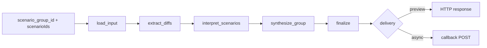
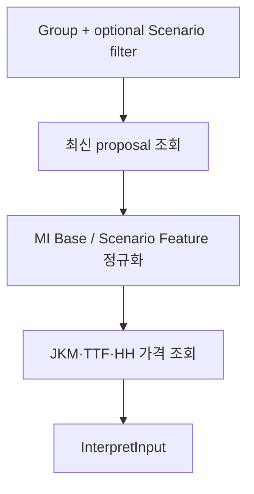
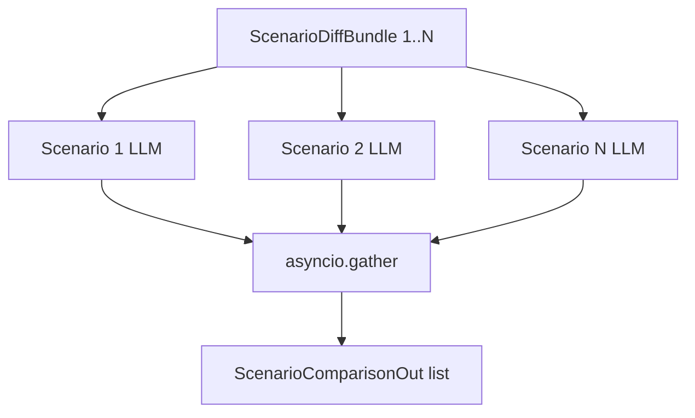
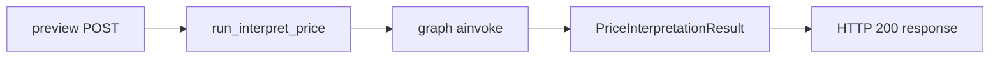
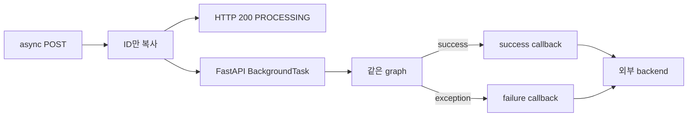

# Interpret Agent Flow

## 범위

이 문서는 현재 Interpret Agent의 유일한 업무 graph인 `interpret_price`를 설명한다.

- Model Parameter proposal과 가격 결과 조회
- MI Base 대비 결정적 차이 계산
- Scenario별 LLM 해석
- Scenario Group 종합
- sync preview 반환과 async callback 전달

Scenario 생성, Model Parameter proposal·confirmation, 수급모델 실행은 범위에서 제외한다. 외부 계약은
[API Spec](02_INTERPRET_AGENT_API_SPEC.md), 읽는 table과 read-only 경계는
[DB Spec](04_INTERPRET_AGENT_DB_SPEC.md)을 참고한다.

## 공통 실행 원칙

- preview와 async endpoint는 같은 cached LangGraph를 사용한다.
- graph state는 `InterpretPriceState`로 검증한다.
- DB 조회는 `ProposalParameterService`를 거쳐 공유 repository를 호출한다.
- LLM보다 먼저 코드가 MI Base 대비 수치 근거를 계산한다.
- Scenario별 LLM 호출은 서로 병렬 실행하고, 모두 끝난 뒤 Group synthesis를 실행한다.
- LLM structured output을 API schema로 변환할 때 사용자 표시 문자열을 일반 텍스트로 정규화한다.
- graph 실행마다 하나의 `TraceContext`를 만들고 모든 LLM 호출에 같은 context와 callback을 전달한다.
- graph는 해석 결과나 진행 상태를 DB에 저장하지 않는다.

## 전체 graph



compiled graph는 `lru_cache(maxsize=1)`로 process 안에서 재사용한다. request마다 state, transaction ID,
session ID, trace context는 새로 만든다.

## 1. 입력 준비

### API state

graph 시작 state는 다음 두 값만 가진다.

```text
scenario_group_id: int
scenario_ids: list[int]
```

빈 `scenario_ids`는 `None` filter로 바꾸어 Group에서 조회되는 proposal 전체를 대상으로 한다.

### `load_input`

`load_input` node는 동기 DB session을 열고 `ProposalParameterService.load_interpret_input()`을 호출한다. 현재
node 자체도 동기 함수이며 Agent 코드에서 `asyncio.to_thread()`를 직접 사용하지 않는다. 실제 sync node 실행
방식은 LangGraph runtime에 따른다.



## 2. proposal을 Feature 시계열로 바꾸는 법

### 대상 proposal 선택

repository는 다음 조건을 만족하는 row를 Scenario별로 모은다.

- 요청 `scenario_group_id`와 일치
- `del_yn='N'`
- `status IN ('PROPOSED', 'CONFIRMED')`
- `proposal_parameters IS NOT NULL`
- `scenarioIds`가 있으면 `scenario_id IN (...)`

Scenario별 `model_param_proposal_id`가 가장 큰 row 하나를 사용한다. `CONFIRMED`이고
`confirmation_parameters`가 non-empty이면 확정값을 사용하고, 그렇지 않으면 `proposal_parameters`를 사용한다.

요청한 Scenario ID 일부가 조회되지 않아도 나머지 row로 계속 실행한다. 전체 조회 결과가 0건일 때만 실패한다.

### 시간 축과 grouping 축

각 proposal parameter의 `modelTarget.slotAxesFieldNames`가 시계열 구조를 정한다.

| 조건 | 정규화 결과 |
| --- | --- |
| 축에 `Month`가 있음 | `monthly`, 기간 `YYYY-MM` |
| 축에 `Month`가 없음 | `annual`, 기간 `YYYY` |
| `Year`가 없음 | 해당 record skip |
| monthly인데 `Month`가 없음 | 해당 record skip |
| `Year`, `Month` 이외 축 | `groupKeys`로 보존 |

`parameterName`은 Feature 이름이 된다. 같은 Feature라도 Country, Region, DegreeDayType, energy source 같은
`groupKeys`가 다르면 별도 series다.

표시용 region은 이름에 `country`, `region`, `continent`, `area`, `zone`, `nation`이 들어간 첫 grouping 축에서
가져온다. 해당 축이 없으면 첫 grouping 축을 사용하고, 나머지 축은 qualifier로 합친다. grouping 축이 없으면
region은 빈 문자열이다.

### MI Base와 Scenario 값

```text
basecaseValue  → MI Base Feature series
proposedValue  → Scenario Feature series
```

여러 Scenario proposal의 `basecaseValue`는 하나의 MI Base store로 병합한다. 같은 Feature·grouping·기간이
여러 proposal에 있으면 현재 구현은 나중에 읽은 값을 덮어쓰며, proposal 간 basecase 일치 여부를 별도로
검증하지 않는다.

Feature `unit`은 현재 빈 문자열이고 `index`도 `None`이다. Feature의 geo label을 JKM·TTF·HH 중 하나에
hard mapping하지 않는다.

## 3. 가격 시계열을 읽는 법

현재 지수와 모델 결과 지역명 mapping은 고정되어 있다.

| 지수 | `prc_rgn_nm` | 값 |
| --- | --- | --- |
| JKM | `East Asia Spot` | MI Base `base_case_prc`, Scenario `user_adj_prc` |
| TTF | `TTF` | MI Base `base_case_prc`, Scenario `user_adj_prc` |
| HH | `HH` | MI Base `base_case_prc`, Scenario `user_adj_prc` |

모든 가격은 `perd_unit_spt_cd='M'`인 월간 결과만 읽고 `perd_key`를 `YYYY-MM`으로 정규화한다.

MI Base는 최신 완료 `MI_BASE` case를 사용한다. Scenario 가격은 Group의 active Scenario가 가진 최신 완료
run을 사용한다.

세 지수 모두 MI Base 결과가 없으면 실패한다. 대상 Scenario별로도 세 지수 가격이 모두 없으면 실패한다. 특정
지수 하나 또는 둘만 없는 경우는 남은 series로 계속 진행한다.

## 4. `extract_diffs`

이 node는 LLM을 호출하지 않는다. Feature와 가격 series를 공통 기간에 맞추고 Scenario별
`ScenarioDiffBundle`을 만든다.

```text
diff = scenario value - MI Base value
```

### Feature matching

Feature는 `(feature 이름, 정렬된 groupKeys)`가 같은 MI Base series와 짝을 이룬다. Scenario에만 있거나
MI Base에만 있어 짝이 없는 series는 diff 결과에 포함하지 않는다.

공통 기간이 하나도 없으면 해당 metric의 자동 요약은 `공통 구간 없음`이 된다. graph 전체를 실패시키지는
않는다.

### Feature 지표

각 Feature series에서 다음 값을 계산한다.

- 평균 차이
- 최대 양수 차이와 최대 음수 차이
- 임계값 이상 차이가 같은 방향으로 연속되는 주요 구간
- 이후 모든 구간이 허용 차이 안에 머무는 최초 수렴 시점
- 극단 편차 anomaly
- 위 값을 합친 자동 요약

Feature와 가격 모두 첫 기간부터 모든 차이가 convergence tolerance 안이면 별도의 "수렴 시작"으로 보지
않고 수렴 시점을 `null`로 둔다. 한 번 tolerance 밖으로 벗어난 뒤 안쪽에 머무르기 시작할 때만 최초
수렴 시점을 기록한다.

현재 고정 Feature 임계값은 다음과 같다.

| Feature | notable | extreme | convergence |
| --- | ---: | ---: | ---: |
| `Temperature` | 2.0 | 6.0 | 1.0 |
| `PowerMix` | 1.0 | 3.0 | 0.5 |

등록되지 않은 Feature는 그 series의 최대 절대 차이에 `0.3`, `0.8`, `0.15`를 곱해 각각 notable,
extreme, convergence 임계값을 만든다. 모든 차이가 0이면 `0.1`, `1.0`, `0.05`를 사용한다.

### 가격 지표

각 지수에서 다음 값을 계산한다.

- MI Base 평균, Scenario 평균, 평균 차이
- 최대 상승과 최대 하락 시점
- 이후 전 기간 차이가 허용 범위에 머무는 수렴 시점
- 음수 가격 anomaly
- MI Base 대비 급변 anomaly

가격 수렴 tolerance는 `1.0 $/MMBtu`와 MI Base 평균 절대값의 5% 중 큰 값이다. 급변은 MI Base 대비
절대 비율이 25% 이상이면서 절대 차이가 `1.0 $/MMBtu` 이상일 때 잡는다. Scenario 가격이 음수면 음수
anomaly로 분류하고 같은 지점의 급변 검사는 생략한다.

### 데이터 품질 flag

Scenario bundle에는 다음 신호를 중복 제거해 남긴다.

- Feature에 extreme diff가 있음
- 가격에 negative price가 있음
- 가격에 spike가 있음

이 flag는 LLM이 해석 신뢰도를 낮추거나 모델 안정성 검증을 권고할 때 사용하는 힌트다. 자동으로 Scenario를
차단하지는 않는다.

## 5. `interpret_scenarios`



대상 Scenario마다 structured-output LLM 호출을 하나 만든 뒤 `asyncio.gather`로 동시에 실행한다. Agent
flow에는 별도 semaphore나 Scenario 개수 제한이 없지만 공통 LLM connector의 LLM·HTTP semaphore는 각 호출에
적용된다. 한 호출이 최종 예외로 끝나면 부분 결과를 callback하거나 저장하지 않고 graph 전체가 실패한다.

LLM 호출 설정은 다음과 같다.

- `ModelPreference.QUALITY`
- node 호출부는 `temperature=0.0`을 전달하지만, 현재 structured-output connector는 이 값을 provider
  request parameter로 전달하지 않는다.
- `max_retries`는 명시하지 않아 공통 connector 기본값 2 사용
- `llm_stream_enabled` 설정 전달
- `llm_reasoning_effort` 설정 전달
- 실행 전체의 `TraceContext` 전달

### LLM에 전달하는 근거

가격 근거는 JKM, TTF, HH 순으로 정렬한다. 각 지수에는 평균·최대 차이·수렴·anomaly·자동 요약이 들어간다.

Feature 근거는 특정 지수 bucket에 넣지 않고 flat list로 전달한다. Feature 이름, geo label, geo level, 단위,
평균 차이, 주요 구간, 수렴, anomaly를 포함한다.

프롬프트는 geo label을 보고 LLM이 시장을 추론하도록 soft hint를 준다.

- JKM은 아시아
- TTF는 유럽
- HH는 미국
- 모호하면 특정 지수에 억지로 귀속하지 않고 시장 공통 영향으로 설명

### structured output

각 호출은 `identity`, `driver_phase`, `price_character`, `summary`를 반환한다. 프롬프트는 MI Base 대비
관점, 일반 텍스트, 정중한 문체, 근거 수치 보존, 글자 수를 요구한다.

Pydantic API schema로 변환할 때 Markdown·HTML 표현 문법을 제거한다. 글자 수와 문체는 validator가 아니라
프롬프트로만 통제한다.

## 6. `synthesize_group`

Scenario별 호출이 모두 끝난 뒤 Group synthesis LLM을 한 번 호출한다.

이 호출에 전달하는 Scenario별 brief는 다음 값만 가진다.

- `scenario_id`
- `identity`
- `price_character`
- `data_quality_signals`

`driver_phase`와 `summary`, 원래 diff metric 전체는 Group synthesis 입력에 직접 포함하지 않는다. 종합 결과는
`overall_message` 한 문자열이고 API schema에서 일반 텍스트로 정규화한다.

## 7. `finalize`

finalize는 LLM을 호출하거나 DB를 조회하지 않는다. 다음 값을 조립해 `PriceInterpretationResult`를 만든다.

- meta: Group ID, `MI Base`, Feature 목록, 고정 지수 목록, 전체 표시 기간, 단위
- scenarios: Scenario별 해석
- synthesis: Group 종합

`meta.indices`는 실제 price diff bundle에 존재하는 지수 목록이 아니라 고정 `INDEX_ORDER` 전체다.

## 8. Sync와 async delivery

### Preview



`run_interpret_price`가 result를 찾지 못하면 `UNKNOWN_ERROR`를 올린다. graph 또는 DB·LLM 예외는 FastAPI 공통
exception handler가 HTTP 오류로 변환한다.

### Async



async prepare에는 DB 사전 검증이 없다. callback success body에는 Scenario별 일반 텍스트만 들어가고 Group
synthesis는 들어가지 않는다.

callback 전송 오류는 graph 오류와 분리해 로그에 남긴다. callback connector는 401에 한해 token refresh 후
즉시 한 번 재요청한다. 전송 결과를 기록하는 DB row, 일반 오류 retry queue, polling, replay는 없다.
`skip_callback=true`이면 connector가 외부 HTTP 요청 없이 반환하며 결과를 별도 저장하지도 않는다.

## 9. Tracing과 startup

`run_interpret_price`는 실행마다 새 transaction ID와 다음 trace 정보를 만든다.

| 값 | 현재 source |
| --- | --- |
| `app_identifier` | `agents.interpret_agent.aip_app_id` |
| `agent_name` | `interpret_agent` |
| `session_id` | `scenario_group_id` 문자열 |

같은 context를 LangGraph config, runtime context, MLflow context에 사용한다. Scenario별 LLM과 Group synthesis
LLM에도 이 context와 graph callback handler를 전달한다.

app lifespan은 logging, Interpret Agent MLflow profile, ORM/DB schema validation, callback OAuth2 token
pre-fetch를 수행한다. token pre-fetch가 실패해도 startup은 계속한다.

## 실패와 복구 경계

- Agent graph에는 node 단위 retry나 fallback 분기가 없다. 공통 LLM connector는 기본 `max_retries=2`로
  non-stream SDK retry 또는 stream 전체 요청 retry를 적용할 수 있다.
- Scenario별 LLM 하나가 실패하면 Group synthesis와 finalize를 실행하지 않는다.
- preview는 같은 HTTP 요청에서 실패한다.
- async는 failure callback을 시도한다.
- callback 전달까지 실패하면 로그 외에 조회 가능한 결과가 없다.
- process가 중단되면 BackgroundTask를 DB operation에서 재개하지 않는다.
- 같은 async 요청을 다시 보내는 중복 방지나 idempotency key가 없다.

## 변경 시 함께 확인할 것

| 변경 대상 | 함께 확인할 영역 |
| --- | --- |
| request·response schema | preview, accepted response, callback type 차이, OpenAPI route isolation |
| proposal JSON parsing | Model Parameter proposal·confirmation 계약, annual/monthly 축, MI Base 병합 |
| 가격 SQL | JKM·TTF·HH mapping, 완료 run 선택, monthly period, read-only 보장 |
| diff threshold | prompt evidence, data quality flag, deterministic unit test |
| Scenario prompt | structured output, plain-text sanitizer, 글자 수 smoke warning |
| Group prompt | 전달 brief 범위, `overallMessage`, callback 미포함 경계 |
| callback | URL 설정, OAuth2, failure body, 실제 HTTP 200 접수 계약 |
| tracing | Interpret agent profile, shared TraceContext, graph callback 전달 |
