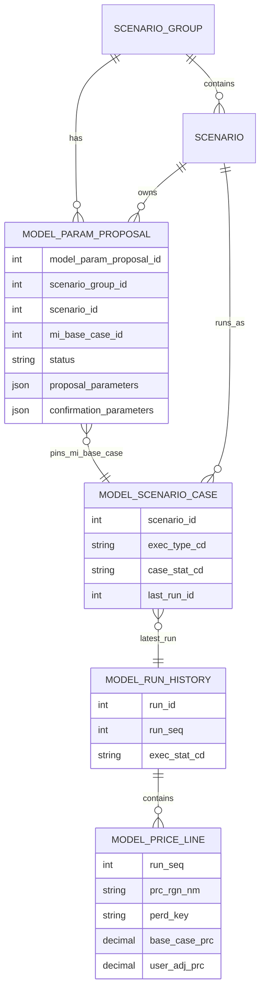

# Interpret Agent DB Spec

## 기준

이 문서는 Interpret Agent가 가격 해석 입력을 만들기 위해 읽는 table과 실제 조회 조건을 설명한다.

Interpret Agent 업무 flow는 DB read-only다. proposal과 가격 결과를 읽지만 interpretation 결과, 작업 상태,
callback 상태를 저장하지 않는다.

```text
flow node
  → apps/agents/interpret_agent/persistence/proposal_parameter_service.py
  → apps/persistence/model_parameter/repository.py
  → tmm_mi_model_param_proposal_m ORM

flow node
  → apps/agents/interpret_agent/persistence/proposal_parameter_service.py
  → apps/persistence/model_result/repository.py
  → 모델 실행 결과 raw SELECT
```

Model Parameter proposal ORM의 정본은 `apps/persistence/model_parameter/models.py`다. 모델 실행 결과 세 table은
이 저장소 ORM·migration 관리 대상이 아니며 `apps/persistence/model_result/repository.py`의 read-only SQL이
Interpret 관점의 조회 정본이다.

## 관계 개요



Diagram의 논리 이름과 실제 table은 다음과 같다.

| 논리 이름 | 실제 table |
| --- | --- |
| `MODEL_PARAM_PROPOSAL` | `tmm_mi_model_param_proposal_m` |
| `SCENARIO_GROUP` | `tmm_mi_scenario_group_m` |
| `SCENARIO` | `tmm_mi_scenario_m` |
| `MODEL_SCENARIO_CASE` | `tmd_mdl_scnrcasem` |
| `MODEL_RUN_HISTORY` | `tmd_mdl_scnrcaseh` |
| `MODEL_PRICE_LINE` | `tmd_mdl_scnrcaseprcl` |

## 1. Model Parameter proposal

### `tmm_mi_model_param_proposal_m`

Interpret Agent가 Feature 입력을 읽는 table이다.

| 컬럼 | Interpret에서의 역할 |
| --- | --- |
| `model_param_proposal_id` | Scenario별 최신 row 선택 순서 |
| `scenario_id` | 해석 대상 Scenario 식별자 |
| `scenario_group_id` | API path의 Group filter |
| `mi_event_id` | 조회 결과에는 포함되지만 Interpret 정규화에는 사용하지 않음 |
| `mi_base_case_id` | Model Parameter가 제안 시점에 고정한 MI Base 가격 case |
| `status` | `PROPOSED`, `CONFIRMED`만 읽음 |
| `proposal_parameters` | 기본 Feature 입력 JSON |
| `confirmation_parameters` | 확정 후 사용자가 정한 최종 Feature 입력 JSON |
| `del_yn` | `N`인 row만 읽음 |

`PROCESSING`, `FAILED`, soft-deleted row는 대상이 아니다.

### 조회 조건

의미상 query는 다음과 같다.

```sql
SELECT *
FROM tmm_mi_model_param_proposal_m
WHERE scenario_group_id = :scenario_group_id
  AND del_yn = 'N'
  AND status IN ('PROPOSED', 'CONFIRMED')
  AND proposal_parameters IS NOT NULL
  AND scenario_id IN (:scenario_ids) -- filter가 있을 때만
ORDER BY scenario_id, model_param_proposal_id;
```

실제 코드는 SQLAlchemy `select()`를 사용한다. Scenario별 정렬 결과의 마지막 row를 남겨 가장 큰
`model_param_proposal_id` 한 건을 최신으로 취급한다.

query는 `proposal_parameters IS NOT NULL`만 검사한다. JSON 빈 배열을 DB 조건에서 차단하지는 않는다.

### CONFIRMED 값 우선순위

최신 row가 `CONFIRMED`이고 `confirmation_parameters`가 non-empty이면 다음 값을 Feature source로 사용한다.

```text
confirmation_parameters
```

그 외에는 다음 값으로 fallback한다.

```text
proposal_parameters
```

이 규칙은 확정 시 사용자가 수정한 입력과 이후 가격 모델 실행 결과의 비교 기준을 맞추기 위한 것이다.

### Scenario ID filter 경계

`scenarioIds` filter는 요청 전체에 대한 존재·소속 검증이 아니다.

```text
요청: [101, 102, 999]
조회된 최신 proposal: 101, 102
실제 해석 대상: 101, 102
```

999가 없다는 이유만으로 실패하지 않는다. 해당 조건에서 proposal 조회가 0건일 때만
`DATA_RETRIEVAL_FAILED`다.

proposal의 `mi_event_id`는 nullable이며 Interpret loader는 이 값이 없어도 정상 처리한다. 다중 Event
Scenario Group의 대표 Event ID가 null인 경우를 지원한다.

반면 `model_param_proposal_id`와 `mi_base_case_id`는 Interpret `v4.1.7` 입력 snapshot의 필수 증적이다.
두 값은 양수여야 하고, 한 요청에서 선택된 모든 proposal의 `mi_base_case_id`가 같아야 한다. 이 조건을 만족하지
않으면 전역 최신 MI Base로 fallback하지 않고 `DATA_RETRIEVAL_FAILED`로 중단한다.

## 2. proposal JSON 정규화

### 사용 필드

`proposal_parameters` 또는 선택된 `confirmation_parameters`의 각 parameter에서 다음 필드를 읽는다.

| JSON path | 역할 |
| --- | --- |
| `parameterName` | Feature 이름 |
| `modelTarget.slotAxesFieldNames` | 시간·grouping 축 정의 |
| `values[*].Year` | 필수 기간 연도 |
| `values[*].Month` | monthly일 때 필수 월 |
| `values[*].basecaseValue` | MI Base 입력 |
| `values[*].proposedValue` | Scenario 입력 |
| `values[*].<other axes>` | Country·Region·energy source 등 grouping 값 |

### 정규화 예시

```json
{
  "parameterName": "Temperature",
  "modelTarget": {
    "slotAxesFieldNames": ["Country", "Year", "Month"]
  },
  "values": [
    {
      "Country": "South Korea",
      "Year": 2027,
      "Month": 1,
      "basecaseValue": 3.5,
      "proposedValue": 1.0
    }
  ]
}
```

위 record는 다음 두 series의 `2027-01` 값이 된다.

```text
MI Base / Temperature / Country=South Korea → 3.5
Scenario / Temperature / Country=South Korea → 1.0
```

`basecaseValue`나 `proposedValue`가 null이면 해당 store에는 값을 넣지 않는다. `Year` 또는 monthly record의
`Month`가 없으면 그 record 전체를 skip한다. 그 결과 빈 Feature series가 생겨도 DB loader가 별도 오류를
내지는 않는다.

### MI Base 병합

모든 target proposal의 `basecaseValue`를 하나의 MI Base Feature collection에 합친다. key는 다음 세 요소다.

```text
parameterName + granularity + sorted(groupKeys)
```

같은 key와 기간이 여러 proposal에 반복될 때 값이 같으면 병합한다. 값이 하나라도 다르면 proposal snapshot의
MI Base 입력이 모순되므로 `DATA_RETRIEVAL_FAILED`로 중단한다.

## 3. 모델 가격 결과

### ORM을 사용하지 않는 이유

다음 table은 이 저장소의 ORM·migration 대상이 아니다.

- `tmd_mdl_scnrcasem`
- `tmd_mdl_scnrcaseh`
- `tmd_mdl_scnrcaseprcl`

Interpret Agent는 SQLAlchemy `text()` raw SQL로 SELECT만 수행한다. table을 생성·수정하거나 startup ORM
schema validation에 추가하지 않는다.

### 지수 mapping

| API 지수 | `tmd_mdl_scnrcaseprcl.prc_rgn_nm` |
| --- | --- |
| JKM | `East Asia Spot` |
| TTF | `TTF` |
| HH | `HH` |

모든 query는 다음 공통 조건을 적용한다.

```text
perd_unit_spt_cd = 'M'
price line del_yn = 'N'
ORDER BY period
```

### MI Base 가격

MI Base query는 proposal snapshot의 정확한 `:mi_base_case_id`를 사용한다. `MAX(case_id)`로 전역 최신 Base를
다시 선택하지 않는다. 대상 case는 다음 조건을 모두 만족해야 한다.

- `exec_type_cd='MI_BASE'`
- case `del_yn='N'`
- `case_stat_cd='COMPLETED'`
- 연결된 history `exec_stat_cd='COMPLETED'`
- history `del_yn='N'`

선택한 case의 `last_run_id`와 history의 `run_id`를 연결하고 price line의 `base_case_prc`, `case_id`, `run_id`,
`run_seq`를 읽는다.

### Scenario 가격

Scenario query는 `tmm_mi_scenario_m`에서 다음 조건의 ID를 먼저 사용한다.

```text
scenario_group_id = :scenario_group_id
del_yn = 'N'
```

각 Scenario에 대해 완료 상태인 case·history 중 가장 큰 `run_seq`를 선택하고 `base_case_prc`와
`user_adj_prc`, `case_id`, `run_id`, `run_seq`를 읽는다. 반환 row는 Scenario ID와 기간 순으로 정렬한 뒤
Scenario별 dictionary로 묶는다.

모델 결과 table에는 `model_param_proposal_id`와 Scenario run을 직접 잇는 FK가 없다. Interpret는 선택한
Scenario run의 각 `base_case_prc`가 proposal에 pinned된 MI Base의 같은 월·지수 가격과 일치하는지 검증해
서로 다른 Base snapshot의 혼합을 차단하고, 실제 사용한 Scenario `run_seq`를 메모리 입력과 로그에 남긴다.

proposal에서 선택된 target Scenario가 Group의 active Scenario가 아니거나 완료 가격 run이 없으면 그 ID의
가격 collection은 비게 된다.

### 기간과 값 변환

`perd_key`의 앞 여섯 자리가 숫자면 `YYYY-MM`으로 바꾼다. null·빈 기간과 null 가격은 반환 series에서
제외하고 `Decimal` 가격은 float로 변환한다. 서비스는 변환된 축이 유효한 월, 오름차순, 중복 없음,
월 단위 연속이라는 조건을 추가로 검증한다. MI Base 지수끼리, 그리고 각 Scenario와 MI Base의 축은 시작·종료·
월 개수까지 완전히 같아야 한다. 실제 모델 축이 `2026-04`~`2030-12`이면 57개월을 그대로 보존한다.

## 4. 입력 완전성 판정

`ProposalParameterService`는 다음 조건을 명시적으로 검사한다.

| 조건 | 결과 |
| --- | --- |
| proposal 조회 0건 | `DATA_RETRIEVAL_FAILED` |
| proposal ID·pinned MI Base ID 누락/invalid 또는 mixed Base | `DATA_RETRIEVAL_FAILED` |
| JKM·TTF·HH MI Base series가 모두 없음 | `DATA_RETRIEVAL_FAILED` |
| target Scenario 하나라도 JKM·TTF·HH series가 모두 없음 | `DATA_RETRIEVAL_FAILED` |
| 가격 월 축 중복·누락·역순·불일치 | `DATA_RETRIEVAL_FAILED` |
| Scenario `base_case_prc`와 pinned MI Base 값 불일치 | `DATA_RETRIEVAL_FAILED` |
| Base 또는 Scenario에 여러 `run_seq` 혼합 | `DATA_RETRIEVAL_FAILED` |
| 특정 지수만 없음 | 남은 지수로 계속 실행 |
| Feature가 비어 있음 | 가격이 있으면 계속 실행 가능 |
| Feature가 MI Base와 공통 기간이 없음 | `공통 구간 없음` metric, 계속 실행 |

모든 지수·모든 Feature·모든 요청 Scenario가 완전해야 한다는 strict 계약은 아니다. API consumer와 품질 검사는
실제 반환 Scenario ID와 해석 근거 범위를 확인해야 한다.

## 5. Interpret 결과 persistence

Interpret Agent는 다음 table이나 row를 만들지 않는다.

- interpretation master/detail
- Scenario Group operation
- operation event 또는 SSE history
- preview snapshot
- callback delivery status
- 해석 성공·실패 상태

graph의 최종 `PriceInterpretationResult`는 메모리 안에만 있다.

```text
preview → HTTP response로 반환 후 별도 저장 없음
async   → callback payload로 변환 후 별도 저장 없음
```

callback이 실패해도 DB update나 retry record가 없다. callback connector가 성공했는지 여부는 현재 server log로만
확인한다.

## 6. Session과 transaction 경계

입력 load 한 번마다 sync DB session 하나를 열고 proposal과 가격 SELECT를 차례로 수행한 뒤 `finally`에서
session을 닫는다.

- 명시적 `commit()` 없음
- `INSERT`, `UPDATE`, `DELETE` 없음
- row lock 또는 `SELECT ... FOR UPDATE` 없음
- 긴 LLM 호출 전에 session close
- interpretation 실행 중 DB transaction 유지 없음

따라서 Interpret Agent는 source data를 변경하지 않는다. proposal이 pin한 MI Base case와 가격 기준값 검증은
snapshot 혼합을 막지만, proposal과 Scenario run 사이의 직접 FK나 명시적 row lock은 없다. proposal 조회와
가격 조회 사이에 최신 Scenario run이 바뀌는 경쟁 조건까지 DB transaction으로 고정하는 계약은 아니다.

## 7. Startup schema validation 경계

`interpret.py` lifespan은 `validate_schema(..., APPLICATION_TABLES)`를 호출한다. 현재
`APPLICATION_TABLES`에는 Scenario·Event·Signpost 등 공통 ORM table이 들어 있지만 다음 Interpret 입력
table은 포함되지 않는다.

- `tmm_mi_model_param_proposal_m`
- `tmd_mdl_scnrcasem`
- `tmd_mdl_scnrcaseh`
- `tmd_mdl_scnrcaseprcl`

따라서 startup schema validation 성공만으로 Interpret 입력 table과 column이 모두 준비되었다고 볼 수 없다.
실제 preview 또는 async graph의 read path로 추가 확인해야 한다.

## 상태 전이

Interpret Agent 자체 DB 상태 전이는 없다.

| 시점 | DB write | 메모리·외부 결과 |
| --- | --- | --- |
| async 접수 | 없음 | BackgroundTask 등록, HTTP `PROCESSING` body |
| graph 성공 | 없음 | `PriceInterpretationResult` 생성 |
| preview 완료 | 없음 | HTTP response |
| async 완료 | 없음 | success callback 시도 |
| graph 실패 | 없음 | preview 오류 또는 failure callback 시도 |
| callback 실패 | 없음 | server log |

## DB 변경 체크리스트

- proposal status나 JSON shape 변경 시 latest row·CONFIRMED 우선 규칙을 함께 검토한다.
- proposal의 `mi_base_case_id` pin과 Scenario run의 `base_case_prc` 정합성 guard를 유지한다.
- `slotAxesFieldNames` 변경 시 monthly/annual 기간과 grouping key 정규화를 검토한다.
- 새 가격 지수를 추가하면 `INDEX_ORDER`, `INDEX_PRICE_REGION`, SQL query, meta, prompt, smoke test를 함께 맞춘다.
- 모델 결과 table 구조는 외부 관리 대상이므로 raw SQL과 실제 schema를 별도로 검증한다.
- read-only 원칙을 유지하고 Interpret 결과 저장이 필요해지면 소유 domain·migration·retention을 먼저 정의한다.
- 결과 저장을 추가한다면 async 상태 조회, callback retry, idempotency 계약도 함께 설계한다.
- startup validation 대상과 실제 runtime 입력 table의 차이를 릴리즈 검증에 포함한다.
