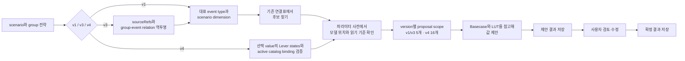
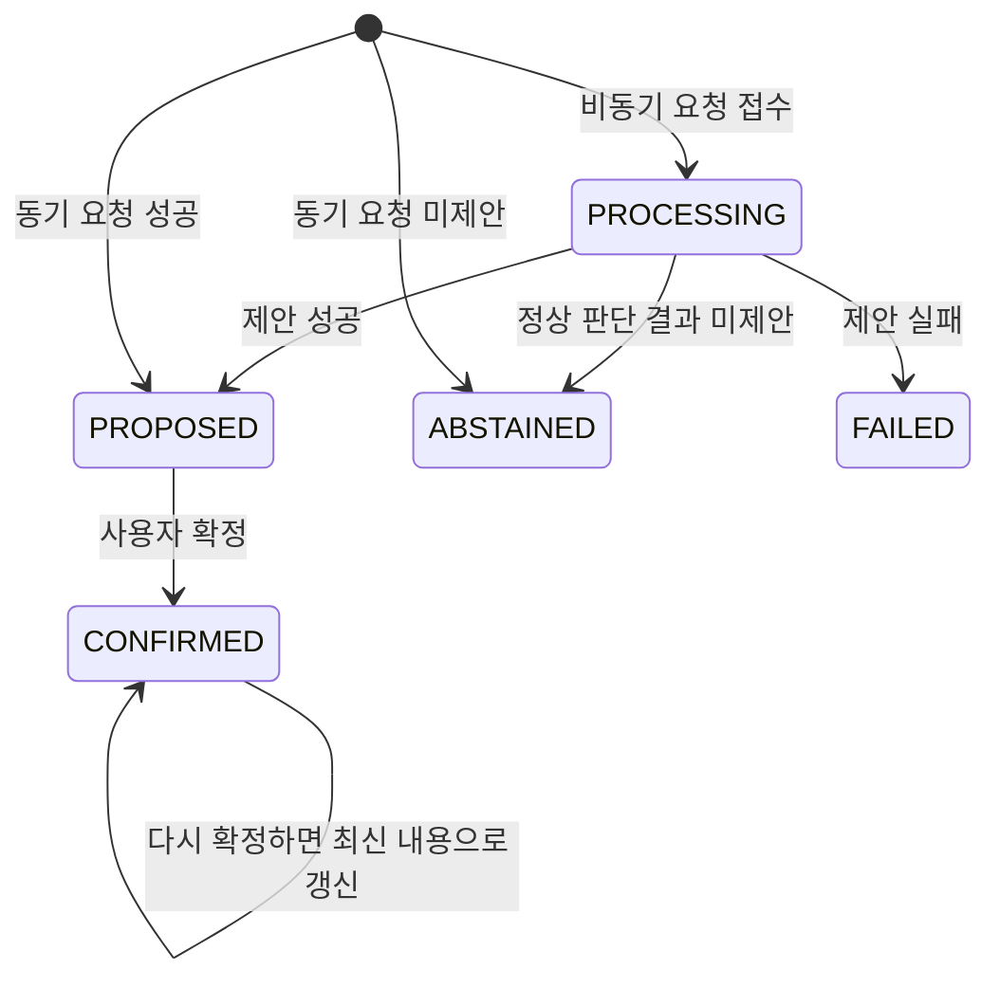

# Model Parameter Agent DB Spec

> 현재 핵심 Skill은 v4 multi-event 경로만 검증한다. v1/v3 table·mapping 설명은 기존 row와 호환
> 코드를 해석하기 위한 참고이며 v4 rollout target이나 fallback이 아니다.

## 기준

| 질문 | 답 |
|---|---|
| DB에는 무엇이 있나? | 파라미터 기준, legacy 연결 규칙, v3 event lineage, v4 Lever catalog와 제안·확정 결과가 있다. |
| Agent는 어떻게 사용하나? | 파라미터·scenario lineage 기준은 읽고, 제안 결과표에는 처리 결과를 저장한다. |
| 현재 외부개발 DB와 Agent 제안 범위는 몇 개인가? | master 24개 중 활성 16개이고, v4.1 executable 고유 Parameter와 Agent v4 extend16 신규 proposal 허용은 모두 16개다. v1/v3는 기존 5개다. |
| 이 문서의 범위는 무엇인가? | 기능 이해에 필요한 관계와 주요 데이터 모양을 설명한다. |

> 이 문서의 개수는 체크인된 v4 master·Lever canonical과 v1/v3 canonical의 `dimension_mappings` 129행을 센 저장소 기준선이다. live DB 적용 상태를 뜻하지 않으며 운영 판정은 runner의 preflight와 DB read-back으로 확인한다. 2026-08-13 snapshot의 128행은 변경 전 증적이다.

> v1/v3 신규 proposal은 `GDP`, `PMI`, `PowerMix`, `Temperature`, `LiqUtilAdjustment` 이름 allow-list를
> 유지한다. v4는 ID `{4, 6, 7, 8, 11, 12, 13, 14, 15, 16, 17, 18, 20, 22, 23, 24}`과 name/target이
> capability contract와 일치해야 한다.
> 정상 0032 canonical DB에서는 이 응용 계층 확장으로 master·mapping, Lever catalog/checksum, canonical/workbook을 변경하지 않는다.

## 1. 핵심 테이블을 한 문장으로 이해하기

| 테이블 | 역할 | Agent 사용 방식 |
|---|---|---|
| `tmm_mi_model_param_m` | “어떤 파라미터를 어느 모델 위치에 넣는가?”를 정한 파라미터 사전 | 읽기 |
| `tmm_mi_model_param_dimension_map` | “이 사건과 영향 항목에는 어떤 파라미터를 검토하는가?”를 정한 연결표 | 읽기 |
| `tmm_mi_model_impact_lever_m` | v4 dimension이 참조하는 Lever와 parameter binding·catalog version을 정한 catalog | 읽기 |
| `tmm_mi_scenario_m` | proposal 대상 scenario와 선택된 dimension value | 읽기 |
| `tmm_mi_scenario_group_m` | v1/v3/v4 전략, dimension 정의, v4 catalog checksum | 읽기 |
| `tmm_mi_scenario_group_event_m` | v3/v4 그룹의 ordered event 관계 | 읽기 |
| `tmm_mi_dimension_value_mapping_m` | v3 자유 value의 source projection, 승인 상태와 version | 읽기 |
| `tmm_mi_model_param_proposal_m` | Agent의 제안과 사용자의 최종 확정을 보관하는 작업 결과표 | 읽기·쓰기 |
| `tmd_mdl_scnrcasem` | 현재 활성 MI Base와 `last_run_id` | 읽기 |
| `tmd_mdl_scnrcaseh` | MI Base 실행 이력의 `run_id`·`run_seq` | 읽기 |
| `tcm_filel` | MI Base·최신 실행에 연결된 파일 metadata | 읽기 |

업무 흐름으로 보면 다음과 같다.



연결표는 파라미터 사전의 항목을 가리킨다. 결과표는 파라미터 사전과 직접 연결되지 않고, 당시 이름과 값을 JSON 이력으로 보관한다.

v3 context 테이블은 동적 composite dimension의 lineage를 기존 연결표가 이해하는 원본 event type·dimension으로 되돌리는 데 사용한다. v4는 `tmm_mi_model_param_dimension_map`, Event Type, 과거 `lever_mappings` 계열을 후보 소스나 fallback으로 사용하지 않는다.

## 2. 파라미터 사전: 무엇을 조정할지 알려주는 표

`tmm_mi_model_param_m`에는 파라미터의 이름, 설명, 값을 넣을 모델 파일·시트·테이블, Basecase를 읽는 기준이 있다.
Agent는 live DB에서 사용 중이며 삭제되지 않은 항목만 읽는다.
0032 canonical fixture 21개 중 활성 기준선은 다음 14개다. 앞의 10개는 LUT-backed이고 뒤의 4개는 Basecase-only다.
아래 표는 canonical과 resource capability 기준선을 설명한다. 표의 활성 상태와 별개로 신규 proposal 허용 여부는 위 runtime allow-list를 따르며, 실제 DB 적용 여부는 read-back으로 확인한다.

| 파라미터 | 적용 대상 | 주요 좌표 | Basecase 읽기 방식 |
|---|---|---|---|
| `GDP` | Demand / GDPPopulationAdjustment | 국가, 연도 | 행마다 정해진 열을 읽음 |
| `PMI` | Demand / PMIAdjustment | 국가, 연도, 월 | 행마다 정해진 열을 읽음 |
| `PowerMix` | Demand / PowerMixAdjustment | 국가, 연도, 에너지원 | 행마다 정해진 열을 읽음 |
| `Temperature` | Demand / WeatherAdjustment | 국가, 연도, 월 | 행마다 정해진 열을 읽음 |
| `Population` | Demand / GDPPopulationAdjustment | 국가, 연도 | 행마다 정해진 열을 읽음 |
| `HurricaneIntensity` | Supply / {USA}Hurricanes | 연도, 월 | 행마다 정해진 열을 읽음 |
| `LiqProdAdjustment` | Supply / LiqProdAdjustment | 국가, LNG 플랜트·트레인, 연도, 월 | 가로로 펼쳐진 월별 값을 읽음 |
| `LiqUtilAdjustment` | Supply / LiqUtilAdjustment | 국가, LNG 플랜트·트레인, 연도, 월 | 가로로 펼쳐진 월별 값을 읽음 |
| `PipelineAdjustment` | Supply / PipelineAdjustment | 파이프라인, From·To 국가, 연도, 월 | 행마다 정해진 열을 읽음 |
| `SupplyDisruption` | Supply / ProductionAdjustment | 국가, 연도, 월 | 행마다 정해진 열을 읽음 |
| `User-Adjusted Gas Demand` | Demand / DemandOutputOverwrite | 국가, 연도, 월, 수요 하위부문 | Basecase exact slot만 사용 |
| `RegasAdjustment` | Supply / RegasAdjustment | 지역 계층, 재기화 Plant, 연도, 월 | Basecase exact slot만 사용 |
| `PNG Contract Volume` | Trade / MidstreamContractInput | 연도, From·To 국가 | Basecase exact slot만 사용 |
| `ShippingCost` | Trade / ShippingCostInput | 연도 | Basecase exact slot만 사용 |

`RemainingUnrestrictedAmount`와 `VolumeCancelled`는 0030에서 master 비활성이고 active v4 binding도 없다.
과거 Basecase 좌표가 있더라도 future restriction/취소 입력 계약과 forward canonical release 전에는 executable
capability로 보지 않는다.

“주요 좌표”는 값을 구별하는 주소다. 예를 들어 `GDP`의 `대한민국 / 2027년`과 `대한민국 / 2028년`은 서로 다른 입력 위치다.
Basecase와 LUT를 읽는 자세한 기준은 [Basecase/LUT 문서](05_MODEL_PARAMETER_AGENT_BASECASE_LUT_PARSING.md)를 참고한다.

이 표의 `parameter_hint` 컬럼은 Excel을 파싱하는 설정이 아니라, LLM에 “이 값의 의미·단위·스케일과 제안 시 제약”을 알려 주는 설명이다. runtime allow-list를 통과한 후보의 routing, slot 선택, value 제안 단계에 같은 파라미터 설명으로 들어간다.

### 2.1 신규 파라미터 DB 정합성 게이트

신규 제안 파라미터는 DB 이름이나 `use_yn`만 추가해서는 안 된다. sibling mgmt의 versioned DML과 Agent
canonical에서 다음 필드를 파라미터별로 대조하고, capability·workbook contract·실제 최종 workbook과 같은
값인지 확인한다.

| 구분 | 반드시 일치시킬 내용 |
|---|---|
| 식별·활성 | `model_param_id`, `parameter_name`, `use_yn`, `del_yn` |
| 최종 쓰기 대상 | `model_file`, `model_sheet`, `model_table` |
| 값 의미 | `parameter_hint`, 단위, 절대값/증감값 의미, 최소·최대 범위 |
| exact 좌표 | `semantic_axes`, capability `exact_axes`, write-target key/value field |
| 기준값 읽기 | `basecase_read_mode`, 모든 `basecase_*` 컬럼, reference source 또는 LUT adapter |
| v4 후보 경로 | active Impact Lever ID/code, binding role, applicability, catalog version/checksum |

DB의 `basecase_*`는 기준값을 **읽는 위치**, `model_*`는 결과를 **쓰는 위치**다. 두 위치가 다를 수 있으므로
시트명 유사성으로 합치거나 과거 이름을 대입하지 않는다. 현재 대표 예시는 다음과 같다.

| Parameter | 기준값 원본 | 최종 쓰기 대상 | 금지되는 해석 |
|---|---|---|---|
| `PipelineAdjustment` | Supply `BCPipeline` | Supply `PipelineAdjustment` / `table1` | From/To 축을 생략하거나 원본 시트에 쓰는 것으로 해석 |
| `SupplyDisruption` | Supply `BCProduction` + `SeasonalityLogic.csv` | Supply `ProductionAdjustment` / `table2` | 과거 `VolumeAdjustment`를 현재 target 별칭으로 사용 |

이 중 하나라도 DML·canonical·계약·실제 workbook과 다르면 신규 proposal scope에 넣지 않는다. DML만 준비한
단계에서는 versioned DML 최종값과 canonical diff를 증적으로 남기고, 실제 환경 적용이 승인된 release에서는
적용 후 DB read-back까지 완료해야 한다. 자세한 전체 매트릭스와 완료 조건은
[파라미터 추가 가이드](06_MODEL_PARAMETER_AGENT_PARAMETER_ADDITION_GUIDE.md)를 따른다.

## 3. Legacy 연결표: v1/v3에서 어떤 파라미터를 검토할지 알려주는 표

`tmm_mi_model_param_dimension_map`은 v1/v3의 사건 유형과 영향 항목을 파라미터에 연결한다. v4는 이 테이블을 조회하지 않는다.
체크인 v1/v3 canonical의 목표 연결은 129건이며 모두 `use_yn='Y'`, `del_yn='N'`이다. 2026-08-13 v4 적용 전 snapshot은 128건·25/2/55/46으로 보존하고, 129행 기준선은 승인된 13개 direct/routing 복구·Population routing 1개 추가·comment 3개 현행화만 반영한다. master, Impact Lever, Scenario/proposal, DB schema는 이 mapping rollout의 DML 대상이 아니다. live DB가 이 상태인지는 mapping runner의 검증과 적용 후 read-back으로 판정한다.
연결 방법인 `mapping_method`는 다음 네 종류다.

중요하게도 이 테이블은 **어떤 파라미터에 raw mapping으로 도달할지**를 정한다. 최종 신규 proposal 후보는 여기서 도달한 항목과 runtime allow-list의 교집합이다. Excel의 몇 행·몇 열을 읽을지는 이 테이블이 아니라 앞 절의 `tmm_mi_model_param_m` Basecase 설정이 정하고, LUT CSV의 열과 계산 방식은 `config.yaml`이 정한다.

| 방법 | canonical 기준선 건수 | 설명 | raw mapping 후보가 되나요? |
|---|---:|---|---|
| `direct` | 35 | 이 영향 항목이면 정해진 파라미터를 바로 사용 | 예 |
| `routing` | 6 | 가능한 파라미터가 여럿일 수 있어 상황에 맞는 항목을 선택 | 예 |
| `indirect` | 55 | 값을 직접 바꾸지는 않지만 판단에 참고할 배경 정보 | 아니요 |
| `na` | 33 | 모델 입력 파라미터와 직접 연결되지 않는 항목 | 아니요 |

DB migration 정본은 sibling `skmip-mi-agent-mgmt`다. 외부개발 DB의 신규 Scenario Group용 active catalog는
`v4.1`, checksum은 `7f4ef0b7aa60efb550b9175654fd82350f0c293debf880a9180e7e935db54d69`이다.
이 Agent release는 master를 변경하지 않고 기존 v4.0 옆에 같은 Lever Full Set 21행과 conditional binding을
추가하므로 mgmt 0036 migration과 exact match해야 한다.
기존 이름의 두 canonical과 `apply_model_parameter_v4.py`/정적 SQL은 0029 역사 릴리스 증적으로 보존하며 0030
적용에 재사용하지 않는다. v1/v3 mapping은 `scripts/model_parameter/model-parameter-canonical-v1.json` 중
`dimension_mappings`만 정본으로 사용한다. parameter 0030 successor에 상속된 128행 mapping payload는 0029
역사 재현용이며 runtime mapping authority가 아니다. 0030은 기존 Lever ID 1~16을 `v0/inactive`, ID 17~34를
`v4/active`로 보존하므로 ORM과 조회는 `(catalog_version, lever_code)`를 identity로 사용한다.

정적 SQL `scripts/model_parameter/apply_model_parameter_canonical_v4.sql`은 격리된 MySQL 8.0에서 첫 적용, 두 번째 semantic idempotency, 강제 precondition 실패 rollback과 post-invariant 실패 rollback을 검증한다. 격리 재검증기는 `tests/manual/model_parameter_agent/verify_model_parameter_v4_sql_mysql.py`다.

`direct`는 연결표가 가리키는 항목이 곧 raw 후보다. 같은 영향 항목에 `routing` 후보가 여러 개면 v1/v3
allow-list 필터 후 LLM이 적합한 후보를 고르지만, 연결표에 없는 새 파라미터를 만들 수는 없다. v4 binding은
Step1.5 LLM routing 없이 deterministic candidate로 구성한다.

연결표의 `comment` 컬럼도 prompt 지침으로 사용한다. `direct`·`routing`이면 `mapping_comment`라는 이름으로 “이 dimension과 파라미터를 연결하고 값을 산정할 때 어떤 근거를 우선할지” 알려 준다. `indirect`이면 후보 선택 문구가 아니라 보조정보의 `reason`으로 들어가며, `na` comment는 prompt에 넣지 않는다. 단계별 JSON 위치와 실제 GDP 예시는 [Flow 문서의 parameter hint와 mapping comment 설명](04_MODEL_PARAMETER_AGENT_FLOW.md#parameter-hint와-mapping-comment)을 참고한다.

후보 선정부터 Basecase/LUT 파싱까지 설정이 이어지는 순서는 [Basecase/LUT 문서의 설정 역할 구분](05_MODEL_PARAMETER_AGENT_BASECASE_LUT_PARSING.md#21-db와-configyaml은-각각-무엇을-정하나)에서 확인할 수 있다.

### 3.1 v1과 v3가 같은 연결표를 사용하는 방법

v1은 group의 대표 `event_type_l2_id`와 scenario의 dimension key를 연결표의 `(event_type_l2_id, dimension_key)`에 직접 대입한다. v3 `multi_event_composite_dimensions`는 다음 순서로 원본 key를 복원한다.

1. `tmm_mi_scenario_group_event_m`을 `display_order` 순서로 읽고 그룹에 속한 event ID, event type L2 ID와 scenario dimension template ID를 확보한다.
2. `tmm_mi_scenario_group_m.dimension_definitions`의 각 composite dimension에서 `source_event_ids`와 `source_refs`를 읽는다.
3. `source_ref.scenario_dimension_template_id`가 같고 event ID가 `source_event_ids`에 포함되는 relation을 찾는다.
4. relation의 `event_type_l2_id`와 source ref의 `dim_key`를 기존 연결표 key로 사용한다.
5. 같은 source ref가 여러 event relation에 걸리면 후보는 중복 생성하지 않고 관련 event ID lineage만 모두 보존한다.

v3 group relation은 2~5개여야 하고, 각 group event는 선택된 composite dimension의 source lineage에서 적어도 한 번 참조되어야 한다. `source_event_ids`가 그룹 밖 event를 가리키거나 source ref template과 연결되는 relation이 없으면 잘못된 lineage이므로 LLM 호출 전에 요청을 실패시킨다. relation은 유효하지만 해당 `(event_type_l2_id, dim_key)` mapping이 없으면 전체 요청을 실패시키지 않고 그 source만 제외하고 경고한다.

한 composite dimension이 여러 `direct`·`routing` 파라미터에 연결되면 raw 후보를 모두 보존한 뒤 runtime allow-list 밖 항목을 제외한다. 반대로 여러 composite dimension 또는 서로 다른 event type이 동일한 모델 target·parameter로 수렴하면 모든 source lineage를 보존한 하나의 parameter task로 병합한다. 허용된 `direct` 자동 통과, composite dimension별 routing 최대 2개, `indirect` 보조정보와 `na` 제외 정책은 v1과 같다.

선택 value가 정의 밖 자유 value이면 `tmm_mi_dimension_value_mapping_m`에서 같은 group·composite dimension·display value의 projection을 확인한다. `status=approved` projection만 보조 근거로 사용한다. mapping row가 없거나 pending/rejected여도 proposal은 허용하고 warning을 남긴다. group의 `parameter_mapping_ready=false`도 실행 gate가 아니다.

이 역투영은 v1/v3 전용이며 live DB의 dimension mapping을 사용한다. 체크인 129행 기준선에서 direct/routing이 도달하는 전역 raw mapping-reachable 합집합은 `GDP`, `PMI`, `PowerMix`, `Temperature`, `Population`, `HurricaneIntensity`, `LiqProdAdjustment`, `LiqUtilAdjustment`, `PipelineAdjustment`, `SupplyDisruption` 10개다. 요청 하나에서는 관련 lineage에 연결된 하위 집합만 raw 후보가 된다. 이 중 신규 proposal에는 allow-list에 있는 `GDP`, `PMI`, `PowerMix`, `Temperature`, `LiqUtilAdjustment`만 남는다. Basecase-only 활성 6개에는 legacy direct/routing row를 추가하지 않았다. v4는 이 테이블을 조회하지 않으므로 v1/v3 raw 후보 생성과 v4 raw 후보 결정은 독립적이다.

### 3.2 v4가 Lever catalog를 사용하는 방법

v4 loader는 Scenario, Group, `display_order`로 정렬한 Group–Event 관계, active Lever catalog와 active parameter definition만 읽는다. 선택한 `dimension_values`의 value 하나에서 `lever_states`를 추출하며 다음 조건을 LLM 호출 전에 strict 검증한다.

1. group의 API version과 `generation_strategy=multi_event_model_lever_dimensions`
2. group에 저장된 catalog checksum과 현재 active catalog checksum
3. dimension, 선택 value, `primary_lever_code`와 primary state 존재
4. `source_event_ids`가 group event 집합의 부분집합인지 여부
5. 각 Lever code/ID가 catalog와 일치하는지 여부

외부개발 DB v4.1 active catalog는 Lever 21개, parameter binding occurrence 56개를 가지며, 37개가
conditional이다. 비활성 이력 binding을 제외한 executable occurrence는 53개, 고유 활성 Parameter는 16개다.
요청 하나에서는 선택 value와 변화 state에 해당하는 하위 집합만 raw 후보가 된다. binding 없는 `price_only`,
binding 없음, 비활성 또는 catalog unsupported는 raw 후보에서 제외하지만 conditional binding이 있는
`price_only`는 Step1.5 근거 판정으로 진행한다. 그 뒤 v4 capability contract의 ID/name/target을 검증해 신규
proposal 후보를 활성 16개 범위로 제한한다. `direction=unchanged`는 supporting context일 뿐 변화 후보가 아니다.
version/checksum/code/ID 불일치나 primary 누락은 proposal을 차단한다.

## 4. 결과표: 제안부터 확정까지 남기는 표

`tmm_mi_model_param_proposal_m`은 한 번의 제안 작업을 한 행으로 관리한다.
주요 내용은 대상 scenario, 처리 상태, 제안 JSON, 확정 JSON, 오류와 callback 결과다.

| 식별 컬럼 | v1 단일 이벤트 | v3/v4 멀티 이벤트 |
|---|---|---|
| `scenario_id` | 요청 scenario ID | 요청 scenario ID |
| `scenario_group_id` | scenario가 속한 그룹 ID | authoritative multi-event group ID |
| `mi_event_id` | 대표 event ID | `NULL` |
| `mi_base_case_id` | 접수 시 선택한 활성 MI Base `case_id`, 없으면 `NULL` | 접수 시 선택한 활성 MI Base `case_id`, 없으면 `NULL` |

v3/v4 proposal을 개별 event 하나에 귀속시키지 않는다. repository·DTO·serializer 소비자는 `mi_event_id`를 nullable로 처리하고 그룹 연결을 기준으로 조회해야 한다.

`mi_base_case_id`는 요청 재현·추적을 위한 nullable unsigned integer다. MI Base 테이블은 별도 모델
영역이 소유하므로 Agent ORM에 foreign key를 추가하지 않고 index만 둔다. 컬럼·인덱스
마이그레이션 정본은 sibling `skmip-mi-agent-mgmt` v0037이다.

### 4.1 MI Base와 연결 파일 조회

1. `tmd_mdl_scnrcasem`의 `actv_base_yn='Y' AND del_yn='N'`을 조회한다.
2. 0건이면 기존 설정 Basecase로 fallback하고, 1건이면 그 `case_id`를 제안 행에 고정한다.
3. 2건 이상은 활성 기준이 애매하므로 임의의 하나를 고르지 않고 요청을 실패시킨다.
4. `last_run_id = tmd_mdl_scnrcaseh.run_id`로 최신 실행의 `run_seq`를 얻는다.
5. `tcm_filel`에서 다음 복합 키로 연결 파일을 조회한다.

| `file_rel_obj_spt_cd` | `file_rel_obj_dstg_no` | 사용 |
|---|---:|---|
| `SCNRCASE` | `case_id` | Demand·Supply·Trade 입력 3종을 제안값 계산에 사용 |
| `SCNRCASEH` | `run_seq` | 결과 파일 metadata만 조회 |
| `SCNRCASEHI` | `run_seq` | 중간 파일 metadata만 조회 |
| `SCNRCASEHTF` | `run_seq` | Trade Flow 결과 파일 metadata만 조회 |

`SCNRCASEH/HI/HTF`가 없어도 입력 workbook 3종이 유효하면 제안 계산은 계속한다.
반대로 `SCNRCASE` 3종을 완전하게 식별·검증하지 못하면 저장된 `mi_base_case_id`는 유지하되
기존 설정 Basecase로 fallback한다.



| 상태 | 의미 |
|---|---|
| `PROCESSING` | 비동기 제안 작업이 진행 중 |
| `PROPOSED` | 제안값 생성과 저장이 끝남 |
| `ABSTAINED` | 정상적으로 판단했지만 제안할 유효값이 없음 |
| `CONFIRMED` | 사용자가 검토한 최종값이 저장됨 |
| `FAILED` | 제안 중 오류가 발생함 |

비동기 callback 상태는 `PENDING`(전송 전), `SUCCEEDED`(성공), `FAILED`(실패)이며, 동기 요청은 `SKIPPED`다.

`ABSTAINED`와 `FAILED`는 모두 `proposal_parameters=[]`을 저장한다. `ABSTAINED`는 기존 `error_code`에
`ABSTAINED_*` 사유 코드를, `error_message`에 사용자 표시용 두 줄 안내를 저장한다. `FAILED`는 기존
`ErrorCode` 이름과 실패 안내를 저장한다. 즉 플랫폼 B.E는 `status`로 보류/실패를 먼저 구분하고,
`error_code`로 세부 원인을 판별하면 된다. `ABSTAINED`는 확정 대상이 아니며 후속 모델 실행 입력에서도 제외한다.

운영 DB의 `status` CHECK 제약에도 `ABSTAINED`를 추가해야 한다. 이 DDL 마이그레이션의 source of truth는
형제 저장소 `skmip-mi-agent-mgmt`이며, Agent 배포보다 먼저 적용한다. 허용 상태는
`PROCESSING / PROPOSED / ABSTAINED / CONFIRMED / FAILED`다.

## 5. 실제 저장 구조를 짧게 보기

아래는 실제 DB에서 확인한 JSON 필드 구조이며, 업무 데이터와 수치는 `<masked>`로 표시했다.

### 제안 JSON (`proposal_parameters`)

```json
[
  {"parameterName": "PMI",
   "modelTarget": {"modelFile": "Demand", "modelSheet": "PMIAdjustment", "tableName": "table1", "valueFieldNames": ["PMI"], "slotAxesFieldNames": ["Country", "Year", "Month"]},
   "rationale": "<masked>",
   "values": [{"Country": "<masked>", "Year": "<masked>", "Month": "<masked>",
     "basecaseValue": "<masked>", "proposedValue": "<masked>", "rationale": "<masked>"}]}
]
```

`basecaseValue`는 같은 slot에 실제 Basecase 값이 있을 때만 채워진다. Basecase가 없어서 LUT를 기준으로 사용한 경우에도 DB의 `basecaseValue`는 `null`이며, 동기 제안 응답에서는 별도 `lutValue`로 LUT 값을 확인할 수 있다.
`proposedValue`는 사건 영향을 반영해 Agent가 제안한 값이다.

### 확정 JSON (`confirmation_parameters`)

```json
[
  {"parameterName": "PMI",
   "modelTarget": {"modelFile": "Demand", "modelSheet": "PMIAdjustment", "tableName": "table1", "valueFieldNames": ["PMI"], "slotAxesFieldNames": ["Country", "Year", "Month"]},
   "rationale": "<masked>",
   "values": [{"Country": "<masked>", "Year": "<masked>", "Month": "<masked>",
     "basecaseValue": "<masked>", "proposedValue": "<user-confirmed value>", "rationale": "<masked>"}]}
]
```

확정 JSON은 제안 JSON과 같은 모양이다. 사용자가 수정했다면 `proposedValue`에 수정값이 들어가며, 후속 조회에서는 확정값을 우선 사용한다. v4 Lever provenance와 제외 reason code는 이 공개·저장 JSON shape에 새 필드로 넣지 않는다.

확정은 원래 proposal의 항목·값과 동일한지 비교하지 않는다. 사용자는 항목을 수정·추가·삭제할 수 있고, canonical master에 없는 custom parameter도 공통 구조 검증을 통과하면 저장할 수 있다. 각 value 객체에는 `basecaseValue`, `proposedValue`, `rationale` key가 필요하지만 `proposedValue` 값은 `null`일 수 있다. `null`이 아닌 값만 persistence 경계에서 엄격한 유한 숫자로 정규화한다. proposal Step3에서 생성하는 값은 유한 숫자여야 하며, 두 경로 모두 설정 기반 소수 자릿수 round/trunc/ceil을 적용하지 않는다. `basecaseValue`의 기존 기준값 정밀도 정책은 유지한다. v4 기능은 public payload나 parameter별 min/max·정수·단위 validator를 추가하지 않는다.

## 6. 운영자가 기억할 점

- 새 파라미터를 추가하려면 이름만 등록하는 것으로 끝나지 않는다. 모델 위치, Basecase/LUT capability와 v4 Lever binding이 함께 맞아야 한다. v1/v3 지원이 필요할 때만 별도로 legacy mapping을 변경한다.
- v1/v3의 `direct`/`routing`과 v4의 executable Lever binding은 raw 후보 소스다. 신규 proposal은 v1/v3
  이름 allow-list 5종 또는 v4 ID capability 16종을 적용한 결과만 사용한다.
- 같은 좌표에서는 Basecase 값이 LUT 값보다 우선한다. DB는 어느 파일과 위치를 읽을지 정하고, 실제 참고값은 Basecase/LUT에서 얻는다.
- 확정은 새 결과 행을 추가하지 않고 기존 제안 행을 `CONFIRMED`로 갱신한다. 다시 확정하면 이전 확정 내용이 최신 요청으로 바뀐다.
- 보류·실패 원인은 결과표의 `error_code`, `error_message`에 남고, 비동기 요청은 callback 상태도 함께 확인해야 한다.
- v4 배포에서는 parameter master와 Lever catalog를 원자적으로 적용한다. catalog checksum이 바뀌면 기존 v4 Scenario를 새 catalog로 재해석하지 않고 신규 Scenario를 생성한다.
- Agent 배포 전 sibling mgmt v0037을 적용해 `mi_base_case_id`·index와 ORM을 먼저 맞춘다.
- Agent는 이 기능에서 DDL이나 canonical DML을 수행하지 않는다. 시작 시 schema validation과 context 조회가 필수 테이블·컬럼·nullable 계약 누락을 명확히 차단한다.
- runtime allow-list는 신규 proposal 생성에만 적용하며 기존 proposal 행·confirmation·custom parameter 호환 동작을 변경하지 않는다.

## 관련 문서

| 궁금한 내용 | 문서 |
|---|---|
| Basecase·LUT의 파일별 읽기 규칙과 우선순위 | [Basecase/LUT 문서](05_MODEL_PARAMETER_AGENT_BASECASE_LUT_PARSING.md) |
| API 요청·응답 | [API 문서](02_MODEL_PARAMETER_AGENT_API_SPEC.md) |
| 제안과 확정의 전체 순서 | [Flow 문서](04_MODEL_PARAMETER_AGENT_FLOW.md) |
| 새 파라미터의 master·mapping 등록 순서 | [파라미터 추가 가이드](06_MODEL_PARAMETER_AGENT_PARAMETER_ADDITION_GUIDE.md) |
