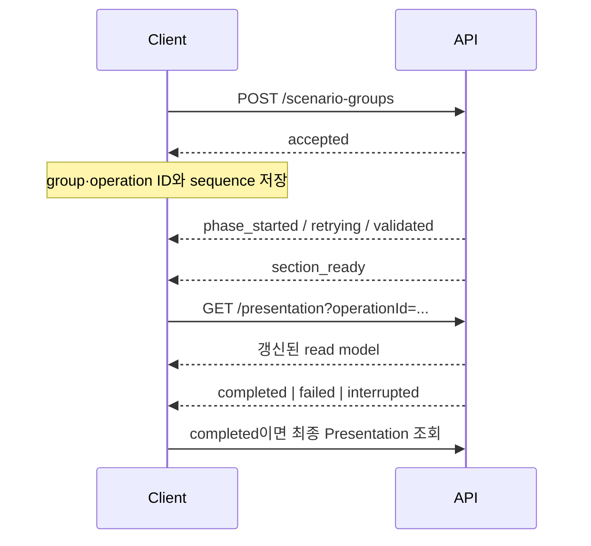

# Scenario Group Agent API Spec

## 기준

- canonical 업무 경로는 `/scenario-groups`다.
- 신규 Scenario Group 생성 엔진은 v4다.
- `/v2|v3|v4/.../sync`는 개발·비교용이며 운영 Client 진입점이 아니다.
- `/v4/scenario-groups`는 callback 호환용 deprecated API다.
- JSON 필드는 Pydantic alias 기준 camelCase로 표시한다.
- gateway prefix는 배포 환경이 소유하며 이 문서는 app 내부 path를 기준으로 한다.

## API 목록

### 운영 API

| Method | Path | 역할 |
| --- | --- | --- |
| `POST` | `/scenario-groups` | v4 Scenario Group 생성 및 진행 SSE |
| `GET` | `/scenario-groups` | Scenario Group 목록 |
| `GET` | `/scenario-groups/{id}` | 업무 상세 또는 table view |
| `GET` | `/scenario-groups/{id}/presentation` | 화면 전용 read model |
| `GET` | `/scenario-groups/{id}/additional-dimensions` | v4 저장 Dimension과 Additional 후보 |
| `GET` | `/scenario-groups/{id}/operations/{operationId}` | operation polling |
| `GET` | `/scenario-groups/{id}/operations/{operationId}/stream` | SSE replay·재연결 |
| `POST` | `/scenario-groups/{id}/validation` | Scenario table 검증 접수 |
| `POST` | `/scenario-groups/{id}/quality-evaluations` | Validation 통과 후 시나리오 집합 품질 평가 접수 (202) |
| `GET` | `/scenario-groups/{id}/quality-evaluations/{operationId}` | 평가 상태·입력·결과 조회 |
| `POST` | `/scenario-groups/{id}/signposts` | Signpost 생성 접수 |
| `POST` | `/scenario-groups/{id}/confirmation` | 최종 확정 |
| `POST` | `/scenario-groups/{id}/dimension-mapping-approvals` | legacy 자유값 mapping 승인·거절 |
| `DELETE` | `/scenario-groups/{id}` | 소유자 soft delete |
| `GET` | `/events` | Event 목록 |
| `POST` | `/events/verifications` | 시나리오 설계 전 Event 사실·최신성 웹 검증 |
| `POST` | `/events/{miEventId}/verification-updates` | 저장된 웹 근거로 수정안 검증 후 변경 전 Snapshot 저장 및 Event 갱신 |
| `POST` | `/events/recommendations` | 로컬 Qdrant 후보 검색 + LLM 최대 2개 추천 (사전 적재 필요) |
| `GET` | `/events/{miEventId}` | Event 상세와 Scenario Template |

### 개발·테스트·호환 API

| 분류 | Method / Path | 비고 |
| --- | --- | --- |
| sync | `POST /v2/scenario-groups/sync` | Event별 원본 Template Dimension 비교 |
| sync | `POST /v3/scenario-groups/sync` | 합성 Dimension 비교 |
| sync | `POST /v4/scenario-groups/sync` | v4 create 완료 응답과 usage |
| sync | `POST /scenario-groups/{id}/validation/sync` | callback body를 동기 반환 |
| sync | `POST /scenario-groups/{id}/signposts/sync` | callback body를 동기 반환 |
| QA | `GET /scenario-groups/{id}/presentation/follow-up-request-bodies` | Validation·Signpost 초기 body 생성 |
| local | `DELETE /scenario-groups/{id}/signposts` | 관리자 토큰 필요 |
| local | `DELETE /scenario-groups/{id}/hard` | 관리자 토큰과 `confirm` 필요 |
| deprecated | `POST /v4/scenario-groups` | background callback 호환 경로 |

## 1. Scenario Group 생성

### Event 추천 (생성 전 선택 보조)

`POST /events/recommendations`, `Content-Type: application/json`으로 호출한다.

```json
{"miEventIds": [5, 12], "actorUsrLognId": "10603"}
```

- `miEventIds`: 중복 없는 양의 정수 1~5개. 문자열 ID는 허용하지 않는다.
- 선택한 전체 조합을 기준으로 최대 2개를 추천한다. 선택된 ID는 결과에서 제외한다.
- 응답은 HTTP 200 JSON이며 callback이나 SSE를 사용하지 않는다.

```json
{
  "items": [{"miEventId": 47, "title": "후보 Event 제목", "reason": "함께 분석할 이유"}],
  "selectionReason": "선택된 조합에 추가 정보를 제공하는 후보를 선정했습니다."
}
```

후보가 없거나 LLM이 적합하지 않다고 판단하면 `items: []`가 정상 결과다. 잘못된 요청은 422,
선택 Event가 없거나 삭제·미게시 상태이면 404, 인덱스 누락·검색 실패·잘못된 LLM 결과는 500이다.
기존 공통 오류 응답을 사용한다. LLM timeout은 기존 connector의 504 처리를 따른다.

백엔드는 Event 본문이나 임베딩을 보내지 않는다. Agent가 MySQL에서 현재 게시된 Event를 조회하고,
로컬 벡터 검색 최대 30개 결과 중 현재 게시 상태인 최대 10개를 LLM에 전달한다.
여러 기준 Event의 후보 점수는 최고 cosine 값으로 합친다. LLM은 전체 조합에서 중복을 제외해 선정한다.
현재 인증 없는 로컬 공유 Event 데이터 테스트용이며, 사용자별 접근 권한 분리는 구현하지 않는다.
사용자 인증은 호출 백엔드가 담당한다. callback OAuth 설정은 이 API 호출 인증에 쓰지 않는다.
설치·실행은 [로컬 검색 가이드](10_LOCAL_EVENT_VECTOR_SEARCH.md)의 API 항목을 참고한다.

### Event 웹 검증 (생성 전 사실·최신성 확인)

`POST /events/verifications`, `Content-Type: application/json`으로 호출한다.

```json
{"miEventIds": [5, 12], "actorUsrLognId": "10603"}
```

- `miEventIds`: 중복 없는 양의 정수 1~5개. 문자열·boolean·소수 ID와 알 수 없는 필드는 422다.
- `actorUsrLognId`: 필수 문자열(공백 제외 1~100자). 백엔드가 인증한 사용자 ID를 전달한다.
- 게시(`PUBLISHED`)·미삭제 Event를 일괄 조회한다. 누락·삭제·미게시 Event가 하나라도 있으면 검색 전에 404다.
- HTTP 200 JSON으로 완료 결과를 반환한다. 요청 ID 순서를 유지하며 callback/SSE는 사용하지 않는다.
- Event별 검색·비교 실패는 해당 항목의 `warning`으로 반환하여 다른 Event의 검증을 계속한다.
- 내부 판정·검색 근거·Event 해시를 검증 테이블에 저장한 뒤 각 항목에 `verificationId`, `expiresAt`을 반환한다.
  실패/근거 없음도 이력으로 저장하나 업데이트 가능한 결과라는 의미는 아니다. 저장 실패 시 성공 응답/ID를 반환하지 않는다.
- DB 접근 오류는 기존 공통 오류 처리를 따른다. 호출 백엔드가 사용자 인증을 담당하는 기존 공유 Event 범위다.

근거가 없을 때의 응답 예시:

```json
{
  "checkedAt": "2026-11-03T01:00:00Z",
  "items": [{
    "miEventId": 5,
    "verificationId": "12345678-1234-4234-8234-123456789abc",
    "expiresAt": "2026-11-03T01:30:00Z",
    "title": "Event 제목",
    "sourceUpdatedAt": "2026-11-02T09:00:00",
    "status": "warning",
    "reasonCode": "no_evidence",
    "review": "비교 가능한 웹 근거를 찾지 못해 사실과 최신성을 확인할 수 없습니다.",
    "links": [],
    "checks": []
  }]
}
```

| 필드 | 의미 |
| --- | --- |
| `checkedAt` | 검증 기준 시각(조회 직후 UTC). 요청 처리 완료 시각이 아님 |
| `verificationId`, `expiresAt` | Event별 저장된 검증 UUID와 재사용 만료 시각. 기본 checkedAt부터 30분 |
| `sourceUpdatedAt` | 조회한 Event의 DB 수정 시각. DB 값의 timezone 유무를 그대로 보존 |
| `status` | `pass`: 최소 한 항목 일치 및 명확한 불일치 없음(주의·일부 확인 불가 포함 가능), `warning`: 일치 확인 항목 없음·검증 불가, `fail`: 명확한 불일치·대체된 정보 |
| `reasonCode` | `verified`, `no_contradiction`, `review_required`, `contradicted`, `outdated`, `no_evidence`, `search_error`, `verification_error` |
| `review` | 한국어 한 줄 비교 후기(최대 300자) |
| `links` | 실제 검색 근거에서 가져온 HTTP(S) URL 배열. 근거가 없으면 `[]` |
| `checks` | 비교가 완료되면 6개 항목, 검색·비교를 완료하지 못한 경우 `[]` |

각 `checks[]`는 `aspect`, `verdict`, `eventClaim`, `finding`, `sourceUrls`를 가진다.
`aspect`는 대상(`entity`), 장소(`location`), 시기(`time`), 수치(`quantity`), 최신성(`freshness`),
기관·전망 귀속(`attribution`)이다. `verdict`는 `matched | caution | contradicted | outdated | unverified |
not_applicable`이다. 해당 주장이 Event에 없을 때만 `not_applicable`을 사용한다.

판정은 비교 항목에서 결정한다. 근거가 연결된 `contradicted`가 있으면 `fail/contradicted`, 그다음
`outdated`가 있으면 `fail/outdated`다. 적어도 하나가 `matched`이고 불일치·outdated가 없으면 `pass`다.
나머지가 모두 `matched` 또는 `not_applicable`이면 `reasonCode=verified`, 주의·미확인이 함께 있으면
`reasonCode=no_contradiction`이다. 예를 들어 3개 일치 + 주의 2개 + 확인 불가 1개는 `pass/no_contradiction`이다.
`matched`가 하나도 없으면 `warning/review_required`다. 검색 실패·근거 없음·비교 실패도 warning을 유지한다.
이 pass는 전체 사실 확인 완료가 아니라 확보한 근거에서 명확한 불일치가 발견되지 않았다는 의미다.
항목별 `verdict`, `finding`, `cautionReason`, `qualificationQuote`와 review는 그대로 제공하므로 화면에 함께 표시한다.
같은 응답 등급을 업데이트 API의 `verification`, `postVerification`에도 적용한다.
업데이트의 수정안 재검증도 이 pass 기준을 저장 허용 조건으로 사용한다. 주의·일부 확인 불가만으로 저장을 차단하지 않는다.
없는 출처 ID 또는 출처 없는 일치·불일치 판정은 `warning/verification_error`로 처리한다.
정상 비교 결과의 `links`는 비교에 인용된 URL만 담는다. 비교 실패 시에는 이미 확보한 검색 링크를 제공한다.

검증 입력은 제목(`one_line_summary`), 검색 요약, 핵심 bullet, 태그, 상세 분석, 수치 근거(`numeric_facts_md`),
기관 전망(`institution_view_synthesis`), 발생·생성·수정 시각과 source record ID다. DB 조회는 기존
`apps/persistence/event/service.py`의 `prepare_verifications`를 사용하며 불필요한 Scenario Template은 조회하지 않는다.

웹 검색은 설정된 첫 사용 가능 provider를 사용한다. 원래 사건과 최신 후속 뉴스·공식 발표를 함께 찾고,
하한 날짜를 강제하지 않는다. 검색의 종료일은 기준일을 전달하는 soft constraint다. 비교 모델에는 검색
connector의 실제 인용 문맥만 전달하며 URL을 생성하게 하지 않는다. 인용 문맥은 검색 모델이 추출한 내용이므로
원문 전체 검증을 보장하지 않는다. 기관별 상충 전망·서로 다른 기간이나 단위·과거 사실을 단순히 오류로
취급하지 않는다. `outdated`는 현재 유효하다고 적힌 상태·계획이 날짜와 후속 관계가 확인된 근거로 대체된 경우다.

`web_search_*`, `llm_*` 설정을 재사용하되 이 호출의 검색은 `tool_choice=required`, 최대 인용 8개다.
요청 내 최대 3개 Event를 동시에 처리한다. `event_verification_timeout_sec`(기본 180초)는 각 항목의
대기·검색·비교 전체 제한이다. HTTP 클라이언트/gateway timeout은 DB 조회 시간과 이 제한을 고려해 설정한다.
이 API는 검증 결과와 검색 근거를 DB에 저장하되 Event 본문을 수정하지 않으며 Scenario 생성의 강제 차단 조건이 아니다.
`checkedAt`과 `sourceUpdatedAt`을 함께 표시하고 Event 수정 후에는 다시 검증한다.

### 검증 기반 Event 업데이트

```http
POST /events/5/verification-updates
Content-Type: application/json
```

```json
{
  "actorUsrLognId": "10603",
  "verificationId": "12345678-1234-4234-8234-123456789abc",
  "expectedUpdatedAt": "2026-11-06T09:00:00.123456"
}
```

- 한 요청에서 양의 정수 Event ID 1개를 처리한다. `actorUsrLognId`는 필수 문자열(공백 제외 1~100자)이다.
- `verificationId`는 필수 UUID다. 먼저 검증 API가 반환한 해당 Event의 ID를 전달한다. 생략/잘못된 형식은 422다.
  존재하지 않거나 삭제됐거나 다른 Event의 ID이면 404, 만료되면 409/EVENT_VERIFICATION_EXPIRED다.
  이미 적용됐으면 409/EVENT_VERIFICATION_ALREADY_APPLIED이며 오류 data에 기존 `mi_event_snapshot_id`를 제공한다.
- `expectedUpdatedAt`은 선택 필드다. 이전 검증 응답의 `sourceUpdatedAt`을 timezone 포함 형태 그대로 전달한다.
  일치하지 않으면 수정안 생성 전에 409를 반환한다. 생략해도 검증 당시와 현재의 전체 row hash를 비교한다.
- 호출 백엔드가 사용자 인증·수정 권한을 검사하고 신뢰할 수 있는 actor를 전달한다. actor 문자열 자체는 인증 수단이 아니다.
- 클라이언트의 검증 결과나 임의 수정 값은 받지 않는다. 서버에 보관된 내부 판정·인용 문맥을 재사용한다.
  새 웹 검색이나 원본 Event 재검증은 하지 않는다. 만료/변경 시 자동 재검색하지 않고 새 검증 ID를 요구한다.
- 저장 판단용 내부 등급에서 최초 검증 `pass`는 `unchanged`, `warning`은 `skipped`다. `fail`인 경우 근거가 연결된 수정안을 생성하고
  같은 검색 근거로 수정안을 다시 비교한다. 수정안을 생성하는 조건과 아래의 수정안 저장 조건을 구분한다.
- 수정안 저장 조건은 검증 API와 동일한 공개 `pass` 기준이다. 6개 항목 비교가 완료되고 최소 한 항목이 `matched`이며
  `contradicted`와 `outdated`가 없으면 저장을 허용한다. `caution`과 일부 `unverified`는 저장 차단 사유가 아니다.
  예: 일치 4개 + 주의 2개, 일치 3개 + 주의 2개 + 확인 불가 1개 모두 저장 가능하다.
  기존 불일치 항목이 수정 후 주의·미확인으로 바뀌어도 같은 기준을 적용한다. 최신성만 예외적으로 허용하던 조건과
  `qualificationQuote`의 본문 포함 여부를 검사하던 별도 저장 조건은 제거했다.
  일치가 하나도 없거나 검색·비교 실패/근거 없음이면 warning으로 저장하지 않고, 불일치·outdated가 남으면 fail로 저장하지 않는다.
- `checks`에는 선택적 `cautionReason`과 `qualificationQuote`가 추가된다. 주의 사유는
  `as_of_limitation`(확인 시점 한계), `source_conflict`(출처 상충), `insufficient_evidence`(근거 부족), `other`다.
  사유가 없으면 null이다. 발췌는 시점 한계인 경우만 설정하며 주의 사항 설명용으로 제공한다.
- 응답의 `verification`과 `postVerification`은 검증 API와 동일하게 집계한다.
  `postVerification.status=pass`, `reasonCode=no_contradiction`이면 주의·일부 확인 불가가 남아도 저장을 허용한다.
  항목별 상세 판정과 안내 메시지는 보존한다. 원본 `verification.status=pass`만으로 수정·저장을 보장하지 않는다.
  실제 저장 여부는 반드시 `updateStatus`와 `miEventSnapshotId`로 확인한다.
  검색 근거 부족이나 저장 조건 미충족 시 Snapshot도 생성하지 않는다.
- 현재 스키마 기준 수정 컬럼은 `one_line_summary`(표시 제목), `search_text`(검색 요약), `key_bullets_json`,
  `detail_analysis`, `numeric_facts_md`, `institution_view_synthesis` 중 실제 값이 달라진 컬럼으로 제한한다.
  기관 전망을 확정 사실로 승격하거나 관련 없는 기존 사실을 삭제하지 않도록 지시한다.
- 수정 근거는 서버가 확보한 인용 ID와 해당 인용 문맥에 실제로 존재하는 발췌문으로 검증한다.
  인용 문맥은 검색 모델의 추출 결과이므로 원문 전체를 재검증한 결과로 간주하지 않는다.

완료 응답은 HTTP 200 JSON이며 공통 `data` wrapper, callback, SSE가 없다.

| 응답 필드 | 의미 |
| --- | --- |
| `miEventId`, `checkedAt` | 대상 Event와 UTC 검증 기준 시각 |
| `verificationId` | 이번 업데이트가 사용한 검증 UUID. checkedAt은 해당 원본 검증 기준 시각 |
| `updateStatus` | `updated` / `unchanged` / `skipped`. HTTP 200만으로 저장 성공을 판단하지 않는다 |
| `message` | 처리 결과 안내 |
| `verification` | 변경 전 Event의 기존 검증 응답 항목과 같은 형식 |
| `postVerification` | 수정안 검증 결과. 수정안 검증 전 종료되면 null |
| `miEventSnapshotId` | 저장한 변경 전 Snapshot ID. 미저장이면 null |
| `snapshotVersionNo`, `previousMiEventSnapshotId` | 새 Snapshot 버전과 직전 Snapshot ID |
| `updatedAt` | 저장 후 DB 수정 시각. 미저장이면 처음 조회한 수정 시각 |
| `changedFields` | 실제 변경한 본문 DB 컬럼명 배열. 미저장이면 [] |
| `changes` | 실제 반영된 필드별 `{field, before, after, reason, sourceUrls}`. 미저장이면 [] |

처리 순서는 `검증 ID·Event 조회 → 만료/중복/해시 검사 → 저장 근거로 수정안 생성 → 같은 근거로 수정안 재검증 →
검증 row lock → Event row lock → 만료/중복/해시 재검사 → 변경 전 Snapshot INSERT → Event UPDATE →
검증 행의 적용 Snapshot ID 기록 → COMMIT`이다. 세 저장은 같은 transaction에서 처리한다.
수정안 생성 중에는 DB session/row lock을 유지하지 않는다. 기존 Snapshot이나 기존 Scenario 관계는 덮어쓰지 않는다.

Snapshot의 `update_trigger_cd`는 `LLM_VALIDATION_UPDATE`이며 `update_reason`에는 verification_id, 검증 기준 시각, 수정 이유,
실제 반영 전후 값의 해시, URL, 근거 발췌를 JSON 문자열로 저장한다. TEXT 용량을 넘기지 않도록 수정 이유·발췌는
길이를 제한하며 전체 변경 전 값은 Snapshot, 전체 diff는 응답에 제공한다. 최초 Snapshot의 `changed_fields_json`은 요청한
계약대로 `[]`이고, 다음 Snapshot부터 실제 변경 컬럼명을 저장한다. 최초 변경 내역도 응답과 `update_reason`에 남는다.
`update_reason`에는 `post_verification_status`와 `remaining_cautions`(항목·사유·비교 제약·본문 한계 발췌)도
기록한다. `RESULT` 로그의 `post_caution_reasons`로 남은 주의 사유를 확인할 수 있다.
이력의 `post_verification_status`는 비교 원본 등급이고, `save_post_verification_status`는 공개 기준을 적용한 등급이다.
`RESULT` 로그의 `save_verification_status`는 수정안 생성에 사용한 원본 Event의 내부 등급,
`raw_post_verification_status`는 수정안의 내부 등급이다. `save_post_verification_status`와
`post_verification_status`는 동일한 공개 등급이다. 따라서 내부 warning이어도 공개 pass이면 저장 가능하다.
이 로그 필드들은 API 응답 필드가 아니다. 수정안 재검증 후 저장하며 저장 후 별도 검색을 하지 않는다.

#### 백엔드 연동: 수정안 pass 저장 기준 적용

이번 변경은 Agent의 저장 판정 변경이다. 기존 `verificationId` 연동이 완료됐다면 요청/응답 DTO와 DB 스키마 변경은 없다.
Agent의 변경 소스를 배포·재시작해야 새 조건이 적용된다. 백엔드는 다음 처리 여부를 점검한다.

1. 검증 응답의 Event별 `verificationId`를 해당 Event의 업데이트 요청에 그대로 전달한다.
   검증 결과·검색 근거는 Agent가 DB에 저장하므로 백엔드에 별도 보관 테이블을 추가할 필요는 없다.
2. Agent가 저장을 수행하므로 백엔드가 Event UPDATE나 Snapshot INSERT를 다시 실행하지 않는다.
3. HTTP 200이나 `verification.status` 대신 `updateStatus`로 저장 결과를 처리한다.
   `updated`는 저장 완료, `unchanged`는 변경 없음, `skipped`는 미저장이다.
   저장 성공 시 반환된 `miEventSnapshotId`, `updatedAt`, `changedFields`를 사용하고 Event 상세를 다시 조회한다.
4. `updated` 결과를 `checks`의 caution/unverified, `reasonCode=no_contradiction` 때문에 실패로 재분류하지 않는다.
   기존에 모든 항목 matched 또는 freshness만 caution이어야 한다는 자체 조건이 있으면 제거한다.
5. 화면에는 저장 성공과 별도로 `postVerification.checks`의 주의·미확인 설명을 제공한다.
   `skipped`의 postVerification은 저장되지 않은 수정안 결과이므로 현재 Event의 검증 상태로 덮어쓰지 않는다.
6. 만료/변경 409는 새 검증을 안내한다. 이미 적용된 ID의 409는 응답의 기존 Snapshot ID와 Event를 확인한다.
   미저장 결과에 대해 서버가 자동 재검색하지 않으며, 실패를 성공으로 바꾸기 위해 백엔드가 직접 DB를 갱신하지 않는다.

백엔드 회귀 확인 사례:

| 수정안 재검증 | 기대 처리 |
| --- | --- |
| 일치 4개 + freshness/attribution 주의 2개 | `postVerification.status=pass`, `updateStatus=updated`, Snapshot ID 있음 |
| 일치 3개 + 주의 2개 + 확인 불가 1개 | 동일하게 저장 성공, 상세 주의·미확인 표시 |
| contradicted 또는 outdated 남음 | `postVerification.status=fail`, `updateStatus=skipped`, Snapshot 없음 |
| 일치 없음 또는 비교 실패 | `postVerification.status=warning`, `updateStatus=skipped`, Snapshot 없음 |

위 저장 성공 사례는 수정안에 실제 변경이 있고 근거 인용·만료·Event 해시·DB transaction 검사를 통과한 경우다.

HTTP 오류: 입력 오류 422, 누락·삭제·미게시 404, 동시 변경 `409/EVENT_UPDATE_STALE`, 저장 스키마 불일치
`500/EVENT_UPDATE_SCHEMA_ERROR`, 잘못된 LLM 수정안 500, 외부 분석 전체 시간 초과 504다.
DB 저장 실패는 전체 transaction을 롤백한다. `event_verification_update_timeout_sec` 기본값은 360초이며
조회·DB commit 시간은 별도다. HTTP client/gateway 제한을 함께 설정한다. 응답 유실 시 자동 재시도하지 말고
Event 상태와 Snapshot을 확인한다. 같은 verificationId의 성공한 적용은 중복 실행하지 않으며,
재요청 시 기존 Snapshot ID가 포함된 409/EVENT_VERIFICATION_ALREADY_APPLIED로 안내한다.
적용 성공 외의 skipped/unchanged는 미적용 상태로 남아 만료 전 재시도할 수 있다.
검증 유효기간은 `event_verification_reuse_ttl_sec` 기본 1800초이며 업데이트 시작과 저장 직전에 검사한다.

운영 로그는 `[EVENT_VERIFICATION_UPDATE]`로 검색한다. `DB_TARGET`은 해당 세션 엔진의 연결 DB명을,
`RESULT`는 최종 update_status·안내 메시지·변경 전/수정안 검증 status·reason·항목별 판정·Snapshot ID·변경 컬럼을
기록한다. `DB_COMMITTED`는 실제 변경이 있고 transaction commit이 완료된 뒤에만 기록한다.
`FAILED`는 Event ID와 오류 종류·도메인 오류명을 기록한다. 이 요약 로그에는 접속 비밀번호, Event 본문,
변경 전후 값, 검색 인용문을 포함하지 않는다. HTTP 200만으로 저장 성공을 판단하지 않는다.

로컬 Qdrant 추천 인덱스는 이 API가 갱신하지 않는다. 변경 Event를 추천 검색에 반영하려면 기존 export/index
갱신 절차를 실행한다. v0046 이후 `event_revision`이 존재하면 증가시키며 게시본 관련 파생 컬럼은 기존 게시
파이프라인이 소유한다. 원본 Fact/Record를 새로 수집하거나 게시본을 재생성하는 API는 아니다.

### Request

```http
POST /scenario-groups
Content-Type: application/json
```

```json
{
  "miEventIds": [1463, 1464, 1433],
  "userId": 10603
}
```

- Event ID는 중복 없는 양의 정수 1~5개다.
- 요청 배열 순서는 Event 표시 순서로 보존된다.
- 동일 Event 조합으로 반복 요청할 수 있다. 기존 그룹의 소유자나 작업 상태와 관계없이 요청마다 새 그룹과 operation을 생성한다.
- 성공 응답은 HTTP 200, `Content-Type: text/event-stream`, `Cache-Control: no-cache`,
  `X-Accel-Buffering: no`다.
- POST body가 필요하므로 브라우저에서는 기본 `EventSource`가 아니라 `fetch` streaming을 사용한다.

요청 검증이나 Event 조회 등 접수 준비가 실패하면 SSE가 아닌 JSON 오류를 반환한다. Client는 body를
읽기 전에 status와 `Content-Type`을 확인한다.

### Client 권장 호출 순서



`accepted`는 Scenario Group, operation, 첫 event가 같은 transaction으로 저장된 뒤 전달된다. Client는
`scenarioGroupId`, `operationId`, 마지막으로 연속 처리한 `sequence`, 요청의 `miEventIds`와 `userId`를
복구 가능한 상태에 저장한다. `section_ready`는 상세 payload가 아니라 Presentation 재조회 신호다.

### SSE 계약

```text
id: {sequence}
event: {eventType}
data: {JSON}
```

모든 업무 event는 `operationId`, `scenarioGroupId`, `sequence`, `eventType`, `phase`, `title`,
`messageMarkdown`, `snapshotRevision`, `mlflowTraceId`, `createdAt`을 공통으로 가진다. SSE `id`, JSON
`sequence`, `event`, `eventType`은 서로 일치해야 한다.

| 공통 필드 | 타입 | 설명 |
| --- | --- | --- |
| `operationId` | string | operation 식별자 |
| `scenarioGroupId` | number | Scenario Group ID |
| `sequence` | number | operation 안에서 1부터 증가하는 event 순번 |
| `eventType` | string | SSE `event` 값과 동일 |
| `phase` | string \| null | 현재 생성 phase |
| `title` | string | 사용자 표시용 제목 |
| `messageMarkdown` | string | 사용자 표시용 Markdown 메시지 |
| `snapshotRevision` | number | Presentation snapshot revision |
| `mlflowTraceId` | string \| null | 운영 추적용 trace ID |
| `createdAt` | string \| null | UTC ISO-8601 생성 시각 |

| eventType | 의미 | Client 처리 |
| --- | --- | --- |
| `accepted` | 생성 접수와 식별자 확정 | group·operation ID와 sequence 저장 |
| `phase_started` | 새 phase 시작 | 진행 문구 갱신 |
| `retrying` | 현재 단계 자동 재시도 | 실패로 확정하지 않음 |
| `validated` | 단계 검증 성공 | 진행 상태 갱신 |
| `section_ready` | Presentation snapshot 갱신 | revision 증가 시 Presentation 재조회 |
| `completed` | 생성·저장 성공 | 최종 Presentation 재조회 |
| `failed` | 생성 실패 | `lastError` 확인 |
| `interrupted` | producer 중단 | 자동 재개하지 않음 |

| eventType | 추가 필드 |
| --- | --- |
| `accepted` | `status`, `engineVersion`, `operationType` |
| `retrying` | `attempt`, `maxAttempts`, `referenceIds`, `validationCode` |
| `validated` | `attempt`, `maxAttempts` |
| `completed` | `status=succeeded` |
| `failed` | `status=failed`, `errorCode` |
| `interrupted` | `status=interrupted` |

terminal event는 `completed`, `failed`, `interrupted`뿐이다. 성공은 `completed.status=succeeded`다.
진행 event가 없을 때 서버는 기본 15초마다 `: keep-alive` comment를 보낼 수 있다. keep-alive는 `id`,
`event`, `data`가 없으며 업무 event나 sequence로 계산하지 않는다. `title`과 `messageMarkdown`은 사용자
안내용이고, Markdown을 HTML로 변환할 때는 sanitization을 적용한다. `validationCode`, `referenceIds`,
`mlflowTraceId`는 진단 정보로 취급한다.

현재 create phase는 `event_analysis`, `dimension_design`, `scenario_synthesis`, `persistence`다.
같은 phase에서 Event 영향과 Interaction처럼 검증 경계가 여러 번 생길 수 있으므로 event 개수에 의존하지 않는다.

### 연결 복구

`accepted` 이후 연결이 끊겨도 producer는 계속 실행된다. 마지막으로 연속 처리한 sequence를 보내 재연결한다.

```http
GET /scenario-groups/{scenarioGroupId}/operations/{operationId}/stream
Accept: text/event-stream
Last-Event-ID: 7
```

서버는 8번부터 DB 이력을 replay하고 실행 중이면 live-tail을 계속한다. `Last-Event-ID`가 없으면 0이며,
음수·비정수는 400이다. Client는 다음 순서로 replay를 처리한다.

1. 마지막으로 성공 처리한 연속 `sequence`를 저장한다.
2. 수신한 `sequence <= lastSequence`이면 replay 중복으로 보고 무시한다.
3. 다음 연속 sequence이면 처리한 뒤 `lastSequence`를 갱신한다.
4. gap이 보이면 현재 event를 건너뛰지 않고 마지막 연속 sequence로 다시 연결한다.
5. terminal event를 처리하면 재연결을 중단한다.

현재 상태만 확인하려면 다음 polling API를 사용한다.

```http
GET /scenario-groups/{scenarioGroupId}/operations/{operationId}
```

핵심 응답 필드는 다음과 같다.

```json
{
  "scenarioGroupId": 410,
  "operation": {
    "operationId": "01KZQJK500D0PE7XVQHXJFMHDY",
    "operationType": "create",
    "engineVersion": "v4",
    "status": "running",
    "currentPhase": "event_analysis",
    "snapshotRevision": 1,
    "latestSequence": 4,
    "lastError": null
  },
  "lastEvent": {
    "sequence": 4,
    "eventType": "section_ready"
  },
  "lastError": null
}
```

operation status는 `queued | running | succeeded | failed | interrupted`다. `queued|running`이면 stream을
재연결하고, `succeeded`이면 Presentation을 조회하며, 실패·중단이면 `lastError`를 표시한다.

페이지 새로고침 뒤 로컬 식별자가 있으면 polling으로 상태를 확인한 후 재연결하거나 최종 화면을 연다. 식별자가
없으면 목록 또는 상세 응답의 `activeOperation`과 `latestOperation`으로 복원한다. 마지막 sequence를 모르면
`Last-Event-ID: 0`으로 전체 이력을 replay하고 Client에서 중복을 제거한다.

최초 POST의 `accepted`를 파싱하기 전에 연결이 끊겨 식별자를 모르는 경우에는 목록에서 요청 사용자, Event 조합,
생성 시각과 operation을 확인한다. 동일 조합의 그룹이 여러 개일 수 있으므로 Event 조합만으로 기존 작업을
확정하지 않는다. 식별한 기존 작업은 polling/SSE로 복구한다. 동일 POST를 재전송하면 별도 그룹과 operation이
생성되므로 자동 재시도하지 않는다. 기존 작업을 식별할 수 없다면 추가 생성 여부를 사용자에게 확인한다.

### 중복 요청

| 기존 상태 | 같은 사용자 | 다른 사용자 |
| --- | --- | --- |
| 동일 조합 operation이 실행 중 | 새 그룹 생성 허용 | 새 그룹 생성 허용 |
| 생성 성공, Confirmation 전 | 새 그룹 생성 허용 | 새 그룹 생성 허용 |
| `stage=completed` | 새 그룹 생성 허용 | 새 그룹 생성 허용 |
| latest operation 실패·중단 | 새 그룹 생성 허용 | 새 그룹 생성 허용 |
| soft delete됨 | 새 그룹 생성 허용 | 새 그룹 생성 허용 |

오류 `data`에는 `error_code`, `error_name`, 가능한 `scenarioGroupId`, `operationId`가 포함된다. Client는
`message` 문자열이 아니라 HTTP status와 `error_name`으로 분기한다. create POST는 멱등 API가 아니므로
timeout이나 연결 끊김 뒤에는 자동 재시도하지 않고 앞의 operation·목록 조회 절차로 기존 작업을 확인한다.
동일 Event 재사용 허용은 새 그룹 생성에 적용된다. 기존 그룹 변경의 소유권·작업 충돌 검사와 같은 그룹에
생성 결과를 중복 저장하지 못하게 하는 검사는 유지한다.

## 2. 조회와 Presentation

### Scenario Group 목록·상세

`GET /scenario-groups`의 query는 `includeDeleted`, `miEventId`, `keyword`, `status`, `stage`, `sort`다.
응답은 group 목록과 latest/active operation 요약을 제공한다. 다중 Event 그룹의 단일 Event 호환 필드는
`null`이다.

`GET /scenario-groups/{id}`는 `includeDeleted`와 `view=full|table`을 받는다. `full`은 업무 상세,
`table`은 group 기본 메타데이터와 Scenario table만 반환한다.

### Presentation

```http
GET /scenario-groups/{scenarioGroupId}/presentation?operationId={operationId}
```

`operationId`를 생략하면 최신 operation을 선택한다. 응답은 engine version과 관계없이 다음 세 section을
가진다.

| 최상위 필드 | 설명 |
| --- | --- |
| `schemaVersion` | Presentation response schema version |
| `rendererVersion` | renderer와 ETag 무효화에 사용하는 version |
| `scenarioGroupId` | Scenario Group ID |
| `engineVersion` | 생성 엔진 version |
| `legacy` | legacy 데이터 복원 여부 |
| `warnings` | 제한된 근거 또는 복원 관련 안내 |
| `operation` | 선택한 operation의 status, phase, sequence, snapshot revision |
| `sections` | 화면에 표시할 공통 3-section read model |

- `sections.eventAnalysis`
- `sections.scenarioDesign`
- `sections.roleSelectionRationale`

각 section의 status는 `pending | partial | ready | unavailable`, evidence level은
`full | limited | none`다. 아직 준비되지 않은 배열과 문자열도 shape을 유지한다.

`hide_price_pressure=true`이면 `roleSelectionRationale`은 `null`이고 Role Markdown을 생성하지 않는다.
같은 설정이 활성화되면 `scenarioDesign.scenarioTable.rows[]`의 `scenarioRole`, `pressureTarget`,
`pressureBand`, `pressureRationale`도 `null`로 마스킹한다. Dimension definition value와 cell evidence의
`pressureContribution`은 계산 증적이므로 유지한다. 설정이 비활성화된 Role Markdown은 `분기 기준 설명`,
`분기별 선택 값 설명`, `분기 상세 설명`, `이벤트 간 상호작용 효과` 표현을 사용하고 Dimension 식별자 대신
header `displayOrder`를 표시한다.

`scenarioDesign`은 Dimension definition과 Scenario table을 제공한다. v4 cell은
`{dimensionId: valueId}`이고 표시 label은 definition에서 해석한다. `sourceEventIds`는 Event 근거,
Dimension `rationale`은 선정 근거, value `rationale`은 미래 상태와 JKM 영향 가정이다.

`engineVersion=v4`의 Dimension definition 계약은 다음과 같다. schema는 legacy 호환 때문에 일부 필드를
nullable로 두지만 v4 생성 결과의 `rationale`은 문자열이고 `source`는 `null`이다.

| `dimensionDefinitions.items[]` 필드 | 타입 | 설명 |
| --- | --- | --- |
| `dimensionId` | string | header와 cell을 연결하는 canonical Dimension ID |
| `label` | string | 화면과 Scenario table header에 표시할 이름 |
| `description` | string \| null | 사용자가 판단할 불확실성을 설명하는 질문 |
| `rationale` | string \| null | 이 Dimension이 Scenario와 JKM 결과를 구분하는 이유 |
| `sourceEventIds` | number[] | 근거가 된 Event ID 목록 |
| `modelSupportStatus` | string \| null | 모델 파라미터 지원 상태 |
| `source` | string \| null | legacy Dimension 정의 복원 방식. v4에서는 `null` |
| `values` | object[] | 선택 가능한 값과 값별 근거·압력 기여 |

| `values[]` 필드 | 타입 | 설명 |
| --- | --- | --- |
| `valueId` | string | cell에 저장·전달하는 canonical value ID |
| `label` | string | 화면 표시값 |
| `description` | string \| null | 미래 상태 설명 |
| `rationale` | string | 해당 상태가 JKM에 미치는 영향의 근거 |
| `pressureContribution` | string \| null | `bearish`, `balanced`, `bullish` 방향 기여 |
| `leverStates` | object[] | Lever별 방향·수준·범위·기간 증적 |

Scenario table row와 cell 증적은 다음 shape을 사용한다.

| 경로 | 타입 | 설명 |
| --- | --- | --- |
| `scenarioTable.headers[]` | object[] | `key`, `label`, `displayOrder` |
| `scenarioTable.rows[].scenarioId` | number \| null | 저장 Scenario ID. 신규 row는 `null` 가능 |
| `scenarioTable.rows[].displayOrder` | number | 화면 표시 순서 |
| `scenarioTable.rows[].title` | string | Scenario 제목 |
| `scenarioTable.rows[].narrative` | string \| null | Scenario 설명 |
| `scenarioTable.rows[].scenarioRole` | string \| null | `ceiling`, `mixed`, `floor` 역할 |
| `scenarioTable.rows[].baselineYn` | string \| null | baseline 여부 |
| `scenarioTable.rows[].pressureTarget` | `JKM` \| null | 압력 대상 |
| `scenarioTable.rows[].pressureBand` | string \| null | Base Scenario 대비 JKM 압력 구간 |
| `scenarioTable.rows[].probabilityScore` | number \| null | 0~100 확률 점수 |
| `scenarioTable.rows[].pressureRationale` | string \| null | 최종 압력 근거 |
| `scenarioTable.rows[].cells` | object | `{dimensionId: valueId}` canonical 선택값 |
| `scenarioTable.rows[].cellEvidence` | object | Dimension별 선택값 label·근거·압력 기여·증적 수준 |

```json
{
  "cells": {"d1": "d1_v1"},
  "cellEvidence": {
    "d1": {
      "valueId": "d1_v1",
      "valueLabel": "전망 하향만 기대에 반영",
      "rationale": "실물 소비 감소가 확인되지 않으면 하락 압력은 제한적이다.",
      "pressureContribution": "balanced",
      "evidenceLevel": "full"
    }
  }
}
```

Dimension header의 canonical 순서는 `scenarioGroup.dimensionSelected` 배열 위치다. table/query/callback과
Presentation의 Dimension definition·header는 이 배열 순서를 보존하고 응답 `displayOrder`를 `1..N`으로 다시
부여한다. 요청 `headers[].displayOrder`와 Template definition의 `displayOrder`는 저장 순서를 바꾸지 않는다.

v1 Scenario row와 cell은 `tmm_mi_scenario_m.dimension_values`를 정본으로 사용한다. Dimension 정의는
Group에 저장된 정의, checksum이 일치하는 template, Scenario master에서 관찰한 key/value 순으로 구성한다.
template은 label·description·전체 enum을 보완할 뿐 Scenario별 선택값을 덮어쓰지 않는다.

| legacy `source` 값 | 의미 |
| --- | --- |
| `legacy_template_checksum_match` | 저장 checksum과 일치하는 Dimension template에서 정의 보완 |
| `legacy_observed` | 저장 Scenario의 Dimension key/value에서 제한적으로 복원 |

Group에 저장된 Dimension 정의를 그대로 사용한 경우에는 legacy group이어도 `source=null`이다. `source`는
Event 근거가 아니며 Event lineage는 `sourceEventIds`로 확인한다.

모든 200 응답은 `ETag`를 반환한다. ETag에는 renderer version, operation ID, snapshot revision,
Scenario Group 수정 시각, 현재 Lever label mapping과 `hide_price_pressure` 값이 반영된다. 같은 URL에
`If-None-Match`를 보내고 내용이 같으면 body 없는 304를 반환한다. `section_ready`의 revision이 증가할 때
조회하되 `completed` 뒤에는 최종 조회를 한 번 더 한다.

현재 renderer version은 `v7`이다. Event 분석 Markdown의 Event·Interaction 구분과 제목 계층을 개선한
변경으로 기존 renderer version의 ETag는 더 이상 304 조건을 충족하지 않는다.

### Presentation에서 후속 API로 매핑

v4 Validation에는 Presentation의 다음 편집 가능 필드만 전달한다.

| Presentation 원천 | Validation request |
| --- | --- |
| `scenarioTable.headers[].key` | `table.headers[].key` |
| `scenarioTable.headers[].label` | `table.headers[].label` |
| `scenarioTable.headers[].displayOrder` | `table.headers[].displayOrder` |
| `scenarioTable.rows[].scenarioId` | `table.rows[].scenarioId` |
| `scenarioTable.rows[].displayOrder` | `table.rows[].displayOrder` |
| `scenarioTable.rows[].title` | `table.rows[].title` |
| `scenarioTable.rows[].cells` | `table.rows[].cells` |

`operation`, `eventAnalysis`, `roleSelectionRationale`, Dimension definition, section status·evidence level,
`narrative`, `scenarioRole`, `baselineYn`, `pressureTarget`, `pressureBand`, `probabilityScore`,
`pressureRationale`, `cellEvidence`는 화면·근거용이므로 Validation request에 복사하지 않는다. 금지 필드를
row에 포함하면 값이 `null`이어도 HTTP 422다.

v4 Signpost request는 `{ "userId": 10603 }`만 보내는 것이 canonical이다. schema의 optional `table`과
QA용 `GET /scenario-groups/{id}/presentation/follow-up-request-bodies`가 만드는 generic Signpost body는
호환·테스트용이며, v4 flow는 request table을 사용하지 않는다.

### Additional Dimension

`GET /scenario-groups/{id}/additional-dimensions`는 v4 group에서만 사용한다. GET은 Group에 저장된 전체
Dimension definition과 저장된 Additional Dimension 후보를 읽고 LLM을 호출하거나 정식 Dimension을 변경하지
않는다. query parameter와 request body는 없다. Create 완료와 후보 생성 완료 시점이 다를 수 있으므로 Client가
이 API로 상태와 결과를 조회한다.

```json
{
  "status": "success",
  "message": "성공",
  "data": {
    "scenarioGroupId": 12345,
    "generationStatus": "ready",
    "dimensionDefinitions": {
      "status": "ready",
      "items": [
        {
          "dimensionId": "d1",
          "label": "공급 복구 시점",
          "description": "공급은 언제 복구되는가?",
          "rationale": "복구 시점이 Scenario와 JKM 압력을 구분한다.",
          "sourceEventIds": [101],
          "modelSupportStatus": "full",
          "source": null,
          "values": []
        }
      ]
    },
    "availableCount": 1,
    "updatedAt": "2026-08-19T10:00:20Z",
    "errorCode": null
  }
}
```

| 응답 필드 | 타입 | 설명 |
| --- | --- | --- |
| `data.scenarioGroupId` | number | Scenario Group ID |
| `data.generationStatus` | string | background 후보 생성 상태 |
| `data.dimensionDefinitions.status` | string | 화면용 전체 Dimension 목록 상태 |
| `data.dimensionDefinitions.items` | object[] | 저장 순서의 DB Dimension definition과 필터링된 Additional Dimension 후보 |
| `data.availableCount` | number | 병합·중복 제거 후 반환한 전체 Dimension 개수 |
| `data.updatedAt` | string \| null | 상태 또는 후보의 마지막 갱신 시각 |
| `data.errorCode` | string \| null | 실패·중단 시 안정적인 오류 코드 |

`generationStatus`는 `not_requested | queued | running | ready | failed | interrupted | discarded`다.

| `generationStatus` | `dimensionDefinitions.status` | Client 처리 |
| --- | --- | --- |
| `queued`, `running` | `pending` | 일정 간격 뒤 다시 조회 |
| `ready` | `ready` | 저장된 Dimension 뒤에 Additional 후보가 이어진 `items`를 표시하고 polling 종료 |
| `not_requested`, `failed`, `interrupted`, `discarded` | `unavailable` | 후보 영역을 비활성화하고 polling 종료 |

`ready`에서는 DB Dimension definition을 저장 순서대로 먼저 배치하고, 이미 선택됐거나 기존 definition과 같은
원천을 사용하는 후보를 제외한 뒤 `dimensionId` 중복을 제거해 Additional 후보를 이어 붙인다. 중복 시 DB
definition이 우선한다. 후보가 없어도 DB definition은 반환하며, 양쪽 모두 없으면 `items=[]`,
`availableCount=0`인 정상 완료다. 후보 생성 자체의 실패·중단도 Scenario Group을 조회할 수 있으면 HTTP 200으로
반환하고 `generationStatus`, optional `errorCode`로 구분하며 내부 LLM 오류 원문은 노출하지 않는다. 이 경우 DB
definition이 있어도 `items=[]`, `availableCount=0`을 유지한다. 실행 중 상태가 stale timeout을 넘으면 조회 시
`interrupted`와 안정적인 timeout error code로 투영한다.

없는 Scenario Group은 404, v1~v3 또는 다른 생성 전략의 group은 400이다. 현재 GET 계약에는 status/stage에
따른 별도 409가 없다.

Additional 후보의 `pressureContribution` enum과 JSON 구조는 Create Dimension과 같다. Choice가 2개면
bearish·bullish, 3~4개면 bearish·balanced·bullish coverage가 필수다. 후보별 서버 검증에서 하나라도 탈락하면
validation feedback으로 전체 생성을 최대 3회 시도하고, 마지막 시도의 유효 후보만 저장한다. 마지막에도 전부
탈락했을 때만 `ADDITIONAL_DIMENSION_CANDIDATES_INVALID`가 되며, 의미 있는 후보가 없어 빈 목록을 반환한 경우는
`ready`인 정상 결과다.

## 3. Validation

```http
POST /scenario-groups/{scenarioGroupId}/validation
```

```json
{
  "userId": 10603,
  "table": {
    "headers": [
      {"key": "d1", "label": "공급 복구 시점", "displayOrder": 1}
    ],
    "rows": [
      {
        "scenarioId": 90001,
        "displayOrder": 1,
        "title": "단기 복구",
        "cells": {"d1": "d1_v1"}
      }
    ]
  }
}
```

요청 row는 `scenarioId`, `displayOrder`, `title`, `cells`만 허용한다. v4 header는 현재 Dimension ID를
Create 순서대로 보내고 cell은 해당 Dimension의 `valueId` 또는 정확한 단일 label이어야 한다. 최종
Scenario 수는 3~8개다. Create가 제외한 조합(`generationDiagnostics.excludedCandidates`)을 다시 넣으면 사유 코드와
함께 비차단 경고 `V4_EXCLUDED_COMBINATION_REINTRODUCED`를 낸다. 옛 코드 `NOT_INDEPENDENT`,
`LOW_DISTINCTIVENESS`는 `DUPLICATE`로 읽는다.

즉시 응답은 접수 상태다.

```json
{
  "status": "success",
  "message": "성공",
  "data": {
    "scenarioGroupId": 12345,
    "status": "creating",
    "stage": "scenario_created"
  }
}
```

최종 callback은 `result`, `reason`, `verdict`, `isValid`, `canProceed`, `reviewSkipped`, `summary`,
`checks`, `generatedDetails`, `scenarioGroup`, `table`을 제공한다.

| verdict | isValid / canProceed | stage | 의미 |
| --- | --- | --- | --- |
| `PASS` | `true / true` | `scenario_validated` | 차단·경고 없음 |
| `PASS_WITH_WARNINGS` | `true / true` | `scenario_validated` | 경고를 확인하고 진행 가능 |
| `BLOCK` | `false / false` | `scenario_created` | 수정 후 재검증 필요 |

Create 결과와 수정 가능한 필드가 같으면 `reviewSkipped=true`로 LLM review를 건너뛴다. `ad_` Additional
Dimension cell은 `null`일 때 허용 방향 안에서 자동 배정할 수 있지만 최초 `d1`, `d2` 계열 Dimension의
`null`은 차단한다. callback table은 canonical `valueId`를 반환한다.

`pressureContribution`은 Dimension마다 다른 정밀 가중치가 아니라 `bearish=-1`, `balanced=0`,
`bullish=+1`인 동일 가중 ordinal 지표다. bullish·bearish Scenario의 빈 Additional Dimension은
`목표 방향 → balanced → 반대 방향` 순서로 사용 가능한 value를 선택한다. balanced Scenario는 row의 모든 빈 Additional
Dimension contribution 조합을 함께 비교해 최종 합계의 절댓값이 가장 작은 조합을 선택한다. 자동 배정만 발생한
기존 Scenario의 확률은 유지한다. `pressureBand`는 모든 row를 Base 대비로 다시 계산하며, 최종 aggregate ordering과
Base 대비 strong extreme 부호 검사는 계속 적용한다.

Validation이 blocking 결론을 정상 반환한 경우에도 operation은 `succeeded`일 수 있다. 다음 단계 활성화는
operation status가 아니라 `canProceed`로 결정한다.

## 4. Signpost 생성

v4 Signpost 생성은 선택 단계다. Validation `canProceed=true`와 최신 fingerprint가 유효하면 아래 API로
Signpost를 생성하거나, Signpost를 생략하고 바로 Confirmation을 호출할 수 있다. v1/v3 lifecycle은 기존처럼
Signpost를 필수로 유지한다.

```http
POST /scenario-groups/{scenarioGroupId}/signposts
```

v4 request는 다음 값만 필요하다.

```json
{"userId": 10603}
```

schema상 `table`은 optional이다. v4는 request table을 사용하지 않고 최신 Validation operation의
fingerprint와 `canProceed=true`, 기록된 Change Set application을 확인한다. stale이면 409
`SCENARIO_VALIDATION_STALE`을 반환하고 stage를 `scenario_created`로 되돌린다.

즉시 응답 shape은 Validation 접수 응답과 같다. 최종 callback은 다음 핵심 필드를 가진다.

```json
{
  "result": "success",
  "reason": null,
  "scenarioGroup": {
    "scenarioGroupId": 12345,
    "status": "creating",
    "stage": "signpost_created"
  },
  "table": {
    "headers": [],
    "rows": [
      {
        "scenarioId": 90001,
        "title": "단기 복구",
        "cells": {},
        "signposts": [
          {
            "signpostId": 1,
            "label": "주요 설비 재가동 발표",
            "probabilityDirectionCode": "sup",
            "probabilityImpactScore": 1.0,
            "signpostReason": "복구 시나리오를 직접 지지하는 관측 신호",
            "strength": "STRONG"
          }
        ]
      }
    ]
  }
}
```

## 5. Confirmation과 삭제

`POST /scenario-groups/{id}/confirmation`은 `userId`, 수정 가능한 `scenarioGroup`, 최종 `table`을 받는다.
header 순서, 활성 Scenario ID 집합, `{dimensionId: valueId}` 조합이 DB와 같아야 한다. 불일치는 409
`SCENARIO_CONFIRMATION_STALE`이며 Confirmation이 Dimension 조합을 덮어쓰지 않는다.

v4 group이 `scenario_validated`에서 직접 Confirmation으로 들어오면 서버가 최신 성공 Validation,
`canProceed`, Scenario/Dimension fingerprint와 Change Set application을 다시 확인한다. 검증이 유효하면
Signpost row 0건을 허용한다. Signpost가 존재하면 기존 소유권·Scenario 정합성 검증과 편집 계약을 그대로 적용한다.

성공하면 Scenario·Signpost 편집 내용과 함께 `status=created`, `stage=completed`를 한 transaction에서
commit한다.

`DELETE /scenario-groups/{id}`는 body의 `userId`로 소유권을 확인하고 soft delete한다. active
`queued|running` operation이 있으면 409다. Signpost soft delete와 hard delete는 로컬 개발 전용이며
관리자 bearer token이 필요하다.

## 6. Callback과 오류

Validation과 Signpost background flow는 다음 설정으로 callback URL을 만든다.

- `callback_base_url`
- `callback_validate_scenarios_path`
- `callback_create_signposts_path`
- `skip_callback`

성공·콘텐츠 차단 callback은 `result=success`, 실행 오류는 `result=failure`와 `reason`을 사용한다.
callback 전송 실패는 Agent 작업 결과와 별도 장애다. 로그에서 graph 실패와 callback delivery 실패를 구분한다.
작업 결과로 payload를 확정한 뒤 callback은 1회만 전송하며, 성공 callback 전송이 실패해도 `result=failure`
callback을 재전송하지 않는다. `send_callback` 실패는 `CALLBACK_DELIVERY_FAILED`(-7001)로 래핑되고
`stage=token|post`, `status_code`로 토큰 발급 실패와 callback 수신 서버 실패를 구분한다. 자동 재시도는 없다.

Create(v4)·Validation·Signpost에 operation이 있으면 전송 결과를 operation event로 남긴다. operation이
terminal이 된 뒤 기록하므로 operation `status`와 `lastError`는 바꾸지 않고, SSE stream은 terminal event에서
종료되어 이 event를 실시간 전송하지 않는다. `Last-Event-ID` replay와 operation 조회의 `lastEvent`에는
나타날 수 있으므로 Client는 완료 판단에 `operation.status`를 사용한다.

| eventType | 의미 | payload |
| --- | --- | --- |
| `callback_succeeded` | callback 전송 성공 | `callbackStatus`, `result` |
| `callback_skipped` | `skip_callback=true`로 전송 생략 | `callbackStatus`, `result` |
| `callback_failed` | callback 전송 실패 | `callbackStatus`, `result`, `stage`, `url`, `statusCode`, `error` |

비밀값과 OAuth2 token은 문서·로그·report에 기록하지 않는다.

operation terminal commit 직후 heartbeat가 실행되어도 `succeeded|failed`는 정상 종료로 처리해 owner task를
취소하지 않는다. `interrupted` 또는 operation 누락일 때만 owner task를 취소하므로 terminal 결과 변환과 성공·실패
callback 전송은 끝까지 진행된다.

공통 domain/API 오류는 보통 다음 shape이다.

```json
{
  "status": "error",
  "message": "오류 설명",
  "data": {
    "error_code": -1005,
    "error_name": "SCENARIO_GROUP_OPERATION_CONFLICT"
  }
}
```

FastAPI request validation은 HTTP 422와 `detail` 배열을 사용한다. sync graph의 처리 실패는 HTTP 200의
`result=failure` callback body가 될 수 있으므로 HTTP status만으로 성공을 판정하지 않는다.

## 구현 정본

- router: `apps/agents/scenario_group_agent/routers/`
- create schema: `flows/create_multi_event_scenarios/api_schema.py`
- validation schema: `flows/validate_scenarios/api_schema.py`
- 공통 callback schema: `schemas/endpoint.py`
- 관리·operation schema: `schemas/api/manage_scenario_groups.py`
- Presentation schema: `schemas/api/scenario_group_presentation.py`
