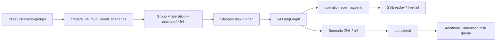
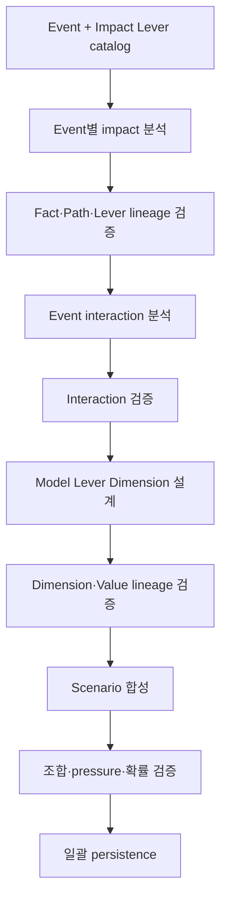
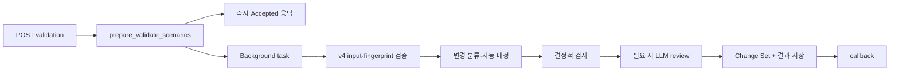
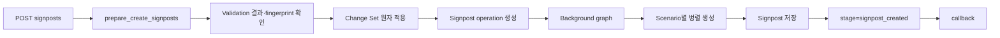

# Scenario Group Agent v4 Flow

## 범위

이 문서는 현재 기준인 v4의 다음 세 업무 흐름만 설명한다.

- Create Scenario Group
- Validate Scenarios
- Create Signposts

v2/v3 비교 구현, 과거 v1 생성 flow, Confirmation 상세는 범위에서 제외한다. API 계약은
[API Spec](02_SCENARIO_GROUP_AGENT_API_SPEC.md), 저장 구조는 [DB Spec](04_SCENARIO_GROUP_AGENT_DB_SPEC.md)을
참고한다.

## 공통 실행 원칙

- router는 request를 schema로 검증하고 prepare/runner를 호출한다.
- prepare는 소유권, stage, 중복, 입력 정합성을 동기로 확인한다.
- graph node는 변경할 state 필드만 반환하고 domain 오류는 `MIBaseError`로 올린다.
- DB 접근은 `apps/agents/scenario_group_agent/persistence/` service를 거친다.
- compiled graph는 캐시하고 요청별 입력 state와 trace context만 분리한다.
- LLM 결과의 ID, lineage, enum, 조합 제약은 서버가 결정적으로 검증한다.

## 1. Create Scenario Group

### 실행 구조

prepare transaction은 다음을 함께 처리한다.

1. `miEventIds` 1~5개와 Event 존재 여부를 확인한다.
2. Event 원본 row를 정렬된 ID 순으로 잠그고 같은 Event 조합을 재검사한다.
3. 빈 Scenario Group, Event 관계, queued create operation, `accepted` event를 저장한다.
4. lifespan task runner에 operation producer를 등록한다.

요청 순서는 Event 관계의 `display_order`와 graph 입력에 보존한다. 중복 점유용 `event_set_hash`는 정렬된
Event ID 집합과 api version으로 계산한다.

### v4 graph

#### 1. Event impact 분석

`analyze_event_impacts`는 Event별 structured-output 호출을 병렬 실행한다. 각 호출은 Event 제목·요약·발생
시각·핵심 사실 후보와 사용 가능한 Impact Lever catalog를 받는다.

결과는 현재 사실, Demand·Supply·Trade·price-only 전달 경로, 아직 열린 질문을 구분한다. LLM이 반환한
사실 문장은 서버가 입력 후보와 대조하고 `factId`, `eventId`, Path ID, Lever ID를 부여한다. 한 Event의
재시도는 성공한 다른 Event 결과를 다시 만들지 않는다.

#### 2. Event interaction 분석

Event가 둘 이상이고 서로 다른 Event의 유효 Path가 있을 때만 interaction LLM을 호출한다. 독립 Event에
임의의 상호작용을 만들지 않는다. 서버는 서로 다른 Event Path 참조, ID 고유성, 질문 budget을 검증하고
동일 Event Path만 참조한 interaction은 warning과 함께 제거한다.

#### 3. Dimension 설계

검증된 열린 질문을 사용자가 선택할 3~6개 Dimension으로 바꾼다. 각 Dimension은 다음을 가진다.

- 짧은 `label`과 열린 질문인 `description`
- 선정 근거 `rationale`
- `sourceEventIds`, Path·uncertainty lineage
- `primaryLeverCode`, `primaryImpactLeverId`, `modelSupportStatus`
- 2~4개 value와 `leverStates`, `pressureContribution`, `assumptionRationale`

LLM은 ID나 source lineage를 만들지 않는다. 서버가 catalog와 검증된 uncertainty를 기준으로 hydrate한다.
지원 상태는 실행 가능성 진단 정보이며 중요한 미지원·price-only 불확실성을 Dimension에서 제거하는 필터가 아니다.

#### 4. Scenario 합성

검증된 Dimension choice와 interaction으로 3~5개의 고유 조합을 선택한다. 각 Scenario는 title, narrative,
Dimension value 조합, JKM `pressureBand`, 근거, role, 상대 확률 가중치를 가진다.

서버는 다음을 최종화한다.

- Scenario와 Dimension/Value ID
- 중복 조합 차단
- floor와 ceiling 각 1개, 필요한 경우 mixed role
- contribution과 pressure band 순서 정합성
- `probabilityScore` 정수 합계 100
- 최고 확률 Scenario 하나의 `baselineYn=Y`

TTF·HH 관련성이 명확한 경우만 `relatedMarkets`에 보조 근거를 둔다. JKM 근거는 `pressureRationale`이
정본이며 시장별 별도 price direction을 생성하지 않는다.

#### 5. Persistence와 Presentation projection

검증이 끝난 결과만 service 호출 한 번으로 Scenario Group과 Scenario에 저장한다. graph 진행 중에는
검증 경계마다 operation의 `presentation_snapshot`을 갱신하고 revision을 증가시킨 뒤 `section_ready`를
발행한다. 렌더링된 Markdown이나 실패 LLM draft는 DB에 저장하지 않는다.

최종 persistence 후 Scenario Group·Scenario·`generation_diagnostics`가 Presentation의 정본이다.
`completed`를 기록한 뒤 unused open question이 있으면 create operation과 독립적인 Additional Dimension
task를 queue한다.

### 재시도와 복구

각 LLM 단계는 최초 호출 포함 최대 3회 시도하며 1초·2초 backoff를 적용한다. schema/structured-output,
timeout, connection, 명시된 retryable HTTP 오류만 재시도한다. 검증을 통과한 앞 단계 결과는 재사용한다.

producer는 기본 30초마다 heartbeat를 갱신한다. heartbeat가 기본 120초 이상 stale인 active operation은
recovery monitor가 `interrupted`로 전환한다. 서버 재시작 후 graph 자체를 재개하지는 않는다.

SSE consumer와 producer 수명은 분리된다. owner worker는 process-local EventHub로 subscriber를 깨우고,
다른 worker는 operation별 adaptive DB watcher로 새 sequence를 감지한다.

## 2. Validate Scenarios

### 실행 구조

v4 validation은 Create의 `dimensionDefinitions`를 closed enum으로 사용한다. 요청 header와 cell을 canonical
Dimension/Value ID로 정규화하고 Scenario·Dimension definition fingerprint를 고정한다.

### 변경 없음 fast-path

요청 row 수, Scenario ID, title, cells가 현재 DB와 같으면 review를 생략한다.

- `reviewSkipped=true`
- `verdict=PASS`
- LLM review 없음
- Change Set의 Scenario write 없음

### 변경 요청 처리

row별로 `NEW`, `TITLE_CHANGED`, `REORDERED`, `COMBINATION_CHANGED`, `AUTOFILL_ONLY`,
`PROBABILITY_RENORMALIZED`를 구분한다. 통과 시 실제 DB에 적용할 최소 `scenarioChangeSet`을 operation
`result_payload`에 저장한다. Validation 단계에서는 Change Set을 Scenario table에 바로 적용하지 않는다.

신규·조합 변경 Scenario는 narrative, pressure, probability 등 저장 필드를 생성한다. row 삭제와 수동 조합
변경이 있으면 활성 Scenario의 확률을 정수 합계 100으로 다시 정규화한다.

### Additional Dimension autofill

ready 후보를 새 header로 추가하고 `ad_` Dimension cell을 `null`로 보내면 목표 pressure 방향 안에서 value를
자동 배정할 수 있다. 기존 canonical 값이 여전히 허용되면 안정성을 위해 재사용한다.

- 사용자가 보낸 non-null 값은 덮어쓰지 않는다.
- 최초 `d1`, `d2`, ... Dimension의 null은 blocking이다.
- unknown header, stale 또는 준비되지 않은 후보는 blocking이다.
- 자동 배정은 `V4_ADDITIONAL_DIMENSION_AUTOFILL` 또는 복원 INFO check로 남긴다.

### 판정

결정적 검사는 header/cell 구조, 중복 title·조합, baseline contrast, value diversity, pressure ordering,
fingerprint 등을 확인한다. 의미적 compatibility와 유사 title처럼 코드만으로 판정할 수 없는 항목만 LLM
review에 맡긴다.

| 결과 | stage | 후속 처리 |
| --- | --- | --- |
| PASS | `scenario_validated` | Signpost 진행 가능 |
| PASS_WITH_WARNINGS | `scenario_validated` | 경고 확인 후 진행 가능 |
| BLOCK | `scenario_created` | 수정 후 재검증 |

처리 오류는 failure callback이지만 콘텐츠 blocking은 정상 success callback이다.

## 3. Create Signposts

### 실행 구조

v4 request table은 사용하지 않는다. prepare transaction이 최신 성공 Validation의 `canProceed`, Scenario
fingerprint, Dimension fingerprint를 확인한다. stale이면 Signpost를 시작하지 않고 stage를
`scenario_created`로 되돌린다.

Validation Change Set이 있으면 다음을 한 transaction에서 적용한다.

- 신규 Scenario ID 발급
- 기존 row update와 삭제 row soft delete
- 영향받은 기존 Signpost soft delete
- baseline, role, probability 재계산 결과 반영
- Validation application 기록

이후 graph는 적용된 DB Scenario를 다시 읽는다. v4에서는 과거 flow의 신규 row narrative 생성과 table sync
node가 no-op이며 Validation에서 만든 저장 필드를 다시 생성하지 않는다.

### Scenario context

각 Scenario의 Signpost prompt는 다음 근거를 분리해 전달한다.

- 요청 순서대로 유지한 각 Event의 현재 사실
- Scenario title·narrative·확률·baseline·role
- JKM pressure band와 rationale, 선택적 related market
- 선택한 Dimension/Value의 label과 rationale
- 현재 Scenario 조합에 정확히 대응하는 Impact Path와 Interaction

`scenarioPressureBreakdowns`는 title이 아니라 전체 Dimension/Value ID 조합으로 연결한다. Validation에서
조합이 바뀌었거나 신규 Scenario라 일치하는 breakdown이 없으면 과거 인과 근거를 재사용하지 않고 최신
Scenario와 Dimension/Value 근거만 사용한다.

### 병렬 생성과 저장

기존 Signpost가 없거나 이번 변경으로 재생성이 필요한 Scenario만 대상이 된다. Scenario별 작업은 semaphore
제한 아래 병렬 실행한다.

1. 관측 가능한 Signpost label 후보를 생성한다.
2. label별 strength, probability direction·impact, reason, keyword hints를 생성한다.
3. 결과를 Scenario ID에 병합한다.
4. Signpost를 저장하고 Scenario status를 `created`, group stage를 `signpost_created`로 갱신한다.

모든 Event를 고려하되 미래 Scenario 가정을 현재 Event 사실로 표현하지 않는다. Signpost는 Scenario를
구분할 수 있는 관측 가능하고 시간적으로 유효한 신호여야 한다.

## 변경 시 함께 확인할 것

| 변경 대상 | 함께 확인할 영역 |
| --- | --- |
| create node·prompt | v4 schema, operation event, Presentation, persistence 일괄 저장 |
| SSE event | operation schema, replay, manual SSE runner |
| Dimension·Scenario schema | Validation closed enum, Signpost context, DB JSON |
| Validation check | callback, Change Set, Signpost prepare, mutation probe |
| Signpost prompt·schema | callback table, persistence enum, 품질 rubric |
| heartbeat·recovery | lifespan runner, terminal event, multi-worker 테스트 |
