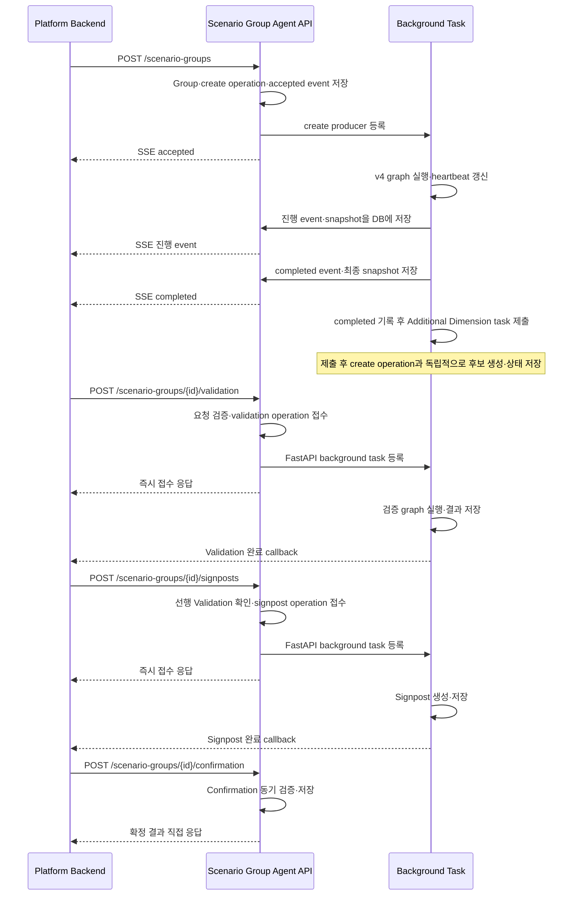
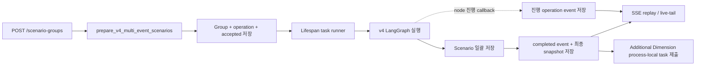
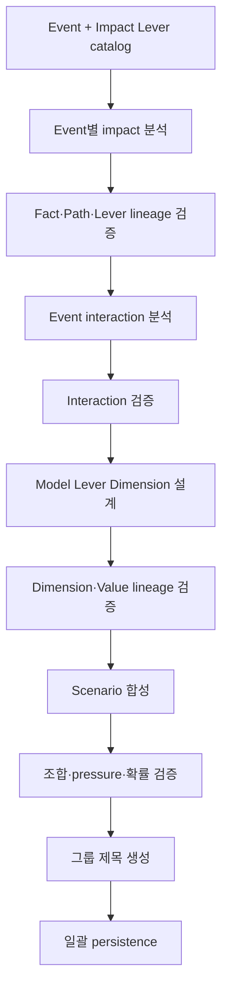
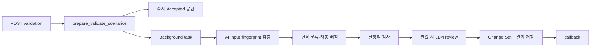
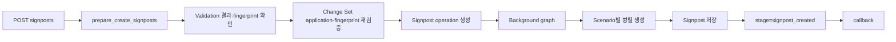

# Scenario Group Agent v4 Flow

## 범위

이 문서는 현재 기준인 v4 운영 API의 전체 수명주기와 다음 세 내부 업무 흐름을 설명한다.

- Create Scenario Group
- Validate Scenarios
- Create Signposts

Confirmation은 운영 API 호출 관계와 동기 처리 특성까지만 다루며 내부 graph 상세는 범위에서 제외한다.
v2/v3 비교 구현과 과거 v1 생성 flow도 범위에서 제외한다. API 계약은
[API Spec](02_SCENARIO_GROUP_AGENT_API_SPEC.md), 저장 구조는 [DB Spec](04_SCENARIO_GROUP_AGENT_DB_SPEC.md)을
참고한다.

## 운영 API 전체 수명주기

SSE consumer와 create producer의 수명은 분리된다. 연결이 끊겨도 producer는 계속 실행되며, 재연결은
`GET /scenario-groups/{id}/operations/{operationId}/stream`과 `Last-Event-ID`를 사용해 DB에 저장된 operation
event를 replay한 뒤 live-tail한다. Additional Dimension은 SSE 진행 중 병렬 생성되는 단계가 아니다. create
`completed` event를 저장한 뒤 제출되며, 실패해도 이미 성공한 create operation을 실패로 바꾸지 않는 독립 보조
작업이다.

## Background 실행과 운영 확인

외부 메시지 브로커나 영속 task queue는 사용하지 않는다. task queue·registry·subscriber·monitor loop는 현재
프로세스 메모리에만 있고, operation과 Additional Dimension의 업무 상태·결과 및 SSE event는 DB에 저장된다.

runtime singleton 객체는 모듈 import 시 이미 프로세스 메모리에 생성된다. FastAPI startup에서는 대부분 실제
task를 만들지 않고 요청을 받을 수 있도록 상태값이나 현재 asyncio event loop 참조만 설정한다. 실제 실행 task는
업무 요청이나 SSE 구독이 발생할 때 필요한 만큼 생성된다. 예외적으로 recovery monitor는 startup부터 주기 task를
계속 실행한다.

| 구성요소 | FastAPI startup 시 | 실제 task 생성 시점 |
| --- | --- | --- |
| `ScenarioGroupOperationTaskRunner` | `_accepting=true`로 설정하고 heartbeat 주기를 저장한다. | Create 접수 시 producer task를 등록하고 해당 operation의 heartbeat task를 생성한다. Validation·Signpost는 FastAPI background task 안에서 heartbeat wrapper task만 사용한다. |
| FastAPI `BackgroundTasks` | 별도 상주 task나 공용 registry를 만들지 않는다. | Validation·Signpost 요청 처리 중 callable을 등록하고 response 전송 뒤 실행한다. `BackgroundTasks` 자체가 상주 asyncio task를 생성하는 것은 아니며, 실행 중 operation heartbeat용 asyncio task가 별도로 생성된다. |
| `AdditionalDimensionTaskRunner` | `_accepting=true`로 설정한다. | create `completed` 저장 후 후보 생성이 제출될 때 Scenario Group별 task를 생성한다. |
| `ScenarioGroupOperationEventHub` | 현재 asyncio event loop 참조를 저장하고 `_stopping=false`로 설정한다. subscriber queue나 watcher는 아직 없다. | SSE 구독 시 subscriber queue를 만들고, 타 worker 소유 operation이면 adaptive DB polling watcher task를 생성한다. owner worker 알림에는 별도 상시 task를 만들지 않는다. |
| `ScenarioGroupOperationRecoveryMonitor` | stale scan을 즉시 한 번 실행하고 기본 30초 주기의 monitor task를 생성한다. | startup에서 생성한 하나의 task가 shutdown까지 `sleep → stale scan`을 반복한다. |

| 구성요소 | 역할 | 저장 상태 | 장애·재시작 동작 | 운영 확인 방법 |
| --- | --- | --- | --- | --- |
| `ScenarioGroupOperationTaskRunner` | SSE consumer와 독립된 create producer 수명을 소유하고 기본 30초마다 heartbeat를 갱신한다. Validation·Signpost 실행도 같은 heartbeat wrapper를 사용한다. | 실행 task registry는 process-local이고 operation 상태·heartbeat·event는 DB에 저장된다. | shutdown 시 소유 task를 취소한다. create graph는 자동 재개하지 않으며 취소 시 `interrupted`, 비정상 종료 후 stale이면 recovery monitor가 `interrupted`로 전환한다. | Create는 SSE, `GET /scenario-groups/{id}/operations/{operationId}`, Presentation, DB operation event로 확인한다. Validation·Signpost는 같은 operation polling API의 상태도 함께 확인한다. |
| FastAPI `BackgroundTasks` | Validation·Signpost 접수 응답을 보낸 뒤 graph 실행, 결과 저장, Platform Backend callback을 수행한다. | 등록된 background task 자체는 process-local이고 업무 operation·결과는 DB에 저장된다. | 프로세스 종료 뒤 task나 callback을 자동 replay하지 않는다. 남은 active operation은 stale recovery 대상이 될 수 있다. | operation 상태와 callback 전송 로그·HTTP 응답을 함께 확인한다. |
| `AdditionalDimensionTaskRunner` | create `completed` 뒤 후보 생성을 제출하고 Scenario Group별 process-local 중복 실행을 막는다. | task registry와 run ID registry는 process-local이고 generation status와 후보는 DB에 저장된다. | create 성공과 독립적으로 실패할 수 있다. shutdown 시 소유 run을 `interrupted` 처리하며 자동 재개하지 않는다. 비정상 종료로 DB에 active 상태가 남으면 조회 시 기본 240초 stale timeout을 기준으로 `interrupted`로 관찰된다. | `GET /scenario-groups/{id}/additional-dimensions`의 `generationStatus`, `errorCode`, 저장 Dimension·후보 통합 목록을 확인한다. |
| `ScenarioGroupOperationEventHub` | owner worker에서는 process-local 알림으로 subscriber를 깨우고, 다른 worker에서는 operation별 adaptive DB polling으로 새 sequence를 감지한다. | subscriber·owner·watcher registry는 process-local이고 replay 원본 event는 DB에 저장된다. | worker 간 메모리를 공유하지 않는다. 재시작·타 worker 연결은 DB event replay와 polling으로 이어가며 terminal 뒤 watcher를 종료한다. | SSE sequence, 재연결 replay, operation의 `latestSequence`, DB operation event를 대조한다. |
| `ScenarioGroupOperationRecoveryMonitor` | 시작 시 한 번, 이후 기본 30초마다 scan하여 heartbeat가 기본 120초 이상 stale인 active operation을 찾는다. | monitor loop는 process-local이고 `interrupted` 상태와 terminal event는 DB에 저장된다. | 서버 재시작 시 create graph를 재개하지 않고 stale operation을 `interrupted`로 정리한다. recovery scan 자체가 실패하면 다음 주기에 재시도한다. | operation polling/SSE의 `interrupted`, `lastError`, recovery 구조화 로그를 확인한다. |

공통 원인 분석에는 operation·group ID가 포함된 구조화 로그와 MLflow trace를 사용한다. Validation·Signpost
callback 전송 실패는 Agent 업무 결과와 별도의 delivery 장애로 판단하며, callback HTTP 응답과
`CALLBACK_FAILED` 로그를 함께 확인한다. OAuth2 인증 요청이 401일 때만 token을 갱신해 한 번 재시도하고,
그 밖의 오류나 재시도 실패는 추가 자동 재시도하지 않는다. canonical `POST /scenario-groups`의 Create는 SSE로
완료를 알리고, Confirmation은 결과를 동기 응답하므로 두 API 모두 callback이 없다.

## 공통 실행 원칙

- router는 request를 schema로 검증하고 prepare/runner를 호출한다.
- prepare는 소유권, stage, 중복, 입력 정합성을 동기로 확인한다.
- graph node는 변경할 state 필드만 반환하고 domain 오류는 `MIBaseError`로 올린다.
- DB 접근은 `apps/agents/scenario_group_agent/persistence/` service를 거친다.
- compiled graph는 캐시하고 요청별 입력 state와 trace context만 분리한다.
- LLM 결과의 ID, lineage, enum, 조합 제약은 서버가 결정적으로 검증한다.

## 1. Create Scenario Group

### 실행 구조

prepare transaction은 다음을 함께 처리한다.

1. `miEventIds` 1~5개와 Event 존재 여부를 확인한다.
2. Event 원본 row를 정렬된 ID 순으로 잠그고 활성 Event 존재 여부를 재확인한다.
3. 빈 Scenario Group, Event 관계, queued create operation, `accepted` event를 저장한다.
4. lifespan task runner에 operation producer를 등록한다.

요청 순서는 Event 관계의 `display_order`와 graph 입력에 보존한다. `event_set_hash`는 정렬된 Event ID 목록의
버전이 지정된 표현(`v1:[...]`)을 해시한 조합 식별 정보이며 생성 차단에 사용하지 않는다. 엔진 버전은 별도
`api_version`에 저장한다. 동일 Event 조합의 기존 그룹에 `queued|running` 작업이 있어도 요청마다 새 그룹과
operation을 생성한다. Event row 잠금은 접수 transaction 동안만 유지하며 긴 생성 작업 동안 유지하지 않는다.

### v4 graph

graph 준비 단계는 설정의 `scenario_group_v4_impact_catalog_version`과 일치하는 active Lever만 조회한다.
현재 신규 Group 값은 `v4.1`이다. version을 생략해 역사 row와 섞지 않으며, hydrated checksum을 Scenario
Group의 `impact_catalog_version/checksum`에 저장한다.
후속 Additional Dimension task도 claim 시 같은 version/checksum pin을 함께 가져와 현재 hydrated catalog와
둘 다 일치할 때만 LLM을 호출한다. pin 누락·불일치는 `IMPACT_CATALOG_PIN_STALE`로 fail-close한다.

#### 1. Event impact 분석

`analyze_event_impacts`는 Event별 structured-output 호출을 병렬 실행한다. 각 호출은 Event 제목·요약·발생
시각·핵심 사실 후보와 사용 가능한 Impact Lever catalog를 받는다.

결과는 현재 사실, Demand·Supply·Trade·price-only 전달 경로, 아직 열린 질문을 구분한다. LLM이 반환한
사실 문장은 서버가 입력 후보와 대조하고 `factId`, `eventId`, Path ID, Lever ID를 부여한다. 한 Event의
재시도는 성공한 다른 Event 결과를 다시 만들지 않는다.

여기서 Event는 하나의 일관된 사실 묶음으로 가정하지 않는다. LNG 뉴스·리포트에는 확정 과거, 현재 관측,
운영사 예상, 기관별 미래 View가 섞일 수 있고 같은 대상·기간의 전망도 서로 충돌할 수 있다. `eventFacts`에는
확정·관측된 기준점만 넣고 미래 예상·기관 View를 현재 사실로 승격하지 않는다. 미래 주장은 출처·발표시점·
적용기간을 유지한 채 `pathUncertainties` 또는 `interactionUncertainties`의 근거로 전달하며, 상충 전망은
평균·최신값 덮어쓰기 없이 서로 다른 Dimension value 후보로 표현한다. 상세 출력 필드와 전환 규칙은
[Event 구조화 → Model Parameter 증적 가이드](06_EVENT_STRUCTURING_FOR_MODEL_PARAMETER.md)의
`Scenario Group Agent Output 설계 가이드`를 따른다.

Event open question은 요청 Event 순서대로 다음 목표·상한을 적용한다. Interaction open question은
Interaction별 최대 1개, 전체 최대 2개이며, Event와 Interaction open question을 합친 최종 상한은 10개다.

| 이벤트 수 | Event 분석 Open Question 배정 | Event 합계 | Interaction 분석 최대 | 최종 최대 |
| ---: | --- | ---: | ---: | ---: |
| 1개 | `[3]` | 3개 | 0개 | 3개 |
| 2개 | `[3, 3]` | 6개 | 1개 | 7개 |
| 3개 | `[3, 3, 2]` | 8개 | 2개 | 10개 |
| 4개 | `[2, 2, 2, 2]` | 8개 | 2개 | 10개 |
| 5개 | `[2, 2, 2, 1, 1]` | 8개 | 2개 | 10개 |

#### 2. Event interaction 분석

Event가 둘 이상이고 서로 다른 Event의 유효 Path가 있을 때만 interaction LLM을 호출한다. 독립 Event에
임의의 상호작용을 만들지 않는다. 서버는 서로 다른 Event Path 참조, ID 고유성, 질문 budget을 검증하고
동일 Event Path만 참조한 interaction은 warning과 함께 제거한다.

| 이벤트 수 | Interaction 최대 개수 | Interaction Open Question 최대 개수 |
| ---: | ---: | ---: |
| 1개 | 0개 | 0개 |
| 2개 | 1개 | 1개 |
| 3개 | 2개 | 2개 |
| 4개 | 3개 | 2개 |
| 5개 | 3개 | 2개 |

Interaction open question 전체 상한은 `min(2, 유효 Interaction 수, 10 - Event open question 수)`로
계산한다. 각 Interaction에는 최대 1개만 허용하고 `independent` Interaction에는 만들지 않는다. 의미 있는
Interaction이나 질문이 없으면 실제 생성 수는 표의 최대치보다 적을 수 있다.

#### 3. Dimension 설계

검증된 열린 질문을 사용자가 선택할 3~6개 Dimension으로 바꾼다. 각 Dimension은 다음을 가진다.

- 짧은 `label`과 열린 질문인 `description`
- 선정 근거 `rationale`
- `sourceEventIds`, Path·uncertainty lineage
- `primaryLeverCode`, `primaryImpactLeverId`, `modelSupportStatus`
- 2~4개 value와 `leverStates`, `pressureContribution`, `assumptionRationale`

기관 이름 자체를 Dimension value로 기계적으로 만들지 않는다. 같은 미래 상태를 가리키는 View는 하나의
의미 상태로 묶고, 복구 시점·가동 수준·물량처럼 시장 영향을 실제로 갈라놓는 가정으로 value를 설계한다.
각 `assumptionRationale`에는 관측 기준점과 채택한 미래 주장, 출처, 적용기간을 구분해 설명한다.

`pressureContribution`은 모든 Dimension에 동일하게 `bearish=-1`, `balanced=0`, `bullish=+1`로 계산하는
ordinal 지표이며 Dimension별 별도 weight를 두지 않는다.

LLM은 ID나 source lineage를 만들지 않는다. 서버가 catalog와 검증된 uncertainty를 기준으로 hydrate한다.
지원 상태는 실행 가능성 진단 정보이며 중요한 미지원·price-only 불확실성을 Dimension에서 제거하는 필터가 아니다.

#### 4. Scenario 합성

검증된 Dimension choice와 interaction으로 고유 조합을 선택한다. 각 Scenario는 title, narrative,
Dimension value 조합, JKM `pressureBand`, 근거, role, 상대 확률 가중치를 가진다. 이 호출은 그룹 description만
만들고 그룹 제목은 만들지 않는다.

개수와 band 규칙은 설정 `scenario_synthesis_policy`로 고르며, 생성 시점의 정책과 개수 범위는 state에
고정하고 `generationDiagnostics.scenarioSynthesisPolicy`, `scenarioCountRange`에 기록한다. 롤백은 설정을
`band_unique`로 되돌린다.

| 정책 | 개수 | band 규칙 | 제외 사유 코드 |
| --- | --- | --- | --- |
| `band_unique` (기본) | 3~5 | 생성 Scenario끼리 band 중복 금지, 생성·제외를 합쳐 5 band를 한 번씩 덮음, Base 대비 방향당 최대 2개 | LLM `LOW_PROBABILITY`·`NOT_INDEPENDENT`, 서버 `LOW_DISTINCTIVENESS` |
| `distinct_driver` | 이벤트 1~2개는 3~5, 3개 이상은 (이벤트 수+1)~(이벤트 수+3) | 같은 band 여러 개 허용, Base 대비 상방·하방 각 1개 이상 | `INSUFFICIENT_EVIDENCE`, `CONTRADICTION`, `DUPLICATE`, `LOW_PROBABILITY`, 서버 `EXCEEDS_MAX_COUNT` |

`pressureBand`는 두 정책 모두 실제 JKM 방향이 아니라 **Base 대비 상대 위치**다. Base(최고 확률 Scenario)와의
`pressureContribution` 합산 차이가 0이면 `balanced`, ±1이면 `bullish`·`bearish`, ±2 이상이면 strong band다.

서버는 다음을 최종화한다.

- Scenario와 Dimension/Value ID
- 중복 조합 차단
- Base를 제외한 Scenario 중 Base 대비 가장 낮은·높은 floor와 ceiling, 필요한 경우 mixed role
- Base 대비 pressure band (`distinct_driver`는 제외 후보 band도 같은 기준으로 다시 계산)
- `probabilityScore` 정수 합계 100
- 최고 확률 Scenario 하나의 `baselineYn=Y`

`distinct_driver` 정책의 추가 처리는 다음과 같다.

- Dimension 선택지로 만들 수 있는데도 Base 대비 상방 또는 하방 Scenario가 없으면 합성을 재시도한다.
  선택지 구조상 만들 수 없는 방향은 `directionCoverageGaps`에 기록하고 결과를 막지 않는다.
- 최대 개수를 넘으면 Base와 압력 차이가 가장 작고 확률이 낮은 후보부터 `EXCEEDS_MAX_COUNT`로 제외한다.
  한 방향의 마지막 Scenario는 제외하지 않는다.
- 목표 최소 개수에 못 미치면 미달 피드백과 함께 합성을 **한 번만** 다시 시도한다. 재시도 결과가 더 적거나
  재시도가 실패하면 첫 결과를 쓴다. 최종 미달은 `scenarioCountShortfall`(목표, 실제, 제외 사유 분포)로 남기고,
  서버가 강제하는 하한은 3개다.

두 정책 모두 같은 band이면서 Dimension 값이 1개만 다른 쌍과 제목이 비슷한 쌍(문자 2-gram Jaccard 0.6 이상)을
`similarScenarioPairs`에 통계로 남긴다. 생성 결과는 바꾸지 않는다.

`baselineYn=Y`는 미래 사실 확정이나 기관 합의를 의미하지 않는다. 생성 기준시점에서 가장 지지되는 작업
가정이며, 대안 View의 lineage를 제거하는 해소 판정으로 사용하지 않는다.

생성 후보의 확률을 합계 100인 정수 점수로 정규화한 뒤, 5 미만인 후보는
`LOW_PROBABILITY` 사유와 함께 제외 목록으로 이동한다. 정확히 5인 후보는 유지한다.
후보가 제외되면 남은 후보의 확률을 다시 정규화한다.

조합 검증 후 후보 개수가 달라졌거나 점수 합계가 100이 아니면 재정규화한다.
정수 배분의 나머지가 같은 경우 기존 baseline을 우선한다.

자동 추가된 fallback을 포함해 최종 점수가 5 미만인 후보가 있으면 기존 합성
재시도 경로로 이동한다. 최종 생성 개수는 정책별 최대 개수와 결과 스키마의 하한 3개를 따른다.
재시도 한도를 소진하면 생성 작업이 실패한다.

TTF·HH 관련성이 명확한 경우만 `relatedMarkets`에 보조 근거를 둔다. JKM 근거는 `pressureRationale`이
정본이며 시장별 별도 price direction을 생성하지 않는다.

#### 5. 그룹 제목 생성

`generate_v4_group_title`은 최종화된 Scenario를 기준으로 그룹 제목을 만든다. 제목은 그룹의 모든 Scenario를
대표해야 하므로 특정 Scenario의 답이나 결말이 아니라 공통 전제와 Scenario를 가르는 핵심 질문을 담는다.

1. 서버가 제목 초점을 고른다(`select_v4_group_title_focus`).
   - 핵심 분기: 생성된 Scenario들이 서로 다른 `pressureContribution`의 value를 고른 Dimension.
     `price_only`는 제외하고, 같은 `primaryLeverCode`는 하나만 쓰며, 최대 2개다.
   - 공통 전제: 핵심 분기가 1개일 때만, 모든 Scenario가 같은 방향(0 제외)을 고른 Dimension.
2. 제목 전용 structured-output 호출(stage `group_title`)에 분기·전제의 질문(`description`)과 출처 Event의
   제목·요약·태그만 전달한다. 공통 영향·Interaction 문구와 value(답)는 전달하지 않는다. 20~45자, `{공통 전제} 속 {핵심 질문의
   대상} 여부/폭/시점/지속성` 형태이며 지표 변경·지역명 묶음·결말 단정·Event 나열을 금지한다.
   짧은 출력이므로 `ModelPreference.SPEED` 모델과 `llm_v4_group_title_reasoning_effort`(기본 `low`)를 쓴다.
3. 핵심 분기의 출처 Event 토큰이 제목에 없으면 feedback과 함께 제목만 다시 만든다(최초 포함 최대 3회).
   모두 실패하거나 호출이 실패하면 출처 Event 라벨로 만든 결정적 제목(`{출처 Event 라벨}에 따른 JKM 시나리오`)을 쓴다.
   제목 생성 실패는 create 실패로 이어지지 않는다.

finalize 단계는 Event 라벨 기반 임시 제목을 두고 이 노드가 확정한다. 진행 이벤트 phase는
`scenario_synthesis`를 그대로 사용한다.

#### 6. Persistence와 Presentation projection

검증이 끝난 결과만 service 호출 한 번으로 Scenario Group과 Scenario에 저장한다. graph 진행 중에는
검증 경계마다 operation의 `presentation_snapshot`을 갱신하고 revision을 증가시킨 뒤 `section_ready`를
발행한다. 렌더링된 Markdown이나 실패 LLM draft는 DB에 저장하지 않는다.

최종 persistence 후 Scenario Group·Scenario·`generation_diagnostics`가 Presentation의 정본이다.
`completed`를 기록한 뒤 unused open question이 있으면 create operation과 독립적인 Additional Dimension
task를 queue한다.

Presentation의 Lever label 치환은 Group의 version만 보지 않고 저장된 checksum까지 현재 hydrated catalog와
일치할 때만 수행한다. 0030 이전 `v4/a4af…` Group처럼 version 문자열은 같아도 checksum이 stale이면 신규
`v4/835e…` label을 소급 적용하지 않고 raw 저장 내용을 유지한다.

Additional Dimension 후보도 value별 `pressureContribution`으로 `bearish`, `balanced`, `bullish`만 사용한다.
Choice가 2개면 bearish·bullish를 모두 포함하고, 3~4개면 bearish·balanced·bullish를 모두 포함해야 한다.
`strong_bearish`, `strong_bullish`는 Dimension value가 아니라 Scenario contribution 합산 결과인
`pressureBand`에서만 사용한다. 서버는 후보별 lineage, state 형식, 중복과 함께 이 coverage를 검증한다.
한 후보라도 탈락하면 validation feedback을 포함해 전체 응답을 최초 호출 포함 최대 3회 다시 생성한다. 마지막
시도에도 일부 후보가 탈락하면 유효 후보만 저장하고, 후보가 하나 이상 생성됐지만 전부 탈락한 경우에만
`ADDITIONAL_DIMENSION_CANDIDATES_INVALID`로 보조 생성을 실패 처리한다. 의미적으로 만들 후보가 없어 반환한
빈 목록은 정상 완료다.

### 재시도와 복구

각 LLM 단계는 최초 호출 포함 최대 3회 시도하며 1초·2초 backoff를 적용한다. schema/structured-output,
timeout, connection, 명시된 retryable HTTP 오류만 재시도한다. 검증을 통과한 앞 단계 결과는 재사용한다.

producer는 기본 30초마다 heartbeat를 갱신한다. 갱신 시 `queued|running`이면 계속 실행하고,
`succeeded|failed`이면 owner를 취소하지 않고 heartbeat만 종료한다. `interrupted` 또는 operation 누락일 때만
owner를 취소한다. heartbeat가 기본 120초 이상 stale인 active operation은 recovery monitor가 `interrupted`로
전환한다. 서버 재시작 후 graph 자체를 재개하지는 않는다.

SSE consumer와 producer 수명은 분리된다. owner worker는 process-local EventHub로 subscriber를 깨우고,
다른 worker는 operation별 adaptive DB watcher로 새 sequence를 감지한다.

## 2. Validate Scenarios

### 실행 구조

v4 validation은 Create의 `dimensionDefinitions`를 closed enum으로 사용한다. 요청 header와 cell을 canonical
Dimension/Value ID로 정규화하고 Scenario·Dimension definition fingerprint를 고정한다.

### 변경 없음 fast-path

요청 row 수, Scenario ID, title, cells가 현재 DB와 같으면 review를 생략한다.

- `reviewSkipped=true`
- `verdict=PASS`
- LLM review 없음
- Change Set의 Scenario write 없음

### 변경 요청 처리

row별로 `NEW`, `TITLE_CHANGED`, `REORDERED`, `COMBINATION_CHANGED`, `AUTOFILL_ONLY`,
`PROBABILITY_RENORMALIZED`를 구분한다. 통과 시 실제 DB에 적용할 최소 `scenarioChangeSet`을 operation
`result_payload`에 저장한다. Validation 단계에서는 Change Set을 Scenario table에 바로 적용하지 않는다.

신규·조합 변경 Scenario는 narrative, pressure, probability 등 저장 필드를 생성한다. row 삭제와 수동 조합
변경이 있으면 활성 Scenario의 확률을 정수 합계 100으로 다시 정규화한다.

### Additional Dimension autofill

ready 후보를 새 header로 추가하고 `ad_` Dimension cell을 `null`로 보내면 목표 pressure 방향 안에서 value를
자동 배정할 수 있다. 기존 canonical 값이 여전히 허용되면 안정성을 위해 재사용한다.

- 사용자가 보낸 non-null 값은 덮어쓰지 않는다.
- 최초 `d1`, `d2`, ... Dimension의 null은 blocking이다.
- unknown header, stale 또는 준비되지 않은 후보는 blocking이다.
- 자동 배정은 `V4_ADDITIONAL_DIMENSION_AUTOFILL` 또는 복원 INFO check로 남긴다.

bullish·bearish target은 각 빈 Dimension에서 `목표 방향 → balanced → 반대 방향` 순서로 사용 가능한
contribution을 반드시 선택한다. 이 fallback은 새 후보뿐 아니라 기존에 저장된 단일 방향 후보에도 적용한다.
balanced target은 row의 모든 빈 Dimension contribution 조합을 한 번에 비교한다. 최종 합계 절댓값, 기존
점수와의 차이, 저장값 재사용 수, header 순서 순으로 동률을 해소한다. 선택 contribution 안에 value가 여러 개일
때만 constrained LLM이 의미적으로 적합한 value를 고르며 허용 범위 밖 응답은 실패 처리한다. autofill-only
Scenario는 기존 확률을 보존한다. 모든 row의 `pressureBand`는 편집 후 Base(최고 확률, 같으면 앞선 표시 순서)
대비로 다시 계산하며, 새 row의 LLM band도 이 값으로 대체한다. pressure ordering과 Base 대비 strong extreme
부호 검사는 마지막에 다시 적용한다. 적용 단계도 같은 기준으로 band, floor·ceiling·mixed role을 다시 계산한다.

### 판정

결정적 검사는 header/cell 구조, 중복 title·조합, baseline contrast, value diversity, pressure ordering,
fingerprint 등을 확인한다. 의미적 compatibility와 유사 title처럼 코드만으로 판정할 수 없는 항목만 LLM
review에 맡긴다.

| 결과 | stage | 후속 처리 |
| --- | --- | --- |
| PASS | `scenario_validated` | v4는 Signpost 생성 또는 direct Confirmation 가능 |
| PASS_WITH_WARNINGS | `scenario_validated` | 경고 확인 후 v4 Signpost 생성 또는 direct Confirmation 가능 |
| BLOCK | `scenario_created` | 수정 후 재검증 |

처리 오류는 failure callback이지만 콘텐츠 blocking은 정상 success callback이다.

## 3. Create Signposts

v4에서 이 단계는 선택사항이다. 생략하면 Confirmation 시작 시 같은 Validation acceptance gate를 실행하되
Signpost operation은 만들지 않는다. v1/v3에서는 기존 필수 lifecycle을 유지한다.

### 실행 구조

v4 request table은 사용하지 않는다. prepare transaction이 최신 성공 Validation의 `canProceed`, Scenario
fingerprint, Dimension fingerprint를 확인한다. stale이면 Signpost를 시작하지 않고 stage를
`scenario_created`로 되돌린다.

Validation 완료 transaction은 Change Set이 있으면 다음을 적용하고 application fingerprint를 기록한다.
Signpost prepare 또는 direct Confirmation은 이 결과를 다시 적용하지 않고 최신 상태와 fingerprint를 검증한다.

- 신규 Scenario ID 발급
- 기존 row update와 삭제 row soft delete
- 영향받은 기존 Signpost soft delete
- baseline, role, probability 재계산 결과 반영
- Validation application 기록

이후 graph는 적용된 DB Scenario를 다시 읽는다. v4에서는 과거 flow의 신규 row narrative 생성과 table sync
node가 no-op이며 Validation에서 만든 저장 필드를 다시 생성하지 않는다.

### Signpost 없는 v4 Confirmation

`scenario_validated` v4 group은 Confirmation load 단계에서 최신 성공 Validation의 `canProceed`와 Scenario/
Dimension fingerprint를 검사한다. stale이면 stage를 `scenario_created`로 되돌리고 차단한다. 유효하면
Signpost 0건인 table도 허용해 Group을 `completed`로 만든다. Signpost가 있으면 기존 검증·편집 경계를 유지한다.

### Scenario context

각 Scenario의 Signpost prompt는 다음 근거를 분리해 전달한다.

- 요청 순서대로 유지한 각 Event의 현재 사실
- Scenario title·narrative·확률·baseline·role
- JKM pressure band와 rationale, 선택적 related market
- 선택한 Dimension/Value의 label과 rationale
- 현재 Scenario 조합에 정확히 대응하는 Impact Path와 Interaction

`scenarioPressureBreakdowns`는 title이 아니라 전체 Dimension/Value ID 조합으로 연결한다. Validation에서
조합이 바뀌었거나 신규 Scenario라 일치하는 breakdown이 없으면 과거 인과 근거를 재사용하지 않고 최신
Scenario와 Dimension/Value 근거만 사용한다.

### 병렬 생성과 저장

기존 Signpost가 없거나 이번 변경으로 재생성이 필요한 Scenario만 대상이 된다. Scenario별 작업은 semaphore
제한 아래 병렬 실행한다.

1. 관측 가능한 Signpost label 후보를 생성한다.
2. label별 strength, probability direction·impact, reason, keyword hints를 생성한다.
3. 결과를 Scenario ID에 병합한다.
4. Signpost를 저장하고 Scenario status를 `created`, group stage를 `signpost_created`로 갱신한다.

모든 Event를 고려하되 미래 Scenario 가정을 현재 Event 사실로 표현하지 않는다. Signpost는 Scenario를
구분할 수 있는 관측 가능하고 시간적으로 유효한 신호여야 한다.

## 변경 시 함께 확인할 것

| 변경 대상 | 함께 확인할 영역 |
| --- | --- |
| create node·prompt | v4 schema, operation event, Presentation, persistence 일괄 저장 |
| SSE event | operation schema, replay, manual SSE runner |
| Dimension·Scenario schema | Validation closed enum, Signpost context, DB JSON |
| Validation check | callback, Change Set, Signpost prepare, mutation probe |
| Signpost prompt·schema | callback table, persistence enum, 품질 rubric |
| heartbeat·recovery | lifespan runner, terminal event, multi-worker 테스트 |
