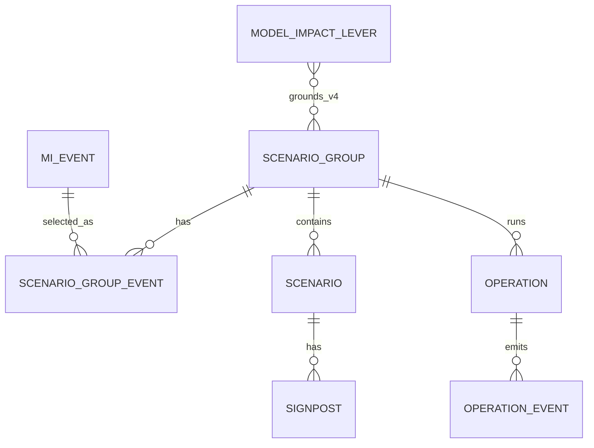

# Scenario Group Agent DB Spec

## 기준

이 문서는 Scenario Group Agent가 읽고 쓰는 table의 관계와 업무상 중요한 컬럼을 설명한다. 실제 column type,
index, constraint mapping은 `apps/persistence/<domain>/models.py`가 런타임 정본이다. DB migration의 정본은
별도 `skmip-mi-agent-mgmt` 저장소의 Alembic이며, 현재 Scenario 관련 기준 revision은 0026이다.

Agent flow나 node에서 SQL을 직접 실행하지 않는다.

```text
flow / node
  → apps/agents/scenario_group_agent/persistence/*_service.py
  → apps/persistence/<domain>/repository.py
  → ORM model
```

## 관계 개요



### 관계 기호와 이름

| 표기 | 의미 |
| --- | --- |
| `||` | 정확히 1개이며 필수 |
| `o|`, `|o` | 0개 또는 1개 |
| `|{`, `}|` | 1개 이상 |
| `o{`, `}o` | 0개 이상 |
| `||--o{` | 왼쪽 1개에 오른쪽 0개 이상이 연결되는 1:N 관계 |
| `}o--o{` | 양쪽 모두 0개 이상 연결될 수 있는 선택적 N:M 관계 |

관계 이름은 Mermaid나 DB가 해석하는 제약 키워드가 아니라 업무 의미를 설명하는 label이다. `selected_as`는
Event가 Scenario Group 생성 대상으로 선택된 관계, `has`는 상위 개체가 하위 개체를 가지는 관계,
`contains`는 Group이 Scenario를 구성요소로 포함하는 관계를 뜻한다. 필수 여부와 개수는 관계 이름이 아니라
위 기호로 읽으며, 실제 FK, null 허용 여부, 삭제 동작은 ORM과 migration 정의를 따른다.

`MI_EVENT`와 `SCENARIO_GROUP`은 `SCENARIO_GROUP_EVENT` 연결 table을 통해 N:M 관계를 구성한다. 즉 하나의
Event가 여러 Group에 선택될 수 있고, 하나의 Group도 여러 Event를 선택할 수 있다.

## 1. 입력 정본

### Event

| Table | 역할 |
| --- | --- |
| `tmm_mi_mievent_m` | Event 제목, 요약, 핵심 사실, 발생 시각, 추천 상태 |
| `tmm_mi_event_type_l1_m` | Event Type L1 master |
| `tmm_mi_event_type_l2_m` | Event Type L2 master |
| `tmm_mi_mievent_record_map` | Event와 원본 MI record 관계 |

v4 create는 Event Type Template을 생성 기준으로 사용하지 않지만 Event 상세 조회와 legacy v1~v3 복원에는
Event Type 관계가 필요하다.

검색 문서 샘플 export는 `EventRepository.list_search_sources`로 `del_yn='N'`, `publish_status='PUBLISHED'`
Event와 활성 Record 연결을 읽는다. 신규 컬럼이나 테이블을 만들지 않는다. 사용자별 권한을 평가하는
운영 검색 API는 아니며, 문서 변환 계약은 [Event 검색 문서 구성](09_EVENT_SEARCH_DOCUMENTS.md)을 따른다.

### Dimension Template과 Impact Lever

| Table | 역할 |
| --- | --- |
| `tmm_mi_scenario_dimension_template_m` | legacy v1~v3 Event Type별 Dimension Template |
| `tmm_mi_model_impact_lever_m` | v4 LNG 영향 Lever catalog와 model parameter binding |

v4는 `lever_code`, domain, 설명, 적용 기준, `parameter_bindings`, catalog version을 사용한다. 0030 이후 identity는
`(catalog_version, lever_code)`이며 domain index와 parent self-FK도 catalog version을 함께 사용한다. v4 create는
설정의 `scenario_group_v4_impact_catalog_version`(현재 신규 Group은 `v4.1`), `use_yn='Y'`, `del_yn='N'`을
명시적으로 조회하고 그 checksum을 Group에 pin한다. v4.1의 `route_disruption`, `trade_restriction`과
`price_only` Lever는 conditional binding이 있어 Model Parameter 근거 판정 후보가 될 수 있다. unknown Parameter
binding이나 version 혼합은 계약 오류로 fail-close한다.
Additional Dimension 생성과 Presentation label enrichment도 Group의 `impact_catalog_version`과
`impact_catalog_checksum`을 한 쌍으로 검증한다. 같은 version 문자열이라도 checksum이 다르면 현재 catalog 의미를
과거 Group에 소급하지 않는다.

## 2. Scenario Group

### `tmm_mi_scenario_group_m`

Scenario Group의 master다.

| 컬럼 | 역할 |
| --- | --- |
| `scenario_group_id` | Group 식별자 |
| `request_usr_id` | 소유 사용자 |
| `title`, `summary`, `description` | 사용자 표시 메타데이터 |
| `dimension_selected` | table header 순서의 Dimension ID 배열 |
| `scenario_count` | 활성 Scenario 수 |
| `status`, `stage` | 업무 상태와 단계 |
| `api_version`, `generation_strategy` | 생성 엔진 계약 |
| `event_set_hash` | 순서와 무관한 Event 조합 식별 정보; 동일 조합의 새 그룹 생성을 차단하지 않음 |
| `impact_catalog_version`, `impact_catalog_checksum` | v4 Lever catalog snapshot 식별자 |
| `template_checksum` | legacy Template 호환 정보 |
| `dimension_definitions` | Dimension·Value 정의 JSON |
| `generation_diagnostics` | v4 분석·lineage·경고·Additional Dimension lifecycle JSON |
| `parameter_mapping_ready` | mapping proposal 승인 준비 상태 |
| `del_yn` | soft delete |

master에는 대표 `mi_event_id`, `event_type_l2_id`를 두지 않는다. 단일 Event 호환 필드는 활성 Event 관계가
정확히 하나일 때 API projection에서만 계산한다.

### `tmm_mi_scenario_group_event_m`

Scenario Group과 Event의 N:M 관계이자 Event lineage 정본이다.

| 컬럼 | 역할 |
| --- | --- |
| `scenario_group_event_id` | 관계 식별자 |
| `scenario_group_id`, `mi_event_id` | Group·Event FK |
| `event_type_l2_id` | 생성 시점 Event Type lineage |
| `scenario_dimension_template_id`, `template_checksum` | legacy Template lineage |
| `display_order` | 요청 Event 표시 순서 |

같은 Group 안의 Event는 중복될 수 없다(`scenario_group_id`, `mi_event_id` 유일성). 같은 Event 또는 Event
조합을 여러 Group에 연결할 수 있으며, 기존 Group의 소유자나 operation 상태에 관계없이 새 Group을 생성한다.

## 3. Scenario와 Signpost

### `tmm_mi_scenario_m`

| 컬럼 | 역할 |
| --- | --- |
| `scenario_id`, `scenario_group_id` | Scenario와 소속 Group |
| `title`, `narrative`, `display_order` | 사용자 표시 내용과 순서 |
| `status` | `creating | created | realized | discarded` |
| `dimension_values` | `{dimensionId: valueId}` 의미의 JSON |
| `probability_score`, `probability_delta` | 현재 확률과 증감 |
| `baseline_yn` | 기준 Scenario 여부 `Y|N` |
| `global_pressure_band` | DB 호환명으로 저장하는 JKM pressure band |
| `scenario_role` | floor, ceiling, mixed 등 생성 역할 |
| `global_pressure_rationale` | JKM pressure 근거 |
| `related_markets` | 선택적인 TTF·HH 보조 근거 JSON |
| `del_yn` | soft delete |

public API의 `pressureBand`, `pressureRationale`은 persistence adapter가 DB 호환 컬럼명에서 변환한다.
`impact_jkm`, `impact_ttf`, `impact_hh`는 legacy 컬럼이며 신규 생성은 가격 방향을 쓰지 않고 `NULL`을 유지한다.

### `tmm_mi_signpost_m`

Scenario별 관측 신호다. 주요 컬럼은 `label`, `probability_direction_code`, `strength`,
`probability_impact_score`, `signpost_reason`, `keyword_hints`, `display_order`, `use_yn`, `del_yn`이다.

Signpost 재생성이 필요한 Scenario의 기존 row는 soft delete하고 새 결과를 저장한다. hard delete는 로컬 관리
경로에서만 허용한다.

## 4. Operation과 SSE event

### `tmm_mi_scenario_group_operation_m`

create, validation, signpost, confirmation, quality_evaluation 작업의 master다.

| 컬럼 | 역할 |
| --- | --- |
| `operation_id` | 26자리 ULID |
| `scenario_group_id`, `operation_type`, `engine_version` | 작업 대상과 종류 |
| `status`, `current_phase` | 실행 상태와 phase |
| `retry_summary` | 단계별 재시도 요약 |
| `presentation_snapshot` | 검증 완료된 중간 Presentation projection |
| `result_payload` | Validation 결과·Change Set 같은 내부 terminal payload |
| `snapshot_revision`, `latest_sequence` | 화면 revision과 SSE cursor |
| `last_error`, `mlflow_trace_id` | 오류·추적 정보 |
| `started_at`, `completed_at`, `heartbeat_at` | 실행 수명 정보 |

operation status는 `queued | running | succeeded | failed | interrupted`다. `result_payload`는 내부 정본이며
Scenario Group 상세나 Presentation에 자동 병합하지 않는다.

### `tmm_mi_scenario_group_operation_event_h`

operation별 append-only SSE history다. `(operation_id, sequence)`는 유일하며 sequence는 1부터 증가한다.
`event_type`, `phase`, 사용자용 `title`·`message_markdown`, 구조화 `payload`, `snapshot_revision`, trace ID를
저장한다.

Scenario Group, create operation, 첫 `accepted` event는 같은 transaction으로 생성한다. 검증된 중간 projection과
`section_ready`도 같은 transaction에서 revision을 맞춘다.

## 5. Dimension value mapping

`tmm_mi_scenario_quality_eval_m`은 평가 operation과 operation_id PK/FK로 연결되는 1:1 상세다.
requestId UUID는 전역 unique이며 입력 snapshot/hash, prompt version, 점수·위반 JSON, 모델 사용량을 저장한다.
실행 상태·heartbeat·오류는 operation이 소유한다. 상세: [품질 평가](07_SCENARIO_QUALITY_EVALUATION.md).

`tmm_mi_dimension_value_mapping_m`은 legacy v2/v3 자유값을 model parameter source에 연결하는 proposal과
승인 상태를 저장한다. 주요 값은 `dimension_value_id`, `dimension_id`, `display_value`,
`source_projections`, `mapping_proposal`, `mapping_version`, `status`다.

v4 closed enum Dimension과 `leverStates`는 이 자유값 mapping을 생성 경로의 정본으로 사용하지 않는다.

## 상태 전이

| 작업 | Group status | Group stage | Scenario status |
| --- | --- | --- | --- |
| create 완료 | `creating` | `scenario_created` | `creating` |
| Validation 통과 | `creating` | `scenario_validated` | `creating` |
| Validation 차단 | `creating` | `scenario_created` | `creating` |
| Signpost 완료 | `creating` | `signpost_created` | `created` |
| v4 direct Confirmation | `created` | `completed` | `created` |
| Signpost 후 Confirmation | `created` | `completed` | `created` |

## Transaction 경계

- canonical create 접수: Group + Event 관계 + operation + `accepted`
- Presentation 중간 갱신: operation projection + revision + `section_ready`
- create 완료: Group/Scenario 일괄 저장 후 operation terminal event
- Validation 완료: Change Set 1회 적용 + application fingerprint 기록
- Signpost prepare: Validation/application fingerprint 재검사 + operation 생성
- v4 direct Confirmation: Validation/application fingerprint 재검사 + Signpost 0건 허용 + Group·Scenario 상태 변경
- Signpost 후 Confirmation: stale 검사 + Scenario·Signpost 변경 적용 + Group·Scenario 상태 변경
- soft delete: active operation 부재와 소유권 확인 후 Group 상태 변경

긴 LLM 호출 동안 DB row lock을 유지하지 않는다. prepare와 최종 apply에서 fingerprint 또는 row lock으로
동시 변경을 다시 확인한다.

## DB 변경 체크리스트

- migration은 관리 저장소에 먼저 정의하고 이 저장소 ORM·DTO를 함께 맞춘다.
- JSON shape 변경은 write, legacy read, Presentation, callback, manual runner를 함께 검토한다.
- Event lineage를 master 대표 컬럼으로 되돌리지 않는다.
- 신규 query는 공유 repository, 여러 repository 조합은 Agent service에 둔다.
- status/stage/check constraint와 API enum을 함께 검증한다.
- soft delete와 `includeDeleted` 의미를 명시한다.
