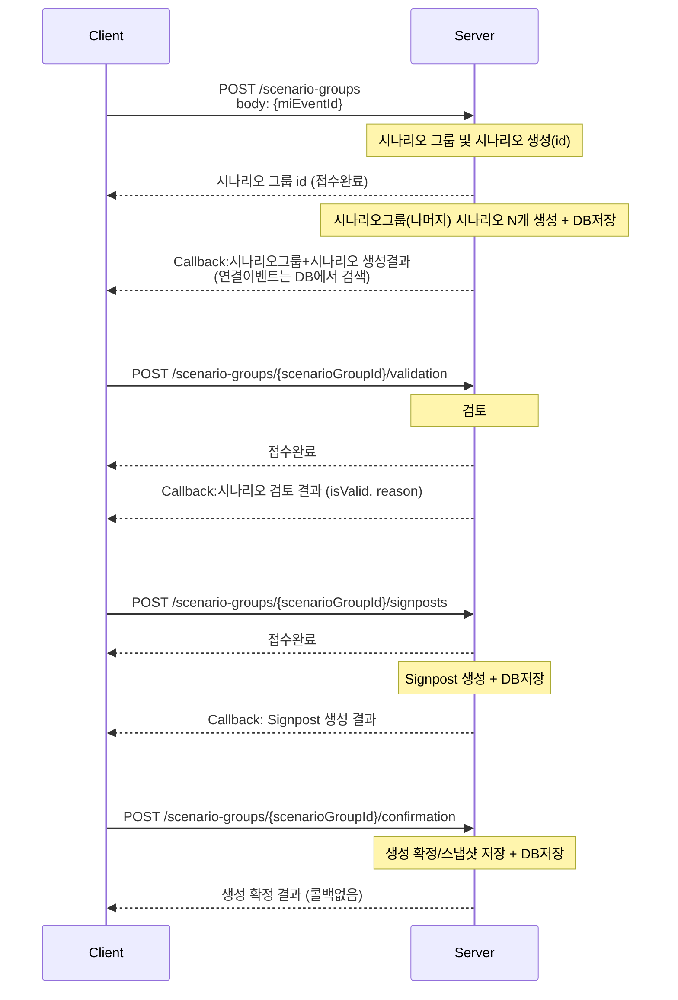

# Scenario Group Agent API Request/Response

> 버전: v7

<aside>
💡

시간이 오래 걸리는 시나리오 생성, 시나리오 검토, Signpost 생성은 HTTP 요청에서 접수 상태를 즉시 반환하고, 작업 완료 후 callback으로 최종 결과를 전송합니다.

즉시 응답은 `ScenarioGroupAcceptedOut` 형태이며, 최종 결과 payload는 각 API의 Callback Body를 기준으로 합니다.

</aside>



## Scenario Group과 Scenario 의 status / stage

### Scenario Group (`tmm_mi_scenario_group_m`)

- `status` (DB default: `creating`)
    - `creating`: 시나리오/사인포스트 생성 진행 중
    - `created`: 생성 파이프라인 완료(검토/확정 대기)
    - `realized`: 실현 처리
- `stage` (DB default: `ready`)
    - `ready`: 그룹 생성 직후 초기 상태
    - `scenario_created`: 시나리오 생성 완료
    - `scenario_validated`: 시나리오 검증 완료
    - `signpost_created`: 시나리오별 signpost 생성 완료
    - `completed`: confirmation 완료(스냅샷 저장 완료)

### Scenario (`tmm_mi_scenario_m`)

- `status` (DB default: `creating`)
    - `creating`: 개별 시나리오 생성 중
    - `created`: 생성 완료
    - `realized`: 실현 시나리오로 판정
    - `discarded`: 폐기 시나리오
- `stage`
    - 별도 컬럼 없음. 단계 관리는 시나리오 그룹의 `stage`를 기준으로 동기화한다.
- DB 제약
    - `ck_tmm_mi_scenario_m_02`: `status IN ('creating','created','realized','discarded')`

| API | Scenario Group status | Scenario Group stage | Scenario status |
| --- | --- | --- | --- |
| create scenario | `creating` | `scenario_created` | `creating` |
| validation | `creating` | 성공 `scenario_validated`<br>실패 `scenario_created` | `creating` |
| create signpost | `creating` | `signpost_created` | `created` |
| confirmation | `created` | `completed` | `created` |

## API

### 0) Event 목록/상세 조회

Backoffice Event List와 Event Detail 화면을 위한 조회 API입니다.

- `GET /events`
  - Query: `keyword`, `status`(`new`/`updated`), `eventTypeL1Id`, `eventTypeL2Id`, `recommendedOnly`, `dateFrom`, `dateTo`, `sort`, `page`, `pageSize`
  - Response: `rows`, `pagination`, `source`
  - 각 row는 `miEventId`, title/summary/time/category, Event Type L1/L2, signal/recommended metadata, market impact summary, `relatedScenarioGroup`, `scenarioActionState`를 포함합니다.
  - `scenarioActionState.type`은 `create`, `continue_generation`, `open_detail`, `disabled` 중 하나입니다.
- `GET /events/{mi_event_id}`
  - Response: `event`, `scenarioTemplate`, `source`
  - `scenarioTemplate`은 event type L2 기준 `tmm_mi_scenario_dimension_template_m.template_json`을 raw JSON과 display용 dimension 목록으로 반환합니다.

Backoffice Scenario Group List를 위한 목록 API도 제공합니다.

- `GET /scenario-groups`
  - Query: `includeDeleted`, `miEventId`, `keyword`, `status`, `stage`, `sort`
  - Response: `rows`, `meta`
  - 각 row는 scenario group ID/name, base `miEventId`, status/stage, scenario/signpost count, created/updated time, deleted state를 포함합니다.

### 1) 시나리오 그룹 및 시나리오 생성

- Method/Path: `POST /scenario-groups`
- Description: `miEventId`를 기준으로 시나리오 그룹/시나리오를 생성한다.

Request

```json
{
  "miEventId": 12345,
  "userId": 10001
}
```

| Field | Type | Required | Description |
| --- | --- | --- | --- |
| `miEventId` | number | Y | MI Event 식별자 |
| `userId` | number | Y | 요청 사용자 식별자(int) |

Response

```json
{
  "status": "success",
  "message": "성공",
  "data": {
    "scenarioGroupId": 1,
    "status": "creating",
    "stage": "ready"
  }
}
```

| Field | Type | Required | Description |
| --- | --- | --- | --- |
| `status` | string | Y | `"success" \| "error"` |
| `message` | string | Y | 처리 결과 메시지 |
| `data.scenarioGroupId` | number | Y | 생성된 시나리오 그룹 ID |
| `data.status` | string | Y | Scenario Group status |
| `data.stage` | string | Y | Scenario Group stage |

Error Response

```json
{
  "status": "error",
  "message": "Event not found for miEventId=113",
  "data": null
}
```

CallBack Body (`CreateScenariosOut`)

> Platform Team에서 정의 예정

```json
{
  "result": "success",
  "reason": null,
  "scenarioGroup": {
    "scenarioGroupId": 12345,
    "miEventId": 998877,
    "eventTypeL2Id": 12,
    "title": "호르무즈 봉쇄 + 전면전",
    "summary": "단기 공급 차질 및 운임 급등 시나리오",
    "description": "상세 설명...",
    "dimensionSelected": ["period_label", "capacity_change", "recovery"],
    "scenarioCount": 5,
    "status": "creating",
    "stage": "scenario_created"
  },
  "table": {
    "headers": [
      { "key": "period_label", "label": "기간", "displayOrder": 1 },
      { "key": "capacity_change", "label": "생산능력 변화", "displayOrder": 2 },
      { "key": "recovery", "label": "공급 복구", "displayOrder": 3 }
    ],
    "rows": [
      {
        "scenarioId": 90001,
        "displayOrder": 1,
        "title": "단기 외교 해결",
        "cells": {
          "period_label": "2026.5월 말 (~2개월)",
          "capacity_change": "15%",
          "recovery": "4~6주 대다수 재기동"
        },
        "baselineYn": "Y"
      }
    ]
  }
}
```

| Path | Type | Required | Description |
| --- | --- | --- | --- |
| `status` | string | Y | `"success" \| "error"` |
| `message` | string | Y | 처리 결과 메시지 |
| `data.scenarioGroup` | object | Y | 시나리오 그룹 메타 정보 |
| `data.scenarioGroup.scenarioGroupId` | number | Y | 시나리오 그룹 ID |
| `data.scenarioGroup.miEventId` | number | Y | 연결된 MI Event ID |
| `data.scenarioGroup.eventTypeL2Id` | number | Y | Event type L2 ID |
| `data.scenarioGroup.title` | string | Y | 시나리오 그룹 제목 |
| `data.scenarioGroup.summary` | string | N | 시나리오 그룹 요약 |
| `data.scenarioGroup.description` | string | N | 시나리오 그룹 상세 설명 |
| `data.scenarioGroup.dimensionSelected` | array(json) | Y | 선택된 테이블 차원 키 목록 |
| `data.scenarioGroup.scenarioCount` | number | Y | 생성 시나리오 개수 |
| `data.scenarioGroup.status` | string | Y | Scenario Group status |
| `data.scenarioGroup.stage` | string | Y | Scenario Group stage |
| `data.table.headers` | array(json) | Y | 테이블 헤더 정의 |
| `data.table.headers[].key` | string | Y | 컬럼 키(예: `period_label`) |
| `data.table.headers[].label` | string | Y | 표시 라벨 |
| `data.table.headers[].displayOrder` | number | Y | 표시 순서 |
| `data.table.rows` | array(json) | Y | 시나리오 행 목록 |
| `data.table.rows[].scenarioId` | number | Y | 시나리오 ID |
| `data.table.rows[].displayOrder` | number | Y | 표시 순서 |
| `data.table.rows[].title` | string | Y | 시나리오 제목 |
| `data.table.rows[].narrative` | string | N | 시나리오 내러티브 |
| `data.table.rows[].cells` | object | Y | 헤더 key별 셀 값 |
| `data.table.rows[].metrics` | object | N | 확률/실현가능성 등 메트릭 |
| `data.table.rows[].impact` | object | N | 시장 영향(예: jkm/ttf/hh) |
| `data.table.rows[].baselineYn` | CHAR(1) | N | Baseline 여부(`"Y" \| "N"`) |

### 2) 시나리오 검증

- Method/Path: `POST /scenario-groups/{scenarioGroupId}/validation`
- Description: 생성된 시나리오 그룹의 유효성을 검증한다.
- Path Param: `scenarioGroupId` (int)

Request body

```json
{
  "user_id": "10001",
  "table": {
    "headers": [
      { "key": "period_label", "label": "기간", "displayOrder": 1 },
      { "key": "capacity_change", "label": "생산능력 변화", "displayOrder": 2 },
      { "key": "recovery", "label": "공급 복구", "displayOrder": 3 },
      { "key": "new_dimension", "label": "새로운 분기항목(예시)", "displayOrder": 3 }
    ],
    "rows": [
      {
        "scenarioId": 90001,
        "displayOrder": 1,
        "title": "단기 외교 해결(시나리오명1)",
        "cells": {
          "period_label": "2026.5월 말 (~2개월)",
          "capacity_change": "15%",
          "recovery": "4~6주 대다수 재기동",
          "new_dimension": null
        }
      }
    ]
  }
}
```

> `new_dimension` 처럼 분기 기준 추가로 인해 agent가 자동생성 해야 하는 값인 경우 `null`로 넣어주세요.

| Path | Type | Required | Description |
| --- | --- | --- | --- |
| `user_id` | number | Y | 요청 사용자 식별자(int) |
| `scenarioGroup` | object | Y | 검증 대상 시나리오 그룹 정보 |
| `scenarioGroup.scenarioGroupId` | number | Y | 시나리오 그룹 ID |
| `scenarioGroup.miEventId` | number | Y | 연결된 MI Event ID |
| `scenarioGroup.eventTypeL2Id` | number | Y | Event type L2 ID |
| `scenarioGroup.title` | string | Y | 제목 |
| `scenarioGroup.summary` | string | N | 요약 |
| `scenarioGroup.description` | string | N | 상세 설명 |
| `table.headers` | array(json) | Y | 테이블 헤더 정의 |
| `table.rows` | array&lt;object&gt; | Y | 검증 대상 시나리오 행 목록 |
| `table.rows[].scenarioId` | number | Y | 시나리오 ID |
| `table.rows[].cells` | object | Y | 헤더 key별 셀 값 |

Response (`ValidateScenariosOut`)

```json
{
  "status": "success",
  "message": "성공",
  "data": {
    "scenarioGroupId": 1,
    "status": "creating",
    "stage": "scenario_created"
  }
}
```

Error Response

```json
{
  "status": "error",
  "message": "Event not found for ScenarioGroupId=113",
  "data": null
}
```

| Path | Type | Required | Description |
| --- | --- | --- | --- |
| `status` | string | Y | `"success" \| "error"` |
| `message` | string | Y | 처리 결과 메시지 |
| `data.scenarioGroupId` | number | Y | 시나리오 그룹 ID |
| `data.isValid` | boolean | N | 검증 결과(상세 포함 시) |
| `data.reason` | string | N | 검증 사유(상세 포함 시) |
| `data.status` | string | Y | Scenario Group status |
| `data.stage` | string | Y | Scenario Group stage |

Callback Body

```json
{
  "result": "success",
  "isValid": true,
  "reason": "MECE and plausibility checks passed",
  "scenarioGroup": {
    "scenarioGroupId": 12345,
    "status": "creating",
    "stage": "scenario_validated"
  },
  "table": {
    "headers": [
      { "key": "period_label", "label": "기간", "displayOrder": 1 },
      { "key": "capacity_change", "label": "생산능력 변화", "displayOrder": 2 },
      { "key": "recovery", "label": "공급 복구", "displayOrder": 3 },
      { "key": "new_dimension", "label": "새로운 분기항목(예시)", "displayOrder": 3 }
    ],
    "rows": [
      {
        "scenarioId": 90001,
        "displayOrder": 1,
        "title": "단기 외교 해결(시나리오명1)",
        "cells": {
          "period_label": "2026.5월 말 (~2개월)",
          "capacity_change": "15%",
          "recovery": "4~6주 대다수 재기동",
          "new_dimension": "new_value"
        }
      }
    ]
  }
}
```

> `table`은 agent가 자동생성한 값을 포함한 전체 테이블의 header/value를 담습니다. Agent가 자동생성한 값은 DB에는 저장하지 않습니다.

| Path | Type | Required | Description |
| --- | --- | --- | --- |
| `status` | string | Y | `"success" \| "error"` |
| `message` | string | Y | 처리 결과 메시지 |
| `data.scenarioGroupId` | number | Y | 시나리오 그룹 ID |
| `data.isValid` | boolean | Y | 검증 결과 |
| `data.reason` | string | N | 검증 사유/코멘트 |
| `data.table` | object | Y | 검증 후 테이블(헤더/행) |
| `data.table.headers` | array(json) | Y | 테이블 헤더 정의 |
| `data.table.headers[].key` | string | Y | 컬럼 키(예: `period_label`) |
| `data.table.headers[].label` | string | Y | 표시 라벨 |
| `data.table.headers[].displayOrder` | number | Y | 표시 순서 |
| `data.table.rows` | array(json) | Y | 검증 결과 행 목록 |
| `data.table.rows[].scenarioId` | number | Y | 시나리오 ID |
| `data.table.rows[].displayOrder` | number | Y | 표시순서 |
| `data.table.rows[].title` | string | Y | 시나리오 제목 |
| `data.table.rows[].cells` | object | Y | 헤더 key별 셀 값(검증/자동생성 값 포함) |
| `data.status` | string | Y | Scenario Group status |
| `data.stage` | string | Y | Scenario Group stage |

### 3) Signpost 생성

- Method/Path: `POST /scenario-groups/{scenarioGroupId}/signposts`
- Description: 시나리오 그룹 기준 signpost를 생성한다.
- Path Param: `scenarioGroupId` (int)

Request (body)

```json
{
  "userId": 10001,
  "table": {
    "headers": [
      { "key": "period_label", "label": "기간", "displayOrder": 1 },
      { "key": "capacity_change", "label": "생산능력 변화", "displayOrder": 2 },
      { "key": "recovery", "label": "공급 복구", "displayOrder": 3 },
      { "key": "new_dimension", "label": "새로운 분기항목(예시)", "displayOrder": 3 }
    ],
    "rows": [
      {
        "scenarioId": 90001,
        "displayOrder": 1,
        "title": "단기 외교 해결(시나리오명1)",
        "cells": {
          "period_label": "2026.5월 말 (~2개월)",
          "capacity_change": "15%",
          "recovery": "4~6주 대다수 재기동",
          "new_dimension": "new_value"
        }
      },
      {
        "scenarioId": null,
        "displayOrder": 2,
        "title": "중장기 갈등 해소(시나리오명2)",
        "cells": {
          "period_label": "~6개월",
          "capacity_change": "30%",
          "recovery": "9주 대다수 재기동",
          "new_dimension": "new_value"
        }
      }
    ]
  }
}
```

> 검증이 끝난 뒤 사용자가 추가한 신규 시나리오는 `scenarioId: null`로 보내주세요. Signpost 생성 request body의 값으로 scenarioGroup, scenario 테이블을 업데이트합니다.

| Field | Type | Required | Description |
| --- | --- | --- | --- |
| `userId` | number | N | 요청 사용자 식별자(int) |
| `table` | object | Y | Signpost 생성을 위한 테이블(헤더/행) |
| `table.headers` | array(json) | Y | 테이블 헤더 정의 |
| `table.headers[].key` | string | Y | 컬럼 키(예: `period_label`) |
| `table.headers[].label` | string | Y | 표시 라벨 |
| `table.headers[].displayOrder` | number | Y | 표시 순서 |
| `table.rows` | array(object) | Y | 대상 시나리오 행 목록 |
| `table.rows[].scenarioId` | number | Y | 시나리오 ID |
| `table.rows[].displayOrder` | number | Y | 표시 순서 |
| `table.rows[].title` | string | Y | 시나리오 제목 |
| `table.rows[].cells` | object | Y | 헤더 key별 셀 값 |

Response (`CreateSignpostsOut`)

```json
{
  "status": "success",
  "message": "성공",
  "data": {
    "scenarioGroupId": 1001,
    "status": "creating",
    "stage": "scenario_validated"
  }
}
```

| Path | Type | Required | Description |
| --- | --- | --- | --- |
| `status` | string | Y | `"success" \| "error"` |
| `message` | string | Y | 처리 결과 메시지 |
| `data.scenarioGroupId` | number | Y | 시나리오 그룹 ID |
| `data.status` | string | Y | Scenario Group status |
| `data.stage` | string | Y | Scenario Group stage |

Error Response

```json
{
  "status": "error",
  "message": "Event not found for ScenarioGroupId=1001",
  "data": null
}
```

Callback Body

```json
{
  "result": "success",
  "reason": null,
  "scenarioGroup": {
    "scenarioGroupId": 12345,
    "miEventId": 998877,
    "eventTypeL2Id": 12,
    "title": "호르무즈 봉쇄 + 전면전",
    "dimensionSelected": ["period_label", "capacity_change", "recovery"],
    "scenarioCount": 5,
    "status": "creating",
    "stage": "signpost_created"
  },
  "table": {
    "headers": [
      { "key": "period_label", "label": "기간", "displayOrder": 1 },
      { "key": "capacity_change", "label": "생산능력 변화", "displayOrder": 2 },
      { "key": "recovery", "label": "공급 복구", "displayOrder": 3 }
    ],
    "rows": [
      {
        "scenarioId": 90001,
        "displayOrder": 1,
        "title": "단기 외교 해결",
        "narrative": "시나리오 내러티브...",
        "cells": {
          "period_label": "2026.5월 말 (~2개월)",
          "capacity_change": "15%",
          "recovery": "4~6주 대다수 재기동"
        },
        "metrics": {
          "probabilityScore": 75.0,
          "probabilityDelta": 0.0
        },
        "baselineYn": "Y",
        "signposts": [
          {
            "signpostId": 1,
            "label": "호르무즈 봉쇄 장기화",
            "probabilityDirectionCode": "sup",
            "probabilityImpactScore": 12.5,
            "signpostReason": "운송 리스크 확대 및 대체 항로 비용 증가",
            "displayOrder": 1,
            "strength": "STRONG"
          }
        ]
      }
    ]
  }
}
```

| Path | Type | Required | Description |
| --- | --- | --- | --- |
| `status` | string | Y | `"success" \| "error"` |
| `message` | string | Y | 처리 결과 메시지 |
| `data.scenarioGroup` | object | Y | 시나리오 그룹 메타 정보 |
| `data.table` | object | Y | 시나리오 테이블(행 + signposts 포함) |
| `data.table.rows[].signposts` | array(json) | Y | 시나리오별 Signpost 목록 |
| `data.table.rows[].signposts[].signpostId` | number | Y | Signpost ID |
| `data.table.rows[].signposts[].label` | string | Y | Signpost 라벨 |
| `data.table.rows[].signposts[].probabilityDirectionCode` | string | N | 확률 방향 코드(phase1에서는 `"sup"` 단일, 가능성강화) |
| `data.table.rows[].signposts[].probabilityImpactScore` | DECIMAL(5,2) | N | 확률 영향 점수 |
| `data.table.rows[].signposts[].signpostReason` | string | N | Signpost 사유 |
| `data.table.rows[].signposts[].displayOrder` | number | N | 표시 순서 |
| `data.table.rows[].signposts[].strength` | string | N | Signpost 강도(예: STRONG/MEDIUM/WEAK) |

### 4) 생성 확정

- Method/Path: `POST /scenario-groups/{scenarioGroupId}/confirmation`
- Description: 시나리오/사인포스트 생성 결과를 확정하고 스냅샷을 남긴다.
- Path Param: `scenarioGroupId` (int)

Request Body:

```json
{
  "scenarioGroup": {
    "title": "호르무즈 봉쇄 + 전면전",
    "summary": "단기 공급 차질 및 운임 급등 시나리오",
    "description": "상세 설명..."
  },
  "table": {
    "headers": [
      { "key": "period_label", "label": "기간", "displayOrder": 1 },
      { "key": "capacity_change", "label": "생산능력 변화", "displayOrder": 2 },
      { "key": "recovery", "label": "공급 복구", "displayOrder": 3 }
    ],
    "rows": [
      {
        "scenarioId": 90001,
        "displayOrder": 1,
        "title": "단기 외교 해결",
        "narrative": "시나리오 내러티브...",
        "cells": {
          "period_label": "2026.5월 말 (~2개월)",
          "capacity_change": "15%",
          "recovery": "4~6주 대다수 재기동"
        },
        "metrics": {
          "probabilityScore": 75.0,
          "probabilityDelta": 0.0
        },
        "baselineYn": "Y",
        "signposts": [
          {
            "signpostId": 1,
            "label": "호르무즈 봉쇄 장기화",
            "probabilityDirectionCode": "sup",
            "signpostReason": "운송 리스크 확대 및 대체 항로 비용 증가",
            "displayOrder": 1,
            "strength": "STRONG",
            "useYn": "Y"
          }
        ]
      }
    ]
  }
}
```

| Path | Type | Required | Description |
| --- | --- | --- | --- |
| `scenarioGroup` | object | Y | 확정 대상 시나리오 그룹 |
| `table` | object | Y | 확정 대상 시나리오 테이블(행 + signposts 포함) |

Response (`ConfirmGenerationOut`)

```json
{
  "status": "success",
  "message": "성공",
  "data": {
    "scenarioGroupId": 1001,
    "status": "created",
    "stage": "completed"
  }
}
```

| Path | Type | Required | Description |
| --- | --- | --- | --- |
| `status` | string | Y | `"success" \| "error"` |
| `message` | string | Y | 처리 결과 메시지 |
| `data.scenarioGroupId` | number | Y | 시나리오 그룹 ID |
| `data.status` | string | Y | Scenario Group status |
| `data.stage` | string | Y | Scenario Group stage |

## 공통 응답 필드

- `status`: `"success" | "error"`
- `message`: 처리 결과 메시지

## 수정 이력

| 버전 | 수정내용 | 수정날짜 | 배포여부 (버전) |
| --- | --- | --- | --- |
| v2 | Req/Res body table 추가<br>`summary`, `description` 필수값을 `Y -> N`으로 변경(nullable 반영)<br>Signpost의 `probabilityDirectionCode`, `probabilityImpactScore` 필수값을 `Y -> N`으로 변경(nullable 반영)<br>예시 JSON 3곳에서 `feasibilityScore` 제거<br>Validation 요청의 `user_id` 표기 정리<br>Confirmation response의 `stage`는 `completed`로 반영된 상태 유지 | 26/06/10 | 외부망 배포<br>(v0.0.1) |
| v3 | Request Body의 user_id 를 string -> number(int) 타입으로 변경<br>confirmation API 에서 안쓰는 파라미터 삭제(scenarioGroupId, eventId 등) | 26/06/11 | 외부망 배포<br>(v0.0.2) |
| v4 | Validation API의 Request Body의 scenarioGroup 삭제(사유: 사용자가 수정못하는 영역이라 DB값 읽기로 함) | 26/06/12 | 외부망 배포<br>(v0.0.3) |
| v5 | 시나리오 검증 API의 request에 새로 추가된 dimension에 대한 예시 추가<br>시나리오 검증 API의 Callback Body에 table 필드 추가<br>Signpost 생성 API의 request body로 table 전체 수신<br>signpost 생성 callback body의 signpost 필드(`strength`, `keyword_hint`) 추가<br>확정 API의 request body의 signpost 필드(`strength`, `keyword_hint`) 추가<br>callback body를 platform에서 정의한 callback body(v1) 형식으로 업데이트 | 26/06/15 | - |
| v6 | 시나리오 검증(Validation) request body와 callback body에 `displayOrder`, `title` 추가<br>확률 방향 코드(phase1에서는 `"SUP"`만 있음) | 26/06/16 | - |
| v7 | Signpost 생성 Callback Body를 Platform Callback API(v2)에 맞게 수정<br>`probabilityDirectionCode` 값을 `"sup"`로 변경<br>`probabilityImpactScore` 추가<br>Callback Body에서 `scenarioGroup.summary`, `scenarioGroup.description`, `signposts[].useYn`, `signposts[].keyword_hints` 제거 | 26/06/18 | - |
