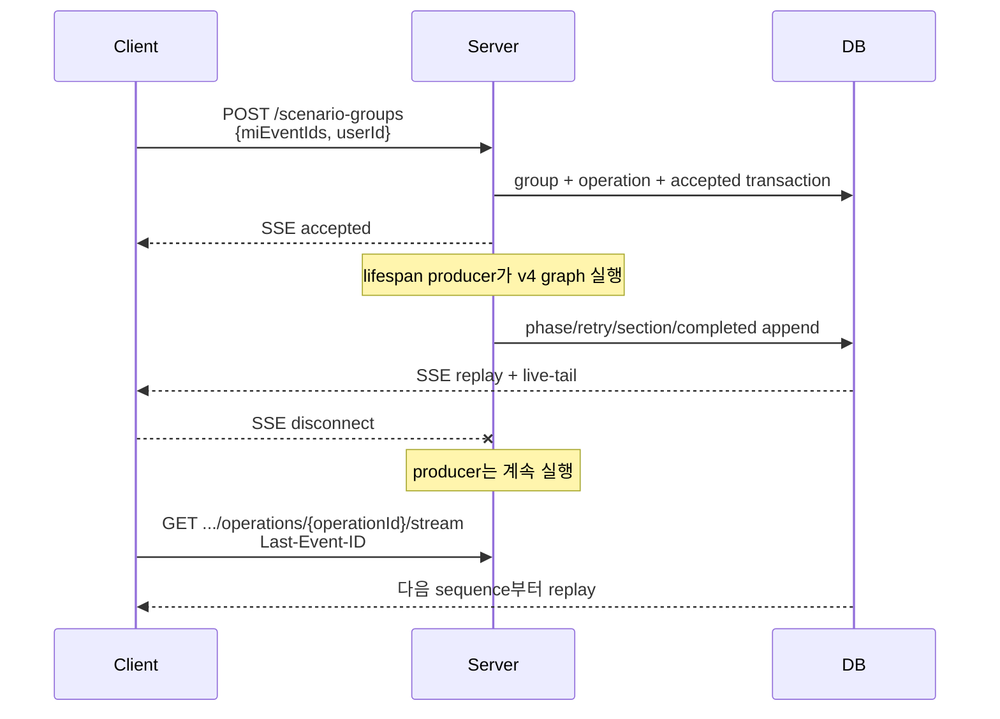

# Scenario Group Agent API Request/Response

> 버전: v10

## API surface 기준

- `/scenario-groups` 경로는 현재 운영 기준(canonical) API다.
- 검증·Signpost·확정도 `/scenario-groups/{scenarioGroupId}/...` canonical 경로를 사용한다.
- `/v1/scenario-groups*` endpoint는 제거됐다. 문서의 `v1` 표기는 과거 저장 데이터의
  `apiVersion`/`engineVersion`과 Presentation 복원 경로만 뜻한다.
- `/v2`, `/v3`, `/v4`의 `/sync` 경로는 버전별 생성 로직을 검증·비교하는 테스트 API다.
- router 모듈은 실행 계약과 transport 책임을 나눈 것이며, 별도의 Scenario Group 도메인을 뜻하지 않는다.

<aside>
💡

신규 Multi-Event 생성은 `POST /scenario-groups`의 SSE와 operation event DB를 사용합니다.
Scenario Group의 검토·Signpost·확정 API는 canonical 경로에서 기존 callback 계약을 유지합니다.

즉시 응답은 `ScenarioGroupAcceptedOut` 형태이며, 최종 결과 payload는 각 API의 Callback Body를 기준으로 합니다.

테스트 및 로컬 검증용으로 동일한 생성/검증 graph를 HTTP 요청 안에서 끝까지 실행하고 Callback Body를 응답으로 반환하는 sync endpoint도 제공합니다.
sync endpoint는 callback을 전송하지 않으며 운영 트래픽용 API가 아닙니다.

</aside>



### 신규 Multi-Event 업무·transport API

- `POST /scenario-groups`: `miEventIds` 1~5개와 `userId`를 받아 create operation을 시작하고 SSE 반환
- `GET /scenario-groups`: 공통 목록과 latest/active operation 요약 반환
- `GET /scenario-groups/{scenarioGroupId}`: 업무 Scenario table과 latest/active operation 반환.
  기본 `view=full`은 전체 상세를 반환한다. `view=table`은 `scenarioGroup` 기본 메타데이터와 `table`만
  반환하며, `dimensionSelected`는 table header label을 결합한 `dimensionKey|label` 형식이다.
  두 view 모두 `scenarioGroup.delYn`을 Scenario Group의 첫 필드로 직렬화한다.
- `GET /scenario-groups/{scenarioGroupId}/additional-dimensions`: v4 그룹의 아직
  승격되지 않은 Additional Dimension 후보를 조회한다. `generationStatus`는
  `not_requested|queued|running|ready|failed|interrupted|discarded`, 표시 상태는
  `pending|ready|unavailable`이다. v1~v3는 400으로 처리한다. 조회는 lifecycle stage와 무관하게
  저장된 후보 snapshot을 반환하되, 후보 생성·승격 같은 변경 작업은 각 작업의 stage 제한을 유지한다.
- `GET /scenario-groups/{scenarioGroupId}/presentation`: v1/v3/v4 차이를 흡수한 화면 전용 세 section read model 반환
- `DELETE /scenario-groups/{scenarioGroupId}`: soft delete. queued/running operation이 있으면 HTTP 409
- `GET /scenario-groups/{scenarioGroupId}/operations/{operationId}`: polling용 operation JSON
- `GET /scenario-groups/{scenarioGroupId}/operations/{operationId}/stream`: `Last-Event-ID` 이후 SSE replay/live-tail

SSE live-tail은 owner worker에서는 DB commit 후 process-local EventHub 알림을 사용한다. 다른
worker에서는 operation별 shared watcher가 `latestSequence`만 1초에서 최대 5초까지 adaptive
polling하고, sequence가 증가할 때만 subscriber cursor 이후 event history를 읽는다. keepalive는
DB polling과 분리한다. master row 조회가 일시적으로 실패해도 subscriber가 남아 있는 동안 watcher를
유지하고 최대 5초의 지수 backoff로 재시도한다.

### Additional Dimension 조회

`GET /scenario-groups/{scenarioGroupId}/additional-dimensions`는 request body와 query parameter가 없다.
GET은 저장된 후보만 읽으며 LLM 호출, background enqueue, 정식 Dimension 변경을 하지 않는다.
검증 후 수정·재검증 흐름을 지원하기 위해 `scenario_validated` 이후에도 동일한 저장 후보를 조회할 수 있다.

```json
{
  "status": "success",
  "message": "성공",
  "data": {
    "scenarioGroupId": 12345,
    "generationStatus": "ready",
    "dimensionDefinitions": {
      "status": "ready",
      "items": [
        {
          "dimensionId": "ad_1",
          "label": "공급 확대 지속성",
          "description": "공급 확대가 얼마나 지속되는가?",
          "rationale": "공급 분기 기준",
          "sourceEventIds": [101],
          "modelSupportStatus": "full",
          "values": [
            {
              "valueId": "ad_1_v1",
              "label": "단기 종료",
              "rationale": "공급 효과가 제한되는 가정",
              "pressureContribution": "balanced",
              "leverStates": []
            }
          ]
        }
      ]
    },
    "availableCount": 1,
    "updatedAt": "2026-08-19T10:00:20Z",
    "errorCode": null
  }
}
```

`queued|running`은 HTTP 200과 `dimensionDefinitions.status=pending`, 빈 `items`를 반환한다.
`failed|interrupted|discarded|not_requested`도 조회는 200이며 `status=unavailable`, 빈 `items`다.
`ready`이면서 후보가 0개인 경우도 정상 응답이다. 내부 source path/question/Lever lineage는
응답에 노출하지 않는다.

단, `queued`가 `queued_at` 기준으로 또는 `running`이 `started_at`(없으면 `queued_at`) 기준으로 설정값
`additional_dimension_stale_after_seconds`(기본 240초) 이상 지속되면 DB를 갱신하지 않고 해당 GET 응답만
`generationStatus=interrupted`, `dimensionDefinitions.status=unavailable`, 빈 `items`,
`errorCode=STALE_TIMEOUT`으로 투영한다. timestamp가 없거나 파싱할 수 없으면 저장 상태를 그대로 반환하며,
`ready`와 다른 terminal 상태는 stale 판정하지 않는다. 최상위 `status`는 계속 `success`다.

unused question이 없거나 LLM이 명시적으로 빈 `dimensions`를 반환한 경우는 `ready + 빈 items`다. LLM이
후보를 반환한 경우에는 item 단위로 검증해 일부 유효 후보를 보존하고 재시도하지 않는다. 반환 후보가 모두
탈락한 batch만 탈락 reason feedback과 1초·2초 backoff로 최대 3회 시도한다. 세 번 모두 전부 탈락하면
`generationStatus=failed`, `dimensionDefinitions.status=unavailable`,
`errorCode=ADDITIONAL_DIMENSION_CANDIDATES_INVALID`를 반환한다. 공개 response shape은 변경하지 않는다.
서버 재시작 시 `queued|running` 작업을 조회·갱신하거나 재등록·재실행하지 않는다. 실제 background가 늦게
완료되어 같은 `run_id`로 DB를 `ready`로 바꾸면 다음 GET은 후보를 정상 반환하므로, 이 조회 전용 상태에는
`interrupted → ready` 전이가 가능하다. `failed|interrupted` 작업은 자동 재실행하지 않으며 내부 `run_id`는
API 응답에 노출하지 않는다.

| HTTP | 조건 |
| --- | --- |
| 404 | Scenario Group이 없음 |
| 400 | v4 `multi_event_model_lever_dimensions` 그룹이 아님 |

### 화면 전용 Presentation API

`GET /scenario-groups/{scenarioGroupId}/presentation?operationId={operationId}`는 화면이 직접 사용하는
read model이다. `operationId`가 없으면 최신 operation을 선택하며, 다른 Scenario Group의 operation은
404로 처리한다. 응답은 엔진 버전과 무관하게 `eventAnalysis`, `scenarioDesign`,
`roleSelectionRationale` 세 section을 항상 포함한다. 각 section은
`pending | partial | ready | unavailable` 상태와 `full | limited | none` 근거 수준을 명시하며,
아직 준비되지 않은 문자열과 배열도 빈 값으로 유지한다.

Markdown의 생성 근거는 저장된 Event, Dimension, Scenario, generation diagnostics로 한정한다.
v4 `roleSelectionRationale`의 사용자 표시 문구는 현재 모델 영향 Lever master의 `lever_code → label`을
적용하며, label을 찾지 못한 code는 원문을 유지한다. Lever label은 화면 표시 메타데이터이므로 변경되면
Presentation 결과와 ETag도 함께 변경된다.
동적 문자열의 raw HTML은 escape하며 렌더링 결과 자체는 DB에 저장하지 않는다. 새 v4 Dimension의
최대 200자의 구체적인 선정 근거는 공통 Dimension `rationale`로 반환하며, 과거 v4 데이터에 근거가 없으면 `null`을 유지한다.
v3의 `derivationRationale`와 v4의 `assumptionRationale`는 공통 Dimension value `rationale`로 변환한다.
v4 Dimension value의 `description`은 저장된 명시값이 없으면 검증된 `leverStates`의
`timeWindow`, `scope`, `level`, `direction`을 입력 순서대로 문장화해 Presentation에서만 생성한다.
direction 한글명과 생성 단계의 허용 direction은 동일한 코드 Enum을 사용하며 DB에는 별도 저장하지 않는다.
Scenario cell은 value ID, value label 순서로 Dimension value와 연결해 동일한 표시 label과
`cellEvidence`를 만든다. v1은 저장되지 않은 impact path, rationale, role을 추정하지 않고 제한 또는
미제공 상태로 표시한다. 현재 Template은 저장된 `templateChecksum`과 canonical checksum이 일치할
때만 v1 Dimension 복원에 사용한다.

v4 `scenarioPressureBreakdowns`는 Scenario 제목이 아니라 Dimension ID/value ID의 전체 조합으로
`roleSelectionRationale`에 연결한다. 과거 label 기반 diagnostics도 현재 definition의 canonical ID로
정규화한 뒤 비교한다. 제목만 변경하거나 서로 교환해도 같은 조합의 Pressure 구성을 유지하며, 조합이
변경됐거나 신규 Scenario에 대응하는 breakdown이 없으면 제목 fallback 없이 Pressure 구성만 생략하고
저장된 Scenario 종합 근거와 cell evidence는 그대로 표시한다.

응답 `ETag`는 renderer version, operation ID, snapshot revision, Scenario Group 수정 시각과 현재 Lever label
mapping으로 만든다.
같은 값을 `If-None-Match`로 보내면 304를 반환한다. v4 진행 중 projection은 Event impact 검증 시
`eventAnalysis=partial`, interaction 검증 시 `eventAnalysis=ready`, Dimension 검증 시
`scenarioDesign=partial`로 갱신한다. `section_ready.details`는 변경 가능한 section 상태와 새
`snapshotRevision`을 포함한다.

기존 v1 데이터의 dry-run 분류, metadata/lineage 보완, 증적 기반 operation/event backfill과 rollback은
`scripts/migrations/20260811_backfill_v1_presentation_operations.sql`을 사용한다. operation ID는
Scenario Group과 operation type으로 결정론적으로 만들고 모든 insert를 idempotent하게 수행한다.

operation event는 `accepted`, `phase_started`, `retrying`, `validated`, `section_ready`,
`completed`, `failed`, `interrupted`를 사용한다. 실패 draft 원문은 event/presentation에 저장하지 않고
validation code, reference ID, 사용자 메시지만 저장한다.
`event_analysis`의 Event 영향 분석이 검증되고 2개 이상의 Event에 영향 경로가 있으면 `validated` 문구로
이어서 `Event 상호작용 분석`을 시작함을 안내한다. 상호작용 재시도는 `eventType=retrying`과 기존
`phase=event_analysis`를 유지하면서 제목과 메시지에 `Event 상호작용 분석` 용어를 사용한다.

producer는 기본 30초마다 operation heartbeat를 갱신한다. lifespan recovery monitor는 시작 직후와
이후 기본 30초마다 stale active operation을 확인하고, heartbeat가 기본 120초 이상 갱신되지 않은
`queued`/`running` operation을 원자적으로 `interrupted` 처리한다. 이 경우 `lastError.code`는
`STALE_HEARTBEAT`, event payload의 `reason`은 `stale_heartbeat`이며, 기존 operation 조회와 SSE가
terminal 상태를 그대로 전달한다. recovery scan 오류는 startup을 막지 않고 다음 주기에 재시도한다.
v4 Validation과 Signpost callback 작업 및 동일 inline 함수를 사용하는 sync API도 operation이 active인
동안 같은 heartbeat를 유지한다. Signpost는 terminal 완료 저장까지 heartbeat 범위에 포함한다.

`POST /scenario-groups`의 중복 판정은 요청 순서와 무관한 Event ID 조합 및 engine version 기준이다.
동일 조합의 active operation은 같은 사용자에게 HTTP 409
`SCENARIO_GROUP_OPERATION_CONFLICT`, 다른 사용자에게 HTTP 403
`SCENARIO_GROUP_OWNERSHIP_CONFLICT`를 반환한다. operation 성공 후 confirmation 전 그룹은
같은 사용자에게 `SCENARIO_GROUP_ALREADY_CREATED`, 다른 사용자에게 ownership conflict를 반환한다.
오류 `data`에는 기존 `error_code`, `error_name`과 함께 `scenarioGroupId`, 가능한 경우
`operationId`를 포함한다. confirmation 완료, latest operation 실패·중단, soft delete 이력만 있으면
새 그룹을 생성한다.

## Scenario Group과 Scenario 의 status / stage

### Scenario Group (`tmm_mi_scenario_group_m`)

- `status` (DB default: `creating`)
    - `creating`: 시나리오/사인포스트 생성 진행 중
    - `created`: 생성 파이프라인 완료(검토/확정 대기)
    - `realized`: 실현 처리
- `stage` (DB default: `ready`)
    - `ready`: 그룹 생성 직후 초기 상태
    - `scenario_created`: 시나리오 생성 완료
    - `scenario_validated`: 시나리오 검증 완료
    - `signpost_created`: 시나리오별 signpost 생성 완료
    - `completed`: confirmation 완료(스냅샷 저장 완료)

### Scenario (`tmm_mi_scenario_m`)

- `status` (DB default: `creating`)
    - `creating`: 개별 시나리오 생성 중
    - `created`: 생성 완료
    - `realized`: 실현 시나리오로 판정
    - `discarded`: 폐기 시나리오
- `stage`
    - 별도 컬럼 없음. 단계 관리는 시나리오 그룹의 `stage`를 기준으로 동기화한다.
- DB 제약
    - `ck_tmm_mi_scenario_m_02`: `status IN ('creating','created','realized','discarded')`

| API | Scenario Group status | Scenario Group stage | Scenario status |
| --- | --- | --- | --- |
| create scenario | `creating` | `scenario_created` | `creating` |
| validation | `creating` | 성공 `scenario_validated`<br>실패 `scenario_created` | `creating` |
| create signpost | `creating` | `signpost_created` | `created` |
| confirmation | `created` | `completed` | `created` |

## API

### Sync 테스트 API

아래 API는 기존 background API와 같은 request body를 사용하고, response body는 각 API의 Callback Body와 같습니다.
sync endpoint 응답에는 테스트 지표 수집을 위해 `usage`가 추가될 수 있습니다.
`usage.prompt_tokens`, `usage.completion_tokens`, `usage.total_tokens`는 해당 sync 요청 안에서 누적된 LLM token 사용량입니다.
Swagger에서는 Presentation 후속 request body 생성 QA API와 함께 `scenario-groups-sync-test` 태그로 묶으며,
`scenario-groups` 태그 다음에 표시합니다.

- `POST /v2/scenario-groups/sync`
  - 중복 없는 양의 정수 `miEventIds` 1~5개
  - Event별 원본 Template dimension 3~6개를 선택하고 key를
    `e{eventId}__{dimKey}`로 namespace한다.
  - v2 전용 compact response schema를 사용하며 v3/v4 상세 diagnostics와 lineage 필드를
    공유하지 않는다.
- `POST /v3/scenario-groups/sync`
  - v2와 같은 요청 계약
  - Event 충격과 관련 상호작용을 3~6개 합성 dimension으로 구성한다.
- `POST /v4/scenario-groups`
  - 요청: 중복 없는 양의 정수 `miEventIds` 1~5개와 `userId`
  - Template 없이 Event 근거와 모델 영향 레버 카탈로그로 3~6개 dimension을 생성
  - Scenario의 pressure/floor/ceiling은 JKM 기준이며, TTF/HH 특이성이
    명확한 경우에만 row의 `relatedMarkets`에 시장과 근거를 보조정보로 포함
  - deprecated callback 호환 API. 신규 업무 API는 `POST /scenario-groups` 사용
- `POST /v4/scenario-groups/sync`
  - v4와 같은 요청 계약으로 테스트·비교용 완료 응답을 동기 반환
  - `generationDiagnostics`에 Event 상호작용, covered/uncovered dimension,
    unsupported lever와 전체 parameter coverage 상태를 포함
  - Scenario persistence 완료 후 Additional Dimension lifecycle을 `queued` 또는 `ready`로 저장한다.
    `queued`이면 lifespan task runner에 background 생성을 제출하고, sync 응답은 기다리지 않고
    `generationDiagnostics.additionalDimensionGeneration`에 현재 상태를 포함해 반환한다.
  - background LLM trace는 `api_identifier=add_dimension`, `api_version=v4_b1`을 사용한다.
- `POST /scenario-groups/{scenarioGroupId}/validation/sync`
  - 기존 validation prepare 및 검증 graph를 동기 실행
  - Response: `ValidateScenariosOut`
- `POST /scenario-groups/{scenarioGroupId}/signposts/sync`
  - 기존 signpost prepare 및 생성 graph를 동기 실행
  - Response: `CreateSignpostsOut`

### Presentation 후속 request body 생성 QA API

`GET /scenario-groups/{scenarioGroupId}/presentation/follow-up-request-bodies`는 로컬·QA에서 최신
Presentation table로 Validation과 Signpost의 초기 request body를 만드는 read-only helper다.
`userId`는 필수 query이고 `operationId`는 Presentation API와 동일하게 선택 query다. Swagger에서 직접 테스트할 수
있도록 OpenAPI에 노출한다.

`scenarioTable.status=ready`이면 두 body 모두 `userId`와 최소 table 필드만 반환한다. 모든 버전에서
Signpost body에도 table을 포함하지만 v4 Signpost는 최신 Validation Change Set을 적용하므로 이 table을 사용하지 않는다.
table이 아직 준비되지 않았으면 HTTP 200에 `ready=false`, 두 body는 `null`로 반환한다.

이 응답은 committed Presentation 기준의 초기 초안이다. 화면의 미저장 편집값이나 v1~v3 Validation callback에서
보정된 table은 자동 반영하지 않으므로 실제 후속 호출 전에 호출자가 최신 table로 교체해야 한다.

graph 실행 중 오류가 발생하면 HTTP 200에 `{"result": "failure", "reason": "..."}` 형태의 callback body를 반환합니다.
prepare 단계의 입력 오류, 권한 오류, 중복 생성 오류는 기존 exception handler 응답을 따릅니다.

versioned sync endpoint의 생성 오류는
`{"status":"error","message":"...","data":null}` 형태로 반환한다. v2/v3/v4
성공 응답은 `apiVersion`, `generationStrategy`,
`events`, `dimensionDefinitions`, `table`, `generationDiagnostics`를 포함한다.
`events`는 요청 Event 순서를 유지한다. v2의 각
`dimensionDefinitions[].sourceRef`는 `eventId`, `scenarioDimensionTemplateId`,
`dimKey`만 포함한다. label·description·required는 서버가 입력 Template에서 복원한다.
v2 value에는 `valueId`, `label`, `pressureContribution`만 포함하며
`sourceAssignments`는 없다. v2 diagnostics는 입력 Event 제목·요약·핵심 사실에서
LLM 없이 구성한 compact EventShock,
`unselectedDimensionRefs`, `unrepresentedPressureBands`를 포함한다. v3는 Event별
`{eventId, shockSummary}`와 compact dimension을 반환한다. v3 dimension은
`rationale`, `sourceEventIds`, `(scenarioDimensionTemplateId, dimKey)` 형태의
`sourceRefs`를 가지며 value에는 `valueId`, `label`, `pressureContribution`,
`description`, `derivationRationale`을 포함한다. 신규 두 value 필드는 과거 저장 데이터와의
호환을 위해 nullable이지만 새 v3 생성 결과에서는 빈 문자열을 허용하지 않는다.
v2/v3/v4를 포함한 모든 `table.rows[].cells`는 `{dimensionId: valueId}`를 반환한다.
화면 label은 `dimensionDefinitions[].values[].label`, Presentation에서는 `cellEvidence.valueLabel`로만
표시한다. 과도기에는 동일 Dimension의 정확한 단일 label request를 valueId로 정규화할 수 있지만
response와 DB에는 valueId만 남긴다.
v3 `generationDiagnostics.templateDimensionSelections`는 Event별 Template 후보의
`relevanceType`, `observedBasis`, `selectionRationale`, 서버가 hydrate한 label·description·required,
enum 예시와 `usedInDimensionIds`를 반환한다. 선택됐지만 합성 dimension에서 사용되지 않은 후보는
`usedInDimensionIds=[]`로 남는다. 이 진단은 기존 Scenario Group JSON 컬럼에 저장하므로 DB migration은 없다.
v4의 각 dimension은 `rationale`, `sourceEventIds`, `sourceImpactPathIds`, `sourceUncertaintyIds`,
`primaryLeverCode`, `primaryImpactLeverId`, `modelSupportStatus`, `values`를 포함한다.
화면용 `label`은 열린 질문인 `description`과 분리되며 핵심 대상과 변화 축을 간결하게 표시한다.
`description`은 열린 질문의 관측일·분석 기준일·수치·시장 신호·대상·영향 경로를 유지한다.
`rationale`은 `description`의 관측 정보와 영향 경로를 유지한 최대 200자의 구체적인 선정 근거다. 최소 길이는
강제하지 않는다. Dimension/Choice label은 30자 이내,
Scenario title은 40자 이내이며 question에는 글자 수 제한을 두지 않는다.
각 value는 구체적인 방향·수준·범위·기간과 Catalog ID를 가진 `leverStates`,
`pressureContribution`, `assumptionRationale`을 제공한다. `assumptionRationale`은 관측된 사실을 기반으로
Value의 미래 상태와 JKM 영향을 간결하게 연결하고 문장 끝의 `가정`으로만 불확실성을 표시한다. 가정 의미를
반복하거나 Value를 답·응답·선택으로 지칭하지 않는다. 기존 `eventGroundings`와
`leverMappings`는 새 v4 생성 응답에서 제거한다.

v4 `generationDiagnostics`는 실행 전체에서 고정한 `analysisAsOf`, 수치·기간·현재 시점 해석을
별도 Anchor ID나 source ref 없이 자연어로 보존한 `decisionBasis`, `eventFacts`, `eventExclusions`, `impactPaths`,
`pathUncertainties`, Path ID를 참조하는 `eventInteractions`, `interactionUncertainties`,
`validationWarnings`, `scenarioPressureBreakdowns`를 포함한다. 이 진단은 기존 Scenario Group
JSON 컬럼에 동일하게 저장하므로 DB migration은 없다. 운영 비동기 완료 callback은 기존
`scenarioGroup + table` 계약을 유지하며 전체 분석 graph는 v4 sync 응답과 DB 조회에서 확인한다.
질문·Interaction 개수 초과와 동일 Event Interaction은 LLM 재시도 대신 결정론적으로 제거한다.
이때 `validationWarnings`에는 각각 `EVENT_OPEN_QUESTION_LIMIT_APPLIED`,
`INTERACTION_COUNT_LIMIT_APPLIED`, `INTERACTION_OPEN_QUESTION_LIMIT_APPLIED`,
`SAME_EVENT_INTERACTION_DROPPED` code를 기존 warning 구조 그대로 기록한다. 단일 Event 질문 3개와
다중 Event 최종 질문 7~10개를 정상 목표로 사용하며, 목표 미달은 `OPEN_QUESTION_TARGET_UNDERSHOT`
warning만 남기고 보충하지 않는다.
`eventFacts`의 사실 본문은 `observedBasis` 문장이다. 새 v4 생성 결과는 서버가 부여한 `factId`,
`eventId`, 원문 발생시각인 `observedAt`만 함께 제공한다. 영향 제외 이유는 `eventExclusions`에만
저장한다. LLM의 주관적 분류인 `factStatus`와 `confidence`, 과거 `noMaterialImpactReason`은
저장 JSON에 남아 있어도 읽을 때 무시하며 새 응답에는 다시 노출하지 않는다. Impact Path와
Event Interaction도 별도 `priceEffect`를 제공하지 않고 JKM 방향·기간을 자연어 `mechanism`에
보존한다. 최종 계산용 Dimension Value `pressureContribution`과 Scenario `pressureBand`는
폐쇄형 Enum 계약을 유지한다.
v2/v3/v4 각 row는 `pressureTarget="JKM"`, `pressureBand`, `pressureRationale`을 반환한다.
DB의 기존 `global_pressure_band`/`global_pressure_rationale` 컬럼은 migration 없이 persistence
adapter에서만 사용하며 public API에는 노출하지 않는다. `scenarioRole`, `baselineYn`,
`probabilityScore`, v4의 `relatedMarkets`도 함께 반환한다. `baselineYn=Y`는
floor·ceiling·mixed를 포함한 전체 Scenario 중
최고 `probabilityScore` 하나에 서버가 지정한다. `relatedMarkets`는 table header/cell이나
pressure tag가 아니라 Scenario 상세에서만 표시하는 선택적 보조정보이며 TTF/HH만 허용한다.
v4의 `probabilityScore`는 `0~100` 정수 백분율이며 같은 그룹의 활성 Scenario 합계는 100이다.
생성 모델의 원시 응답이 `0~1` 확률 또는 임의 가중치여도 서버가 합계 100으로 정규화한 값만 저장·반환한다.

### 자유 dimension value mapping 승인

- `POST /scenario-groups/{scenarioGroupId}/dimension-mapping-approvals`
- Request: `userId`, `decisions[]`
  (`dimensionValueId`, `mappingVersion`, `approve|reject`)
- LLM을 호출하지 않는다.
- 현재 proposal과 다른 `mappingVersion`은 stale 요청으로 거부한다.
- Validation은 저장된 `dimensionDefinitions`에 없는 자유 value를 source
  dimension에 투영해 pending proposal로 반환한다.
- v2 mapping proposal의 source 식별자는
  `(eventId, scenarioDimensionTemplateId, dimKey)`다.
- v3 mapping proposal의 source 식별자는
  `(scenarioDimensionTemplateId, dimKey)`이며 Event 연결은 `sourceEventIds`가 담당한다.
- v2 compact source와 v4 dimension grounding/lever mapping은 각 버전의 독립 계약을 유지한다.
- 현재 사용 중인 proposal이 모두 승인되면
  `parameterMappingReady=true`가 된다.

### 0) Event 목록/상세 조회

Backoffice Event List와 Event Detail 화면을 위한 조회 API입니다.

- `GET /events`
  - Query: `keyword`, `status`(`new`/`updated`), `eventTypeL1Id`, `eventTypeL2Id`, `recommendedOnly`, `dateFrom`, `dateTo`, `sort`, `page`, `pageSize`
  - Response: `rows`, `pagination`, `source`
  - 각 row는 `miEventId`, title/summary/time/category, Event Type L1/L2, signal/recommended metadata, `relatedScenarioGroup`, `scenarioActionState`를 포함합니다.
  - `scenarioActionState.type`은 `create`, `continue_generation`, `open_detail`, `disabled` 중 하나입니다.
- `GET /events/{mi_event_id}`
  - Response: `event`, `scenarioTemplate`, `source`
  - `event` detail에는 `keyBullets`, `tags`, `detailAnalysis`, `sourceMiRecordIds`, `createdAt`, `updatedAt`, `language`를 포함합니다.
  - `scenarioTemplate`은 event type L2 기준 Template ID/checksum,
    `eventTypeDefinition`, `lngPriceImpactExamples`, raw JSON과 display용
    dimension 목록을 반환합니다. legacy dimension의 description이 없으면
    label을 display fallback으로 사용합니다.

Backoffice Scenario Group List를 위한 목록 API도 제공합니다.

- `GET /scenario-groups`
  - Query: `includeDeleted`, `miEventId`, `keyword`, `status`, `stage`, `sort`
  - Response: `rows`, `meta`
  - 각 row는 scenario group ID/name, 호환 `miEventId`, status/stage, scenario/signpost count, created/updated time, deleted state를 포함합니다.
  - `miEventId`와 `eventTypeL2Id` 호환 필드는 활성 Event 관계가 정확히 하나일 때만 채워지며 다중 Event 그룹은 `null`입니다.

Scenario Group master에는 `mi_event_id`, `event_type_l2_id` 컬럼을 두지 않습니다. 목록의
`miEventId` 필터와 숫자 keyword 검색, 상세/Callback의 단일 Event 호환 필드는 모두 활성
`tmm_mi_scenario_group_event_m` 관계를 기준으로 처리합니다.

### 2) 시나리오 검증

- Method/Path: `POST /scenario-groups/{scenarioGroupId}/validation`
- Description: 생성된 시나리오 그룹의 유효성을 검증한다.
- Path Param: `scenarioGroupId` (int)

v4 `multi_event_model_lever_dimensions` 그룹은 Create의 `dimensionDefinitions`를 closed enum으로 사용한다.
header는 현재 Dimension ID 전체를 Create 순서대로 보내고, cell은 해당 Dimension의 `valueId` 또는 정확한
label만 허용하며 최종 Scenario는 2~7개여야 한다. v1~v3의 optional dimension `null` 보정과 자유 value
mapping은 v4에 적용하지 않는다.

Request body

```json
{
  "userId": 10001,
  "table": {
    "headers": [
      { "key": "period_label", "label": "기간", "displayOrder": 1 },
      { "key": "capacity_change", "label": "생산능력 변화", "displayOrder": 2 },
      { "key": "recovery", "label": "공급 복구", "displayOrder": 3 },
      { "key": "new_dimension", "label": "새로운 분기항목(예시)", "displayOrder": 3 }
    ],
    "rows": [
      {
        "scenarioId": 90001,
        "displayOrder": 1,
        "title": "단기 외교 해결(시나리오명1)",
        "cells": {
          "period_label": "2026.5월 말 (~2개월)",
          "capacity_change": "15%",
          "recovery": "4~6주 대다수 재기동",
          "new_dimension": null
        }
      }
    ]
  }
}
```

> `new_dimension` 처럼 분기 기준 추가로 인해 agent가 자동생성 해야 하는 값인 경우 `null`로 넣어주세요.

| Path | Type | Required | Description |
| --- | --- | --- | --- |
| `userId` | number | Y | 요청 사용자 식별자(int) |
| `table.headers` | array(json) | Y | 테이블 헤더 정의 |
| `table.rows` | array&lt;object&gt; | Y | 검증 대상 시나리오 행 목록 |
| `table.rows[].scenarioId` | number \| null | N | 기존 시나리오 ID. 신규 row는 `null` 또는 생략 |
| `table.rows[].displayOrder` | number | N | 표시 순서. 생략 시 `0` |
| `table.rows[].title` | string | N | 시나리오 제목. 생략 시 빈 문자열 |
| `table.rows[].cells` | object | Y | 헤더 key별 셀 값 |

Response (`ValidateScenariosOut`)

```json
{
  "status": "success",
  "message": "성공",
  "data": {
    "scenarioGroupId": 1,
    "status": "creating",
    "stage": "scenario_created"
  }
}
```

Error Response

```json
{
  "status": "error",
  "message": "Event not found for ScenarioGroupId=113",
  "data": null
}
```

| Path | Type | Required | Description |
| --- | --- | --- | --- |
| `status` | string | Y | `"success" \| "error"` |
| `message` | string | Y | 처리 결과 메시지 |
| `data.scenarioGroupId` | number | Y | 시나리오 그룹 ID |
| `data.isValid` | boolean | N | 검증 결과(상세 포함 시) |
| `data.reason` | string | N | 검증 사유(상세 포함 시) |
| `data.status` | string | Y | Scenario Group status |
| `data.stage` | string | Y | Scenario Group stage |

Callback Body

v4에서 ready Additional Dimension header를 새로 추가하고 기존 또는 신규 row의 해당 cell을 `null`로 보내면,
서버는 pressure 방향을 제한한 뒤 유효 valueId를 자동 배정해 callback `table.rows[].cells`에 반환한다. 후보가
이미 정식 정의에 승격됐더라도 현재 `dimensionSelected`에 없어 화면에서 새 header로 추가하는 경우에는 같은
자동 배정 규칙을 적용한다. `dimensionSelected`에는 있으나 저장된 모든 Scenario에 해당 값이 아직 없는
승격 중간 상태도 새 header로 복구한다.
자동 배정 cell은 `checks[].checkId=V4_ADDITIONAL_DIMENSION_AUTOFILL`, `status=INFO`로 row·Dimension·valueId를
남긴다. v4 최초 Dimension ID는 `d1`, `d2`, ...이고 Additional Dimension ID는 `ad_` prefix를 영구 유지한다.
따라서 `ad_` Dimension은 승격 여부와 관계없이 `null`을 허용하고, `d` prefix Dimension의 `null`은 blocking이다.
사용자가 valueId를 직접 보낸 cell은 덮어쓰지 않는다. `ad_ + null`에서 기존 저장값이 현재 pressure 방향의
허용 후보이면 재사용하고 `V4_EXISTING_DIMENSION_VALUE_RESTORED` INFO check를 남긴다. 저장값이 없거나 방향에
맞지 않으면 pressure 기준으로 새 value를 자동 선택한다. unknown header와 stale/unready candidate는 blocking이다.

자동 배정만 일어난 기존 row는 기존 `pressureBand`와 `probabilityScore`를 보존한다. 신규 row, row 삭제,
수동 Dimension 조합 변경이 있으면 최종 활성 Scenario의 점수를 정수 백분율 합계 100으로 정규화하며, 기존
row의 상대 비율을 유지해 비례 조정한다. aggregate pressure의 band 순서 역전 또는 strong extreme 부호
불일치는 blocking이다. 자동 배정 후 R03 compatibility 의미 모순은 WARN으로 반환하며 이 경우에도
`verdict=PASS_WITH_WARNINGS`, `isValid=true`, `canProceed=true`다.

callback `reason`은 화면 사용자용 문구다. 내부 저장 필드 생성 건수는 표시하지 않고, 분기와 시나리오의
추가·삭제만 `[주요 변경]` 한 줄로 요약한다. 차단·경고 대상은 `scenarioId`, row key, Dimension/value ID가
아니라 시나리오 제목과 Dimension/value label로 표시한다.

```json
{
  "result": "success",
  "verdict": "PASS_WITH_WARNINGS",
  "isValid": true,
  "canProceed": true,
  "reviewSkipped": false,
  "summary": { "PASS": 3, "WARN": 1, "FAIL": 0, "INFO": 0 },
  "checks": [
    {
      "checkId": "V4_LOW_PROBABILITY_REINTRODUCED",
      "status": "WARN",
      "blocking": false,
      "detail": "Create에서 낮은 가능성으로 제외한 조합입니다.",
      "offenders": ["new:4"],
      "advice": ["낮은 가능성 조합임을 확인한 뒤 그대로 진행할 수 있습니다."]
    }
  ],
  "generatedDetails": [],
  "reason": "[주요 변경] 1개의 분기 추가",
  "scenarioGroup": {
    "scenarioGroupId": 12345,
    "status": "creating",
    "stage": "scenario_validated"
  },
  "table": {
    "headers": [
      { "key": "period_label", "label": "기간", "displayOrder": 1 },
      { "key": "capacity_change", "label": "생산능력 변화", "displayOrder": 2 },
      { "key": "recovery", "label": "공급 복구", "displayOrder": 3 },
      { "key": "new_dimension", "label": "새로운 분기항목(예시)", "displayOrder": 3 }
    ],
    "rows": [
      {
        "scenarioId": 90001,
        "displayOrder": 1,
        "title": "단기 외교 해결(시나리오명1)",
        "cells": {
          "period_label": "2026.5월 말 (~2개월)",
          "capacity_change": "15%",
          "recovery": "4~6주 대다수 재기동",
          "new_dimension": "new_value"
        }
      }
    ]
  }
}
```

v4에서 변경 없는 요청은 `reviewSkipped=true`, `verdict=PASS`로 LLM 없이 통과한다. warning만 있으면
`isValid=true`, `canProceed=true`, `stage=scenario_validated`이며 다음 버튼을 활성화할 수 있다. blocking
검사는 `isValid=false`, `canProceed=false`, `stage=scenario_created`로 완료된다. Validation 실행 자체가
정상 종료한 blocking 판정도 operation status는 `succeeded`다.

신규 Scenario의 내부 `clientRowKey`는 요청 `table.rows`의 1-based 배열 위치를 사용한
`new:<rowIndex>`다. `displayOrder`는 표시·저장 순서이므로 신규 row 사이에서 중복돼도 내부 key나 review
임시 ID를 공유하지 않는다. 일반적인 `displayOrder == rowIndex` 요청에서는 기존 key 문자열과 동일하다.

내부 Validation 결과와 최소 `scenarioChangeSet`은 최신 validation operation의 nullable
`result_payload`에 저장한다. `generationDiagnostics`, operation 조회 응답, Scenario Group 상세 및
Presentation 응답에는 이 내부 payload를 병합하거나 노출하지 않는다.

> `table`은 agent가 자동생성한 값을 포함한 전체 테이블의 header/value를 담습니다. v1~v3의 자동 보정 값은
> DB에 저장하지 않는다. v4는 별도 자동 보정을 하지 않고, 통과한 변경 행의 canonical value와 Validation에서
> 생성한 저장 필드를 내부 Change Set으로 확정한다.

| Path | Type | Required | Description |
| --- | --- | --- | --- |
| `status` | string | Y | `"success" \| "error"` |
| `message` | string | Y | 처리 결과 메시지 |
| `data.scenarioGroupId` | number | Y | 시나리오 그룹 ID |
| `data.isValid` | boolean | Y | 검증 결과 |
| `data.reason` | string | N | 검증 사유/코멘트 |
| `data.table` | object | Y | 검증 후 테이블(헤더/행) |
| `data.table.headers` | array(json) | Y | 테이블 헤더 정의 |
| `data.table.headers[].key` | string | Y | 컬럼 키(예: `period_label`) |
| `data.table.headers[].label` | string | Y | 표시 라벨 |
| `data.table.headers[].displayOrder` | number | Y | 표시 순서 |
| `data.table.rows` | array(json) | Y | 검증 결과 행 목록 |
| `data.table.rows[].scenarioId` | number | Y | 시나리오 ID |
| `data.table.rows[].displayOrder` | number | Y | 표시순서 |
| `data.table.rows[].title` | string | Y | 시나리오 제목 |
| `data.table.rows[].cells` | object | Y | 헤더 key별 셀 값(검증/자동생성 값 포함) |
| `data.status` | string | Y | Scenario Group status |
| `data.stage` | string | Y | Scenario Group stage |

### 3) Signpost 생성

- Method/Path: `POST /scenario-groups/{scenarioGroupId}/signposts`
- Description: 시나리오 그룹 기준 signpost를 생성한다.
- Path Param: `scenarioGroupId` (int)

Request (body)

v4 request는 table이나 validation operation ID를 받지 않는다.

```json
{
  "userId": 10001
}
```

서버는 가장 최근 Validation 시도를 선택해 `status=succeeded`, `canProceed=true`와 Scenario/Dimension
fingerprint를 확인한다. 변경 결과라면 background task 등록 전에 Change Set을 Scenario table에 원자 적용하고,
변경 없는 결과라면 Scenario write 없이 Signpost 생성을 시작한다. fingerprint가 달라졌으면
`SCENARIO_VALIDATION_STALE` HTTP 409를 반환하고 stage를 `scenario_created`로 되돌린다.

v1~v3 request는 기존처럼 table이 필수다.

```json
{
  "userId": 10001,
  "table": {
    "headers": [
      { "key": "period_label", "label": "기간", "displayOrder": 1 },
      { "key": "capacity_change", "label": "생산능력 변화", "displayOrder": 2 },
      { "key": "recovery", "label": "공급 복구", "displayOrder": 3 },
      { "key": "new_dimension", "label": "새로운 분기항목(예시)", "displayOrder": 3 }
    ],
    "rows": [
      {
        "scenarioId": 90001,
        "displayOrder": 1,
        "title": "단기 외교 해결(시나리오명1)",
        "cells": {
          "period_label": "2026.5월 말 (~2개월)",
          "capacity_change": "15%",
          "recovery": "4~6주 대다수 재기동",
          "new_dimension": "new_value"
        }
      },
      {
        "scenarioId": null,
        "displayOrder": 2,
        "title": "중장기 갈등 해소(시나리오명2)",
        "cells": {
          "period_label": "~6개월",
          "capacity_change": "30%",
          "recovery": "9주 대다수 재기동",
          "new_dimension": "new_value"
        }
      }
    ]
  }
}
```

> 검증이 끝난 뒤 사용자가 추가한 신규 시나리오는 `scenarioId: null`로 보내주세요. Signpost 생성 request body의 값으로 scenarioGroup, scenario 테이블을 업데이트합니다.

| Field | Type | Required | Description |
| --- | --- | --- | --- |
| `userId` | number | Y | 요청 사용자 식별자(int) |
| `table` | object | Y | Signpost 생성을 위한 테이블(헤더/행) |
| `table.headers` | array(json) | Y | 테이블 헤더 정의 |
| `table.headers[].key` | string | Y | 컬럼 키(예: `period_label`) |
| `table.headers[].label` | string | Y | 표시 라벨 |
| `table.headers[].displayOrder` | number | Y | 표시 순서 |
| `table.rows` | array(object) | Y | 대상 시나리오 행 목록 |
| `table.rows[].scenarioId` | number \| null | N | 기존 시나리오 ID. 신규 row는 `null` 또는 생략 |
| `table.rows[].displayOrder` | number | Y | 표시 순서 |
| `table.rows[].title` | string | Y | 시나리오 제목 |
| `table.rows[].cells` | object | Y | 헤더 key별 셀 값 |

Response (`CreateSignpostsOut`)

```json
{
  "status": "success",
  "message": "성공",
  "data": {
    "scenarioGroupId": 1001,
    "status": "creating",
    "stage": "scenario_validated"
  }
}
```

| Path | Type | Required | Description |
| --- | --- | --- | --- |
| `status` | string | Y | `"success" \| "error"` |
| `message` | string | Y | 처리 결과 메시지 |
| `data.scenarioGroupId` | number | Y | 시나리오 그룹 ID |
| `data.status` | string | Y | Scenario Group status |
| `data.stage` | string | Y | Scenario Group stage |

Error Response

```json
{
  "status": "error",
  "message": "Event not found for ScenarioGroupId=1001",
  "data": null
}
```

Callback Body

```json
{
  "result": "success",
  "reason": null,
  "scenarioGroup": {
    "scenarioGroupId": 12345,
    "miEventId": 998877,
    "eventTypeL2Id": 12,
    "title": "호르무즈 봉쇄 + 전면전",
    "dimensionSelected": ["period_label", "capacity_change", "recovery"],
    "scenarioCount": 5,
    "status": "creating",
    "stage": "signpost_created"
  },
  "table": {
    "headers": [
      { "key": "period_label", "label": "기간", "displayOrder": 1 },
      { "key": "capacity_change", "label": "생산능력 변화", "displayOrder": 2 },
      { "key": "recovery", "label": "공급 복구", "displayOrder": 3 }
    ],
    "rows": [
      {
        "scenarioId": 90001,
        "displayOrder": 1,
        "title": "단기 외교 해결",
        "narrative": "시나리오 내러티브...",
        "cells": {
          "period_label": "2026.5월 말 (~2개월)",
          "capacity_change": "15%",
          "recovery": "4~6주 대다수 재기동"
        },
        "metrics": {
          "probabilityScore": 75.0,
          "probabilityDelta": 0.0
        },
        "baselineYn": "Y",
        "signposts": [
          {
            "signpostId": 1,
            "label": "호르무즈 봉쇄 장기화",
            "probabilityDirectionCode": "sup",
            "probabilityImpactScore": 12.5,
            "signpostReason": "운송 리스크 확대 및 대체 항로 비용 증가",
            "displayOrder": 1,
            "strength": "STRONG"
          }
        ]
      }
    ]
  }
}
```

| Path | Type | Required | Description |
| --- | --- | --- | --- |
| `status` | string | Y | `"success" \| "error"` |
| `message` | string | Y | 처리 결과 메시지 |
| `data.scenarioGroup` | object | Y | 시나리오 그룹 메타 정보 |
| `data.table` | object | Y | 시나리오 테이블(행 + signposts 포함) |
| `data.table.rows[].signposts` | array(json) | Y | 시나리오별 Signpost 목록 |
| `data.table.rows[].signposts[].signpostId` | number | Y | Signpost ID |
| `data.table.rows[].signposts[].label` | string | Y | Signpost 라벨 |
| `data.table.rows[].signposts[].probabilityDirectionCode` | string | N | 확률 방향 코드(phase1에서는 `"sup"` 단일, 가능성강화) |
| `data.table.rows[].signposts[].probabilityImpactScore` | DECIMAL(5,2) | N | 확률 영향 점수 |
| `data.table.rows[].signposts[].signpostReason` | string | N | Signpost 사유 |
| `data.table.rows[].signposts[].displayOrder` | number | N | 표시 순서 |
| `data.table.rows[].signposts[].strength` | string | N | Signpost 강도(예: STRONG/MEDIUM/WEAK) |

### 4) 생성 확정

- Method/Path: `POST /scenario-groups/{scenarioGroupId}/confirmation`
- Description: 시나리오/사인포스트 생성 결과를 확정하고 스냅샷을 남긴다.
- Path Param: `scenarioGroupId` (int)

Request Body:

```json
{
  "userId": 10603,
  "scenarioGroup": {
    "title": "호르무즈 봉쇄 + 전면전",
    "summary": "단기 공급 차질 및 운임 급등 시나리오",
    "description": "상세 설명..."
  },
  "table": {
    "headers": [
      { "key": "period_label", "label": "기간", "displayOrder": 1 },
      { "key": "capacity_change", "label": "생산능력 변화", "displayOrder": 2 },
      { "key": "recovery", "label": "공급 복구", "displayOrder": 3 }
    ],
    "rows": [
      {
        "scenarioId": 90001,
        "displayOrder": 1,
        "title": "단기 외교 해결",
        "narrative": "시나리오 내러티브...",
        "cells": {
          "period_label": "period_label_v1",
          "capacity_change": "capacity_change_v2",
          "recovery": "recovery_v1"
        },
        "metrics": {
          "probabilityScore": 75.0,
          "probabilityDelta": 0.0
        },
        "baselineYn": "Y",
        "signposts": [
          {
            "signpostId": 1,
            "label": "호르무즈 봉쇄 장기화",
            "probabilityDirectionCode": "sup",
            "signpostReason": "운송 리스크 확대 및 대체 항로 비용 증가",
            "displayOrder": 1,
            "strength": "STRONG",
            "useYn": "Y"
          }
        ]
      }
    ]
  }
}
```

| Path | Type | Required | Description |
| --- | --- | --- | --- |
| `userId` | number | Y | Scenario Group 소유 사용자 ID |
| `scenarioGroup` | object | Y | 확정 대상 시나리오 그룹 |
| `table` | object | Y | 확정 대상 시나리오 테이블(행 + signposts 포함) |

Confirmation의 header 순서와 Scenario ID 집합은 현재 활성 DB 상태와 정확히 같아야 한다.
각 cell은 해당 Dimension의 valueId여야 하며 request/DB 조합이 다르면
`SCENARIO_CONFIRMATION_STALE`(409)을 반환한다. Confirmation은 `dimension_values`를 갱신하지 않는다.

Response (`ConfirmGenerationOut`)

```json
{
  "status": "success",
  "message": "성공",
  "data": {
    "scenarioGroupId": 1001,
    "status": "created",
    "stage": "completed"
  }
}
```

| Path | Type | Required | Description |
| --- | --- | --- | --- |
| `status` | string | Y | `"success" \| "error"` |
| `message` | string | Y | 처리 결과 메시지 |
| `data.scenarioGroupId` | number | Y | 시나리오 그룹 ID |
| `data.status` | string | Y | Scenario Group status |
| `data.stage` | string | Y | Scenario Group stage |

## 공통 응답 필드

- `status`: `"success" | "error"`
- `message`: 처리 결과 메시지

## 수정 이력

| 버전 | 수정내용 | 수정날짜 | 배포여부 (버전) |
| --- | --- | --- | --- |
| v10 | Validation, Signpost 생성, Confirmation을 canonical `/scenario-groups/{scenarioGroupId}/...` 경로로 이관하고 `/v1` prefix 및 deprecated 표기를 제거 | 26/08/11 | - |
| v2 | Req/Res body table 추가<br>`summary`, `description` 필수값을 `Y -> N`으로 변경(nullable 반영)<br>Signpost의 `probabilityDirectionCode`, `probabilityImpactScore` 필수값을 `Y -> N`으로 변경(nullable 반영)<br>예시 JSON 3곳에서 `feasibilityScore` 제거<br>Validation 요청의 `user_id` 표기 정리<br>Confirmation response의 `stage`는 `completed`로 반영된 상태 유지 | 26/06/10 | 외부망 배포<br>(v0.0.1) |
| v3 | Request Body의 user_id 를 string -> number(int) 타입으로 변경<br>confirmation API 에서 안쓰는 파라미터 삭제(scenarioGroupId, eventId 등) | 26/06/11 | 외부망 배포<br>(v0.0.2) |
| v4 | Validation API의 Request Body의 scenarioGroup 삭제(사유: 사용자가 수정못하는 영역이라 DB값 읽기로 함) | 26/06/12 | 외부망 배포<br>(v0.0.3) |
| v5 | 시나리오 검증 API의 request에 새로 추가된 dimension에 대한 예시 추가<br>시나리오 검증 API의 Callback Body에 table 필드 추가<br>Signpost 생성 API의 request body로 table 전체 수신<br>signpost 생성 callback body의 signpost 필드(`strength`, `keyword_hint`) 추가<br>확정 API의 request body의 signpost 필드(`strength`, `keyword_hint`) 추가<br>callback body를 platform에서 정의한 callback body(v1) 형식으로 업데이트 | 26/06/15 | - |
| v6 | 시나리오 검증(Validation) request body와 callback body에 `displayOrder`, `title` 추가<br>확률 방향 코드(phase1에서는 `"SUP"`만 있음) | 26/06/16 | - |
| v7 | Signpost 생성 Callback Body를 Platform Callback API(v2)에 맞게 수정<br>`probabilityDirectionCode` 값을 `"sup"`로 변경<br>`probabilityImpactScore` 추가<br>Callback Body에서 `scenarioGroup.summary`, `scenarioGroup.description`, `signposts[].useYn`, `signposts[].keyword_hints` 제거 | 26/06/18 | - |
| v8 | 시나리오 가격 영향 방향 생성을 중단하고 신규 `impact_jkm/ttf/hh`를 `NULL`로 저장<br>공통 Scenario table 및 confirmation request/response에서 `impact` 제거 | 26/07/20 | - |
