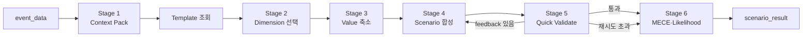
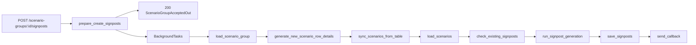
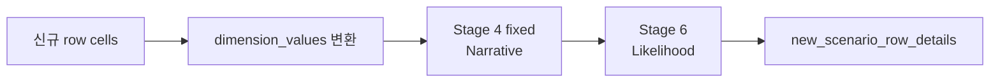
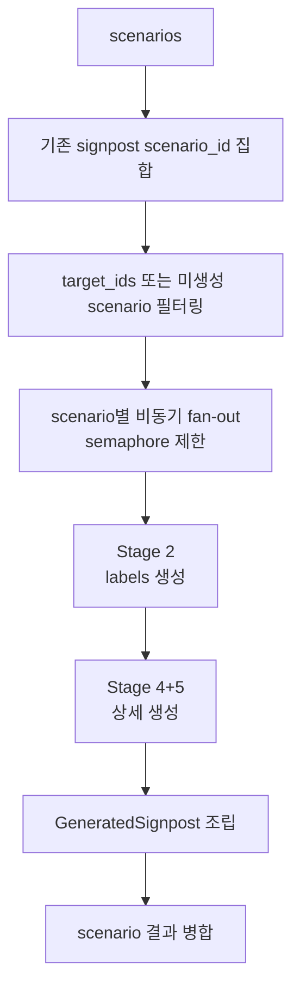
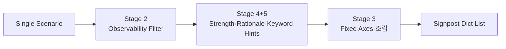
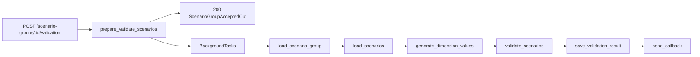
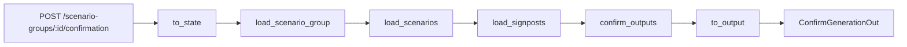

# Scenario Group Agent Flow Pipeline

v4 다중 Event 모델 영향 레버 방식의 계획과 구현 이력은
`[23_multi_event_model_lever_scenario_v4_plan.md](../../local/plan/23_multi_event_model_lever_scenario_v4_plan.md)`를
참고한다.

## 문서 목적

`scenario_group_agent`의 네 flow가 API 입력을 LangGraph state로 변환하고,
노드를 순차 실행한 뒤 API 응답으로 변환하는 구조를 설명한다.

- `flows/create_multi_event_scenarios/` — v2/v3 Template 기반 및 v4 모델 영향 레버 기반 다중 Event 생성
- `flows/create_signposts/` — Signpost 생성
- `flows/validate_scenarios/` — 시나리오 테이블 검증
- `flows/confirm_generation/` — 생성 확정

## 비동기 실행 패턴 (공통)

`create_signposts`, `validate_scenarios` 두 flow는
**동기 prepare + FastAPI BackgroundTasks + callback** 패턴을 사용한다.

```text
API 요청
  -> prepare_*()       # 권한·중복 확인, 초기 DB row 생성 (동기, 즉시 200 반환)
  -> BackgroundTasks   # 실제 LLM 파이프라인 실행
  -> send_callback()   # 완료 후 콜백 URL로 결과 전송
```

API는 `ScenarioGroupAcceptedOut`(scenario_group_id, status, stage)을 즉시 반환하고,
LLM 파이프라인이 끝나면 콜백으로 최종 결과를 전달한다.
`confirm_generation`만 `flow.py`의 LangGraph graph를 직접 `ainvoke`한다.

신규 `POST /scenario-groups`는 v4 Multi-Event 생성 전용이며 다른 실행 수명 모델을 사용한다.

```text
prepare transaction
  -> Scenario Group + create operation + accepted event commit
  -> lifespan task runner에 producer 등록
  -> LangGraph updates/custom stream을 사용자 event로 정규화
  -> operation event history append
  -> POST 또는 재연결 GET SSE가 DB event를 replay/live-tail
```

SSE consumer가 끊겨도 producer는 계속 실행된다. worker shutdown에서는 task를 취소하고 operation을
`interrupted`로 기록한다. producer는 operation event와 별도로 기본 30초마다 master row의 heartbeat를
갱신한다. 모든 worker의 lifespan recovery monitor는 시작 직후와 이후 기본 30초마다 active operation을
조회하며, heartbeat가 기본 120초 이상 갱신되지 않은 `queued`/`running` operation을 row lock 후 다시
검사해 `interrupted` event와 master 상태를 같은 transaction으로 저장한다. 여러 worker가 동시에 조회할
때는 `SKIP LOCKED`로 한 worker만 처리한다. 최초 recovery scan이 일시적으로 실패해도 startup은 계속하고
다음 주기에 재시도한다. 서버 재시작 후 LangGraph 재개는 아직 지원하지 않는다.

operation owner worker에서는 event DB commit 이후 process-local EventHub가 subscriber queue를
깨운다. 다른 worker로 재연결한 경우에는 operation별 shared tail watcher가 master row의
`latestSequence`만 1초부터 최대 5초까지 adaptive polling한다. sequence가 증가했을 때만 각
subscriber가 자신의 cursor 이후 event history를 range query하며, 변경이 발견되면 polling 간격을
1초로 초기화한다. master row 조회가 일시적으로 실패하면 subscriber가 남아 있는 동안 같은 watcher가
최대 5초의 지수 backoff로 재시도한다. SSE keepalive는 DB를 조회하지 않는다.

검증 완료 projection은 operation master의 `presentation_snapshot`에 저장한다. Event impact 검증은
facts/exclusions, impact paths/uncertainties와 Event snapshot을 저장하고 `eventAnalysis=partial`을,
Event interaction 검증은 interactions/uncertainties까지 포함해 `eventAnalysis=ready`를 기록한다.
Dimension 검증은 전체 공통 Dimension definition을 저장하고 `scenarioDesign=partial`을 기록한다.
각 projection commit은 `snapshotRevision`을 하나 올린 뒤 같은 transaction의 `section_ready` event에
section 상태와 revision만 싣는다. 최종 persistence 후에는 Scenario Group·Scenario와 저장된
generation diagnostics가 Presentation source of truth다. 렌더링된 Markdown과 실패 draft는 projection이나
event history에 저장하지 않는다.

생성 준비 단계의 중복 점유 단위는 개별 Event가 아니라 정렬된 Event ID 조합이다.
요청 순서는 Event 연결의 `display_order`와 graph 입력에 유지하고, 중복 조회용
`event_set_hash`는 `v1:` + compact JSON 정렬 배열의 SHA-256으로 계산한다.
canonical `POST /scenario-groups`만 Event 원본 행을 ID 오름차순으로 잠근 뒤
`(api_version, event_set_hash)` 후보를 재조회한다. hash가 같은 후보도 연결 Event 집합을
다시 비교하며, soft-deleted 부모 그룹은 연결 row 상태와 무관하게 제외한다.

동일 조합 후보는 active `queued`/`running` operation을 가장 먼저 차단하고, 다음으로
latest operation이 `succeeded`이거나 operation 이력이 없는 confirmation 전 그룹을 차단한다.
`completed` 그룹과 latest operation이 `failed`/`interrupted`인 그룹은 새 생성을 허용한다.
그룹, Event 연결, queued operation, accepted event는 같은 transaction에서 commit한다.
deprecated `/v4/scenario-groups`와 `/v4/scenario-groups/sync`는 이 중복·잠금 정책을 적용하지 않는다.

## 공통 실행 구조


### 1. 재사용 가능한 진입점

`create_signposts`, `validate_scenarios`는 `flow.py`의
`get_compiled_graph().ainvoke(...)`를 호출한다.
`confirm_generation`은 `flow.py`의 `get_api_runnable().ainvoke(...)`를 호출한다.

```python
@lru_cache(maxsize=1)
def get_compiled_graph() -> Runnable:
    return _build_background_graph()
```

`@lru_cache(maxsize=1)`는 최초 호출 때만 runnable graph를 생성하고 이후 요청에서 동일한
compiled graph를 재사용한다.

### 2. Runnable graph 조립

```text
background state
  -> compiled StateGraph
  -> explicit output conversion
  -> callback payload
```

- background flow는 prepare 단계에서 flow state를 만들고 compiled graph를 직접 호출한다.
- API payload adapter가 필요한 flow만 `RunnableLambda(to_state) | graph | RunnableLambda(to_output)` 구조를 유지한다.
- output 변환은 최종 state에서 API 응답 필드만 추출한다. **실패 상태이면** `MIBaseError`**를 raise한다.**


### 3. `build_graph()`: 상태 기반 node 체인 정의

```python
builder = StateGraph(flow별 state)
builder.add_node("node_name", node_function)
builder.set_entry_point("first_node")
builder.add_edge("first_node", "next_node")
builder.set_finish_point("last_node")
return builder.compile()
```

- 모든 node는 현재 `flow별 state`를 입력으로 받는다.
- node는 변경할 필드만 `dict`로 반환한다.
- LangGraph는 반환된 필드를 기존 state에 병합한 뒤 다음 node로 전달한다.
- **오류 발생 시 node는** `status="failure"` **dict를 반환하지 않고** `MIBaseError`**를 raise한다.**


## Flow State

공통 실행 상태는 `schemas/state.py`의 `BaseFlowState`에 두고, 각 flow는 자기 `state.py`에 실제 사용 필드만 둔다.


| Flow               | State                    | 주요 전용 필드                                                                                                                                                                        |
| ------------------ | ------------------------ | ------------------------------------------------------------------------------------------------------------------------------------------------------------------------------- |
| validate_scenarios | `ValidateScenariosState` | `scenario_group`, `scenarios`, `dimension_template`, `request_table`, `validation_result`, `is_valid`, `reason`                                                                 |
| create_signposts   | `CreateSignpostsState`   | `mi_event_id`, `scenario_group`, `scenarios`, `signposts`, `request_table`, `signpost_result`, `saved_signpost_ids`, `signpost_target_scenario_ids`, `new_scenario_row_details` |
| confirm_generation | `ConfirmGenerationState` | `scenario_group`, `scenarios`, `signposts`, `request_scenario_group`, `request_table`, `snapshot_id`, `confirmed`                                                               |


초기 `status`는 `"success"`다. `to_output`은 `status`가 `"failure"` 또는 `"error"`이면
`MIBaseError`를 raise한다.

## Create Scenarios Flow


### Versioned sync 분기

Create Scenario의 version 구분은 v2/v3에서 sync endpoint에만 적용하고,
v4는 운영 비동기 endpoint와 테스트용 sync endpoint를 함께 제공한다.


| Endpoint                        | 입력                      | 생성 전략                                       |
| ------------------------------- | ----------------------- | ------------------------------------------- |
| `POST /v2/scenario-groups/sync` | 중복 없는 `miEventIds` 1~5개 | Event별 원본 dimension 3~6개                    |
| `POST /v3/scenario-groups/sync` | 중복 없는 `miEventIds` 1~5개 | Event 충격·상호작용 기반 합성 dimension 3~6개          |
| `POST /scenario-groups`         | 중복 없는 `miEventIds` 1~5개 | Event grounding·모델 영향 레버 기반 dimension 3~6개, DB event + SSE 비동기 실행 |
| `POST /v4/scenario-groups`      | 신규 API와 동일             | 기존 callback 호환 alias, deprecated                    |
| `POST /v4/scenario-groups/sync` | v4와 동일                  | v4 생성 흐름 동기 실행                              |


v2/v3는 `flows/create_multi_event_scenarios/flow.py`에서 Event와 Event Type
Template revision을 함께 준비한 뒤 cached LangGraph에 입력한다. Prompt의 `Event Context`와
`Template Domain Knowledge`를 분리하고 Template의 대표 사례 및
`value_enums`는 참고 예시로만 전달한다. Event Context는 공통 compact formatter를
사용해 요청 순서의 ID·제목·요약·발생시각·제한된 핵심 사실/태그만 전달한다.
생성 결과는 다음 결정론적 검사를
통과해야 저장된다.

- v2는 입력 Event에서 `{eventId, shockSummary}`를 결정론적으로 구성하고 원본
  Template dimension 3~6개를 단일 compact sourceRef로 선택하며 모든 Event를 최소 한 번 연결
- v3는 입력 Event마다 정확히 하나의 `{eventId, shockSummary}`와 Event 소유 Template
  dimension 후보 1~4개를 생성
- v2의 `e{eventId}__{dimKey}` namespacing과
  `(eventId, scenarioDimensionTemplateId, dimKey)` source identity
- v3 합성 단계의 `(eventId, scenarioDimensionTemplateId, dimKey)` source mapping이
  검증된 후보에 존재하는지 확인한 뒤, 3~6개 합성 dimension의
  `(scenarioDimensionTemplateId, dimKey)` compact `sourceRefs`와 `sourceEventIds`를
  입력 순서대로 결정론적으로 투영
- v3 value의 Template enum anchor 정확성, enum 보유 source mapping의 최소 1회 사용,
  value별 `description`/`derivationRationale` 및 필요한 anchor 존재 여부
- 최종 3~5개 고유 조합과 `floor`/`ceiling` 각 1개. v3는 bullish·bearish value를 함께 쓰는
  non-extreme `mixed`를 정확히 1개 생성하고 v4는 실제 contribution 조합으로 선택적 `mixed`를 판정
- 가장 높은 `probabilityScore` 하나만 `baselineYn=Y`

v2 LLM schema에는 EventShock의 상세 impact path/generated value, Template checksum,
source type/assumption/rationale, `sourceAssignments`, typed 제외 후보를 포함하지 않는다.
서버는 선택 sourceRef의 정확한 Template 존재 여부와 중복만 검증하고
`label`, `description`, `required`를 Template에서 hydration한다. 미선택 Template ref와
미생성 pressure band는 입력/출력 배열의 차집합으로 계산한다. source key 접두사 제거,
다른 Event로 sourceRef 이동, dimension/value 보충, Template example 대조와 value별 source
projection은 실행하지 않는다.

v3 분석 단계는 Event별 Template 후보의
`(eventId, scenarioDimensionTemplateId, dimKey)`가 해당 Event의 `event_type_l2_id`로
조회한 Template에 실제 속하는지 검증한다. 다른 Event 소유 후보, 알 수 없는 후보,
중복 후보, Event coverage 누락과 Event당 4개 초과를 거절한다. LLM은 후보의
label·description·required·enum을 복사하지 않으며 서버가 원본 Template에서 hydrate한다.

v3 합성 단계는 전체 원본 Template을 다시 받지 않고 검증된 Shock, interaction과 hydrated
후보만 받는다. 내부 `sourceMappings`와 `templateValueAnchors`를 검증한 뒤
`sourceEventIds`와 compact `sourceRefs`를 투영한다. Template enum은 폐쇄형 값 목록이 아니라
신규 Event 특화 value를 설명하는 의미적 anchor로 사용한다. 공개 value의
`description`과 `derivationRationale`은 과거 저장 데이터 읽기를 위해 nullable이지만,
새 생성 결과에서는 non-blank여야 한다. Event coverage와 interaction resolution은 투영된
`sourceEventIds`로 검증한다. 새 value의 화면용 label은 10~40자의 비교 가능한 상태명으로 생성한다.
검증된 Shock·`observedBasis`·Template enum에 현재 판단에 유효한 수치·범위·기간이 있으면 핵심 anchor를
최대 2개까지 label에 포함하고, 근거가 없으면 수치를 만들지 않고 구체적인 시장·운영 상태를 사용한다.
이 label 정책은 prompt 계약이며 서버가 label 문자열을 별도로 파싱하거나 강제 검증하지 않는다.
v3 dimension 표시 순서는 저장된 `dimensionDefinitions` 배열 순서다.

v2 다중 Event 생성 graph는 다음 단계로 구성하며 정상 경로의 LLM 호출은 2회다.

1. `prepare_v2_event_grounding`: 입력 Event 제목·요약·핵심 사실로 compact EventShock을
   결정론적으로 구성한다. LLM을 호출하지 않는다.
2. `generate_dimensions`: 권위 있는 Event Context, EventShock과 Template을 사용해 dimension만 설계한다.
   모든 Event lineage와 이미 발생·시작·완료된 사실을 유지해야 한다.
3. `generate_scenarios`: 검증된 dimension으로 그룹 메타데이터와 Scenario만 합성한다.
4. `persist_generation`: 완성된 결과를 service 호출 한 번으로 일괄 저장한다.

v3는 검증 경계를 분리한 세 LLM 단계로 구성한다.

1. `analyze_v3_events`: 모든 Event와 Template을 한 번에 분석해 EventShock, Event interaction,
   Event별 관련 Template dimension 후보 1~4개를 선택한다.
2. `synthesize_v3_dimensions`: 검증·hydrate된 후보만 사용해 내부 Event–Template source mapping,
   enum anchor, 상세 value를 가진 합성 dimension을 생성한다. 전체 Template은 다시 전달하지 않는다.
3. `generate_scenarios`: 결정론적으로 검증된 Shock, interaction, dimension과 value의 상세 상태를 사용해 그룹
   메타데이터와 Scenario를 합성한다.
4. `persist_generation`: 완성된 결과와 Template 선택 진단을 service 호출 한 번으로 일괄 저장한다.

v2 dimension 또는 Scenario 검증 실패와 v3 Event/Template 분석·dimension 또는 Scenario 검증 실패는 해당 LLM node만 재실행하며
검증을 통과한 앞 단계 결과는 재생성하지 않는다. 각 LLM 단계는 최초 호출을 포함해 최대 3회 시도하고,
재시도 전 1초·2초 backoff를 적용한다. structured/schema 검증 오류와 408, 429, 500,
502, 503, 504, 529, timeout/connection 오류만 재시도한다. 그 밖의 오류는 즉시
`fail_generation`으로 보낸다.

공통 LLM connector는 `llm_structured_output_strict` 전역 설정이 활성화되면 OpenAI SDK의
Pydantic strict parsing helper를 사용한다. 호출부가 strict 여부를 개별 전달하지 않으므로
같은 Agent 프로세스의 structured-output 호출에는 동일한 정책이 적용된다. v3 trace stage는
`event_template_analysis`, `dimension_design`, `scenario_synthesis`로 구분한다. 배포별 환경변수
`LLM_STRUCTURED_OUTPUT_STRICT`가 `config.yaml` 값을 덮어쓸 수 있다. 각 버전은 LLM request와
최초 parsing에 같은 Pydantic schema를 사용한다. v2는 상세 EventShock과 value source
assignment를 schema에서 제거했고, v3는 단계별 분석·합성·Scenario 전용 schema를 사용한다.
Scenario `dimensionValues`는 strict JSON Schema가
허용하는 key/value 객체 배열로 요청한 뒤 내부 dict 표현으로 복원한다. 최초 Pydantic 검증
실패는 connector가 `LLM_INVALID_RESPONSE_ERROR`로 구분한다. 다중 Event graph의 node가
retry와 feedback을 명시적으로 추적할 수 있도록 connector 내부 `max_retries`는 0으로
고정한다. 각 graph node와 fallback 경로는 LangGraph/MLflow step으로 관측된다.

Scenario Group master에는 `mi_event_id`, `event_type_l2_id` 대표 Event 컬럼을 두지 않는다.
Event와 사용 Template ID/checksum은 `tmm_mi_scenario_group_event_m`에 순서대로 저장한다.
기존 v1 데이터도 사용 Template checksum과 단일 Event lineage를 같은 연결 테이블에 보존한다.
목록 필터, Event context, legacy Template 조회, Model Parameter context도 이 관계를 기준으로 한다.
응답 호환용 단일 Event 필드는 활성 연결 row가 정확히 하나일 때만 계산하고, 다중 Event 그룹은
대표 Event를 임의로 만들지 않는다.

v2/v3 준비·생성 경로는 모델 영향 레버 카탈로그를 조회하지 않는다.
`apps/agents/scenario_group_agent/persistence/model_impact_lever_service.py`의
`ModelImpactLeverService`와 Impact Path·Lever lineage 검증은 v4 경로에만 존재한다.
레버 catalog의 ORM·DTO·DB 조회는 `apps/persistence/model_impact_lever/`가 소유하고, 기존 모델
파라미터 master는 catalog binding의 활성·지원 상태 확인에만 사용한다.
최종 버전 선정 전에는 v2·v3·v4를 비교 가능한 독립 구현으로 유지하며 버전 간 호환
adapter를 추가하지 않는다.

Template Excel 이관은
`scripts/scenario_generation/import_template_domain_knowledge.py`를 사용한다.
이 스크립트는 Event Type 정의와 LNG 가격 영향 대표 사례를 Template row에
저장하고, 명시적 description이 없으면 `항목 - 기준 - 참고` 순으로 초기
description을 만든다. 운영 저장 전에는 모든 dimension의 description을
필수 검증한다.

### v4 Event 및 모델 영향 레버 방식

v4는 Event Type을 Template 선택 키로 사용하지 않는다. 선택한 Event는 시나리오가
위반하면 안 되는 현재 사실, Demand·Supply·Trade·price-only 영향 경로의 근거,
사용자가 확인할 불확실성의 출처를 제공한다.

`tmm_mi_model_impact_lever_m`은 안정적인 `lever_code`, domain, 설명, 선택 기준과 기존
`tmm_mi_model_param_m` 파라미터 binding을 갖는 작은 카탈로그다. 파일·시트·축과
Basecase 읽기 정보는 기존 parameter master를 그대로 조회하므로 상세 Excel tree를
복제하지 않는다. binding이 기존 master에 없으면 요청을 실패시키고, 비활성
파라미터는 `known_unsupported`로 강등한다. 미지원 상위 상태는 유지하되
binding 자체가 없으면 `NO_PARAMETER_BINDING`, master의 `use_yn=N`이면
`INACTIVE_MODEL_PARAMETER`, catalog가 명시적으로 미지원 처리한 binding이면
`CATALOG_MARKED_UNSUPPORTED`로 사유를 구분한다.

`price_only` 레버는 Basecase Excel에서 유래한 모델 입력명이 아니라, 재고 여건,
지역 가격 스프레드와 금융시장 위험 프리미엄처럼 JKM 가격을 설명하는
비수급 경로다. 모델 입력 미지원과 혼동하지 않도록 `PRICE_ONLY`로 별도 표시한다.

`v4_flow.py`는 Event와 활성 카탈로그를 준비한 뒤 v4 LangGraph에 입력한다. v4는
네 개의 논리적 LLM 단계와 단계별 서버 검증, 최종 일괄 저장 node로 구성한다.
첫 단계는 Event 수만큼의 작은 호출을 병렬 실행하므로 전체 순차 단계 수는 늘지 않는다.

1. `analyze_event_impacts`: Event별로 독립된 자연어 중심 structured-output 호출을 동시에 실행한다.
   입력은 원본 DTO JSON 대신 Event 설명, 핵심 사실 후보 문장, 사용 가능한 Lever 목록을 Markdown으로
   보여준다. LLM은 LNG 시장에 중요한 Fact 문장을 후보에서 그대로 최대 3개 선택하고, 각 영향의
   전달 경로·JKM 방향·영향 기간을 설명한다. 수치·기간·목표일과 실행 단위로 고정한
   `analysisAsOf`를 함께 해석한 판단 근거는 별도 ID나 source ref 없는 자연어 `decisionBasis`
   문장으로 Event당 최대 3개 보존한다. 각 문장은 그 자체로 어느 Event의 어떤 사실을 사용했는지
   식별 가능하게 작성한다. `48시간 사전 요청` 같은 반복 운영 조건과 `30일 내 복구 목표`,
   `60일 협상 기간` 같은 목표·유효 기간을 구분하고, 시작점을 확인할 수 있을 때만 현재 기한 경과나
   잔여 기간을 해석한다. 중요한 수치·일정은 상위 Fact에 선택되지 않아도 Fact 후보를 근거로
   `decisionBasis`에 남길 수 있다. 별도 `price` 필드는 생성하지 않는다. `factStatus`와 `confidence`, Fact/Path ID는
   생성하지 않으며 서버가 선택 문장을 원본 후보와 대조한 뒤 ID와 lineage를 부여한다. 배열 첫 항목은
   별도 필드 없이 의미 계약을 가진다. `eventFacts[0]`은 제목·요약의 핵심 주체·지표·상태·변화를 직접 담은
   Primary Fact이고, `impacts[0]`은 그 Fact를 evidence로 사용해 대표 전달 경로를 설명하는 Primary Impact다.
   뒤의 최대 두 Fact와 Impact는 서로 다른 Lever·방향·기간 또는 실질적인 증폭·상쇄를 추가할 때만 사용한다.
   `decisionBasis`는 Primary Fact나 Impact를 대신하지 않는다. Event당 Impact Path는 최대 3개, ordered Lever
   step은 Path당 가급적 1~2개로 제한하되 driver·transmission·primary 세 단계가 모두 중요한 경우에만
   최대 3개까지 허용하며, 열린 질문은 최대 2개다. 열린 질문은
   분석 기준일에 아직 결과가 열려 있고 JKM pressure를 구분하는 변수를 우선하며, 이미 지난 목표는
   미래 가능성으로 되돌리지 않고 현재 남은 제약과 앞으로의 해소 시점으로 전환한다. 각 Event는
   자기 호출만 최대 3회 재시도하므로 한 Event 실패가 성공한 다른 Event의 재생성을 유발하지 않는다.
2. `validate_event_impacts`: 병렬 결과를 요청 Event 순서로 병합한 뒤 모든 Event coverage와
   Fact→Path→Lever lineage를 검증하고
   `leverCode`로 `impactLeverId`를 hydrate한다. price-only Path는 `balanceEffect`를 생략하며,
   그 외 Path는 Catalog domain과 일치하는 balance effect를 가져야 한다.
3. `analyze_event_interactions` / `validate_event_interactions`: 검증된 Path를 `[P1]`, `[P2]` 형태의
   읽기 쉬운 카드로 전달하고 Event별 첫 Path를 `Primary Impact`로 표시한다. LLM은 Primary Impact가 포함된
   결합을 우선 검토하되 실제 추가 효과가 있을 때만 Interaction을 만들며, 함께 발생했을 때 달라지는 점을 한국어 문장으로 설명하고
   관련 Path 별칭만 선택한다. 결합 효과의 JKM 순방향과 기간도 `analysis` 문장에 포함하며 별도
   `price` 필드는 만들지 않는다. 중요한 cross-Event Interaction과 열린 질문을 각각 최대 3개만
   생성하며, 관계가 없으면 빈 배열을 허용한다. Interaction ID, Event ID, canonical Path ID와
   semantic key는 서버가 Path lineage에서 hydrate한다.
4. `design_model_lever_dimensions`: 검증된 열린 질문을 `[U1]`, `[U2]` 카드로 전달하고, 각 질문을
   어떤 선택 축으로 모델링할지 Dimension 3~6개와 Value 2~4개로 답하게 한다. LLM은 질문·축·선택지와
   선택 결과를 자연어 및 짧은 상태 표현으로 생성하며 Dimension/Value ID와 source lineage는 서버가
   부여한다. 화면용 Dimension label은 질문과 분리하고, Dimension rationale은 질문의 관측일·분석 기준일·
   수치·시장 신호·대상·영향 경로를 빠짐없이 유지하며 질문 어미만 `...하는지에 따라` 형태의 근거형 평서문으로
   바꿔, 이 불확실성이 Scenario와 JKM 결과를 구분하는 이유를 10~200자의 구체적인 한국어 한 문장으로 설명한다.
   Value label은 비교 가능한 시장·운영 상태를
   10~25자로 표현한다. `decisionBasis`에 현재 판단에 유효한 수치·기간·잔여일이 있으면 질문과 Value에
   반영한다. Value의 `assumptionRationale`은 `관측된 사실 → Value의 미래 상태 → JKM 영향`을 간결하게
   연결하고 문장 끝의 `가정`으로만 불확실성을 표시한다. `상태를 가정하면 ... 가정이다`처럼 가정 의미를
   반복하거나 Value를 답·응답·선택으로 지칭하지 않는다. Anchor ref는 추가하지 않으며 새로운 숫자 경계는
   제공된 판단 근거가 실제 기준을 줄 때만
   만든다. Dimension은 새 Lever를 선택하지 않고 source uncertainty의 affected Lever를 상속한다.
   LLM은 별도 `format`을 생성하지 않는다. 서버는 `timing`·`duration`·`recovery` axis를 `temporal`,
   그 외 axis에서 단위가 있으면 `numeric_range`, 나머지를 `categorical` `valueKind`로 결정한다.
5. `validate_model_lever_dimensions`: Dimension의 source Event/Path/uncertainty와
   `primaryImpactLeverId`, Value별 Lever state ID 및 model support status를 hydrate한다.
6. `synthesize_v4_scenarios`: 공통 영향, 검증된 Interaction, Dimension 선택지를 읽기 쉬운
   의사결정표로 전달하고, 원본 Event의 ID·제목·요약·발생시각·핵심 사실·태그도 compact block으로 함께
   제공한다. LLM은 `D1.V1` 같은 선택지 별칭을 골라 Scenario 3~5개의 제목·서사·JKM
   압력 설명을 자연스러운 한국어 문장으로 생성한다. 미리 정한 공급·수요·운송 유형에 맞추지 않고
   입력 Dimension과 Interaction에서 Scenario별 구분 요인을 선택한다. 제목은 핵심 조건이나 메커니즘을
   20~40자로 표현하고, narrative는 주요 조건과 최종 전달 경로를 80~300자의 두 문장으로 설명한다.
   그룹 title은 선택한 Event의 구체적인 대상·지역·지표·변화 2~3개를 반영해 검색 가능한 이름으로 만들고,
   생성 목적만 나타내는 `JKM 대표 전개`·`합성 초안` 같은 이름은 사용하지 않는다. 그룹 description은 발생한
   사건을 `이벤트`, 미래 분기를 `시나리오`로 표기하며 영문 `Event`·`Scenario`, `입력 사실`, `JKM`을 쓰지 않는다.
   서버는 이 설명을 파싱하지 않고 보존하며,
   공통 Path analysis·선택 Value의 why·적용 Interaction analysis로 pressure breakdown을 구성한다.
   Scenario ID와 canonical Dimension/Value/Interaction ID도 서버가 hydrate한다.
7. `persist_generation`: 완성된 결과를 service 호출 한 번으로 일괄 저장한다.

각 LLM 단계는 최대 3회 재시도하며 검증을 통과한 앞 단계 결과는 재사용한다. ID·lineage·Enum,
Fact 부정과 같이 설명으로 성립할 수 없는 모순은 해당 단계를 재생성한다. Event/Interaction의
JKM 방향·기간은 자연어 analysis에 보존하고 기계 검증하지 않는다. 최종 계산에 사용하는
Dimension Choice pressure와 Scenario pressure만 폐쇄형 Enum으로 검증한다. 별도 review LLM은
추가하지 않으며 공통 LLM connector와 MLflow trace 기록 방식은 변경하지 않는다.

v4 Dimension은 다음 정본을 저장한다.

- 열린 질문인 `description`과 짧은 Dimension 선택 근거인 `rationale`
- `sourceEventIds`, `sourceImpactPathIds`, `sourceUncertaintyIds`
- `primaryLeverCode`, 서버가 hydrate한 `primaryImpactLeverId`, `modelSupportStatus`
- `values[]`: `valueId`, `label`, `leverStates[]`, `pressureContribution`, `assumptionRationale`

기존 `eventGroundings`와 `leverMappings`는 새 v4 생성 계약에서 제거한다. 실행 기준일인
`analysisAsOf`, 자연어 `decisionBasis`, Event Fact, Impact Path, Path/Interaction uncertainty,
Interaction, validation warning과 Scenario pressure
breakdown은 기존 `generation_diagnostics` JSON에 저장하며 v4 sync 응답에도 반환한다.
신규 DB 테이블이나 컬럼은 추가하지 않는다.

서버는 모든 Event의 Fact 또는 명시적 제외 사유, Fact/Path/uncertainty/interaction ID 고유성,
서로 다른 Event Path를 참조하는 Interaction, Dimension/Value lineage, 고유 Scenario 조합,
pressure band partition과 contribution 순서를 검증한다. floor·ceiling 및 실제 bullish·bearish
contribution이 함께 있는 선택적 mixed를 지정하고 전체 Scenario 중 최고 `probabilityScore`
하나를 baseline으로 지정한다.
여기서 가격 결과는 절대 가격 예측값이 아니라 모든 v2/v3/v4 Scenario에 필수인 JKM
pressure band와 rationale이다. 응답의 `pressureTarget`은 LLM이 아닌 서버가 `JKM`으로 고정한다.
TTF 또는 HH가 특별히 관련된 v4 Scenario만 `related_markets`에 시장과 근거를 선택적으로
저장하며 JKM 자체의 근거는 `pressureRationale`에 둔다. 시장별 방향이나
floor·ceiling을 생성하지 않는다. 지원 상태는 dimension 선택 우선순위나 생성 성공의
필수 조건으로 사용하지 않는다. `price_only`나 미지원 경로도 중요한 불확실성이면 선택할 수 있고,
서버는 실행 가능한 binding coverage를 진단 정보로만 계산한다.

그룹에는 카탈로그 version/checksum, 새 Dimension 정의와 전체 분석 진단을 저장한다.
현재 Model Parameter Agent는 기존 v4의 `leverMappings`를 소비하므로 새 v4 그룹의
`values[].leverStates[]` 연계는 후속 구현 범위다. 이번 변경에서는 해당 소비부와 기존 저장
데이터를 변환하지 않는다.
API schema의 boolean `baseline_yn`은 persistence 경계에서 DB 계약인 `Y`/`N`으로
변환한다.
관측 Event에 따른 사후 확률 갱신은 v4 범위에 포함하지 않는다.

DB 계약의 정본은 `skmip-mi-agent-mgmt`의 기존 Alembic 0022 revision이며,
Scenario 관련 컬럼과 proposal의 `parameter_mapping_evidence` JSON 컬럼을 함께 반영한다.

### 재사용 Scenario Generation Subgraph

기존 v1 생성 flow와 endpoint는 제거되었지만, Signpost 생성이 신규 Scenario row를 보강할 때
`subgraphs/scenario_generation/flow.py`의 6-stage subgraph를 재사용하므로 이 모듈은 유지한다.
이 subgraph는 독립 API 진입점이나 Scenario Group master row 생성 책임을 갖지 않는다.

`subgraphs/scenario_generation/flow.py`에서 컴파일한 `get_scenario_generation_subgraph()`를
직접 node로 등록한다. 6-stage subgraph가 하나의 node처럼 실행된다.




#### Stage 1: event context 구성

`stage1_build_context_pack()`은 DB에서 읽은 event dict를 `Stage1ContextPack`으로 변환한다.

- `C1_base_event`: event ID, 제목, event type, 요약, 발생 시각, key facts, tags
- `C2_linked_records`, `C3_historical_analogs`, `C4_related_events`: 현재 stub

Stage 1은 signpost·scenario 서술용 compact event context를 만든다. 프롬프트를 구성할 때
서버 로컬 날짜를 `current_date`(`YYYY-MM-DD`)로 추가하며, 운영 Docker 환경에서는
`TZ=Asia/Seoul` 설정에 따라 KST 날짜가 사용된다.

- `current_date`: 최근 N일/개월, 계절, 과거·현재·미래 판단의 기준일
- `occurred_at`, 비어 있지 않은 `tags` 최대 8개
- `key_bullets` 최대 5개(항목별 최대 280자)
- `detail_analysis`는 compact context와 LLM prompt에 사용하지 않음
- DB의 `occurred_at`이 `NULL`이면 record 생성일을 대신 사용하지 않고 빈 값으로 유지
- `occurred_at`은 `current_date`와 구분되는 Base Event 발생 시점으로 안내

Scenario Stage 2·3·4·6과 signpost 생성 Stage 2·4+5는 이 context를 사용한다. 이 처리는 이미
조회한 event payload를 정규화할 뿐 추가 DB 조회나 LLM 호출을 만들지 않는다.

#### Template 조회

`ScenarioService.load_pipeline_template(event_type_l2_id)`로 DB template을 조회한다.
활성 template이 없으면 `KeyError`, 구조가 잘못되면 `ValueError`가 발생한다.

#### Stage 2: Dimension 선택

`stage2_select_dimensions()`은 template 전체 dimension 중 event 분기에 의미 있는 3~5개를
structured-output LLM으로 선택한다.

- 검증: template 외 ID 금지, 선택 수 3~5개, `(b)` 기준 사용 금지
- 후처리: LLM이 누락한 미선택 dimension은 자동으로 excluded 목록에 추가
- LLM 호출 또는 응답 검증 실패: retry 소진 후 flow 실패


#### Stage 3: Dimension별 enum 축소

`stage3_reduce_values()`은 선택된 dimension 전체를 하나의 structured-output LLM 호출로 받아,
dimension별 전체 enum을 2~4개로 줄인다.

- 선택 enum은 template enum의 부분집합이어야 한다.
- LLM 응답은 입력된 모든 dim_key를 정확히 한 번 포함해야 한다.
- LLM 호출 실패, dimension 누락·중복, template 밖 enum 반환은 retry 소진 후 flow 실패로 처리한다.


#### Stage 4: Scenario 합성

`stage4_synthesize_scenarios()`은 Stage 3 enum들로 Cartesian product를 만들고 목표 개수만 선택한다.
baseline에 가까운 조합과 tail 조합을 anchor로 잡고, 나머지는 Hamming distance가 큰 조합을 우선
선택해 다양성을 확보한다. 기본 목표 개수는 `REF_TARGET_SCENARIOS`(기본값 6)다.

`validation_feedback`이 있으면 이전 합성 결과에 대한 피드백을 반영해 조합을 재선정한다.
compatibility feedback에 `recommended_value`가 있으면 해당 시나리오의 이전 조합을 기준으로
권장 값을 우선 적용한 target 조합을 만든다. 이 값은 Stage 3 selected enum 밖이어도
template enum 안의 값이면 사용할 수 있다.

선택한 각 조합에 대해 LLM이 `title`, `description`, `derivation_rationale`를 생성한다.
가격 영향 방향은 생성하지 않으며 신규 scenario의 `impact_jkm/ttf/hh` DB 컬럼에는 `NULL`을 저장한다.
호출 또는 응답 검증 실패 시 scenario를 저장하지 않는다.
최종 scenario ID는 `S_01`, `S_02` 형식으로 부여된다.

#### Stage 5: Quick Validate (재시도 루프)

`stage5_quick_validate()`는 합성된 scenario 조합이 dimension 다양성·중복 요건을 충족하는지
빠르게 검사한다.

- 통과(`validation_feedback=None`): Stage 6으로 진행
- 실패하면 `validation_feedback`을 유지해 `synthesize_scenarios` 노드로 돌아가 재합성
  - Stage 5는 `dimension_values`를 직접 보정하지 않는다.
  - feedback에는 실패 유형(`baseline_contrast`, `duplicate`, `compatibility`), 문제 시나리오/값,
  Stage 4 재생성 지시를 포함한다.
  - compatibility 실패에서 LLM이 권장한 값은 `Stage5RepairInstruction` 형태로 Stage 4 재생성에 전달된다.
  이는 Stage 6으로 직행하는 직접 보정이 아니라, Stage 4가 해당 target 조합과 narrative를 다시 만들기 위한
  override 입력이다.
  - compatibility LLM은 재생성이 필요한 incompatible 항목만 반환한다. 모든 조합이 통과하면 `items=[]`로 처리한다.
  - Stage 4는 feedback을 반영해 조합을 재선정하고, 새 조합에 맞춰 `title`, `description`,
  `derivation_rationale`를 다시 생성한다.
- `REF_QUICK_VALIDATE_MAX_RETRIES` 초과: 남은 feedback이 있어도 Stage 6으로 진행
  - 기본값은 1이다. 즉 quick validate 실패 후 Stage 4 재생성은 최대 1회 수행한다.


#### Stage 6: MECE 및 Likelihood 검증

`stage6_validate()`는 모든 scenario에 대해 likelihood를 5단계
(`very_low | low | medium | high | very_high`)로 분류한다.

LLM은 MECE 판정도 반환하지만, 최종 `mutually_exclusive` 값은 코드가 `dimension_values` 조합의
중복 여부를 검사한 결정론적 결과를 우선 사용한다. likelihood LLM 실패는 flow 실패로 처리한다.

#### 재시도와 반환 구조

Stage 2~6의 LLM 호출은 retry 가능한 오류에 한해 `REF_MAX_RETRIES`만큼 재시도한다.
소진 후에는 원인에 맞는 `MIBaseError`를 raise하고 failure callback을 전송한다.

최종 `scenario_result` 주요 필드:


| 필드                           | 내용                                            |
| ---------------------------- | --------------------------------------------- |
| `stage1_context_pack`        | event context                                 |
| `stage2_dimension_selection` | 선택/제외 dimension                               |
| `stage3_value_selection`     | dimension별 선택 enum                            |
| `stage4_scenario_synthesis`  | 조합 수, scenarios                               |
| `stage5_validation`          | Stage 6 MECE와 likelihood prior (기존 저장 필드명 유지) |
| `scenario_count`             | 최종 scenario 수                                 |
| `mece_passed`                | 결정론적 MECE 결과                                  |


## Create Signposts Flow


### 전체 흐름

v4는 `prepare_create_signposts`의 짧은 transaction에서 최신 Validation operation과 두 fingerprint를
검증하고 `scenarioChangeSet`을 먼저 확정한다. 신규 ID 발급, 기존 row update/soft-delete, 기존 Signpost
soft-delete, baseline/role 재계산과 Validation application 기록을 완료한 뒤 Signpost operation과
background task를 만든다. 따라서 v4 graph의 `generate_new_scenario_row_details`와
`sync_scenarios_from_table` node는 no-op이며, Validation에서 생성한 DB 저장 필드를 다시 LLM으로 만들지 않는다.

v1~v3는 아래 table 기반 흐름을 유지한다.




### 입력과 출력 변환

`CreateSignpostsIn`은 `user_id`와 optional `table`(ScenarioTable)을 받는다. v1~v3는 table이 필수이며,
v4는 최신 Validation Change Set을 서버에서 적용하므로 table을 사용하지 않는다. 로컬·QA용 Presentation 후속
request body helper는 버전별 초안 shape을 통일하기 위해 v4 body에도 table을 포함한다.
`to_state`는 `request_table=parsed.table.model_dump()`를 state에 설정한다.

`to_output`은 `build_scenario_group_table_data(group, scenarios, signposts)`로
`CreateSignpostsOut`의 `scenario_group`, `table` 필드를 구성한다.

### Node 책임


| 순서  | Node                                | 주요 동작                                                                                                     | 오류 조건                                |
| --- | ----------------------------------- | --------------------------------------------------------------------------------------------------------- | ------------------------------------ |
| 1   | `load_scenario_group`               | group 조회, 점유자 확인                                                                                          | group 미존재 또는 다른 사용자 점유 시 raise       |
| 2   | `generate_new_scenario_row_details` | table 신규 row(`scenario_id=None`)가 있으면 고정 dimension 조합에 대해 Stage 4 fixed narrative와 Stage 6 likelihood를 생성 | event 누락 시 raise                     |
| 3   | `sync_scenarios_from_table`         | 테이블 변경 내용을 DB에 반영하고 재생성 필요 scenario ID를 `signpost_target_scenario_ids`에 설정                                | table 누락 또는 신규 row detail 누락 시 raise |
| 4   | `load_scenarios`                    | group 소속 scenarios 조회                                                                                     | scenario가 없으면 raise                  |
| 5   | `check_existing_signposts`          | scenario별 기존 signpost 조회                                                                                  | (생략 없음)                              |
| 6   | `run_signpost_generation`           | 미생성 scenario + `target_ids` 대상 비동기 생성                                                                     | `failure`, `already_exist`이면 skip    |
| 7   | `save_signposts`                    | group 존재 확인 후 새 signpost 저장, scenario `status="created"` 갱신, group `stage="signpost_created"` 갱신          | `failure`, `already_exist`이면 skip    |


### `generate_new_scenario_row_details` 상세

신규 scenario row는 table cell의 dimension 조합은 이미 확정되어 있지만 DB 저장에 필요한
`narrative`, `probability_score`가 없다. 이 node는 persistence service가
LLM pipeline을 직접 호출하지 않도록 저장 전에 generation을 수행한다.




- Stage 4 fixed는 조합을 재선정하지 않고, 주어진 dimension 조합에 narrative만 생성한다.
- Stage 6 likelihood는 신규 row의 초기 `probability_score`로 변환된다.
- 신규 row의 `impact_jkm/ttf/hh`는 생성하지 않고 `NULL`로 저장한다.
- `ScenarioService.sync_from_table*()`는 `new_scenario_row_details`를 받아 DB insert/update만 담당한다.


### `run_signpost_generation` 상세




#### v4 Signpost context 조립

`generation_strategy="multi_event_model_lever_dimensions"`인 그룹은 연결된 Event를 하나의 합성 Event로
병합하지 않는다. Event 관계의 `display_order` 순서대로 원본 Event를 읽고, 각 Event에 compact 제한을
독립 적용해 ID·제목·요약·발생시각·핵심 사실·태그를 별도 block으로 만든다. 따라서 한 Event의 긴 사실
목록이 다른 Event의 사실을 밀어내지 않는다. v1~v3는 기존 단일/composite Event context를 유지한다.

Scenario별 context는 저장된 Scenario와 그룹의 `dimensionDefinitions`, `generationDiagnostics`로 조립한다.
title·narrative·probability·baseline·role·JKM pressure band/rationale·related market을 포함하고,
선택한 Dimension/Value ID는 다음 표시 정보로 변환한다.

- `Dimension label | description`과 별도 Dimension `rationale`
- `Value label | assumptionRationale`
- 알 수 없는 Value 또는 definition은 원본 ID를 표시 fallback으로 사용하며 생성을 중단하지 않음

`generationDiagnostics.scenarioPressureBreakdowns`는 title이 아니라 Dimension/Value label을 canonical ID로
정규화한 `dimensionValues` 조합 전체로 매칭한다. 매칭된 breakdown이 참조하는 Impact Path와 적용
Interaction만 각각 `eventId + mechanism`, `eventIds + mechanism`으로 축약한다. Validation에서 조합이
변경됐거나 신규 Scenario라 동일 조합이 없으면 과거 breakdown의 Path·Interaction을 사용하지 않는다.
이 경우 최신 Scenario 및 Dimension/Value 근거만으로 Signpost를 생성한다. diagnostics 일부가 누락돼도
동일하게 빈 causal evidence로 진행한다.

Signpost subgraph state는 `event_contexts`와 Scenario별 `scenario_context`를 받아 Stage 2와 Stage 4+5에
동일하게 전달한다. 두 prompt는 현재 사실인 `Event Context`와 미래 가정·근거인
`Scenario Assumptions and Rationale`를 분리하며, 모든 Event와 Event 간 Interaction을 함께 고려하되
Scenario rationale을 현재 사실로 오인하지 않고 해당 Scenario를 판별할 미래의 관측 가능·binary 신호를
만들도록 지시한다.

#### 대상 scenario 결정

```python
scenarios_to_process = [
    s
    for s in state.scenarios
    if int(s["scenario_id"]) in target_ids          # sync_scenarios_from_table이 지정한 재생성 대상
    or int(s["scenario_id"]) not in existing_scenario_ids  # 기존 signpost가 없는 scenario
]
```

`target_ids`는 `sync_scenarios_from_table`이 테이블 편집(dimension 변경 등)을 감지해 설정한다.
기존 signpost가 이미 있는 scenario라도 `target_ids`에 포함되면 재생성된다.

#### Scenario별 병렬 생성

`run_signpost_generation`은 대상 scenario마다 단일 scenario subgraph를 실행하고 `asyncio.gather()`로 결과를 병합한다.
동시 실행 수는 `create_signposts_max_concurrent_scenarios` 설정값으로 제한한다. 각 scenario 내부에서는 Stage 2가
끝난 뒤 Stage 4+5를 실행하지만, 서로 다른 scenario는 병렬로 진행해 대형 batch 응답의 tail latency와 gateway
timeout 위험을 피한다.

한 scenario가 실패해도 다른 scenario의 정상 결과는 보존한다. 성공 signpost는 저장하되 실패 scenario가 하나라도
있으면 group stage를 변경하지 않고 failure callback을 보낸다. 다음 요청에서는 기존 정상 signpost를 건너뛰고
미생성 scenario만 다시 처리한다.




코드의 stage 번호는 개념적 설계 번호를 유지하되, 실행 시간 단축을 위해 Stage 4와 Stage 5는
하나의 structured-output LLM 호출로 통합한다. scenario별 실행 순서는 `2 → 4+5 → 3/조립` 형태다.

##### Stage 2: Observability Filter

세 가지 필터(공식 채널 관측 가능, binary 판정 가능, scenario 가정과 직접 연결)를 모두 통과한
후보만 출력한다. 탈락 후보와 `passes_filter=false` 항목은 output token 절감을 위해 받지 않는다.
동일 scenario 안에서는 관측 대상·판정 사실·시간축/단계가 실질적으로 다른 후보만 허용하고,
같은 사건의 표현 변형은 하나만 남긴다. 통과 개수는 최종 저장 기준 기본 3~6개다. 7개 이상이면
시나리오 고유성·후보 간 차별성 우선순서로 반환된 앞의 6개만 사용하고, 3개 미만이면 재시도 후
해당 scenario를 저장하지 않는다.

##### Stage 4+5: Strength와 Keyword Hint 생성

각 signpost에 strength, 한국어 근거, record 검색용 keyword 3~5개를 한 번에 부여한다.
`direction`은 항상 `"SUP"`로 고정한다.

Stage 4+5 응답은 다음 조건을 확인한다.

- 입력 label 수와 출력 signpost 수가 동일해야 한다.
- `label_ko` 순서가 Stage 2 label 순서와 동일해야 한다.
- strong/early strength quota를 만족해야 한다.
- 각 signpost의 `keyword_hints`는 3~5개이고 빈 문자열이 없어야 한다.

최종 조립 전에는 label, Stage 4+5 결과, keyword hints의 길이가 모두 같고 signpost 개수가 3~6개인지
재검증한다. 이 계약을 만족하지 못한 scenario 결과는 저장하지 않는다.

검증이나 LLM 호출이 최종 실패하면 해당 scenario의 signpost를 저장하지 않고 다른 scenario 결과는 보존한다.

##### Stage 3 및 최종 조립


| 필드                | 값 또는 출처                  |
| ----------------- | ------------------------ |
| `scenario_id`     | DB scenario PK           |
| `signpost_id`     | `sgp_{scenario_pk}_{순번}` |
| `signpost_class`  | `"observation"`          |
| `label`           | Stage 2 결과               |
| `signpost_source` | `"mi_record"`            |
| `direction`       | `"SUP"`                  |
| `strength`        | Stage 4+5 결과             |
| `rationale_ko`    | Stage 4+5 결과             |
| `keyword_hints`   | Stage 4+5 결과             |


## Validate Scenarios Flow


### 전체 흐름

v4는 prepare에서 validation operation을 만들고 stage를 `scenario_created`로 정리한다. background graph의
review node 안에서는 다음 v4 전용 순서를 수행한다.

```text
label/valueId -> canonical valueId 정규화
  -> Scenario 수·header/cell·enum·title·조합 결정적 검사
  -> unchanged이면 LLM 없이 PASS
  -> title/조합 변경 및 신규 row만 semantic review
  -> 신규·조합 변경 row만 DB 저장 필드 structured generation
  -> 최소 scenarioChangeSet 조립
  -> operation.result_payload 저장 + stage 갱신 (같은 transaction)
```

canonical table은 메모리 표현이며 별도 DB table로 저장하지 않는다. operation에는 변경 row의 최종 DB payload와
삭제 ID만 저장하고 unchanged row, 전체 table, `leverState`는 저장하지 않는다. warning만 존재하면
`PASS_WITH_WARNINGS`, `canProceed=true`이고, blocking은 operation `succeeded` 이력과 결과를 남기되
`scenarioChangeSet=null`, `stage=scenario_created`로 처리한다.

v1~v3는 아래 optional dimension 보정·mapping·review 흐름을 유지한다.




### 입력과 출력 변환

`ValidateScenariosIn`은 `user_id`와 `table`(`ValidateScenariosTableIn`)을 받는다.
validation 요청 row는 `scenario_id`, `display_order`, `title`, `cells`만 허용한다.
`to_state`는 `request_table=parsed.table.model_dump()`를 state에 설정한다.

`to_output`은 `is_valid`, `reason`, `scenario_group`(id, status, stage), `table`을 반환한다.
응답의 `table`은 보정된 `request_table`을 `ScenarioTable`로 검증해 구성한다.

### Node 책임


| 순서  | Node                        | 주요 동작                                                                   | 오류 조건                               |
| --- | --------------------------- | ----------------------------------------------------------------------- | ----------------------------------- |
| 1   | `load_scenario_group`       | scenario group 조회, 점유자 확인                                               | group 미존재 또는 다른 사용자 점유 시 raise      |
| 2   | `load_scenarios`            | group 소속 scenarios 조회, `dimension_template` 로드                          | scenario가 없으면 raise                 |
| 3   | `generate_dimension_values` | 선택 dimension(`required=False`)의 빈 값을 LLM으로 생성, 필수 dimension 누락/빈 값 검증   | 필수 dimension 누락 또는 필수 값 미입력 시 raise |
| 4   | `validate_scenarios`        | `subgraphs/scenario_review/` runnable로 시나리오 검토                          | 앞선 실패 시 skip                        |
| 5   | `save_validation_result`    | `is_valid`에 따라 `stage="scenario_validated"` 또는 `"scenario_created"`로 갱신 | 앞선 실패 시 skip                        |


#### `generate_dimension_values` 상세

`generate_dimension_values`는 validation 요청 table을 review 가능한 형태로 보정하는 전처리 node다.
주 역할은 다음 둘이다.

1. template 기준 필수 dimension이 요청 header에 포함되어 있는지 확인한다.
2. 선택 dimension(`required=False`) column에 비어 있는 값이 있으면 각 scenario row의 값을 자동 생성한다.


##### 입력 기준


| 데이터                               | 출처            | 용도                              |
| --------------------------------- | ------------- | ------------------------------- |
| `request_table.headers`           | validation 요청 | 화면에 존재하는 dimension key 집합       |
| `request_table.rows[].cells`      | validation 요청 | scenario별 현재 dimension value    |
| 단일 활성 Event 관계의 `event_type_l2_id` | DB relation   | legacy scenario template 조회     |
| `state.scenarios`                 | DB scenario   | 기존 scenario의 title/narrative 보강 |


node는 `ScenarioService.load_scenario_template(event_type_l2_id)`로 template을 다시 조회한다.
`load_scenarios`에서 넣은 `dimension_template`은 review context용 dict 목록이고,
`generate_dimension_values`는 required flag와 enum label이 필요하므로 `ScenarioTemplate` 모델을 별도로 사용한다.

##### 필수 dimension 검증

template의 `dimensions[].required=True`인 dimension key가 요청 header에 없으면 즉시
`SCENARIO_VALIDATION_INPUT_ERROR`를 raise한다. 이 검증은 row 값 생성보다 먼저 수행된다.

```text
required_keys = template.dimensions where required=True
header_keys = request_table.headers[].key
missing_required = required_keys - header_keys
```

에러 메시지에는 가능한 경우 template의 `label_ko`를 사용한다.

##### 자동 생성 대상 판별

요청 header에 존재하는 key 중 template에서 `required=False`인 선택 dimension만 자동 생성 후보가 된다.
그중 하나 이상의 row에서 해당 cell 값이 `null`이면 자동 생성 대상(`fillable_dims`)으로 본다.

```text
fillable_dims =
  header key 중
  template.dimensions[].required == False
  and rows 중 하나라도 row.cells[key] is null
```

중요한 점은 “template에는 있는데 DB에 없던 dimension”인지 직접 비교하지 않는다는 것이다.
현재 판별 기준은 요청 header, template required flag, row 값의 `null` 여부다.
이미 값이 들어 있는 cell은 자동 생성 결과로 덮어쓰지 않고, `null` cell만 채운다.

##### 신규 scenario row의 입력 검증

`scenario_id is None`인 row는 validation 전에 사용자가 새로 추가한 scenario다. 기존/신규 여부와 무관하게
필수 dimension(`required=True`) 값은 비워 둘 수 없다. 필수 dimension 값이 `null`이면 LLM 호출 없이 즉시
`SCENARIO_VALIDATION_INPUT_ERROR`를 raise한다. 선택 dimension(`required=False`)의 `null`은 자동 생성 대상으로 허용한다.

```text
모든 row에서
  header key가 required=True
  and row.cells[key] is null
이면 입력 오류
```

즉, 선택 dimension의 부분 `null`은 Agent가 채우지만, 필수 dimension의 부분 `null`은 기존 scenario와 신규 scenario
모두에서 허용하지 않는다.

##### LLM 생성 입력 보강

자동 생성 대상이 있으면 `generate_new_dimension_values(template, rows, fillable_dims)`를 호출한다.
이때 기존 scenario row(`scenario_id != null`)는 DB에 저장된 title/narrative를 보강해서 LLM에 전달한다.

- 요청 row의 title이 비어 있으면 DB scenario title을 사용한다.
- DB scenario narrative를 LLM 입력에만 추가한다.
- 보강한 narrative는 callback의 `request_table` row에 되돌려 넣지 않는다.

이 처리는 validation 요청 schema가 row의 수정 가능 필드를 제한하기 때문에 필요하다.
사용자가 validation 요청에서 narrative를 보내지 않아도 LLM은 기존 scenario 서술을 참고할 수 있다.

##### 생성값 검증과 실패 처리

`generate_new_dimension_values`는 자동 생성 대상 dimension별 enum label 목록을 prompt에 포함해 structured-output LLM을
호출한다. LLM 응답은 다음 기준으로 필터링된다.

- `dim_key`가 자동 생성 대상 dimension이어야 한다.
- `scenario_index`가 요청 row 범위 안이어야 한다.
- `value`가 해당 dimension의 enum label 중 하나여야 한다.

LLM이 enum 밖 값을 반환하거나 필수 생성 cell을 누락하면 `LLM_INVALID_RESPONSE_ERROR`를 raise한다.
LLM 호출 자체가 실패해도 request table을 임의로 변경하지 않으며 validation flow는 failure callback으로 종료한다.

##### request_table 갱신 규칙

생성 결과는 기존 cell이 `null`인 경우에만 채운다.

```text
for each generated value:
  if row.cells[key] is null:
    row.cells[key] = generated_value
```

이미 사용자가 입력한 값은 덮어쓰지 않는다. node 반환값은 갱신된 `request_table`뿐이며,
이후 `validate_scenarios`는 이 보정된 table을 기준으로 review context를 만든다.

##### 현재 한계

이 node가 enum membership을 강제하는 범위는 **자동 생성된 선택 dimension 값**뿐이다.
사용자가 직접 입력한 `cells` 값이 template enum label에 포함되는지는 여기서 검증하지 않는다.
따라서 화면 편집 단계에서 template enum 밖 사용자 정의 값을 허용하려면, validation 정책은
“직접 입력값은 자유값, 자동 생성값은 template enum 값”이라는 구분을 명시해야 한다.

#### `validate_scenarios` 상세

`validate_scenarios` node는 `subgraphs/scenario_review/flow.py`의 `get_scenario_review_subgraph() 직접 호출`을 호출한다.
subgraph adapter가 parent state를 review state로 변환하면서
`build_context(group, requested_rows, persisted_scenarios, template_dims, requested_headers)` 입력을 구성하고,
`run_review(context)`가 검토 리포트를 반환한다. validation review의 검사 대상 dimension은
DB의 `scenario_group.dimension_selected`가 아니라 요청 `table.headers[].key`를 기준으로 한다.
따라서 요청 table에 없는 dimension은 DB에 selected로 남아 있어도 R01/R02 검사 대상에서 제외된다.
리포트에는 verdict(`PASS | REVIEW | BLOCK`), summary, checks 목록이 포함된다.

`subgraphs/scenario_review/`는 다음 책임을 가진다.

- `flow.py`: review subgraph runnable 조립
- `schema.py 또는 parent flow nodes.py`: `flow별 state`와 `ScenarioReviewState` 사이의 변환, review 결과를 parent state update dict로 변환
- `nodes.py`: LangGraph node wrapper
- `schema.py`: review context, check result, report DTO
- `state.py`: review subgraph 전용 state
- `nodes.py`: review context 구성, dimension value 자동 생성 helper, R00~R06 검사 구현, LangGraph node wrapper


##### `run_review` 검사 규칙 (R00~R06)


| 규칙                             | 목적                      | 현재 동작                                                           | enum/custom 영향                                   |
| ------------------------------ | ----------------------- | --------------------------------------------------------------- | ------------------------------------------------ |
| R00 title exact duplicate      | 완전 중복 시나리오명 차단          | Unicode·대소문자·공백·문장부호를 정규화한 제목이 동일한 쌍을 `FAIL`로 판정                | dimension enum과 무관                               |
| R01 baseline contrast coverage | baseline 대비 시나리오 구분력 확인 | 각 selected dimension에서 baseline과 다른 값이 최소 1개 이상 존재하는지 검사        | enum 순서나 tail flag가 아니라 실제 값 문자열 비교로 판단          |
| R02 value diversity            | dimension별 값 다양성 확인     | 각 selected dimension에서 서로 다른 값이 2개 이상인지 검사                      | custom text도 일반 값으로 집계되므로 동의어가 다양성으로 과대 계산될 수 있음 |
| R03 compatibility              | 값 조합의 물리/논리 정합성 확인      | scenario별 dimension value 조합과 narrative를 LLM에 전달해 모순 여부를 평가     | enum 밖 custom value도 그대로 검토 입력에 포함               |
| R04 MECE                       | 시나리오 조합 중복 방지           | 모든 dimension value 조합이 완전히 동일한 scenario 쌍을 탐지                   | 문자열 완전 일치 비교이므로 표기 차이가 있으면 중복으로 잡히지 않을 수 있음      |
| R05 probability range          | 수치 범위 유효성 확인            | 확률(0~~100), 증감(-100~~100) 검사 함수가 있으나 현재 `run_review`에서는 비활성     | 현재 validation verdict에 영향 없음                     |
| R06 semantic title duplicate   | 의미상 유사한 시나리오명 수정 권고     | R03 compatibility와 같은 LLM 호출에서 유사 제목 쌍·사유·수정 방향을 받아 `WARN`으로 판정 | dimension 값 차이를 제목에 드러내는 권고에 활용                  |


추가로, 요청 table이 DB의 create 결과와 동일하면 review를 skip하고 PASS를 반환한다.
동일성 비교는 validation request body가 실제로 받을 수 있는 row 필드만 기준으로 한다.

- 비교 대상: row 수, `scenario_id`, `title`, `cells`와 DB의 `dimension_values`
- 비교 제외: validation request schema가 받지 않는 `narrative`, `metrics`, `baseline_yn`, `signposts`

따라서 GET 응답 table을 validation 요청 형태로 축약해 보내는 경우에도,
사용자가 수정 가능한 필드가 바뀌지 않았으면 변경 없음으로 보고 LLM review를 건너뛴다.

- `is_valid=True`: verdict가 `PASS`
- `is_valid=False`: verdict가 `REVIEW` 또는 `BLOCK`

`FAIL`이 하나라도 있으면 verdict는 `BLOCK`, `FAIL` 없이 `WARN`이 있으면 `REVIEW`가 된다.
두 verdict 모두 콘텐츠 검토 결과이므로 예외를 raise하지 않고 callback `result=success`, `is_valid=False`로 반환한다.
LLM 호출 실패나 잘못된 structured output 같은 처리 오류만 `MIBaseError`를 raise한다.

## Confirm Generation Flow


### 전체 흐름




이 flow만 동기 LangGraph graph를 `ainvoke`한다 (백그라운드 패턴 없음).

### 입력과 출력 변환

`ConfirmGenerationIn`은 `user_id`, `scenario_group`(title, summary, description), `table`(ScenarioTable)을 받는다.

`to_state`는 `scenario_group_id`(path parameter), `user_id`, `request_scenario_group`, `request_table`을 state에 설정한다.

`to_output`은 `scenario_group_id`, `status`, `stage`를 `ConfirmGenerationOut`으로 반환한다.

### Node 책임


| 순서  | Node                  | 주요 동작                                                                             | 오류 조건                               |
| --- | --------------------- | --------------------------------------------------------------------------------- | ----------------------------------- |
| 1   | `load_scenario_group` | group 조회, 점유자 확인                                                                  | group 미존재 또는 다른 사용자 점유 시 raise      |
| 2   | `load_scenarios`      | group 소속 scenarios 조회                                                             | scenario가 없으면 raise                 |
| 3   | `load_signposts`      | scenarios의 signpost 전체 조회                                                         | signpost가 없으면 raise                 |
| 4   | `confirm_outputs`     | `ScenarioGroupService.apply_confirmation()`으로 변경 내용 저장 및 confirmation snapshot 생성 | request payload 누락 또는 저장 실패 시 raise |


`confirm_outputs`는 `request_scenario_group`과 `request_table`을 읽어
시나리오·signpost 변경 사항을 한 번에 적용하고 `snapshot_id`를 state에 설정한다.

## 후속 편집 Flow 비교


| 항목         | Create Signposts                                        | Validate Scenarios                         | Confirm Generation                   |
| ---------- | ------------------------------------------------------- | ------------------------------------------ | ------------------------------------ |
| 시작 식별자     | `scenario_group_id`                                     | `scenario_group_id`                        | `scenario_group_id`                  |
| 실행 방식      | prepare + 백그라운드                                         | prepare + 백그라운드                            | 동기 ainvoke                           |
| 입력 payload | `user_id`, `table`                                      | `user_id`, `table`                         | `user_id`, `scenario_group`, `table` |
| 핵심 외부 처리   | 신규 row fixed scenario detail 생성 + signpost 비동기 pipeline | 차원값 생성 + 로컬 규칙 검증                          | snapshot 생성 (DB only)                |
| 중복 처리      | 미생성 scenario + target_ids 대상만 생성                        | 제목 완전 중복 FAIL, 의미 중복 WARN                  | 해당 없음                                |
| stage 갱신   | `signpost_created`                                      | `scenario_validated` 또는 `scenario_created` | `completed`                          |
| 최종 DB 변경   | signposts 생성, scenario 상태 갱신                            | judgment stage 갱신                          | snapshot 생성, 변경 사항 적용                |


## 읽기 순서 요약

flow를 분석하거나 새 flow를 추가할 때는 다음 순서로 확인한다.

1. `api.py`에서 path parameter와 body가 어떤 payload로 합쳐지는지 확인한다.
2. `flow.py`의 `prepare_*`에서 동기 전처리 로직을 확인한다 (`confirm_generation`은 `flow.py` 직접).
3. `flow.py`의 `get_compiled_graph()`에서 graph가 지연 생성되고 캐시되는지 확인한다.
4. background flow는 `_build_background_graph() → _bg_to_output`, confirm flow는 `build_runnable_graph()`에서 연결을 확인한다.
5. `to_state`와 `to_output`에서 API schema와 state 사이의 경계를 확인한다.
6. `nodes.py`에서 각 node의 state 변경 필드와 오류 처리 조건을 확인한다.
