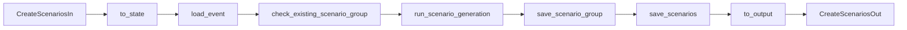
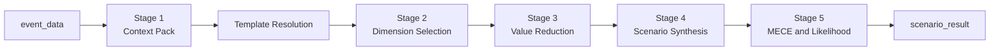
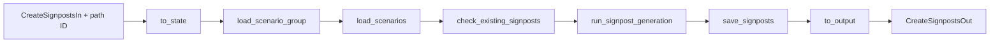
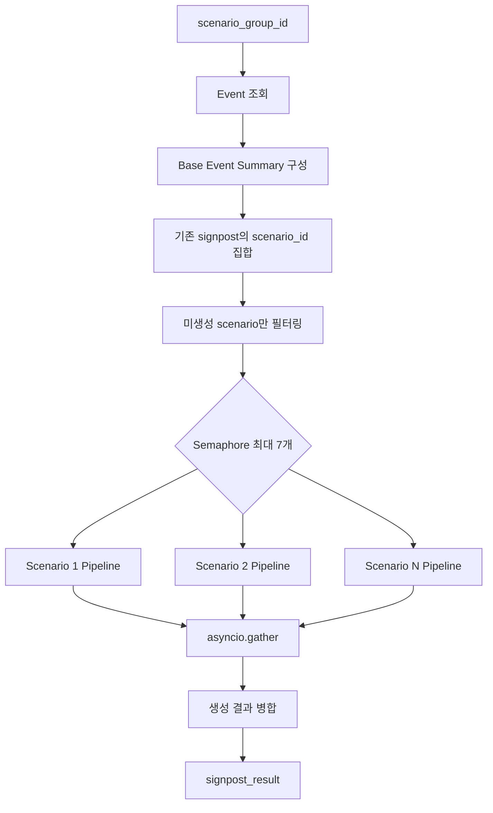
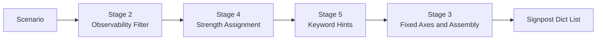
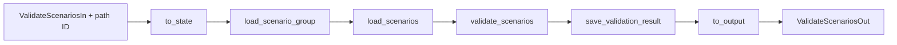

# Scenario Group Agent Flow 로직

## 문서 목적

`scenario_group_agent`의 다음 세 flow가 API 입력을 LangGraph state로 변환하고,
노드를 순차 실행한 뒤 API 응답으로 변환하는 구조를 설명한다.

- `flows/create_scenarios/flow.py`
- `flows/create_signposts/flow.py`
- `flows/validate_scenarios/flow.py`

코드를 읽을 때는 실제 호출 진입점인 파일 하단의 `get_runnable_graph()`부터 시작해
`build_runnable_graph()`와 `build_graph()`를 역순으로 따라가는 편이 이해하기 쉽다.

## 공통 실행 구조

### 1. `get_runnable_graph()`: 재사용 가능한 진입점

각 API는 `api.py`에서 `get_runnable_graph().ainvoke(...)`를 호출한다.

```python
@lru_cache(maxsize=1)
def get_runnable_graph() -> Runnable:
    return build_runnable_graph()
```

`@lru_cache(maxsize=1)`는 최초 호출 때만 runnable graph를 생성하고 이후 요청에서는
동일한 compiled graph를 재사용한다. 따라서 모듈 import 시점에는 graph를 만들지 않으면서,
매 요청마다 graph를 다시 compile하는 비용도 피한다.

### 2. `build_runnable_graph()`: 입출력 파이프라인 조립

세 flow는 모두 다음 파이프라인을 사용한다.

```text
API payload(dict)
  -> RunnableLambda(to_state)
  -> compiled StateGraph
  -> RunnableLambda(to_output)
  -> API response(dict)
```

```python
return (RunnableLambda(to_state) | build_graph() | RunnableLambda(to_output)).with_types(
    input_type=...In,
    output_type=...Out,
)
```

- `to_state`: 입력 payload를 검증하고 공통 `ScenarioDesignState`를 생성한다.
- `build_graph()`: flow별 node를 등록하고 실행 순서를 정의한다.
- `to_output`: 최종 state에서 API 응답 필드만 추출한다.
- `with_types`: runnable의 입력/출력 schema 정보를 선언한다.

`with_types`는 runnable metadata를 지정하는 역할이며, 실제 입력 검증은 `to_state`의
`model_validate()`가 수행한다. API 계층은 반환 dict를 다시 response model로 검증한다.

### 3. `build_graph()`: 상태 기반 node 체인 정의

```python
builder = StateGraph(ScenarioDesignState)
builder.add_node("node_name", node_function)
builder.set_entry_point("first_node")
builder.add_edge("first_node", "next_node")
builder.set_finish_point("last_node")
return builder.compile()
```

- 모든 node는 현재 `ScenarioDesignState`를 입력으로 받는다.
- node는 전체 state를 직접 반환하지 않고 변경할 필드만 `dict`로 반환한다.
- LangGraph는 반환된 필드를 기존 state에 병합한 뒤 다음 node로 전달한다.
- 현재 세 graph에는 conditional edge가 없다. 실패나 기존 데이터 발견 여부와 관계없이
  edge는 끝까지 이동하며, 각 node가 `state.status`를 확인해 작업을 건너뛴다.

## 공통 State

세 flow는 [`ScenarioDesignState`](../../apps/agents/scenario_group_agent/state.py)를 공유한다.

| 분류 | 주요 필드 | 용도 |
|---|---|---|
| 식별자 | `mi_event_id`, `scenario_group_id` | event와 scenario group 식별 |
| 조회 데이터 | `event_data`, `scenario_group`, `scenarios`, `signposts` | DB에서 읽은 데이터 |
| 처리 결과 | `scenario_result`, `validation_result`, `signpost_result` | 생성/검증 pipeline 결과 |
| 저장 결과 | `saved_scenario_ids`, `saved_signpost_ids` | 신규 저장된 row ID |
| 검증 결과 | `is_valid`, `reason` | scenario 유효성 결과 |
| 실행 상태 | `status`, `message`, `error` | node 간 중단 또는 결과 상태 전달 |

초기 `status`는 `"success"`다. 오류가 발생하면 node가 `"failure"`를 반환하고,
중복 데이터가 모두 존재하면 `"already_exist"`를 반환한다. 뒤쪽 node는 이 값을 보고
외부 호출이나 DB 저장을 생략한다.

## Create Scenarios Flow

### 전체 흐름



### 입력과 출력 변환

`to_state`는 `CreateScenariosIn`으로 `mi_event_id`를 검증하고 다음 state를 만든다.

```python
ScenarioDesignState(mi_event_id=parsed.mi_event_id, include_details=True)
```

`to_output`은 최종 state에서 다음 값을 반환한다.

- `mi_event_id`
- `scenario_group_id`
- `scenario_count`: `state.scenarios` 길이
- `saved_scenario_ids`
- `scenario_result`
- `status`, `message`

### Node 책임

| 순서 | Node | 주요 동작 | 건너뛰기/실패 조건 |
|---|---|---|---|
| 1 | `load_event` | `EventService`로 MI event 조회 | ID 누락 또는 event 미존재 시 `failure` |
| 2 | `check_existing_scenario_group` | event에 연결된 group과 scenarios 조회 | 앞선 실패 시 skip, 기존 group 발견 시 `already_exist` |
| 3 | `run_scenario_generation` | `ScenarioGenerationService`로 scenario group 생성 | `failure`, `already_exist`면 skip |
| 4 | `save_scenario_group` | 생성 결과에서 선택 차원과 scenario 수를 추출해 group 저장 | 생성 결과 누락 시 `failure` |
| 5 | `save_scenarios` | scenarios 저장, group의 scenario count 갱신, 저장 결과 재조회 | group ID 또는 생성 결과 누락 시 `failure` |

기존 scenario group이 있으면 새 LLM 생성과 저장을 수행하지 않고 기존 group/scenarios를
응답하며, 상태는 `"already_exist"`가 된다.

### `run_scenario_generation` 상세

이 node는 직접 prompt를 조립하지 않고
`ScenarioGenerationService.generate_scenario_group_from_event(state.event_data)`에
전체 생성 작업을 위임한다.

```python
def run_scenario_generation(state: ScenarioDesignState) -> dict[str, Any]:
    if state.status in {"failure", "already_exist"}:
        return {}
    if state.event_data is None:
        return {
            "status": "failure",
            "error": "event_data is required",
            "message": "event_data is required",
        }

    result = ScenarioGenerationService().generate_scenario_group_from_event(
        state.event_data
    )
    return {"scenario_result": result}
```

node 자체의 책임은 다음 세 가지로 제한된다.

1. 앞선 node가 설정한 `failure` 또는 `already_exist` 상태를 확인한다.
2. `event_data`가 존재하는지 방어적으로 검사한다.
3. service의 전체 결과를 `state.scenario_result`에 저장한다.

실제 생성은 다음 5-stage pipeline으로 실행된다.



#### Stage 1: event context 구성

`stage1_build_context_pack()`은 DB에서 읽은 event dict를 `Stage1ContextPack`으로 변환한다.

- `C1_base_event`: event ID, 제목, event type, 요약, 핵심 driver
- `C2_linked_records`: 현재는 빈 records를 가진 stub
- `C3_historical_analogs`: 현재는 빈 목록
- `C4_related_events`: 현재는 빈 목록

핵심 driver는 `key_bullets`의 첫 항목을 우선 사용하고, 없으면
`detail_analysis`의 첫 문장을 사용한다. event type은
`level_1_code::level_2_code` 형식의 template key로 변환된다.

#### Template 조회

`_resolve_template()`은 Stage 1에서 만든 `event_type_l1_l2`를 key로 template registry를
조회한다. 일치하는 template이 없으면 `KeyError`가 발생하며 node 내부에서 별도로
처리하지 않으므로 graph 호출까지 예외가 전파된다.

#### Stage 2: Dimension 선택

`stage2_select_dimensions()`은 template의 전체 dimension 중 event 분기에 의미 있는
3~5개를 structured-output LLM으로 선택한다.

- 입력: base event 요약, driver, `detail_analysis`, template dimensions
- 출력: `selected_dimensions`, `excluded_dimensions`
- 검증: template 외 ID 금지, 선택 수 3~5개, `(b)` 기준 사용 금지
- 후처리: LLM이 누락한 미선택 dimension은 자동으로 excluded 목록에 추가
- fallback: template 앞 4개 dimension을 선택

#### Stage 3: Dimension별 enum 축소

`stage3_reduce_values()`은 선택된 각 dimension마다 별도의 LLM 호출을 실행해 전체 enum을
2~4개로 줄인다. 각 호출은 현재 순차 실행된다.

- 선택 enum은 template enum의 부분집합이어야 한다.
- 최소 하나의 tail-risk enum을 포함해야 한다.
- 결과는 dimension별 `selected_enum`과 `tail_risk_kept`로 구성된다.
- fallback은 첫 값, 중간 값, tail 값을 조합해 최소 2개를 확보한다.

#### Stage 4: Scenario 합성

`stage4_synthesize_scenarios()`은 Stage 3의 enum들로 Cartesian product를 만들고,
template compatibility rule을 적용한 뒤 목표 개수만 선택한다.

조합 선택은 baseline에 가까운 조합과 tail 조합을 anchor로 잡고, 나머지는 dimension 값의
Hamming distance가 큰 조합을 우선 선택해 다양성을 확보한다. 기본 목표 개수는
`REF_TARGET_SCENARIOS`이며 기본값은 6이다. compatibility rule을 통과한 조합이 없으면
Cartesian 결과 중 첫 조합을 강제로 사용한다.

선택한 각 조합에 대해 LLM이 다음 값을 생성한다.

- `title`
- `description`
- `derivation_rationale`
- `price_direction.brent`, `jkm`, `ttf`

LLM 출력 수는 입력 조합 수와 같아야 한다. 실패 시 각 조합에 중립 가격 방향을 가진
fallback narrative를 생성한다. 최종 scenario ID는 `S_01`, `S_02` 형식으로 부여된다.

#### Stage 5: MECE 및 likelihood 검증

`stage5_validate()`는 모든 scenario에 대해 likelihood를 다음 5단계로 분류한다.

```text
very_low | low | medium | high | very_high
```

LLM은 MECE 판정도 반환하지만, 최종 `mutually_exclusive` 값은 코드가
`dimension_values` 조합의 중복 여부를 검사한 결정론적 결과를 우선 사용한다.
LLM 실패 시 모든 scenario의 likelihood는 `medium`으로 설정된다.

#### 재시도와 반환 구조

Stage 2~5의 LLM 호출은 schema 검증 실패, rate limit, timeout 등 재시도 가능한 오류에
대해 `REF_MAX_RETRIES`만큼 재시도한다. 재시도를 모두 소진하면 stage별 fallback으로
pipeline을 계속 진행한다.

최종 `scenario_result`는 stage별 상세 결과와 요약 필드를 함께 가진다.

| 필드 | 내용 |
|---|---|
| `stage1_context_pack` | event context |
| `stage2_dimension_selection` | 선택/제외 dimension |
| `stage3_value_selection` | dimension별 선택 enum |
| `stage4_scenario_synthesis` | 조합 수, compatibility 통과 수, scenarios |
| `stage5_validation` | MECE와 likelihood prior |
| `scenario_count` | 최종 scenario 수 |
| `cartesian_total` | 전체 dimension 조합 수 |
| `filtered_by_compatibility` | compatibility 통과 조합 수 |
| `mece_passed` | 결정론적 MECE 결과 |

이 결과는 아직 DB에 저장된 데이터가 아니다. 다음 `save_scenario_group`과
`save_scenarios` node가 `scenario_result`를 읽어 실제 group/scenario row를 생성한다.
service가 만든 임시 문자열 `scenario_group_id`는 `save_scenario_group`에서 DB PK로
교체된다.

## Create Signposts Flow

### 전체 흐름



### 입력과 출력 변환

request body schema는 비어 있고 `scenario_group_id`는 API path parameter에서 payload에
합쳐진다. `to_state`는 payload를 검증한 뒤 ID를 정수로 변환한다.

`to_output`은 `scenario_group_id`, 전체 `signpost_count`, 이번 실행에서 저장한
`saved_signpost_ids`, 상세 `signpost_result`, `status`, `message`를 반환한다.

### Node 책임

| 순서 | Node | 주요 동작 | 건너뛰기/실패 조건 |
|---|---|---|---|
| 1 | `load_scenario_group` | group 조회 후 `mi_event_id`를 state에 전달 | group 미존재 시 `failure` |
| 2 | `load_scenarios` | group 소속 scenarios 조회 | scenario가 없으면 `failure` |
| 3 | `check_existing_signposts` | scenario별 기존 signpost 조회 | 모든 scenario에 존재하면 `already_exist` |
| 4 | `run_signpost_generation` | event context를 만들고 signpost가 없는 scenario만 비동기 생성 | `failure`, `already_exist`면 skip |
| 5 | `save_signposts` | 새 signpost 저장 후 group 전체 signpost 재조회 | `failure`, `already_exist`면 skip |

`run_signpost_generation`은 `asyncio.Semaphore(7)`로 scenario 단위 동시 실행 수를 제한하고,
`asyncio.gather()`로 생성 작업을 병렬 실행한다. 일부 scenario에만 기존 signpost가 있으면
해당 scenario는 제외하고 나머지만 생성한다. `signpost_result["signposts"]`에는 이번에
새로 생성한 항목만 들어가며, state의 `signposts`에는 기존 항목과 신규 항목이 합쳐진다.

### `run_signpost_generation` 상세

이 node는 scenario group 전체를 입력으로 받지만, 실제 signpost pipeline은 scenario
한 건씩 독립적으로 실행한다.



#### 1. 실행 전 조건과 event context

`state.status`가 `failure` 또는 `already_exist`면 아무 작업도 하지 않는다.
`mi_event_id`가 없거나 event 조회 결과가 없으면 `failure` 상태를 반환한다.

event가 존재하면 scenario pipeline의 `stage1_build_context_pack()`을 재사용해 context를
구성하지만, signpost pipeline에는 다음 C1 필드만 전달한다.

```python
base_event_summary = {
    "title": c1.get("title", ""),
    "summary": c1.get("summary", ""),
    "driver": c1.get("driver", ""),
}
```

#### 2. 부분 중복 제거

`check_existing_signposts`에서 읽어 둔 `state.signposts`의 `scenario_id` 집합을 만든 뒤,
기존 signpost가 하나라도 연결된 scenario는 생성 대상에서 제외한다.

```python
scenarios_to_process = [
    scenario
    for scenario in state.scenarios
    if int(scenario["scenario_id"]) not in existing_scenario_ids
]
```

따라서 현재 로직은 scenario별 all-or-nothing 방식이다. 한 scenario에 필요한 signpost가
일부만 존재하더라도 해당 scenario의 부족한 개수를 보충하지는 않는다.

#### 3. Scenario 단위 동시 실행

각 scenario는 `process_one()`에서 `build_signposts_for_scenario()`를 호출한다.
`asyncio.Semaphore(_MAX_CONCURRENT_SCENARIOS)`가 동시에 pipeline을 실행하는 scenario 수를
7개로 제한하고, `asyncio.gather()`가 모든 결과를 기다린다.

scenario 하나의 반환값은 다음 두 부분으로 나뉜다.

- 생성된 signpost dict 목록
- `scenario_id`, `status`, `signpost_count`를 가진 실행 요약

`gather()`는 기본 예외 처리 방식을 사용한다. 따라서 scenario 하나에서 fallback으로
처리되지 않은 예외가 발생하면 node 전체 호출도 실패하며, 부분 성공 결과를 저장하지 않는다.

#### 4. Scenario 내부 signpost pipeline

`build_signposts_for_scenario()`는 다음 순서로 실행된다.



코드의 stage 번호는 개념적 설계 번호를 유지하므로 실행 순서가 `2 -> 4 -> 5 -> 3/조립`
형태다. Stage 3의 값은 현재 LLM 호출 없이 고정값으로 조립 단계에서 적용된다.

##### Stage 2: Observability Filter

`stage2_observability_filter()`는 scenario의 제목, 설명, `dimension_values`,
`price_direction`과 base event 요약을 사용해 관측 가능한 후보 5~10개를 생성한다.

후보는 다음 세 필터를 모두 통과해야 한다.

- 주요 매체 또는 공식 채널에서 관측 가능한가
- 관측/미관측을 binary로 판정할 수 있는가
- 해당 scenario의 가정과 직접 연결되는가

통과 후보 수는 환경 설정상 기본 3~6개다. label 중복과 통과 개수를 검증하며,
LLM 실패 시 scenario 제목과 dimension 값을 이용해 최소 개수의 fallback label을 만든다.
통과 label이 없으면 해당 scenario는 빈 signpost 목록을 반환하고 이후 stage를 실행하지 않는다.

##### Stage 4: Direction과 Strength

`stage4_assign_direction_strength()`는 Stage 2 label의 순서를 유지하면서 각 signpost에
`STRONG`, `MEDIUM`, `WEAK` 중 하나와 한국어 근거를 부여한다.

- `STRONG`: scenario 실현을 직접 증명하는 신호
- `MEDIUM`: 분명한 초기 신호
- `WEAK`: 간접적 초기 신호

STRONG과 MEDIUM/WEAK 개수는 환경변수로 설정된 quota를 따라야 한다. 출력 길이와 label
순서도 입력과 정확히 같아야 한다. 실패 시 quota 범위 안에서 strength를 분배하는
fallback을 사용한다. `direction`은 LLM이 결정하지 않고 항상 `"SUP"`로 고정된다.

##### Stage 5: Keyword Hint 생성

`stage5_mint_keywords()`는 각 label에 record 검색용 keyword 3~5개를 부여한다.
출력 길이와 label 순서를 검증하며, 빈 keyword는 허용하지 않는다. 실패 시 label에서
토큰을 추출하고 `"보도"` 같은 정형 행위어를 추가해 최소 3개를 만든다.

##### Stage 3 및 최종 조립

현재 Stage 3 axis 분류는 결정론적 고정값이다. 최종 조립 시 다음 값이 설정된다.

| 필드 | 값 또는 출처 |
|---|---|
| `scenario_id` | DB scenario PK |
| `signpost_id` | `sgp_{scenario_pk}_{순번}` |
| `signpost_class` | `"observation"` |
| `label` | Stage 2 결과 |
| `signpost_source` | `"mi_record"` |
| `direction` | `"SUP"` |
| `strength` | Stage 4 결과 |
| `rationale_ko` | Stage 4 결과 |
| `keyword_hints` | Stage 5 결과 |

#### 5. Node 반환과 저장 경계

모든 scenario 결과를 병합한 뒤 node는 다음 state update를 반환한다.

```python
{
    "signposts": [*state.signposts, *generated],
    "signpost_result": {
        "scenario_group_id": state.scenario_group_id,
        "scenario_results": scenario_results,
        "signposts": generated,
    },
}
```

- `state.signposts`: 기존 signpost와 이번 생성 결과를 합친 전체 목록
- `signpost_result["signposts"]`: 이번 실행에서 새로 생성한 목록만 포함
- `scenario_results`: 이번에 처리한 scenario별 생성 건수

이 단계에서는 DB 저장을 하지 않는다. 다음 `save_signposts` node가 신규 목록만 저장하고,
저장 완료 후 DB에서 group 전체 signpost를 다시 조회해 state를 최신 상태로 맞춘다.

## Validate Scenarios Flow

### 전체 흐름



### 입력과 출력 변환

`create_signposts`와 마찬가지로 request body는 비어 있고 path의 `scenario_group_id`가
payload에 합쳐진다. 출력은 `is_valid`, `reason`, `validation_result`와 공통 상태 필드를
포함한다.

### Node 책임

| 순서 | Node | 주요 동작 | 건너뛰기/실패 조건 |
|---|---|---|---|
| 1 | `load_scenario_group` | scenario group 조회 | group 미존재 시 `failure` |
| 2 | `load_scenarios` | group 소속 scenarios 조회 | scenario가 없으면 `failure` |
| 3 | `validate_scenarios` | title, dimension 값, dimension 조합 중복 검사 | 앞선 실패 시 skip |
| 4 | `save_validation_result` | scenario 판단 상태를 `검증완료` 또는 `검토필요`로 갱신 | 앞선 실패 시 skip |

검증 이슈가 없으면 `is_valid=True`, `reason="Scenarios are valid"`가 된다. 이슈가 있으면
각 이슈를 세미콜론으로 연결한 문자열이 `reason`에 들어가고, 상세 목록은
`validation_result["issues"]`에 저장된다.

## 세 Flow 비교

| 항목 | Create Scenarios | Create Signposts | Validate Scenarios |
|---|---|---|---|
| 시작 식별자 | `mi_event_id` | `scenario_group_id` | `scenario_group_id` |
| 핵심 외부 처리 | scenario LLM pipeline | signpost 비동기 pipeline | 로컬 규칙 검증 |
| 중복 처리 | 기존 group 전체 재사용 | 기존 signpost가 없는 scenario만 생성 | 해당 없음 |
| 최종 DB 변경 | group/scenarios 생성 | signposts 생성 | judgment status 갱신 |
| 성공 결과 | 생성 scenario와 저장 ID | 전체 signpost와 신규 저장 ID | 유효성, 사유, 이슈 목록 |

## 읽기 순서 요약

flow를 분석하거나 새 flow를 추가할 때는 다음 순서로 확인한다.

1. `api.py`에서 path parameter와 body가 어떤 payload로 합쳐지는지 확인한다.
2. `get_runnable_graph()`에서 graph가 지연 생성되고 캐시되는지 확인한다.
3. `build_runnable_graph()`에서 `to_state -> graph -> to_output` 연결을 확인한다.
4. `to_state`와 `to_output`에서 API schema와 state 사이의 경계를 확인한다.
5. `build_graph()`에서 node 등록 순서와 entry/finish point를 확인한다.
6. `nodes.py`에서 각 node의 state 변경 필드와 skip 조건을 확인한다.
