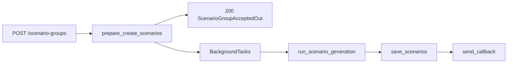
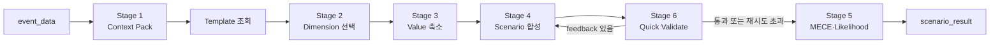
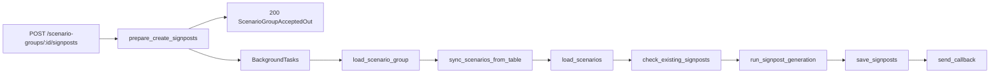
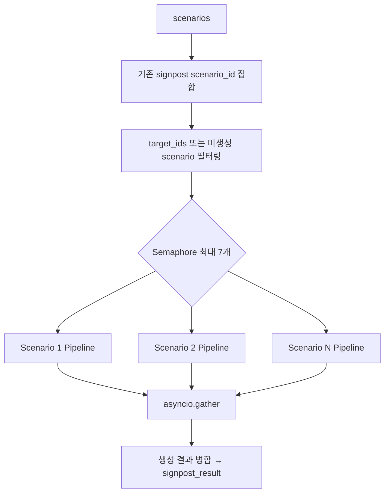
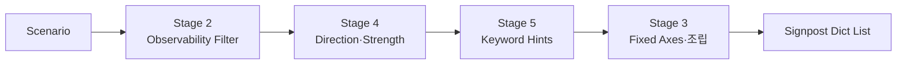
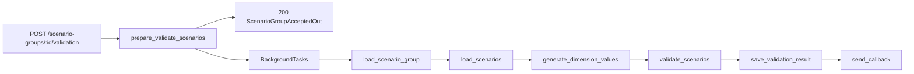
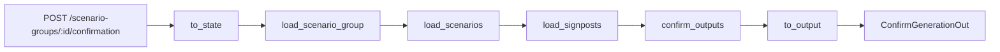

# Scenario Group Agent Flow 로직

## 문서 목적

`scenario_group_agent`의 네 flow가 API 입력을 LangGraph state로 변환하고,
노드를 순차 실행한 뒤 API 응답으로 변환하는 구조를 설명한다.

- `flows/create_scenarios/` — 시나리오 그룹 생성
- `flows/create_signposts/` — Signpost 생성
- `flows/validate_scenarios/` — 시나리오 테이블 검증
- `flows/confirm_generation/` — 생성 확정

## 비동기 실행 패턴 (공통)

`create_scenarios`, `create_signposts`, `validate_scenarios` 세 flow는 **동기 prepare + 비동기 백그라운드** 패턴을 사용한다.

```text
API 요청
  -> prepare_*()       # 권한·중복 확인, 초기 DB row 생성 (동기, 즉시 200 반환)
  -> BackgroundTasks   # 실제 LLM 파이프라인 실행
  -> send_callback()   # 완료 후 콜백 URL로 결과 전송
```

API는 `ScenarioGroupAcceptedOut`(scenario_group_id, status, stage)을 즉시 반환하고,
LLM 파이프라인이 끝나면 콜백으로 최종 결과를 전달한다.
`confirm_generation`만 동기 LangGraph graph를 직접 `ainvoke`한다.

## 공통 실행 구조

### 1. `get_runnable_graph()`: 재사용 가능한 진입점

각 flow의 `flow.py` 또는 `flow_async.py`에서 `get_runnable_graph().ainvoke(...)`를 호출한다.

```python
@lru_cache(maxsize=1)
def get_runnable_graph() -> Runnable:
    return build_runnable_graph()
```

`@lru_cache(maxsize=1)`는 최초 호출 때만 runnable graph를 생성하고 이후 요청에서 동일한
compiled graph를 재사용한다.

### 2. `build_runnable_graph()`: 입출력 파이프라인 조립

```text
API payload(dict)
  -> RunnableLambda(to_state)
  -> compiled StateGraph
  -> RunnableLambda(to_output)
  -> API response
```

- `to_state`: 입력 payload를 검증하고 `ScenarioDesignState`를 생성한다.
- `build_graph()`: flow별 node를 등록하고 실행 순서를 정의한다.
- `to_output`: 최종 state에서 API 응답 필드만 추출한다. **실패 상태이면 `MIBaseError`를 raise한다.**

### 3. `build_graph()`: 상태 기반 node 체인 정의

```python
builder = StateGraph(ScenarioDesignState)
builder.add_node("node_name", node_function)
builder.set_entry_point("first_node")
builder.add_edge("first_node", "next_node")
builder.set_finish_point("last_node")
return builder.compile()
```

- 모든 node는 현재 `ScenarioDesignState`를 입력으로 받는다.
- node는 변경할 필드만 `dict`로 반환한다.
- LangGraph는 반환된 필드를 기존 state에 병합한 뒤 다음 node로 전달한다.
- **오류 발생 시 node는 `status="failure"` dict를 반환하지 않고 `MIBaseError`를 raise한다.**

## 공통 State

네 flow는 [`ScenarioDesignState`](../../apps/agents/scenario_group_agent/state.py)를 공유한다.

| 분류 | 주요 필드 | 용도 |
|---|---|---|
| 식별자 | `mi_event_id`, `scenario_group_id`, `user_id` | event, scenario group, 요청 사용자 식별 |
| 조회 데이터 | `event_data`, `scenario_group`, `scenarios`, `signposts`, `dimension_template` | DB에서 읽은 데이터 |
| 처리 결과 | `scenario_result`, `validation_result`, `signpost_result` | 생성·검증 pipeline 결과 |
| 요청 payload | `request_scenario_group`, `request_table` | 클라이언트가 전달한 수정 내용 |
| 저장 결과 | `saved_scenario_ids`, `saved_signpost_ids`, `snapshot_id` | 신규 저장된 row ID |
| 검증 결과 | `is_valid`, `reason`, `confirmed` | scenario 유효성·확정 결과 |
| 재생성 대상 | `signpost_target_scenario_ids` | 테이블 변경으로 signpost 재생성이 필요한 scenario ID |
| 실행 상태 | `status`, `message`, `error` | node 간 중단 또는 결과 상태 전달 |

초기 `status`는 `"success"`다. `to_output`은 `status`가 `"failure"` 또는 `"error"`이면
`MIBaseError`를 raise한다.

## Create Scenarios Flow

### 전체 흐름



`prepare_create_scenarios`는 LangGraph graph 없이 동기 함수로 실행된다.

```text
load_event → check_existing_scenario_group → create_group_record
```

- `load_event`: MI event 조회, 없으면 `MIBaseError` raise
- `check_existing_scenario_group`: 기존 group 확인
  - 없음 또는 `ready` 상태: 새로 생성 진행
  - `creating` 상태이고 같은 사용자: `SCENARIO_GROUP_ALREADY_CREATED` raise
  - `creating` 상태이고 다른 사용자: `SCENARIO_GROUP_OWNERSHIP_CONFLICT` raise
  - 그 외 상태: `SCENARIO_GROUP_ALREADY_CREATED` raise
- `create_group_record`: `status="creating"`, `stage="ready"`인 group row를 INSERT하고 `scenario_group_id`를 확보한다.

백그라운드 graph는 `run_scenario_generation → save_scenarios`만 실행한다.

### 입력과 출력 변환

`to_state`는 `CreateScenariosIn`으로 검증 후 다음 state를 만든다.

```python
ScenarioDesignState(
    scenario_group_id=...,   # prepare에서 확보한 ID
    event_data=...,          # prepare에서 조회한 event
    user_id=...,
)
```

`to_output`(및 `_bg_to_output`)은 `build_scenario_group_table_data(group, scenarios)`를 사용해
`CreateScenariosOut`의 `scenario_group`, `table` 필드를 구성한다.

### Node 책임

| 순서 | Node | 주요 동작 | 오류 조건 |
|---|---|---|---|
| 1 | `run_scenario_generation` | scenario generation subgraph 실행 | subgraph 내부 오류 |
| 2 | `save_scenarios` | scenarios 저장, group `stage="scenario_created"` 갱신, 저장 결과 재조회 | group ID 또는 생성 결과 누락 시 raise |

### `run_scenario_generation` 상세

`subgraphs/scenario_generation/subgraph_builder.py`에서 컴파일한 `scenario_generation_runnable`이
직접 node로 등록된다. 6-stage subgraph가 하나의 node처럼 실행된다.



#### Stage 1: event context 구성

`stage1_build_context_pack()`은 DB에서 읽은 event dict를 `Stage1ContextPack`으로 변환한다.

- `C1_base_event`: event ID, 제목, event type, 요약, 핵심 driver
- `C2_linked_records`, `C3_historical_analogs`, `C4_related_events`: 현재 stub

핵심 driver는 `key_bullets`의 첫 항목을 우선 사용하고, 없으면 `detail_analysis`의 첫 문장을 사용한다.

#### Template 조회

`ScenarioService.load_pipeline_template(event_type_l2_id)`로 DB template을 조회한다.
활성 template이 없으면 `KeyError`, 구조가 잘못되면 `ValueError`가 발생한다.

#### Stage 2: Dimension 선택

`stage2_select_dimensions()`은 template 전체 dimension 중 event 분기에 의미 있는 3~5개를
structured-output LLM으로 선택한다.

- 검증: template 외 ID 금지, 선택 수 3~5개, `(b)` 기준 사용 금지
- 후처리: LLM이 누락한 미선택 dimension은 자동으로 excluded 목록에 추가
- fallback: template 앞 4개 dimension 선택

#### Stage 3: Dimension별 enum 축소

`stage3_reduce_values()`은 선택된 각 dimension마다 별도 LLM 호출로 전체 enum을 2~4개로 줄인다.

- 선택 enum은 template enum의 부분집합이어야 한다.
- 최소 하나의 tail-risk enum을 포함해야 한다.
- fallback: 첫 값, 중간 값, tail 값을 조합해 최소 2개 확보

#### Stage 4: Scenario 합성

`stage4_synthesize_scenarios()`은 Stage 3 enum들로 Cartesian product를 만들고 목표 개수만 선택한다.
baseline에 가까운 조합과 tail 조합을 anchor로 잡고, 나머지는 Hamming distance가 큰 조합을 우선
선택해 다양성을 확보한다. 기본 목표 개수는 `REF_TARGET_SCENARIOS`(기본값 6)다.

`validation_feedback`이 있으면 이전 합성 결과에 대한 피드백을 반영해 조합을 재선정한다.

선택한 각 조합에 대해 LLM이 `title`, `description`, `derivation_rationale`,
`price_direction.brent/jkm/ttf`를 생성한다. 실패 시 중립 가격 방향 fallback 사용.
최종 scenario ID는 `S_01`, `S_02` 형식으로 부여된다.

#### Stage 6: Quick Validate (재시도 루프)

`stage6_quick_validate()`는 합성된 scenario 조합이 dimension 다양성·중복 요건을 충족하는지
빠르게 검사한다.

- 통과(`validation_feedback=None`)하거나 `REF_QUICK_VALIDATE_MAX_RETRIES` 초과: Stage 5로 진행
- 피드백이 있으면: `synthesize_scenarios` 노드로 돌아가 재합성 (conditional edge)

#### Stage 5: MECE 및 Likelihood 검증

`stage5_validate()`는 모든 scenario에 대해 likelihood를 5단계
(`very_low | low | medium | high | very_high`)로 분류한다.

LLM은 MECE 판정도 반환하지만, 최종 `mutually_exclusive` 값은 코드가 `dimension_values` 조합의
중복 여부를 검사한 결정론적 결과를 우선 사용한다. LLM 실패 시 모든 scenario의 likelihood는
`medium`으로 설정된다.

#### 재시도와 반환 구조

Stage 2~5의 LLM 호출은 `REF_MAX_RETRIES`만큼 재시도한다. 소진 후에는 stage별 fallback으로
pipeline을 계속 진행한다.

최종 `scenario_result` 주요 필드:

| 필드 | 내용 |
|---|---|
| `stage1_context_pack` | event context |
| `stage2_dimension_selection` | 선택/제외 dimension |
| `stage3_value_selection` | dimension별 선택 enum |
| `stage4_scenario_synthesis` | 조합 수, scenarios |
| `stage5_validation` | MECE와 likelihood prior |
| `scenario_count` | 최종 scenario 수 |
| `mece_passed` | 결정론적 MECE 결과 |

## Create Signposts Flow

### 전체 흐름



### 입력과 출력 변환

`CreateSignpostsIn`은 `user_id`와 `table`(ScenarioTable)을 받는다.
`to_state`는 `request_table=parsed.table.model_dump()`를 state에 설정한다.

`to_output`은 `build_scenario_group_table_data(group, scenarios, signposts)`로
`CreateSignpostsOut`의 `scenario_group`, `table` 필드를 구성한다.

### Node 책임

| 순서 | Node | 주요 동작 | 오류 조건 |
|---|---|---|---|
| 1 | `load_scenario_group` | group 조회, 점유자 확인 | group 미존재 또는 다른 사용자 점유 시 raise |
| 2 | `sync_scenarios_from_table` | 테이블 변경 내용을 DB에 반영하고 재생성 필요 scenario ID를 `signpost_target_scenario_ids`에 설정 | table 누락 시 raise |
| 3 | `load_scenarios` | group 소속 scenarios 조회 | scenario가 없으면 raise |
| 4 | `check_existing_signposts` | scenario별 기존 signpost 조회 | (생략 없음) |
| 5 | `run_signpost_generation` | 미생성 scenario + `target_ids` 대상 비동기 생성 | `failure`, `already_exist`이면 skip |
| 6 | `save_signposts` | 새 signpost 저장, scenario `status="created"`, group `stage="signpost_created"` 갱신 | `failure`, `already_exist`이면 skip |

### `run_signpost_generation` 상세



#### 대상 scenario 결정

```python
scenarios_to_process = [
    s
    for s in state.scenarios
    if int(s["scenario_id"]) in target_ids          # sync_scenarios_from_table이 지정한 재생성 대상
    or int(s["scenario_id"]) not in existing_scenario_ids  # 기존 signpost가 없는 scenario
]
```

`target_ids`는 `sync_scenarios_from_table`이 테이블 편집(dimension 변경 등)을 감지해 설정한다.
기존 signpost가 이미 있는 scenario라도 `target_ids`에 포함되면 재생성된다.

#### Scenario 내부 signpost pipeline



코드의 stage 번호는 개념적 설계 번호를 유지하므로 실행 순서가 `2 → 4 → 5 → 3/조립` 형태다.

##### Stage 2: Observability Filter

관측 가능한 후보 5~10개를 생성하고 세 가지 필터(공식 채널 관측 가능, binary 판정 가능,
scenario 가정과 직접 연결)를 적용한다. 통과 개수는 기본 3~6개.

##### Stage 4: Direction과 Strength

각 signpost에 `STRONG | MEDIUM | WEAK`과 한국어 근거를 부여한다. `direction`은 항상 `"SUP"`로 고정.

##### Stage 5: Keyword Hint 생성

각 label에 record 검색용 keyword 3~5개를 부여한다.

##### Stage 3 및 최종 조립

| 필드 | 값 또는 출처 |
|---|---|
| `scenario_id` | DB scenario PK |
| `signpost_id` | `sgp_{scenario_pk}_{순번}` |
| `signpost_class` | `"observation"` |
| `label` | Stage 2 결과 |
| `signpost_source` | `"mi_record"` |
| `direction` | `"SUP"` |
| `strength` | Stage 4 결과 |
| `rationale_ko` | Stage 4 결과 |
| `keyword_hints` | Stage 5 결과 |

## Validate Scenarios Flow

### 전체 흐름



### 입력과 출력 변환

`ValidateScenariosIn`은 `user_id`와 `table`(ScenarioTable)을 받는다.
`to_state`는 `request_table=parsed.table.model_dump()`를 state에 설정한다.

`to_output`은 `is_valid`, `reason`, `scenario_group`(id, status, stage), `table`을 반환한다.

### Node 책임

| 순서 | Node | 주요 동작 | 오류 조건 |
|---|---|---|---|
| 1 | `load_scenario_group` | scenario group 조회, 점유자 확인 | group 미존재 또는 다른 사용자 점유 시 raise |
| 2 | `load_scenarios` | group 소속 scenarios 조회, `dimension_template` 로드 | scenario가 없으면 raise |
| 3 | `generate_dimension_values` | 새로 추가된 dimension의 값을 LLM으로 생성, 필수 dimension 누락 검증 | 필수 dimension 누락 또는 신규 scenario 값 미입력 시 raise |
| 4 | `validate_scenarios` | `build_context` + `run_review`로 시나리오 검토 | 앞선 실패 시 skip |
| 5 | `save_validation_result` | `is_valid`에 따라 `stage="scenario_validated"` 또는 `"scenario_created"`로 갱신 | 앞선 실패 시 skip |

#### `generate_dimension_values` 상세

요청 table에서 header가 있지만 모든 row의 해당 cell이 `null`인 dimension을 **새로 추가된 dimension**으로
판별하고, LLM(`generate_new_dimension_values`)을 호출해 각 row에 값을 채워 `request_table`을 갱신한다.

필수 dimension 누락 또는 기존 scenario의 cell 값이 누락된 경우에는 LLM 호출 없이 즉시
`SCENARIO_VALIDATION_INPUT_ERROR`를 raise한다.

#### `validate_scenarios` 상세

`build_context(group, requested_rows, persisted_scenarios, template_dims)`로 context를 구성한 뒤
`run_review(context)`가 검토 리포트를 반환한다. 리포트에는 verdict(`PASS | REVIEW | BLOCK`),
summary, checks 목록이 포함된다.

- `is_valid=True`: verdict가 `PASS` 또는 `REVIEW`
- `is_valid=False`: verdict가 `BLOCK`

## Confirm Generation Flow

### 전체 흐름



이 flow만 동기 LangGraph graph를 `ainvoke`한다 (백그라운드 패턴 없음).

### 입력과 출력 변환

`ConfirmGenerationIn`은 `user_id`, `scenario_group`(title, summary, description), `table`(ScenarioTable)을 받는다.

`to_state`는 `scenario_group_id`(path parameter), `user_id`, `request_scenario_group`, `request_table`을 state에 설정한다.

`to_output`은 `scenario_group_id`, `status`, `stage`를 `ConfirmGenerationOut`으로 반환한다.

### Node 책임

| 순서 | Node | 주요 동작 | 오류 조건 |
|---|---|---|---|
| 1 | `load_scenario_group` | group 조회, 점유자 확인 | group 미존재 또는 다른 사용자 점유 시 raise |
| 2 | `load_scenarios` | group 소속 scenarios 조회 | scenario가 없으면 raise |
| 3 | `load_signposts` | scenarios의 signpost 전체 조회 | signpost가 없으면 raise |
| 4 | `confirm_outputs` | `ScenarioGroupService.apply_confirmation()`으로 변경 내용 저장 및 confirmation snapshot 생성 | request payload 누락 또는 저장 실패 시 raise |

`confirm_outputs`는 `request_scenario_group`과 `request_table`을 읽어
시나리오·signpost 변경 사항을 한 번에 적용하고 `snapshot_id`를 state에 설정한다.

## 네 Flow 비교

| 항목 | Create Scenarios | Create Signposts | Validate Scenarios | Confirm Generation |
|---|---|---|---|---|
| 시작 식별자 | `mi_event_id` | `scenario_group_id` | `scenario_group_id` | `scenario_group_id` |
| 실행 방식 | prepare + 백그라운드 | prepare + 백그라운드 | prepare + 백그라운드 | 동기 ainvoke |
| 입력 payload | `user_id` | `user_id`, `table` | `user_id`, `table` | `user_id`, `scenario_group`, `table` |
| 핵심 외부 처리 | scenario LLM pipeline (6 stage) | signpost 비동기 pipeline | 차원값 생성 + 로컬 규칙 검증 | snapshot 생성 (DB only) |
| 중복 처리 | 기존 group 존재 시 에러 raise | 미생성 scenario + target_ids 대상만 생성 | 해당 없음 | 해당 없음 |
| stage 갱신 | `scenario_created` | `signpost_created` | `scenario_validated` 또는 `scenario_created` | `completed` |
| 최종 DB 변경 | group/scenarios 생성 | signposts 생성, scenario 상태 갱신 | judgment stage 갱신 | snapshot 생성, 변경 사항 적용 |

## 읽기 순서 요약

flow를 분석하거나 새 flow를 추가할 때는 다음 순서로 확인한다.

1. `api.py`에서 path parameter와 body가 어떤 payload로 합쳐지는지 확인한다.
2. `flow_async.py`의 `prepare_*`에서 동기 전처리 로직을 확인한다 (`confirm_generation`은 `flow.py` 직접).
3. `get_runnable_graph()`에서 graph가 지연 생성되고 캐시되는지 확인한다.
4. `build_runnable_graph()`에서 `to_state → graph → to_output` 연결을 확인한다.
5. `to_state`와 `to_output`에서 API schema와 state 사이의 경계를 확인한다.
6. `nodes.py`에서 각 node의 state 변경 필드와 오류 처리 조건을 확인한다.
