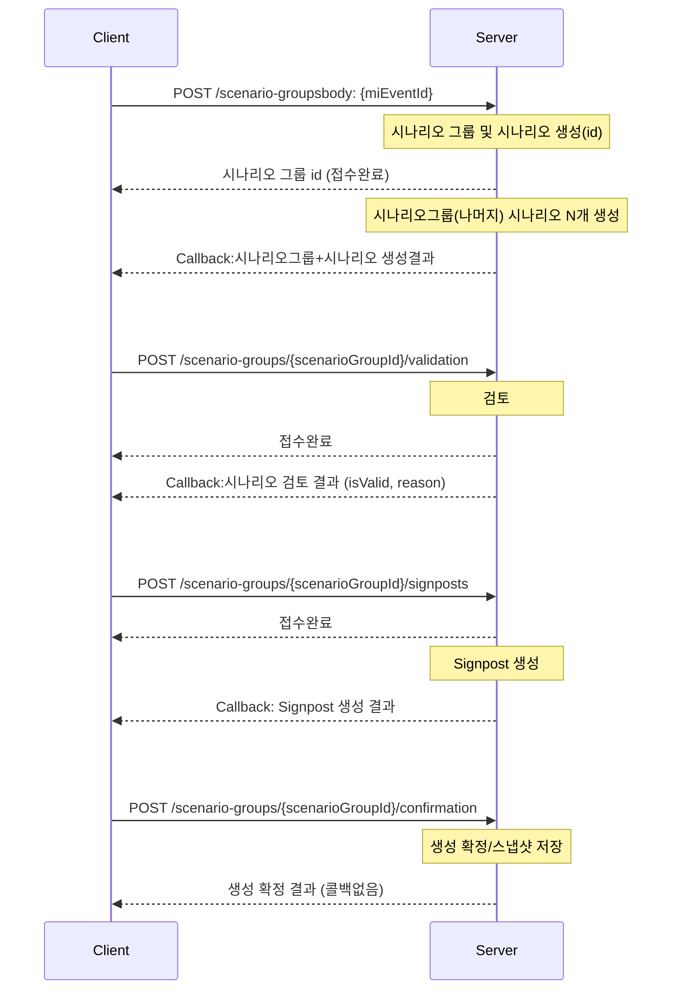

<aside>
💡

시간이 오래걸리는 시나리오 생성, 시나리오 검토, Signpost생성은 작업 완료 후 callback 할 예정입니다.

다만, callback 로직 구현 전까지 Sync 방식으로 통신하며, **Sync 방식의 Response Body는 Callback Body와 동일합니다.**

</aside>



## Scenario Group과 Scenario 의 status / stage

### Scenario Group (`tmm_mi_scenario_group_m`)

- `status` (DB default: `creating`)
    - `creating`: 시나리오/사인포스트 생성 진행 중
    - `created`: 생성 파이프라인 완료(검토/확정 대기)
    - `realized`: 최종 확정 또는 실현 처리
- `stage` (DB default: `ready`)
    - `ready`: 그룹 생성 직후 초기 상태
    - `scenario_created`: 시나리오 생성 완료
    - `scenario_validated`: 시나리오 검증 완료
    - `signpost_created`: 시나리오별 signpost 생성 완료
    - `completed`: confirmation 완료(스냅샷 저장 완료)

### Scenario (`tmm_mi_scenario_m`)

- `status` (DB default: `creating`)
    - `creating`: 개별 시나리오 생성 중
    - `created`: 생성 완료
    - `realized`: 실현 시나리오로 판정
    - `discarded`: 폐기 시나리오
- `stage`
    - 별도 컬럼 없음. 단계 관리는 시나리오 그룹의 `stage`를 기준으로 동기화한다.
- DB 제약
    - `ck_tmm_mi_scenario_m_02`: `status IN ('creating','created','realized','discarded')`

### 권장 전이 순서 (Group 기준)

`ready` -> `scenario_created` -> `scenario_validated` -> `signpost_created` -> `completed`

- `POST /scenario-groups`: 그룹 생성 후 `status=creating`, `stage=ready`
- 시나리오 생성 완료 callback: `stage=scenario_created`
- `POST /scenario-groups/{scenarioGroupId}/validation` 완료: `stage=scenario_validated`
- `POST /scenario-groups/{scenarioGroupId}/signposts` 완료: `stage=signpost_created`
- `POST /scenario-groups/{scenarioGroupId}/confirmation` 완료: `stage=completed`, `status=realized`(정책에 따라 `created` 유지 가능)

## API

### 1) 시나리오 그룹 및 시나리오 생성

- Method/Path: `POST /scenario-groups`
- Description: `miEventId`를 기준으로 시나리오 그룹/시나리오를 생성한다.

Request

```json
{
  "miEventId": 12345,
  "userId": 10001
}
```

| Field | Type | Required | Description |
| --- | --- | --- | --- |
| `miEventId` | number | Y | MI Event 식별자 |
| `userId` | number | Y | 요청 사용자 식별자(int) |

Response Body (`CreateScenariosOut`)

```json
{
  "result": "success",
  "reason": null,
  "scenarioGroup": {
    "scenarioGroupId": 12345,
    "miEventId": 998877,
    "eventTypeL2Id": 12,
    "title": "호르무즈 봉쇄 + 전면전",
    "summary": "단기 공급 차질 및 운임 급등 시나리오",
    "description": "상세 설명...",
    "dimensionSelected": ["period_label", "capacity_change", "recovery"],
    "scenarioCount": 5,
    "status": "creating",
    "stage": "scenario_created"
  },
  "table": {
    "headers": [
      { "key": "period_label", "label": "기간", "displayOrder": 1 },
      { "key": "capacity_change", "label": "생산능력 변화", "displayOrder": 2 },
      { "key": "recovery", "label": "공급 복구", "displayOrder": 3 }
    ],
    "rows": [
      {
        "scenarioId": 90001,
        "displayOrder": 1,
        "title": "단기 외교 해결",
        "cells": {
          "period_label": "2026.5월 말 (~2개월)",
          "capacity_change": "15%",
          "recovery": "4~6주 대다수 재기동"
        },
        "baselineYn": "Y"
      }
    ]
  }
}
```

| Path | Type | Required | Description |
| --- | --- | --- | --- |
| `result` | string | Y | `"success" \| "error"` |
| `reason` | string | N | 에러 사유 (성공 시 null) |
| `scenarioGroup` | object | Y | 시나리오 그룹 메타 정보 |
| `scenarioGroup.scenarioGroupId` | number | Y | 시나리오 그룹 ID |
| `scenarioGroup.miEventId` | number | Y | 연결된 MI Event ID |
| `scenarioGroup.eventTypeL2Id` | number | Y | Event type L2 ID |
| `scenarioGroup.title` | string | Y | 시나리오 그룹 제목 |
| `scenarioGroup.summary` | string | N | 시나리오 그룹 요약 |
| `scenarioGroup.description` | string | N | 시나리오 그룹 상세 설명 |
| `scenarioGroup.dimensionSelected` | array(json) | Y | 선택된 테이블 차원 키 목록 |
| `scenarioGroup.scenarioCount` | number | Y | 생성 시나리오 개수 |
| `scenarioGroup.status` | string | Y | Scenario Group status |
| `scenarioGroup.stage` | string | Y | Scenario Group stage |
| `table.headers` | array(json) | Y | 테이블 헤더 정의 |
| `table.headers[].key` | string | Y | 컬럼 키(예: `period_label`) |
| `table.headers[].label` | string | Y | 표시 라벨 |
| `table.headers[].displayOrder` | number | Y | 표시 순서 |
| `table.rows` | array(json) | Y | 시나리오 행 목록 |
| `table.rows[].scenarioId` | number | Y | 시나리오 ID |
| `table.rows[].displayOrder` | number | Y | 표시 순서 |
| `table.rows[].title` | string | Y | 시나리오 제목 |
| `table.rows[].cells` | object | Y | 헤더 key별 셀 값 |
| `table.rows[].baselineYn` | CHAR(1) | N | Baseline 여부(`"Y" \| "N"`) |

### 2) 시나리오 검증

- Method/Path: `POST /scenario-groups/{scenarioGroupId}/validation`
- Description: 생성된 시나리오 그룹의 유효성을 검증한다.
- Path Param: `scenarioGroupId` (int)

Request body

```json
{
  "userId": 10001,
  "table": {
    "headers": [
      { "key": "period_label", "label": "기간", "displayOrder": 1 },
      { "key": "capacity_change", "label": "생산능력 변화", "displayOrder": 2 },
      { "key": "recovery", "label": "공급 복구", "displayOrder": 3 },
      { "key": "new_dimension", "label": "새로운 분기항목(예시)", "displayOrder": 4 }
    ],
    "rows": [
      {
        "scenarioId": 90001,
        "cells": {
          "period_label": "2026.5월 말 (~2개월)",
          "capacity_change": "15%",
          "recovery": "4~6주 대다수 재기동",
          "new_dimension": null
        }
      }
    ]
  }
}
```

> `new_dimension` 처럼 분기 기준 추가로 인해 agent가 자동생성 해야 하는 값인 경우 `null`로 넣어주세요.

| Path | Type | Required | Description |
| --- | --- | --- | --- |
| `userId` | number | Y | 요청 사용자 식별자(int) |
| `table.headers` | array(json) | Y | 테이블 헤더 정의 |
| `table.rows` | array&lt;object&gt; | Y | 검증 대상 시나리오 행 목록 |
| `table.rows[].scenarioId` | number | Y | 시나리오 ID |
| `table.rows[].cells` | object | Y | 헤더 key별 셀 값 (agent 자동생성 대상은 null) |

Response Body (`ValidateScenariosOut`)

```json
{
  "result": "success",
  "isValid": true,
  "reason": "MECE and plausibility checks passed",
  "scenarioGroup": {
    "scenarioGroupId": 12345,
    "status": "creating",
    "stage": "scenario_validated"
  },
  "table": {
    "headers": [
      { "key": "period_label", "label": "기간", "displayOrder": 1 },
      { "key": "new_dimension", "label": "새로운 분기항목(예시)", "displayOrder": 4 }
    ],
    "rows": [
      {
        "scenarioId": 90001,
        "cells": {
          "period_label": "2026.5월 말 (~2개월)",
          "new_dimension": "new_value"
        }
      }
    ]
  }
}
```

> `table`은 agent가 자동생성한 값을 포함한 전체 테이블의 header/value를 담습니다.

| Path | Type | Required | Description |
| --- | --- | --- | --- |
| `result` | string | Y | `"success" \| "error"` |
| `reason` | string | N | 검증 사유/코멘트 (에러 시 에러 메시지) |
| `isValid` | boolean | Y | 검증 결과 |
| `scenarioGroup.scenarioGroupId` | number | Y | 시나리오 그룹 ID |
| `scenarioGroup.status` | string | Y | Scenario Group status |
| `scenarioGroup.stage` | string | Y | Scenario Group stage |
| `table.headers` | array(json) | Y | 테이블 헤더 정의 |
| `table.rows` | array(json) | Y | 검증 결과 행 목록 |
| `table.rows[].scenarioId` | number | Y | 시나리오 ID |
| `table.rows[].cells` | object | Y | 헤더 key별 셀 값(검증/자동생성 값 포함) |

### 3) Signpost 생성

- Method/Path: `POST /scenario-groups/{scenarioGroupId}/signposts`
- Description: 시나리오 그룹 기준 signpost를 생성한다.
- Path Param: `scenarioGroupId` (int)

Request (body)

```json
{
  "userId": 10001,
  "table": {
    "headers": [
      { "key": "period_label", "label": "기간", "displayOrder": 1 },
      { "key": "capacity_change", "label": "생산능력 변화", "displayOrder": 2 },
      { "key": "recovery", "label": "공급 복구", "displayOrder": 3 }
    ],
    "rows": [
      {
        "scenarioId": 90001,
        "cells": {
          "period_label": "2026.5월 말 (~2개월)",
          "capacity_change": "15%",
          "recovery": "4~6주 대다수 재기동"
        }
      },
      {
        "scenarioId": null,
        "cells": {
          "period_label": "~6개월",
          "capacity_change": "30%",
          "recovery": "9주 대다수 재기동"
        }
      }
    ]
  }
}
```

> 사용자가 추가한 신규 시나리오는 `scenarioId: null`로 보내주세요.

| Field | Type | Required | Description |
| --- | --- | --- | --- |
| `userId` | number | N | 요청 사용자 식별자(int) |
| `table` | object | Y | Signpost 생성을 위한 테이블(헤더/행) |
| `table.headers` | array(json) | Y | 테이블 헤더 정의 |
| `table.headers[].key` | string | Y | 컬럼 키(예: `period_label`) |
| `table.headers[].label` | string | Y | 표시 라벨 |
| `table.headers[].displayOrder` | number | Y | 표시 순서 |
| `table.rows` | array(object) | Y | 대상 시나리오 행 목록 |
| `table.rows[].scenarioId` | number\|null | Y | 시나리오 ID (사용자 추가 시나리오는 null) |
| `table.rows[].cells` | object | Y | 헤더 key별 셀 값 |

Response Body (`CreateSignpostsOut`)

```json
{
  "result": "success",
  "reason": null,
  "scenarioGroup": {
    "scenarioGroupId": 12345,
    "miEventId": 998877,
    "eventTypeL2Id": 12,
    "title": "호르무즈 봉쇄 + 전면전",
    "summary": "단기 공급 차질 및 운임 급등 시나리오",
    "description": "상세 설명...",
    "dimensionSelected": ["period_label", "capacity_change", "recovery"],
    "scenarioCount": 5,
    "status": "creating",
    "stage": "signpost_created"
  },
  "table": {
    "headers": [
      { "key": "period_label", "label": "기간", "displayOrder": 1 },
      { "key": "capacity_change", "label": "생산능력 변화", "displayOrder": 2 },
      { "key": "recovery", "label": "공급 복구", "displayOrder": 3 }
    ],
    "rows": [
      {
        "scenarioId": 90001,
        "displayOrder": 1,
        "title": "단기 외교 해결",
        "narrative": "시나리오 내러티브...",
        "cells": {
          "period_label": "2026.5월 말 (~2개월)",
          "capacity_change": "15%",
          "recovery": "4~6주 대다수 재기동"
        },
        "metrics": { "probabilityScore": 75.0, "probabilityDelta": 0.0 },
        "baselineYn": "Y",
        "signposts": [
          {
            "signpostId": 1,
            "label": "호르무즈 봉쇄 장기화",
            "probabilityDirectionCode": "up",
            "signpostReason": "운송 리스크 확대 및 대체 항로 비용 증가",
            "displayOrder": 1,
            "strength": "STRONG",
            "useYn": "Y"
          }
        ]
      }
    ]
  }
}
```

| Path | Type | Required | Description |
| --- | --- | --- | --- |
| `result` | string | Y | `"success" \| "error"` |
| `reason` | string | N | 에러 사유 (성공 시 null) |
| `scenarioGroup` | object | Y | 시나리오 그룹 메타 정보 |
| `table` | object | Y | 시나리오 테이블(행 + signposts 포함) |
| `table.rows[].signposts` | array(json) | Y | 시나리오별 Signpost 목록 |
| `table.rows[].signposts[].signpostId` | number | Y | Signpost ID |
| `table.rows[].signposts[].label` | string | Y | Signpost 라벨 |
| `table.rows[].signposts[].probabilityDirectionCode` | string | N | 확률 방향 코드(예: up/down) |
| `table.rows[].signposts[].signpostReason` | string | N | Signpost 사유 |
| `table.rows[].signposts[].displayOrder` | number | N | 표시 순서 |
| `table.rows[].signposts[].strength` | string | N | Signpost 강도 (STRONG/MEDIUM/WEAK) |
| `table.rows[].signposts[].useYn` | CHAR(1) | N | 사용 여부 (Y/N) |
| `table.rows[].signposts[].keywordHints` | array(string) | N | 키워드 힌트 목록 |

### 4) 생성 확정

- Method/Path: `POST /scenario-groups/{scenarioGroupId}/confirmation`
- Description: 시나리오/사인포스트 생성 결과를 확정하고 스냅샷을 남긴다.
- Path Param: `scenarioGroupId` (int)

Request Body:

```json
{
  "scenarioGroup": {
    "title": "호르무즈 봉쇄 + 전면전",
    "summary": "단기 공급 차질 및 운임 급등 시나리오",
    "description": "상세 설명..."
  },
  "table": {
    "headers": [
      { "key": "period_label", "label": "기간", "displayOrder": 1 },
      { "key": "capacity_change", "label": "생산능력 변화", "displayOrder": 2 },
      { "key": "recovery", "label": "공급 복구", "displayOrder": 3 }
    ],
    "rows": [
      {
        "scenarioId": 90001,
        "displayOrder": 1,
        "title": "단기 외교 해결",
        "narrative": "시나리오 내러티브...",
        "cells": {
          "period_label": "2026.5월 말 (~2개월)",
          "capacity_change": "15%",
          "recovery": "4~6주 대다수 재기동"
        },
        "metrics": { "probabilityScore": 75.0, "probabilityDelta": 0.0 },
        "baselineYn": "Y",
        "signposts": [
          {
            "signpostId": 1,
            "label": "호르무즈 봉쇄 장기화",
            "probabilityDirectionCode": "up",
            "signpostReason": "운송 리스크 확대 및 대체 항로 비용 증가",
            "displayOrder": 1,
            "strength": "STRONG",
            "useYn": "Y"
          }
        ]
      }
    ]
  }
}
```

| Path | Type | Required | Description |
| --- | --- | --- | --- |
| `scenarioGroup` | object | Y | 확정 대상 시나리오 그룹 |
| `scenarioGroup.title` | string | Y | 확정 대상 그룹 제목 |
| `scenarioGroup.summary` | string | N | 확정 대상 그룹 요약 |
| `scenarioGroup.description` | string | N | 확정 대상 그룹 상세 설명 |
| `table` | object | Y | 확정 대상 시나리오 테이블(행 + signposts 포함) |

Response (`ConfirmGenerationOut`)

```json
{
  "status": "success",
  "message": "성공",
  "data": {
    "scenarioGroupId": 1001,
    "status": "created",
    "stage": "completed"
  }
}
```

| Path | Type | Required | Description |
| --- | --- | --- | --- |
| `status` | string | Y | `"success" \| "error"` |
| `message` | string | Y | 처리 결과 메시지 |
| `data.scenarioGroupId` | number | Y | 시나리오 그룹 ID |
| `data.status` | string | Y | Scenario Group status |
| `data.stage` | string | Y | Scenario Group stage |

## 공통 응답 필드

### Callback Body (API 1, 2, 3)

- `result`: `"success" | "error"`
- `reason`: 에러 사유 (성공 시 null)

### 일반 Response Body (API 4)

- `status`: `"success" | "error"`
- `message`: 처리 결과 메시지
