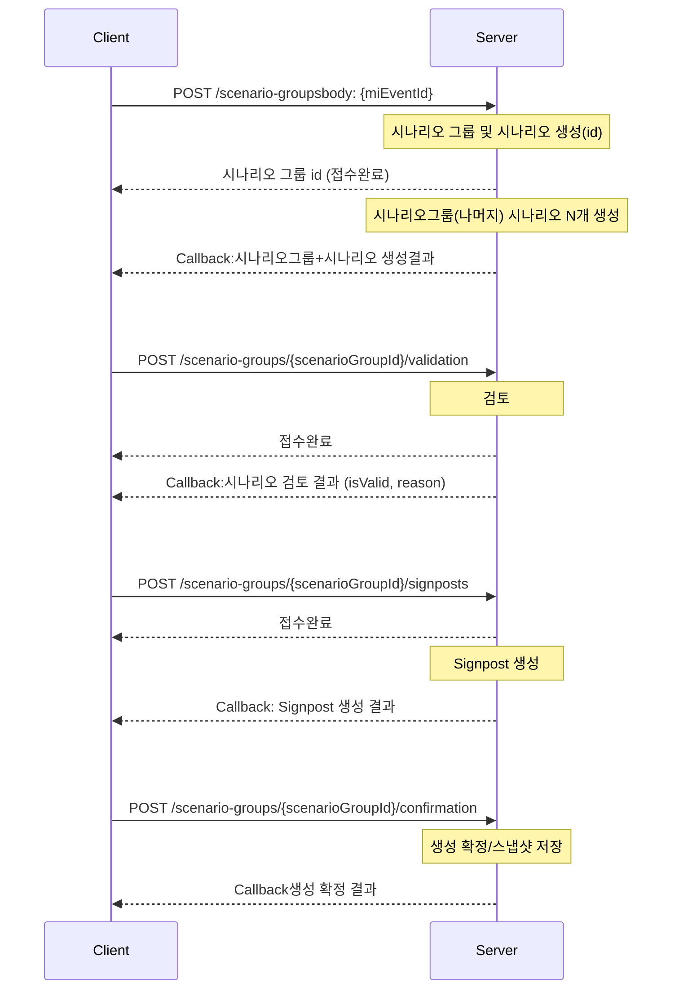

<aside>
💡

시간이 오래걸리는 시나리오 생성, 시나리오 검토, Signpost생성은 작업 완료 후 callback 할 예정입니다.

다만, 6/12일까지 callback 로직을 구현하기에는 촉박하여 우선 Sync 방식으로 통신하도록 구현 예정이며, 추후 callback API 논의 완료되면 Async 방식으로 전환 예정입니다.

Sync 방식의 Response Body는 Callback Body를 참고해주세요.

</aside>



## Scenario Group과 Scenario 의 status / stage

### Scenario Group (`tmm_mi_scenario_group_m`)

- `status` (DB default: `creating`)
    - `creating`: 시나리오/사인포스트 생성 진행 중
    - `created`: 생성 파이프라인 완료(검토/확정 대기)
    - `realized`: 최종 확정 또는 실현 처리
- `stage` (DB default: `ready`)
    - `ready`: 그룹 생성 직후 초기 상태
    - `scenario_created`: 시나리오 생성 완료
    - `scenario_validated`: 시나리오 검증 완료
    - `signpost_created`: 시나리오별 signpost 생성 완료
    - `completed`: confirmation 완료(스냅샷 저장 완료)

### Scenario (`tmm_mi_scenario_m`)

- `status` (DB default: `creating`)
    - `creating`: 개별 시나리오 생성 중
    - `created`: 생성 완료
    - `realized`: 실현 시나리오로 판정
    - `discarded`: 폐기 시나리오
- `stage`
    - 별도 컬럼 없음. 단계 관리는 시나리오 그룹의 `stage`를 기준으로 동기화한다.
- DB 제약
    - `ck_tmm_mi_scenario_m_02`: `status IN ('creating','created','realized','discarded')`

### 권장 전이 순서 (Group 기준)

`ready` -> `scenario_created` -> `scenario_validated` -> `signpost_created` -> `completed`

- `POST /scenario-groups`: 그룹 생성 후 `status=creating`, `stage=ready`
- 시나리오 생성 완료 callback: `stage=scenario_created`
- `POST /scenario-groups/{scenarioGroupId}/validation` 완료: `stage=scenario_validated`
- `POST /scenario-groups/{scenarioGroupId}/signposts` 완료: `stage=signpost_created`
- `POST /scenario-groups/{scenarioGroupId}/confirmation` 완료: `stage=completed`, `status=realized`(정책에 따라 `created` 유지 가능)

## API

### 1) 시나리오 그룹 및 시나리오 생성

- Method/Path: `POST /scenario-groups`
- Description: `miEventId`를 기준으로 시나리오 그룹/시나리오를 생성한다.

Request

```json
{
  "miEventId": 12345,
  "userId": "..."
}
```

| Field | Type | Required | Description |
| --- | --- | --- | --- |
| `miEventId` | number | Y | MI Event 식별자 |
| `userId` | string | Y | 요청 사용자 식별자 |

Response

```json
{
  "status": "success", //success , error
  "message": "성공",
  "data": {
    "scenarioGroupId": 1,
    "status":"creating",
    "stage": "ready",
  }
}
```

| Field | Type | Required | Description |
| --- | --- | --- | --- |
| `status` | string | Y | `"success" | "error"` |
| `message` | string | Y | 처리 결과 메시지 |
| `data.scenarioGroupId` | number | Y | 생성된 시나리오 그룹 ID |
| `data.status` | string | Y | Scenario Group status |
| `data.stage` | string | Y | Scenario Group stage |

```json
{
  "status": "error",
  "message": "Event not found for miEventId=113",
  "data": null,
}
```

CallBack Body (`CreateScenariosOut`)

> Platform Team에서 정의 예정
> 

```json
{
  "status": "success",
  "message": "성공",
  "data": {
    "scenarioGroup": {
      "scenarioGroupId": 12345,
      "miEventId": 998877,
      "eventTypeL2Id": 12,
      "title": "호르무즈 봉쇄 + 전면전",
      "summary": "단기 공급 차질 및 운임 급등 시나리오",
      "description": "상세 설명...",
      "dimensionSelected": ["period_label", "capacity_change", "recovery"],
      "scenarioCount": 5,
      "status": "creating",
      "stage": "scenario_created"
    },
    "table": {
      "headers": [
        {
          "key": "period_label",
          "label": "기간",
          "displayOrder": 1
        },
        {
          "key": "capacity_change",
          "label": "생산능력 변화",
          "displayOrder": 2
        },
        {
          "key": "recovery",
          "label": "공급 복구",
          "displayOrder": 3
        }
      ],
      "rows": [
        {
          "scenarioId": 90001,
          "displayOrder": 1,
          "title": "단기 외교 해결",
          "narrative": "시나리오 내러티브...",
          "cells": {
            "period_label": "2026.5월 말 (~2개월)",
            "capacity_change": "15%",
            "recovery": "4~6주 대다수 재기동"
          },
          "metrics": {
            "probabilityScore": 75.0,
            "probabilityDelta": 0.0
          },
          "impact": {
            "jkm": "중",
            "ttf": "중",
            "hh": "하"
          },
          "baselineYn": "Y"
        }
      ]
    }
  }
}
```

| Path | Type | Required | Description |
| --- | --- | --- | --- |
| `status` | string | Y | `"success" | "error"` |
| `message` | string | Y | 처리 결과 메시지 |
| `data.scenarioGroup` | object | Y | 시나리오 그룹 메타 정보 |
| `data.scenarioGroup.scenarioGroupId` | number | Y | 시나리오 그룹 ID |
| `data.scenarioGroup.miEventId` | number | Y | 연결된 MI Event ID |
| `data.scenarioGroup.eventTypeL2Id` | number | Y | Event type L2 ID |
| `data.scenarioGroup.title` | string | Y | 시나리오 그룹 제목 |
| `data.scenarioGroup.summary` | string | N | 시나리오 그룹 요약 |
| `data.scenarioGroup.description` | string | N | 시나리오 그룹 상세 설명 |
| `data.scenarioGroup.dimensionSelected` | array(json) | Y | 선택된 테이블 차원 키 목록 |
| `data.scenarioGroup.scenarioCount` | number | Y | 생성 시나리오 개수 |
| `data.scenarioGroup.status` | string | Y | Scenario Group status |
| `data.scenarioGroup.stage` | string | Y | Scenario Group stage |
| `data.table.headers` | array(json) | Y | 테이블 헤더 정의 |
| `data.table.headers[].key` | string | Y | 컬럼 키(예: `period_label`) |
| `data.table.headers[].label` | string | Y | 표시 라벨 |
| `data.table.headers[].displayOrder` | number | Y | 표시 순서 |
| `data.table.rows` | array(json) | Y | 시나리오 행 목록 |
| `data.table.rows[].scenarioId` | number | Y | 시나리오 ID |
| `data.table.rows[].displayOrder` | number | Y | 표시 순서 |
| `data.table.rows[].title` | string | Y | 시나리오 제목 |
| `data.table.rows[].narrative` | string | N | 시나리오 내러티브 |
| `data.table.rows[].cells` | object | Y | 헤더 key별 셀 값 |
| `data.table.rows[].metrics` | object | N | 확률/실현가능성 등 메트릭 |
| `data.table.rows[].impact` | object | N | 시장 영향(예: jkm/ttf/hh) |
| `data.table.rows[].baselineYn` | CHAR(1) | N | Baseline 여부(`"Y" | "N"`) |

### 2) 시나리오 검증

- Method/Path: `POST /scenario-groups/{scenarioGroupId}/validation`
- Description: 생성된 시나리오 그룹의 유효성을 검증한다.
- Path Param: `scenarioGroupId` (int)

Request body

```json
{
  "user_id": "...",
  "scenarioGroup": {
    "scenarioGroupId": 12345,
    "miEventId": 998877,
    "eventTypeL2Id": 12,
    "title": "호르무즈 봉쇄 + 전면전",
    "summary": "단기 공급 차질 및 운임 급등 시나리오",
    "description": "상세 설명...",
  },
  "table": {
    "headers": [
      {
        "key": "period_label",
        "label": "기간",
        "displayOrder": 1
      },
      {
        "key": "capacity_change",
        "label": "생산능력 변화",
        "displayOrder": 2
      },
      {
        "key": "recovery",
        "label": "공급 복구",
        "displayOrder": 3
      }
    ],
    "rows": [
      {
        "scenarioId": 90001,
        "cells": {
          "period_label": "2026.5월 말 (~2개월)",
          "capacity_change": "15%",
          "recovery": "4~6주 대다수 재기동"
        }
      }
    ]
  }
}
```

| Path | Type | Required | Description |
| --- | --- | --- | --- |
| `user_id` | string | Y | 요청 사용자 식별자 |
| `scenarioGroup` | object | Y | 검증 대상 시나리오 그룹 정보 |
| `scenarioGroup.scenarioGroupId` | number | Y | 시나리오 그룹 ID |
| `scenarioGroup.miEventId` | number | Y | 연결된 MI Event ID |
| `scenarioGroup.eventTypeL2Id` | number | Y | Event type L2 ID |
| `scenarioGroup.title` | string | Y | 제목 |
| `scenarioGroup.summary` | string | N | 요약 |
| `scenarioGroup.description` | string | N | 상세 설명 |
| `table.headers` | array(json) | Y | 테이블 헤더 정의 |
| `table.rows` | array&lt;object&gt; | Y | 검증 대상 시나리오 행 목록 |
| `table.rows[].scenarioId` | number | Y | 시나리오 ID |
| `table.rows[].cells` | object | Y | 헤더 key별 셀 값 |

Response (`ValidateScenariosOut`)

```json
{
  "status": "success", //success , error
  "message": "성공",
  "data": {
    "scenarioGroupId": 1,
    "status":"creating",
    "stage": "scenario_created",
  }
}
```

| Path | Type | Required | Description |
| --- | --- | --- | --- |
| `status` | string | Y | `"success" | "error"` |
| `message` | string | Y | 처리 결과 메시지 |
| `data.scenarioGroupId` | number | Y | 시나리오 그룹 ID |
| `data.isValid` | boolean | N | 검증 결과(상세 포함 시) |
| `data.reason` | string | N | 검증 사유(상세 포함 시) |
| `data.status` | string | Y | Scenario Group status |
| `data.stage` | string | Y | Scenario Group stage |

```json
{
  "status": "error"
  "message": "Event not found for ScenarioGroupId=113"
  "data": null
}
```

Callback Body

```json
{
  "status": "success",
  "message": "성공",
  "data": {
    "scenarioGroupId": 1001,
    "isValid": true, //false
    "reason": "MECE and plausibility checks passed",
    "status":"creating",
    "stage": "scenario_validated", //scenario_created
  }

}
```

| Path | Type | Required | Description |
| --- | --- | --- | --- |
| `status` | string | Y | `"success" | "error"` |
| `message` | string | Y | 처리 결과 메시지 |
| `data.scenarioGroupId` | number | Y | 시나리오 그룹 ID |
| `data.isValid` | boolean | Y | 검증 결과 |
| `data.reason` | string | N | 검증 사유/코멘트 |
| `data.status` | string | Y | Scenario Group status |
| `data.stage` | string | Y | Scenario Group stage |

### 3) Signpost 생성

- Method/Path: `POST /scenario-groups/{scenarioGroupId}/signposts`
- Description: 시나리오 그룹 기준 signpost를 생성한다.
- Path Param: `scenarioGroupId` (int)

Request (body optional)

```json
{
  "userId": "..."
}
```

| Field | Type | Required | Description |
| --- | --- | --- | --- |
| `userId` | string | N | 요청 사용자 식별자 |

Response (`CreateSignpostsOut`)

```json
{
  "status": "success", //success , error
  "message": "성공",
  "data": {
    "scenarioGroupId": 1001,
    "status":"creating",
    "stage": "scenario_validated",
  }
}
```

| Path | Type | Required | Description |
| --- | --- | --- | --- |
| `status` | string | Y | `"success" | "error"` |
| `message` | string | Y | 처리 결과 메시지 |
| `data.scenarioGroupId` | number | Y | 시나리오 그룹 ID |
| `data.status` | string | Y | Scenario Group status |
| `data.stage` | string | Y | Scenario Group stage |

```json
{
  "status": "error"
  "message": "Event not found for ScenarioGroupId=1001"
  "data": null
}
```

Callback Body

```json
{
  "status": "success",
  "message": "성공",
  "data": {
    "scenarioGroup": {
      "scenarioGroupId": 12345,
      "miEventId": 998877,
      "eventTypeL2Id": 12,
      "title": "호르무즈 봉쇄 + 전면전",
      "summary": "단기 공급 차질 및 운임 급등 시나리오",
      "description": "상세 설명...",
      "dimensionSelected": ["period_label", "capacity_change", "recovery"],
      "scenarioCount": 5,
      "status": "creating",
      "stage": "signpost_created"
    },
    "table": {
      "headers": [
        {
          "key": "period_label",
          "label": "기간",
          "displayOrder": 1
        },
        {
          "key": "capacity_change",
          "label": "생산능력 변화",
          "displayOrder": 2
        },
        {
          "key": "recovery",
          "label": "공급 복구",
          "displayOrder": 3
        }
      ],
      "rows": [
        {
          "scenarioId": 90001,
          "displayOrder": 1,
          "title": "단기 외교 해결",
          "narrative": "시나리오 내러티브...",
          "cells": {
            "period_label": "2026.5월 말 (~2개월)",
            "capacity_change": "15%",
            "recovery": "4~6주 대다수 재기동"
          },
          "metrics": {
            "probabilityScore": 75.0,
            "probabilityDelta": 0.0
          },
          "impact": {
            "jkm": "중",
            "ttf": "중",
            "hh": "하"
          },
          "baselineYn": "Y",
          "signposts": [
            {
              "signpostId": 1,
              "label": "호르무즈 봉쇄 장기화",
              "probabilityDirectionCode": "up",
              "probabilityImpactScore": 12.5,
              "signpostReason": "운송 리스크 확대 및 대체 항로 비용 증가",
              "displayOrder": 1
            }
          ]
        }
      ]
    }
  }
}
```

| Path | Type | Required | Description |
| --- | --- | --- | --- |
| `status` | string | Y | `"success" | "error"` |
| `message` | string | Y | 처리 결과 메시지 |
| `data.scenarioGroup` | object | Y | 시나리오 그룹 메타 정보 |
| `data.table` | object | Y | 시나리오 테이블(행 + signposts 포함) |
| `data.table.rows[].signposts` | array(json) | Y | 시나리오별 Signpost 목록 |
| `data.table.rows[].signposts[].signpostId` | number | Y | Signpost ID |
| `data.table.rows[].signposts[].label` | string | Y | Signpost 라벨 |
| `data.table.rows[].signposts[].probabilityDirectionCode` | string | N | 확률 방향 코드(예: up/down) |
| `data.table.rows[].signposts[].probabilityImpactScore` | DECIMAL(5,2) | N | 확률 영향 점수 |
| `data.table.rows[].signposts[].signpostReason` | string | N | Signpost 사유 |
| `data.table.rows[].signposts[].displayOrder` | number | N | 표시 순서 |

### 4) 생성 확정

- Method/Path: `POST /scenario-groups/{scenarioGroupId}/confirmation`
- Description: 시나리오/사인포스트 생성 결과를 확정하고 스냅샷을 남긴다.
- Path Param: `scenarioGroupId` (int)

Request Body:

```json
{
  "status": "success",
  "message": "성공",
  "data": {
    "scenarioGroup": {
      "scenarioGroupId": 12345,
      "miEventId": 998877,
      "eventTypeL2Id": 12,
      "title": "호르무즈 봉쇄 + 전면전",
      "summary": "단기 공급 차질 및 운임 급등 시나리오",
      "description": "상세 설명..."
    },
    "table": {
      "headers": [
        {
          "key": "period_label",
          "label": "기간",
          "displayOrder": 1
        },
        {
          "key": "capacity_change",
          "label": "생산능력 변화",
          "displayOrder": 2
        },
        {
          "key": "recovery",
          "label": "공급 복구",
          "displayOrder": 3
        }
      ],
      "rows": [
        {
          "scenarioId": 90001,
          "displayOrder": 1,
          "title": "단기 외교 해결",
          "narrative": "시나리오 내러티브...",
          "cells": {
            "period_label": "2026.5월 말 (~2개월)",
            "capacity_change": "15%",
            "recovery": "4~6주 대다수 재기동"
          },
          "metrics": {
            "probabilityScore": 75.0,
            "probabilityDelta": 0.0
          },
          "impact": {
            "jkm": "중",
            "ttf": "중",
            "hh": "하"
          },
          "baselineYn": "Y",
          "signposts": [
            {
              "signpostId": 1,
              "label": "호르무즈 봉쇄 장기화",
              "probabilityDirectionCode": "up",
              "probabilityImpactScore": 12.5,
              "signpostReason": "운송 리스크 확대 및 대체 항로 비용 증가",
              "displayOrder": 1
            }
          ]
        }
      ]
    }
  }
}
```

| Path | Type | Required | Description |
| --- | --- | --- | --- |
| `status` | string | Y | `"success" | "error"` |
| `message` | string | Y | 처리 결과 메시지 |
| `data.scenarioGroup` | object | Y | 확정 대상 시나리오 그룹 |
| `data.table` | object | Y | 확정 대상 시나리오 테이블(행 + signposts 포함) |

Response (`ConfirmGenerationOut`)

```json
{
  "status": "success",
  "message": "성공",
  "data":{
    "scenarioGroupId": 1001,
    "status":"created",
    "stage": "completed",
  }

}
```

| Path | Type | Required | Description |
| --- | --- | --- | --- |
| `status` | string | Y | `"success" | "error"` |
| `message` | string | Y | 처리 결과 메시지 |
| `data.scenarioGroupId` | number | Y | 시나리오 그룹 ID |
| `data.status` | string | Y | Scenario Group status |
| `data.stage` | string | Y | Scenario Group stage |

## 공통 응답 필드

- `status`: `"success" | "error"`
- `message`: 처리 결과 메시지