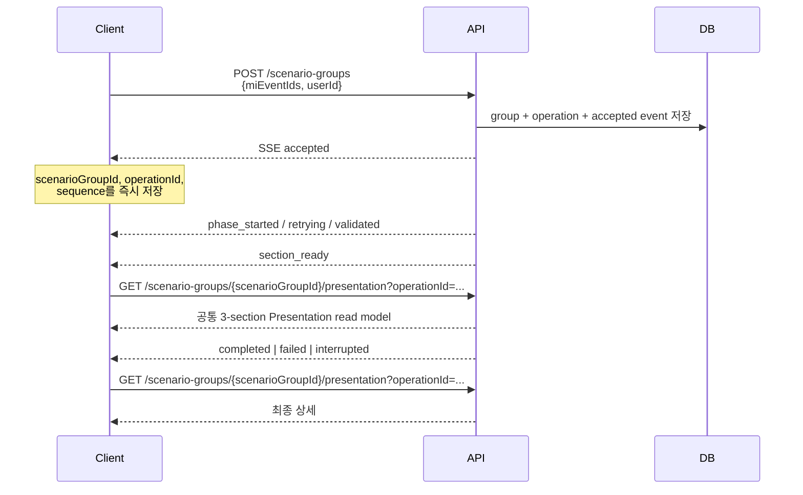

# Multi-Event Scenario Group API Request/Response

> 대상: Client 개발자
> 기준 API: `POST /scenario-groups`
> 생성 엔진: `v4` (`multi_event_model_lever_dimensions`)

## 1. 문서 범위

이 문서는 여러 Event를 선택해 Scenario Group을 생성할 때 Client가 사용해야 하는 API 호출 순서,
중복 생성 정책, 생성 진행 상태를 전달하는 SSE(Server-Sent Events) 계약을 설명한다.

신규 Multi-Event 생성의 canonical API는 `POST /scenario-groups`다. 이 API는 JSON 완료 응답을
즉시 반환하는 API가 아니라, 생성 작업을 접수한 뒤 같은 HTTP 응답에서 진행 이벤트를 계속 보내는
SSE API다.

기존 단일 Event callback 생성 API는 제거되었다.
`/v4/scenario-groups`는 callback 호환을 위한 deprecated API이므로 신규 Client에서는
Multi-Event 생성 진입점으로 사용하지 않는다.

## 2. API 요약

| 목적 | Method / Path | 사용 시점 |
| --- | --- | --- |
| Scenario Group 생성 및 진행 수신 | `POST /scenario-groups` | 사용자가 Event 1~5개를 선택하고 생성을 실행할 때 |
| Scenario Group 화면 데이터 조회 | `GET /scenario-groups/{scenarioGroupId}/presentation` | `section_ready`, `completed` 수신 후 화면을 갱신할 때 |
| Scenario Group 업무 상세 조회 | `GET /scenario-groups/{scenarioGroupId}` | 업무 데이터와 latest/active operation을 조회할 때 |
| operation 상태 polling | `GET /scenario-groups/{scenarioGroupId}/operations/{operationId}` | SSE 연결 상태가 불확실하거나 복구 여부를 판단할 때 |
| operation SSE 재연결 | `GET /scenario-groups/{scenarioGroupId}/operations/{operationId}/stream` | SSE가 끊긴 뒤 마지막 sequence 이후 이벤트를 복구할 때 |
| Scenario Group 목록 조회 | `GET /scenario-groups` | 목록 진입 또는 새로고침 시 생성 중인 operation을 복원할 때 |

## 3. Client 권장 호출 프로세스



### 3.1 생성 전

1. 사용자가 선택한 Event ID를 `miEventIds`에 담는다.
2. Event는 1~5개여야 한다.
3. 각 ID는 양의 정수여야 하고 한 요청 안에 같은 ID를 두 번 넣을 수 없다.
4. 배열 순서는 Scenario Group의 Event 표시 순서로 보존된다.

예를 들어 `[1463, 1464, 1433]`과 `[1433, 1463, 1464]`는 화면 표시 순서는 다르지만,
중복 생성 정책에서는 같은 Event 조합으로 판정된다.

### 3.2 생성 요청

```bash
curl --no-buffer -X POST \
  '{HOST_URL}/scenario-groups' \
  -H 'Content-Type: application/json' \
  -d '{
    "miEventIds": [1463, 1464, 1433],
    "userId": 10603
  }'
```

- 성공 시 HTTP `200`과 `Content-Type: text/event-stream`을 반환하고 연결을 유지한다.
- 서버는 `Cache-Control: no-cache`, `X-Accel-Buffering: no`를 반환한다.
- 이 endpoint는 항상 SSE를 반환하므로 Client가 `Accept` 요청 헤더를 지정할 필요가 없다.
- 최초 요청은 POST body가 필요하므로 브라우저 기본 `EventSource`로 호출할 수 없다.
  `fetch`의 `ReadableStream`을 이용해 SSE frame을 읽어야 한다.
- 요청 검증, Event 조회 또는 중복 정책에서 실패하면 SSE가 아니라 JSON 오류 응답을 반환한다.
  따라서 Client는 본문을 읽기 전에 HTTP status와 `Content-Type`을 먼저 확인한다.

### 3.3 `accepted` 수신

첫 번째 정상 이벤트는 `accepted`다. Client는 다음 값을 즉시 로컬 상태 또는 복구 가능한 저장소에 보관한다.

- `scenarioGroupId`: 상세 조회와 이후 화면 이동에 사용
- `operationId`: polling과 SSE 재연결에 사용
- `sequence`: 마지막으로 정상 처리한 SSE event ID
- 요청에 사용한 `miEventIds`, `userId`: 초기 응답 유실 시 복구에 사용

`accepted`는 Scenario Group, operation, 첫 event가 DB에 같은 transaction으로 저장된 뒤 전달된다.
따라서 이 이벤트를 받은 이후 브라우저 연결이 끊겨도 서버의 생성 작업은 계속된다.

### 3.4 진행 이벤트 처리

Client는 `sequence` 오름차순으로 이벤트를 처리한다. `id`와 JSON의 `sequence`는 같은 값이다.

| `event` / `eventType` | 의미 | Client 권장 처리 |
| --- | --- | --- |
| `accepted` | 생성 요청 접수 | 식별자와 마지막 sequence 저장, 진행 화면 표시 |
| `phase_started` | 새 생성 phase 시작 | phase와 안내 문구 갱신 |
| `retrying` | 현재 검증 단계 자동 재시도 | 실패 화면으로 전환하지 말고 시도 횟수와 안내 문구 표시 |
| `validated` | 세부 단계 검증 완료 | 진행 상태만 갱신 |
| `section_ready` | 검증된 화면용 section 준비 | `snapshotRevision`이 기존 값보다 크면 Presentation API 재조회 |
| `completed` | 생성 및 저장 성공 | 최종 Presentation API 재조회 후 성공 화면 표시 |
| `failed` | 생성 실패 | 오류 상태 표시, 필요하면 operation 상태 API로 `lastError` 조회 |
| `interrupted` | 서버 종료 등으로 작업 중단 | 중단 상태 표시. 현재 자동 재개되지 않으므로 새 생성 가능 |

`event_analysis` phase 안에는 Event 개별 영향 분석과 Event 상호작용 분석처럼 여러 검증 지점이
존재할 수 있다. 따라서 동일 phase에서 `validated`, `section_ready`, `retrying`이 여러 번 발생해도
정상이다. Client는 고정된 이벤트 개수나 고정 순서에 의존하지 않고 `eventType`, `phase`, `sequence`를
기준으로 처리한다.

`title`과 `messageMarkdown`은 사용자 안내용이다. `messageMarkdown`을 HTML로 변환해 표시할 때는
sanitization을 적용하고, `validationCode`, `referenceIds`, `mlflowTraceId`는 진단 정보로 취급한다.

### 3.5 화면 데이터 갱신

SSE의 `section_ready`는 “화면을 다시 조회할 수 있다”는 신호다. 상세 데이터 전체를 SSE event에
싣지 않으므로 다음 API를 호출한다.

```http
GET /scenario-groups/{scenarioGroupId}/presentation?operationId={operationId}
```

주요 응답 필드는 다음과 같다.

| 필드 | 설명 |
| --- | --- |
| `operation` | 선택한 operation의 status, phase, sequence, snapshot revision |
| `sections.eventAnalysis` | Event 분석 Markdown과 준비/근거 상태 |
| `sections.scenarioDesign` | 공통 Dimension definitions와 Scenario table |
| `sections.scenarioDesign.dimensionDefinitions.items[].rationale` | 해당 Dimension이 Scenario와 JKM 결과를 구분하는 이유를 설명하는 문자열 |
| `sections.roleSelectionRationale` | Ceiling/Floor/Mixed 선택 근거 Markdown |

`engineVersion=v4`의 `dimensionDefinitions.items[]` 계약은 다음과 같다.

| 필드 | 타입 | 설명 |
| --- | --- | --- |
| `dimensionId` | string | Scenario table의 header/cell과 연결되는 Dimension ID |
| `label` | string | 화면과 Scenario table header에 표시할 Dimension 이름 |
| `description` | string | 사용자가 판단해야 할 불확실성을 질문 형태로 설명한 문장 |
| `rationale` | string | `description`의 관측 시점·수치·시장 신호·대상·영향 경로를 빠짐없이 유지하고 질문 어미만 `...하는지에 따라`로 바꿔 이 Dimension의 선정 근거를 설명하는 10~200자의 구체적인 한국어 문장 |
| `sourceEventIds` | number[] | Dimension의 근거가 된 Event ID 목록 |
| `modelSupportStatus` | string \| null | 모델 파라미터 지원 상태 |
| `source` | string \| null | Dimension 복원 출처. v3·v4에서는 `null`이며, v1 legacy 복원 시에만 식별 문자열을 반환 |
| `values` | object[] | Dimension에서 선택할 수 있는 값과 값별 근거 및 압력 기여 |

`rationale`은 Dimension 자체의 선정 근거이고, `values[].rationale`은 관측 사실을 기반으로 해당 Value의
미래 상태와 JKM 영향을 간결하게 연결하고 문장 끝의 `가정`으로만 불확실성을 표시하는 근거다. 가정 의미를
반복하거나 Value를 답·응답·선택으로 지칭하지 않는다.
v4 응답에서 `items[].rationale`은 `null`이 아니라 문자열로 반환되므로
Client는 두 필드를 구분해 표시한다.

`source`는 Event 근거나 일반적인 출처를 나타내는 필드가 아니다. v3·v4에서는 사용하지 않으므로
항상 `null`이며, 근거 Event는 `sourceEventIds`로 확인한다. v1에서도 저장된 Dimension 정의가 있으면
`source`는 `null`이고, 저장된 정의가 없어 legacy 복원 로직을 사용한 경우에만 다음 값 중 하나를 반환한다.

| `source` 값 | 의미 |
| --- | --- |
| `legacy_confirmation_snapshot` | confirmation 당시 저장된 Dimension snapshot에서 복원 |
| `legacy_template_checksum_match` | 저장된 checksum과 일치하는 기존 Dimension template에서 복원 |
| `legacy_observed` | 저장된 Scenario의 Dimension 관찰값에서 제한적으로 복원 |

축약 응답 예시는 다음과 같다.

```json
{
  "schemaVersion": "v1",
  "rendererVersion": "v1",
  "scenarioGroupId": 366,
  "engineVersion": "v4",
  "legacy": false,
  "warnings": [],
  "operation": {
    "operationId": "01KZQNK7AJTV5DAA49G7ZE9ZZE",
    "status": "succeeded",
    "currentPhase": "persistence",
    "latestSequence": 15,
    "snapshotRevision": 5
  },
  "sections": {
    "eventAnalysis": {
      "status": "ready",
      "evidenceLevel": "full",
      "contentType": "text/markdown",
      "markdown": "## Event 분석\n\n..."
    },
    "scenarioDesign": {
      "status": "ready",
      "evidenceLevel": "full",
      "dimensionDefinitions": {
        "status": "ready",
        "items": [
          {
            "dimensionId": "d1",
            "label": "2026년 수요 둔화 규모",
            "description": "2026년 세계 성장률 하향이 실제 산업활동과 전력용 가스 소비 감소로 연결되는 규모는 어느 정도인가?",
            "rationale": "수요 둔화 규모에 따라 산업·전력용 LNG 수요 기대와 JKM 하락 압력이 달라짐",
            "sourceEventIds": [1132],
            "modelSupportStatus": "full",
            "source": null,
            "values": [
              {
                "valueId": "d1_v1",
                "label": "전망 하향만 기대에 반영",
                "description": null,
                "rationale": "실물 소비 감소가 확인되지 않으면 JKM 하락 압력은 제한적이다.",
                "pressureContribution": "balanced",
                "leverStates": [
                  {
                    "level": "실물 소비 감소 미확인",
                    "scope": "세계 산업활동·전력용 가스 수요",
                    "direction": "unchanged",
                    "lever_code": "economic_activity",
                    "time_window": "2026년 전망 형성기",
                    "impact_lever_id": 3
                  }
                ]
              }
            ]
          }
        ]
      },
      "scenarioTable": {
        "status": "ready",
        "headers": [],
        "rows": []
      }
    },
    "roleSelectionRationale": {
      "status": "ready",
      "evidenceLevel": "full",
      "contentType": "text/markdown",
      "markdown": "## 대표 Scenario 선택 근거\n\n..."
    }
  }
}
```

Client는 마지막으로 반영한 `snapshotRevision`보다 큰 `section_ready`만 상세 재조회하면 된다.
같은 revision을 다시 받거나 replay로 중복 수신한 경우에는 재조회를 생략할 수 있다.

Presentation 응답에서 Validation·Signpost request body를 조립하는 필드별 규칙은
[`presentation_followup_api_request_mapping.md`](../guides/presentation_followup_api_request_mapping.md)를 참고한다.

`completed` 수신 후에는 마지막으로 Presentation API를 조회한 뒤 Scenario Group 상세 화면으로 전환한다.
신규 Multi-Event 생성 graph 안에서 각 단계 검증이 함께 수행되므로, Client가 생성 도중 후속 편집용
`/scenario-groups/{scenarioGroupId}/validation` 또는
`/scenario-groups/{scenarioGroupId}/signposts` API를 호출하지 않는다.

### 3.6 terminal 처리

다음 event를 받으면 해당 SSE stream은 종료된다.

| terminal event | operation status | 의미 |
| --- | --- | --- |
| `completed` | `succeeded` | 정상 완료 |
| `failed` | `failed` | 생성 실패 |
| `interrupted` | `interrupted` | 서버 종료 등으로 중단 |

`retrying`은 terminal event가 아니므로 스트림을 닫거나 실패로 확정하면 안 된다.

## 4. SSE 재연결과 복구

### 4.1 연결이 끊겨도 생성은 계속된다

SSE consumer와 생성 producer의 수명은 분리돼 있다. 브라우저 새로고침, 네트워크 단절 또는 Client의
stream cancel로 POST 연결이 끝나도 서버 작업은 계속 실행된다.

producer는 기본 30초마다 operation heartbeat를 갱신한다. worker crash나 강제 종료로 producer가
사라져 heartbeat가 120초 이상 갱신되지 않으면 lifespan recovery monitor가 해당 `queued`/`running`
operation을 `interrupted`로 전환하고 terminal event를 기록한다. `lastError.code=STALE_HEARTBEAT`와
event payload의 `reason=stale_heartbeat`로 정상 shutdown 중단과 구분할 수 있다. 자동 재개는 지원하지
않으며, interrupted 처리 후에는 동일 Event 조합을 다시 생성하거나 기존 그룹을 삭제할 수 있다.

연결이 끊기면 마지막으로 처리한 `sequence`를 `Last-Event-ID`에 넣어 재연결한다.

```bash
curl --no-buffer \
  '{HOST_URL}/scenario-groups/410/operations/01KZQJK500D0PE7XVQHXJFMHDY/stream' \
  -H 'Accept: text/event-stream' \
  -H 'Last-Event-ID: 7'
```

서버는 sequence `7` 자체가 아니라 `8`부터 DB 이력을 replay한 뒤 아직 실행 중이면 live event를
계속 전달한다. `Last-Event-ID`가 없으면 `0`으로 간주해 첫 event부터 replay한다. 음수 또는 정수가
아닌 값은 HTTP `400 INVALID_REQUEST`다.

Client의 replay 처리 규칙은 다음과 같다.

1. 마지막으로 성공 처리한 `sequence`를 저장한다.
2. 수신한 `sequence <= lastSequence`이면 중복으로 보고 무시한다.
3. `sequence > lastSequence`이면 처리 후 값을 갱신한다.
4. sequence gap이 보이면 현재 이벤트를 임의로 건너뛰지 말고 마지막 연속 sequence로 다시 연결한다.
5. terminal event를 처리하면 재연결을 중단한다.

### 4.2 operation 상태 polling

SSE 연결이 끊겼거나 페이지를 복원할 때 다음 API로 현재 상태를 확인할 수 있다.

```http
GET /scenario-groups/{scenarioGroupId}/operations/{operationId}
```

응답 구조 예시는 다음과 같다.

```json
{
  "scenarioGroupId": 410,
  "operation": {
    "operationId": "01KZQJK500D0PE7XVQHXJFMHDY",
    "scenarioGroupId": 410,
    "operationType": "create",
    "engineVersion": "v4",
    "source": "api",
    "status": "running",
    "currentPhase": "event_analysis",
    "retrySummary": {},
    "presentationSnapshot": {},
    "snapshotRevision": 0,
    "latestSequence": 2,
    "lastError": null,
    "mlflowTraceId": "15743a93-5a6f-44a4-a510-ef1ea51b5b0c",
    "startedAt": "2026-08-11T04:51:47.409650Z",
    "completedAt": null,
    "heartbeatAt": "2026-08-11T04:51:47.409650Z",
    "createdAt": "2026-08-11T04:51:47.392548Z",
    "updatedAt": "2026-08-11T04:51:47.409650Z"
  },
  "lastEvent": {
    "operationId": "01KZQJK500D0PE7XVQHXJFMHDY",
    "scenarioGroupId": 410,
    "sequence": 2,
    "eventType": "phase_started",
    "phase": "event_analysis",
    "title": "Event 분석을 시작했습니다",
    "messageMarkdown": "선택한 Event의 LNG 시장 영향 경로를 분석하고 있습니다.",
    "payload": {},
    "snapshotRevision": 0,
    "mlflowTraceId": "15743a93-5a6f-44a4-a510-ef1ea51b5b0c",
    "createdAt": "2026-08-11T04:51:47.409650Z"
  },
  "lastError": null
}
```

polling 결과가 `queued` 또는 `running`이면 저장한 sequence로 SSE를 재연결한다. `succeeded`이면
Presentation API를 조회하고, `failed` 또는 `interrupted`이면 operation 상태 API의 `lastError`를 포함한
실패/중단 UI를 표시한다.

### 4.3 keep-alive

진행 event가 없는 동안 서버는 기본 15초 간격으로 다음 comment frame을 보낼 수 있다.

```text
: keep-alive
```

keep-alive에는 `id`, `event`, `data`가 없다. Client는 업무 event로 처리하거나 sequence를 증가시키지
않고 연결이 살아 있다는 신호로만 사용한다.

### 4.4 `accepted`를 받기 전에 연결이 끊긴 경우

최초 POST의 HTTP 응답을 받지 못했거나 `accepted`를 파싱하기 전에 연결이 끊기면 Client가
`scenarioGroupId`, `operationId`를 모를 수 있다. 이때 동일한 `miEventIds`, `userId`로 POST를
다시 요청한다.

- 첫 요청이 DB에 접수되어 아직 실행 중이면 HTTP `409` 응답의 `scenarioGroupId`, `operationId`로
  기존 operation에 재연결한다.
- 첫 요청이 성공 완료됐고 아직 confirmation 전이면 HTTP `400` 응답의 식별자로 기존 상세 화면을 연다.
- 첫 요청이 실제로 접수되지 않았다면 새 operation이 정상 생성된다.

### 4.5 페이지 새로고침 후 복원

로컬에 식별자가 남아 있으면 operation 상태 API를 먼저 호출한 뒤 상태에 따라 재연결하거나 상세
화면을 연다. 로컬 식별자가 없으면 `GET /scenario-groups` 또는 알고 있는 Scenario Group의 상세
API에서 `activeOperation`/`latestOperation`을 확인한다. active operation을 찾았지만 마지막
sequence를 모르면 `Last-Event-ID: 0`으로 연결해 전체 이력을 replay하고 Client에서 중복을 제거한다.

## 5. 중복 Event 요청 정책

### 5.1 요청 body 내부 중복

한 요청의 `miEventIds`에 같은 값이 두 번 있으면 HTTP `422`를 반환한다.

```json
{
  "miEventIds": [1463, 1463],
  "userId": 10603
}
```

이 오류는 FastAPI 요청 검증 오류이므로 공통 오류 body가 아니라 `{"detail": [...]}` 형식이다.

### 5.2 이미 존재하는 동일 Event 조합

서버는 요청 순서와 무관한 Event ID 집합과 engine version을 기준으로 중복을 판정한다. 즉,
`[1463, 1464, 1433]`과 `[1433, 1464, 1463]`은 같은 v4 생성 조합이다.
별도의 client idempotency key는 없으며, 이 Event 조합 중복 정책이 생성 요청의 업무상 중복 방지
역할을 한다.

| 기존 상태 | 요청 사용자 | 처리 |
| --- | --- | --- |
| 동일 조합 operation이 `queued`/`running` | 같은 사용자 | HTTP `409 SCENARIO_GROUP_OPERATION_CONFLICT`; 기존 operation으로 연결 |
| 동일 조합 operation이 `queued`/`running` | 다른 사용자 | HTTP `403 SCENARIO_GROUP_OWNERSHIP_CONFLICT`; 생성/열람 권한 없음 |
| 동일 조합 생성 성공, confirmation 전 | 같은 사용자 | HTTP `400 SCENARIO_GROUP_ALREADY_CREATED`; 기존 그룹 상세로 이동 |
| 동일 조합 생성 성공, confirmation 전 | 다른 사용자 | HTTP `403 SCENARIO_GROUP_OWNERSHIP_CONFLICT` |
| 기존 그룹이 confirmation 완료(`stage=completed`) | 무관 | 새 Scenario Group 생성 허용 |
| latest operation이 `failed`/`interrupted` | 무관 | 새 Scenario Group 생성 허용 |
| 기존 그룹이 soft delete됨 | 무관 | 새 Scenario Group 생성 허용 |

동시에 같은 조합을 요청해도 Event row locking과 transaction 안의 재검사로 하나의 요청만 생성에
성공한다. 충돌한 요청이 임시 Scenario Group을 남기지 않는다.

active operation 충돌 응답 예시는 다음과 같다.

```http
HTTP/1.1 409 Conflict
Content-Type: application/json
```

```json
{
  "status": "error",
  "message": "실행 중인 Scenario Group 작업과 충돌합니다. - Scenario group 410 operation 01KZQJK500D0PE7XVQHXJFMHDY is still active",
  "data": {
    "scenarioGroupId": 410,
    "operationId": "01KZQJK500D0PE7XVQHXJFMHDY",
    "error_code": -1005,
    "error_name": "SCENARIO_GROUP_OPERATION_CONFLICT"
  }
}
```

Client는 표시용 분기를 `message` 문자열이 아니라 HTTP status와 `data.error_name`으로 결정한다.
충돌 응답에 `operationId`가 있으면 기존 stream으로 재연결하고, `scenarioGroupId`만 있으면 기존
상세 화면으로 이동한다.

## 6. SSE 공통 data 계약

각 업무 event는 다음 frame으로 전달된다.

```text
id: {sequence}
event: {eventType}
data: {JSON object}
```

모든 JSON data가 공통으로 갖는 필드는 다음과 같다.

| 필드 | 타입 | 설명 |
| --- | --- | --- |
| `operationId` | string | operation 식별자. 26자리 ULID 형태 |
| `scenarioGroupId` | number | 생성된 Scenario Group ID |
| `sequence` | number | operation 안에서 1부터 증가하는 event 순번 |
| `eventType` | string | SSE의 `event` 값과 동일 |
| `phase` | string \| null | 현재 생성 phase |
| `title` | string | 사용자 표시용 제목 |
| `messageMarkdown` | string | 사용자 표시용 Markdown 메시지 |
| `snapshotRevision` | number | 화면용 presentation snapshot revision |
| `mlflowTraceId` | string \| null | 운영 추적용 trace ID |
| `createdAt` | string | UTC ISO-8601 생성 시각 |

event 종류에 따라 다음 필드가 추가된다.

| event | 추가 필드 |
| --- | --- |
| `accepted` | `status`, `engineVersion`, `operationType` |
| `retrying` | `attempt`, `maxAttempts`, `referenceIds`, `validationCode` |
| `validated` | `attempt`, `maxAttempts` |
| `completed` | `status=succeeded` |
| `failed` | `status=failed`, `errorCode` |
| `interrupted` | `status=interrupted` |

현재 phase 값은 다음과 같다.

| phase | 의미 |
| --- | --- |
| `event_analysis` | 선택 Event의 영향 경로 및 Event 상호작용 분석 |
| `dimension_design` | 모델 영향 레버 기반 Dimension 설계 |
| `scenario_synthesis` | Dimension 조합과 Scenario 합성 |
| `persistence` | 최종 결과 저장 |

## 7. Create Scenario Group SSE 전체 예시

아래 예시는 `miEventIds=[1463,1464,1433]`, `userId=10603` 요청의 실제 형태다.
LLM 검증 결과에 따라 `retrying` 발생 여부, event 개수, attempt와 소요 시간은 요청마다 달라질 수 있다.

```text
id: 1
event: accepted
data: {"operationId":"01KZQJK500D0PE7XVQHXJFMHDY","scenarioGroupId":410,"sequence":1,"eventType":"accepted","phase":null,"title":"시나리오 그룹 생성을 접수했습니다","messageMarkdown":"선택한 Event를 바탕으로 시나리오 그룹 생성을 시작합니다.","snapshotRevision":0,"mlflowTraceId":null,"createdAt":"2026-08-11T04:51:47.392548Z","status":"queued","engineVersion":"v4","operationType":"create"}

id: 2
event: phase_started
data: {"operationId":"01KZQJK500D0PE7XVQHXJFMHDY","scenarioGroupId":410,"sequence":2,"eventType":"phase_started","phase":"event_analysis","title":"Event 분석을 시작했습니다","messageMarkdown":"선택한 Event의 LNG 시장 영향 경로를 분석하고 있습니다.","snapshotRevision":0,"mlflowTraceId":"15743a93-5a6f-44a4-a510-ef1ea51b5b0c","createdAt":"2026-08-11T04:51:47.409650Z"}

: keep-alive

id: 3
event: validated
data: {"operationId":"01KZQJK500D0PE7XVQHXJFMHDY","scenarioGroupId":410,"sequence":3,"eventType":"validated","phase":"event_analysis","title":"Event 분석이 완료되었습니다","messageMarkdown":"Event 분석 결과가 검증되었습니다.","snapshotRevision":0,"mlflowTraceId":"15743a93-5a6f-44a4-a510-ef1ea51b5b0c","createdAt":"2026-08-11T04:52:11.760568Z","attempt":1,"maxAttempts":3}

id: 4
event: section_ready
data: {"operationId":"01KZQJK500D0PE7XVQHXJFMHDY","scenarioGroupId":410,"sequence":4,"eventType":"section_ready","phase":"event_analysis","title":"Event 분석 화면을 갱신할 수 있습니다","messageMarkdown":"검증된 Event 분석 결과가 준비되었습니다.","snapshotRevision":1,"mlflowTraceId":"15743a93-5a6f-44a4-a510-ef1ea51b5b0c","createdAt":"2026-08-11T04:52:11.771814Z"}

id: 5
event: retrying
data: {"operationId":"01KZQJK500D0PE7XVQHXJFMHDY","scenarioGroupId":410,"sequence":5,"eventType":"retrying","phase":"event_analysis","title":"Event 분석을 다시 수행합니다","messageMarkdown":"검증 기준을 충족하지 못해 Event 분석을 다시 수행합니다.","snapshotRevision":1,"mlflowTraceId":"15743a93-5a6f-44a4-a510-ef1ea51b5b0c","createdAt":"2026-08-11T04:52:24.341159Z","attempt":2,"maxAttempts":3,"referenceIds":[],"validationCode":"LLM_INVALID_RESPONSE_ERROR"}

: keep-alive

id: 6
event: validated
data: {"operationId":"01KZQJK500D0PE7XVQHXJFMHDY","scenarioGroupId":410,"sequence":6,"eventType":"validated","phase":"event_analysis","title":"Event 상호작용 분석이 완료되었습니다","messageMarkdown":"Event 상호작용 분석 결과가 검증되었습니다.","snapshotRevision":1,"mlflowTraceId":"15743a93-5a6f-44a4-a510-ef1ea51b5b0c","createdAt":"2026-08-11T04:52:40.093682Z","attempt":2,"maxAttempts":3}

id: 7
event: section_ready
data: {"operationId":"01KZQJK500D0PE7XVQHXJFMHDY","scenarioGroupId":410,"sequence":7,"eventType":"section_ready","phase":"event_analysis","title":"Event 상호작용 분석 화면을 갱신할 수 있습니다","messageMarkdown":"검증된 Event 상호작용 분석 결과가 준비되었습니다.","snapshotRevision":2,"mlflowTraceId":"15743a93-5a6f-44a4-a510-ef1ea51b5b0c","createdAt":"2026-08-11T04:52:40.100205Z"}

: keep-alive

: keep-alive

: keep-alive

: keep-alive

id: 8
event: phase_started
data: {"operationId":"01KZQJK500D0PE7XVQHXJFMHDY","scenarioGroupId":410,"sequence":8,"eventType":"phase_started","phase":"dimension_design","title":"Dimension 설계을 시작했습니다","messageMarkdown":"Dimension 설계을 진행하고 있습니다.","snapshotRevision":2,"mlflowTraceId":"15743a93-5a6f-44a4-a510-ef1ea51b5b0c","createdAt":"2026-08-11T04:53:44.971636Z"}

id: 9
event: validated
data: {"operationId":"01KZQJK500D0PE7XVQHXJFMHDY","scenarioGroupId":410,"sequence":9,"eventType":"validated","phase":"dimension_design","title":"Dimension 설계이 완료되었습니다","messageMarkdown":"Dimension 설계 결과가 검증되었습니다.","snapshotRevision":2,"mlflowTraceId":"15743a93-5a6f-44a4-a510-ef1ea51b5b0c","createdAt":"2026-08-11T04:53:45.115180Z","attempt":1,"maxAttempts":3}

id: 10
event: section_ready
data: {"operationId":"01KZQJK500D0PE7XVQHXJFMHDY","scenarioGroupId":410,"sequence":10,"eventType":"section_ready","phase":"dimension_design","title":"Dimension 설계 화면을 갱신할 수 있습니다","messageMarkdown":"검증된 Dimension 설계 결과가 준비되었습니다.","snapshotRevision":3,"mlflowTraceId":"15743a93-5a6f-44a4-a510-ef1ea51b5b0c","createdAt":"2026-08-11T04:53:45.125195Z"}

: keep-alive

: keep-alive

: keep-alive

id: 11
event: phase_started
data: {"operationId":"01KZQJK500D0PE7XVQHXJFMHDY","scenarioGroupId":410,"sequence":11,"eventType":"phase_started","phase":"scenario_synthesis","title":"Scenario 합성을 시작했습니다","messageMarkdown":"Scenario 합성을 진행하고 있습니다.","snapshotRevision":3,"mlflowTraceId":"15743a93-5a6f-44a4-a510-ef1ea51b5b0c","createdAt":"2026-08-11T04:54:37.970411Z"}

id: 12
event: validated
data: {"operationId":"01KZQJK500D0PE7XVQHXJFMHDY","scenarioGroupId":410,"sequence":12,"eventType":"validated","phase":"scenario_synthesis","title":"Scenario 합성이 완료되었습니다","messageMarkdown":"Scenario 합성 결과가 검증되었습니다.","snapshotRevision":3,"mlflowTraceId":"15743a93-5a6f-44a4-a510-ef1ea51b5b0c","createdAt":"2026-08-11T04:54:38.013108Z","attempt":1,"maxAttempts":3}

id: 13
event: section_ready
data: {"operationId":"01KZQJK500D0PE7XVQHXJFMHDY","scenarioGroupId":410,"sequence":13,"eventType":"section_ready","phase":"scenario_synthesis","title":"Scenario 합성 화면을 갱신할 수 있습니다","messageMarkdown":"검증된 Scenario 합성 결과가 준비되었습니다.","snapshotRevision":4,"mlflowTraceId":"15743a93-5a6f-44a4-a510-ef1ea51b5b0c","createdAt":"2026-08-11T04:54:38.019077Z"}

id: 14
event: phase_started
data: {"operationId":"01KZQJK500D0PE7XVQHXJFMHDY","scenarioGroupId":410,"sequence":14,"eventType":"phase_started","phase":"persistence","title":"결과 저장을 시작했습니다","messageMarkdown":"결과 저장을 진행하고 있습니다.","snapshotRevision":4,"mlflowTraceId":"15743a93-5a6f-44a4-a510-ef1ea51b5b0c","createdAt":"2026-08-11T04:54:38.073750Z"}

id: 15
event: completed
data: {"operationId":"01KZQJK500D0PE7XVQHXJFMHDY","scenarioGroupId":410,"sequence":15,"eventType":"completed","phase":"persistence","title":"시나리오 그룹 생성이 완료되었습니다","messageMarkdown":"5개 Scenario를 생성했습니다.","snapshotRevision":5,"mlflowTraceId":"15743a93-5a6f-44a4-a510-ef1ea51b5b0c","createdAt":"2026-08-11T04:54:38.088670Z","status":"succeeded"}
```

## 8. 브라우저 구현 시 주의사항

### 8.1 최소 상태 모델

Client는 진행 화면별로 최소 다음 상태를 유지한다.

```ts
type ScenarioGroupCreateStreamState = {
  scenarioGroupId: number | null;
  operationId: string | null;
  lastSequence: number;
  snapshotRevision: number;
  operationStatus: "queued" | "running" | "succeeded" | "failed" | "interrupted";
  currentPhase: "event_analysis" | "dimension_design" | "scenario_synthesis" | "persistence" | null;
};
```

### 8.2 POST stream 읽기

아래 코드는 전체 애플리케이션 구현이 아니라 POST SSE 처리 방식의 핵심 예시다.

```ts
const response = await fetch(`${hostUrl}/scenario-groups`, {
  method: "POST",
  headers: {
    "Content-Type": "application/json",
  },
  body: JSON.stringify({
    miEventIds: [1463, 1464, 1433],
    userId: 10603,
  }),
});

const contentType = response.headers.get("content-type") ?? "";
if (!response.ok || !contentType.includes("text/event-stream")) {
  const error = await response.json();
  throw error;
}
if (!response.body) {
  throw new Error("SSE response body is empty");
}

const reader = response.body.getReader();
const decoder = new TextDecoder();
let buffer = "";

while (true) {
  const { value, done } = await reader.read();
  buffer += decoder.decode(value, { stream: !done });

  let boundary: number;
  while ((boundary = buffer.indexOf("\n\n")) >= 0) {
    const frame = buffer.slice(0, boundary);
    buffer = buffer.slice(boundary + 2);

    if (!frame || frame.startsWith(":")) continue;

    const lines = frame.split("\n");
    const id = Number(lines.find((line) => line.startsWith("id:"))?.slice(3).trim());
    const event = lines.find((line) => line.startsWith("event:"))?.slice(6).trim();
    const dataLine = lines.find((line) => line.startsWith("data:"));
    if (!event || !dataLine || !Number.isInteger(id)) continue;

    const data = JSON.parse(dataLine.slice(5).trim());
    // id <= lastSequence는 replay/중복 event이므로 무시한다.
    // accepted: scenarioGroupId와 operationId를 저장한다.
    // section_ready: snapshotRevision 비교 후 Presentation API를 조회한다.
    // completed/failed/interrupted: terminal 상태로 전환한다.
  }

  if (done) break;
}
```

운영 코드에서는 `AbortController`, 인증 header, 최대 재연결 횟수와 backoff, component unmount 시
reader 정리, JSON parse 오류 로깅을 함께 구현한다. 단, Client 재연결 backoff 중에도 서버 작업은 계속된다.

## 9. Client 체크리스트

- 최초 생성은 `POST /scenario-groups`를 사용한다.
- 요청에는 서로 다른 양의 정수 Event ID 1~5개와 `userId`를 보낸다.
- POST 응답은 `fetch` streaming으로 읽는다.
- `accepted`에서 `scenarioGroupId`, `operationId`, `sequence`를 즉시 저장한다.
- `section_ready`에서 revision이 증가했을 때 Presentation API를 조회한다.
- keep-alive comment는 무시한다.
- `retrying`을 실패로 처리하지 않는다.
- SSE 재연결에는 마지막 처리 sequence를 `Last-Event-ID`로 보낸다.
- `completed`, `failed`, `interrupted`만 terminal로 처리한다.
- 중복 생성 오류는 `data.error_name`으로 분기하고 응답의 기존 resource ID를 재사용한다.
- `completed` 후 최종 Presentation API를 다시 조회한다.
