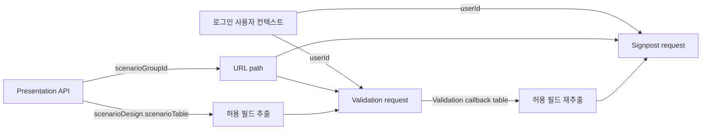

# Presentation API → Validation / Signpost API Request Mapping

## 1. 결론

`GET /scenario-groups/{scenarioGroupId}/presentation`의 전체 응답을 후속 API에 보내는 것이 아니다.

두 후속 API는 모두 Presentation 응답의 아래 테이블을 원천으로 사용한다.

```text
sections.scenarioDesign.scenarioTable
```

단, `scenarioTable`을 그대로 복사하지 않고 `headers`와 `rows`의 허용 필드만 추출해야 한다.
Validation과 Signpost request schema는 추가 필드를 허용하지 않는다(`extra="forbid"`).



## 2. 공통 매핑표

| 대상 | Presentation API 원천 | Validation request | Signpost request | 비고 |
| --- | --- | --- | --- | --- |
| Scenario Group ID | `scenarioGroupId` | URL `{scenarioGroupId}` | URL `{scenarioGroupId}` | request body에는 넣지 않음 |
| 사용자 ID | 없음 | `userId` | `userId` | 로그인/화면 context에서 공급 |
| Dimension key | `sections.scenarioDesign.scenarioTable.headers[].key` | `table.headers[].key` | `table.headers[].key` | 그대로 복사 |
| Dimension label | `...headers[].label` | `table.headers[].label` | `table.headers[].label` | 그대로 복사 |
| Dimension 표시 순서 | `...headers[].displayOrder` | `table.headers[].displayOrder` | `table.headers[].displayOrder` | 그대로 복사 |
| Scenario ID | `...rows[].scenarioId` | `table.rows[].scenarioId` | `table.rows[].scenarioId` | 사용자가 추가한 신규 row는 `null` |
| Scenario 표시 순서 | `...rows[].displayOrder` | `table.rows[].displayOrder` | `table.rows[].displayOrder` | 그대로 복사 |
| Scenario 제목 | `...rows[].title` | `table.rows[].title` | `table.rows[].title` | 화면 편집값이 있으면 편집값 사용 |
| Dimension 선택값 | `...rows[].cells` | `table.rows[].cells` | `table.rows[].cells` | 표시 label 값을 그대로 사용 |

`cells`는 Presentation이 이미 화면용 label로 변환한 값이다. 예를 들어 저장값이 `d1_v1`이어도
Presentation의 `cells.d1`은 `"상승"`일 수 있다. Request에는 `cells.d1="상승"`을 보내며,
`cellEvidence.d1.valueId`로 대체하지 않는다.

## 3. Validation API request

### Endpoint

```http
POST /scenario-groups/{scenarioGroupId}/validation
Content-Type: application/json
```

로컬/자동화 테스트에서는 동일 body를 아래 sync endpoint에 보낼 수 있다.

```http
POST /scenario-groups/{scenarioGroupId}/validation/sync
```

### Request body 조립

```json
{
  "userId": 10603,
  "table": {
    "headers": [
      {
        "key": "d1",
        "label": "수급 방향",
        "displayOrder": 1
      }
    ],
    "rows": [
      {
        "scenarioId": 501,
        "displayOrder": 1,
        "title": "공급 제약 심화",
        "cells": {
          "d1": "상승"
        }
      }
    ]
  }
}
```

Validation은 이 table을 기준으로 검토한다. 선택 Dimension의 `null` cell은 보정될 수 있지만,
필수 Dimension 헤더 누락이나 필수 cell의 `null`은 입력 오류다.

## 4. Signpost API request

### Endpoint

```http
POST /scenario-groups/{scenarioGroupId}/signposts
Content-Type: application/json
```

로컬/자동화 테스트용 sync endpoint도 body 계약은 같다.

```http
POST /scenario-groups/{scenarioGroupId}/signposts/sync
```

### Request body 조립

Signpost request의 허용 필드는 Validation request와 동일하다.

```json
{
  "userId": 10603,
  "table": {
    "headers": [
      {
        "key": "d1",
        "label": "수급 방향",
        "displayOrder": 1
      }
    ],
    "rows": [
      {
        "scenarioId": 501,
        "displayOrder": 1,
        "title": "공급 제약 심화",
        "cells": {
          "d1": "상승"
        }
      }
    ]
  }
}
```

권장 순서는 Presentation → Validation → Signpost다. Signpost request를 만들 때는 최초
Presentation table보다 **Validation callback이 반환한 최신 `table`**을 우선한다. Validation이
선택 Dimension의 빈 cell을 보정했을 수 있기 때문이다. 단, callback `table.rows[]`도 응답용 추가
필드를 포함할 수 있으므로 동일하게 허용 필드만 재추출한다.

## 5. 보내지 않는 Presentation 필드

| Presentation 필드 | request에 매핑하지 않는 이유 |
| --- | --- |
| `schemaVersion`, `rendererVersion`, `engineVersion`, `legacy`, `warnings` | 화면 read-model metadata |
| `operation` | 생성 operation 상태이며 후속 API body 계약이 아님 |
| `sections.eventAnalysis` | 화면 표시용 Markdown |
| `sections.roleSelectionRationale` | 화면 표시용 Markdown |
| `scenarioDesign.status`, `evidenceLevel` | 호출 가능 여부를 판단하는 상태이며 body에는 복사하지 않음 |
| `scenarioDesign.dimensionDefinitions` | 화면 선택지·근거 표시용; request schema에 없음 |
| `scenarioTable.status` | 준비 상태일 뿐 `table` 필드가 아님 |
| `rows[].narrative` | request row에서 금지 |
| `rows[].scenarioRole`, `baselineYn` | request row에서 금지 |
| `rows[].pressureTarget`, `pressureBand`, `pressureRationale` | request row에서 금지 |
| `rows[].probabilityScore` | request row에서 금지 |
| `rows[].cellEvidence` | 근거 표시용; `cells`로 대체하지 않음 |

Presentation에 있는 필드를 그대로 `table.rows[]`에 넣으면 Validation과 Signpost 모두
HTTP 422 request validation 오류가 발생한다.

## 6. Client 변환 예시

```ts
type EditableTableSource = {
  headers: Array<{ key: string; label: string; displayOrder: number }>;
  rows: Array<{
    scenarioId: number | null;
    displayOrder: number;
    title: string;
    cells: Record<string, unknown>;
  }>;
};

function toFollowUpRequest(
  source: EditableTableSource,
  userId: number,
) {
  return {
    userId,
    table: {
      headers: source.headers.map(({ key, label, displayOrder }) => ({
        key,
        label,
        displayOrder,
      })),
      rows: source.rows.map(({ scenarioId, displayOrder, title, cells }) => ({
        scenarioId,
        displayOrder,
        title,
        cells,
      })),
    },
  };
}

const presentationTable =
  presentation.sections.scenarioDesign.scenarioTable;

const validationBody = toFollowUpRequest(presentationTable, loginUserId);

// Validation callback을 받은 후에는 callback.table을 재투영한다.
const signpostBody = toFollowUpRequest(validationCallback.table, loginUserId);
```

## 7. 호출 시점 체크

- `sections.scenarioDesign.scenarioTable.status`가 `ready`인지 확인한다.
- 생성 중 `pending`/`partial` table을 Validation 또는 Signpost에 보내지 않는다.
- 신규 Multi-Event 생성 graph의 중간 단계에서는 후속 API를 호출하지 않고, `completed` 수신 후
  최종 Presentation을 재조회한 다음 편집/검토 흐름을 시작한다.
- Validation callback의 성공 결과와 최신 table을 확인한 후 Signpost를 호출한다.

## 8. 관련 구현 계약

### 로컬·QA용 초기 body 생성 API

클라이언트 변환을 확인하거나 초기 요청 body가 필요하면 Swagger/OpenAPI에 노출된 아래 helper를 사용할 수 있다.

```http
GET /scenario-groups/{scenarioGroupId}/presentation/follow-up-request-bodies?userId=10603&operationId={operationId}
```

서버가 최신 Presentation을 재조회해 `validationRequestBody`와 `signpostRequestBody`를 반환한다.
`scenarioTable.status`가 `ready`가 아니면 `ready=false`이고 두 body는 `null`이다. helper는 모든 버전의
Signpost body에 table을 포함하지만, v4 Signpost 서버 흐름은 최신 Validation Change Set을 사용하므로 해당 table을 무시한다.

이 API는 committed Presentation 기준의 **초기 초안 생성기**다. 화면에서 수정한 값이나 Validation callback이
반환한 보정 table은 재조회로 복원할 수 없으므로 실제 Signpost 호출 전에는 최신 table을 다시 투영해야 한다.

- Presentation response schema:
  [`schemas/api/scenario_group_presentation.py`](../../apps/agents/scenario_group_agent/schemas/api/scenario_group_presentation.py)
- Validation / Signpost request schema:
  [`schemas/endpoint.py`](../../apps/agents/scenario_group_agent/schemas/endpoint.py)
- Presentation table 생성 로직:
  [`presentation.py`](../../apps/agents/scenario_group_agent/presentation.py)
- Validation / Signpost router:
  [`routers/scenario_groups.py`](../../apps/agents/scenario_group_agent/routers/scenario_groups.py)
- 후속 flow 설명:
  [`03_SCENARIO_GROUP_AGENT_FLOW.md`](../agents/scenario_group_agent/03_SCENARIO_GROUP_AGENT_FLOW.md)
