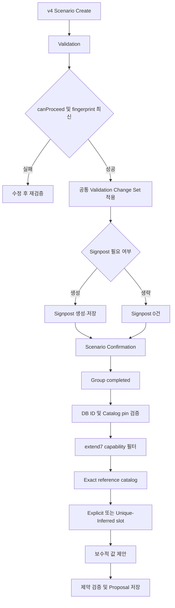

# Model Parameter Agent extend7

## 1. 목표와 결론

v4 `multi_event_model_lever_dimensions` proposal 범위를 기존 5개에서 ID 15
`PipelineAdjustment`, ID 17 `SupplyDisruption`을 더한 7개 Parameter ID로 확장한다. `7`은 release에서
제안 가능한 고유 ID 수이며 한 Scenario가 항상 7개를 반환한다는 뜻은 아니다.

기존 proposal/confirmation 경로와 저장 JSON, v1/v3 lifecycle은 유지한다. 제안 처리 결과에는
`ABSTAINED` 상태와 사유 필드를 추가해 보류와 실패를 구분한다. v4 workbook artifact 자체는 변경하지 않고,
기존 artifact digest를 재사용하는 `new-bc-v2` 계약으로 7종을 통합한다.
v4는 DB ID·이름·target과 extend7 capability 계약이 모두 일치해야 실행하고, v4 Signpost는 선택 단계로 바꾼다.

## 2. DB 적용 필수 조건과 환경별 판정

extend7 앱 배포 전 대상 DB는 sibling `skmip-mi-agent-mgmt` revision `a378b54ef997`의 0030 final 계약을
만족해야 한다. DB read-back·migration·DML은 코드 구현 권한과 별도 승인 사항이며 이번 로컬 구현에서는
실행하지 않는다.

| 확인 대상 | 필수 상태 | 판정 |
| --- | --- | --- |
| Parameter ID 15 | `PipelineAdjustment`, active, Supply/PipelineAdjustment/table1, fixed-columns | 일치하면 NO-OP, 불일치하면 mgmt 0030/forward migration 필요 |
| Parameter ID 17 | `SupplyDisruption`, active, Supply/VolumeAdjustment/table2, fixed-columns | 일치하면 NO-OP, 불일치하면 mgmt 0030/forward migration 필요 |
| Lever ID 29 | active v4 `pipeline_capacity`, primary executable `PipelineAdjustment` | 불일치 시 배포 차단 |
| Lever ID 27 | active v4 `upstream_production`, primary executable `SupplyDisruption` | 불일치 시 배포 차단 |
| active catalog | `v4`, checksum `835e6f2d4eb77f5e7aedc9ffe8b90bc73288242d2e9dc764a019f1bea962be51` | 불일치 시 Scenario 생성·proposal 차단 |
| legacy dimension mapping | 전체 semantic digest 불변 | 변경 시 rollout 실패·rollback |
| Scenario Group pin | active catalog version/checksum과 일치 | stale Group 수정 금지, 새 Group 생성 |
| Proposal status CHECK | `PROCESSING/PROPOSED/ABSTAINED/CONFIRMED/FAILED` | `ABSTAINED`가 없으면 mgmt forward migration 필요 |

Agent 저장소의 역사적 0029 SQL이나 generic runner는 0030 대체 적용에 사용하지 않는다. 정상 0030 DB에는
추가 canonical DML이 없고 catalog checksum도 바뀌지 않는다.

외부개발 DB의 현재 CHECK 제약은 `PROCESSING/PROPOSED/CONFIRMED/FAILED`만 허용하므로 Agent 배포 전에
`ABSTAINED`를 추가하는 DDL이 필요하다. 기존 proposal 행의 상태나 데이터를 바꾸는 DML은 필요하지 않으며,
마이그레이션 정본은 sibling `skmip-mi-agent-mgmt`에서 관리한다. `.env`에는 새 접속 항목이 추가되지 않는다.

## 3. Parameter와 evidence 정책

활성 proposal ID는 정확히 `{4, 6, 7, 8, 14, 15, 17}`이다.

- `EXPLICIT`: 대상·기간·방향이 직접 명시되면 exact slot을 제안한다.
- `UNIQUE_INFERRED`: 일부 근거가 없어도 selected Lever, Scenario branch, Event scope와 exact catalog 적용 후
  후보가 하나면 보수적으로 제안한다.
- `AMBIGUOUS_OR_CONTRADICTED`: 동등 후보가 여러 개이거나 catalog·Lever·lifecycle과 모순되면 abstain한다.

정량 변화폭 없이 방향만 있으면 reference 대비 작은 비영 변화를 제안하고 가정과 사용자 검토 필요성을 rationale에
남긴다. 방향이 충돌하지만 exact slot이 하나면 reference value를 중립값으로 제안하고 충돌을 명시한다.

| ID | Reference 우선순위 | exact axes |
| ---: | --- | --- |
| 15 | `new-bc-v2` Supply `BCPipeline` 우선, same-exact Pipeline LUT fallback | Pipeline Name, From Country, To Country, Year, Month |
| 17 | `new-bc-v2` Supply `BCProduction`×seasonality 우선, same-exact LUT fallback | Country, Year, Month |

기존 5종에도 unique-inference 원칙을 적용하되 PowerMix atomic vector와 exact-key 검증은 유지한다.
LiqUtil은 applicability 필터 후 exact slot이 하나면 시설·기간 직접 언급이 일부 없어도 허용하고, 여러 후보면
차단한다.

## 4. Signpost 선택형 전체 Flow

v4 Confirmation은 최신 성공 Validation과 fingerprint 일치를 확인하고 Validation Change Set을 정확히 한 번
적용한 뒤 Signpost 0건을 허용한다. Signpost가 있으면 기존 소유권·정합성 검증을 유지한다. v1/v3의 Signpost
필수 lifecycle은 변경하지 않는다.

## 5. 변경표

| 대상 | 처리 |
| --- | --- |
| Parameter master·Impact Lever | 대상 DB 0030 read-back gate, 저장소 canonical DML 없음 |
| Legacy dimension mapping | 변경 금지·digest 불변 |
| Scenario/Signpost table | schema 변경 없음, v4 Signpost 0행 허용 |
| Proposal table·공개 API | `ABSTAINED` status CHECK DDL, 결과 사유 필드 추가, 기존 proposal JSON 유지 |
| Capability contract | ID 기반 `model-parameter-proposal-capabilities-v2.json` 추가 |
| Workbook contract | 기존 Excel digest를 재사용하는 `new-bc-v2` 7종 계약 추가 |
| Config/ConfigMap | workbook/capability release ID·fingerprint 동기화 |

## 6. 구현 및 테스트 결과

구현을 완료했다.

- `extend7-v3` ID 기반 capability 계약을 추가하고 ID·이름·target 불일치를 LLM 전에 차단했다.
- `new-bc-v2`가 7종 모두를 하나의 `v4_workbook_then_lut` reference 경로로 처리한다. ID 15는
  `BCPipeline` 420건, ID 17은 `BCProduction × SeasonalityLogic` 4,908건을 authoritative record로 검증한다.
- 향후 proposal 확대도 동일한 versioned workbook contract→same-exact LUT fallback→slot/evidence/value 절차를
  기본 불변 조건으로 삼고, 파라미터별 legacy reference 우회를 추가하지 않도록 가이드에 기록했다.
- v4 candidate는 Step1.5 LLM 없이 deterministic하게 구성하며 primary/alternative lineage는 보존한다.
- 공통 Step2 exact-key 검증과 Step3 보수적 값 정책을 유지하고, extend7의 0 이상 제약을 서버에서 검증한다.
- v4 direct Confirmation은 최신 성공 Validation, `canProceed`, fingerprint와 Change Set application을 재검증한 뒤
  Signpost 0건을 허용한다. v1/v3는 기존 Signpost 필수 경로를 유지한다.
- resource manifest schema를 5로 올리고 workbook/capability release/hash를 로컬 YAML과 Kubernetes ConfigMap에 동기화했다.

검증 결과는 다음과 같다.

| 검증 | 결과 |
| --- | --- |
| 안전 환경 전체 automated suite | `1359 passed`, fail 0 (`test_model_parameter_multi_event_mysql.py` 명시 제외) |
| Model Parameter core gate | `98 passed`, `109 deselected`, fail 0 |
| proposal-only runner focused suite | `41 passed`, fail 0 |
| canonical workbook `--check-only` | PASS |
| 변경 Python Ruff(F/E9/I), 신규 파일 전체 Ruff | PASS |
| Python `compileall`, `git diff --check` | PASS |

대상 DB read-back, migration/DML, live proposal/confirmation, 외부 LLM canary, remote cache 쓰기와 배포는 권한이
없어 실행하지 않았다. 따라서 로컬 non-mutating gate는 PASS지만 DB/E2E까지 포함한 full release PASS는 주장하지
않는다. 상세 증적은 `tests/reports/model_parameter_agent/extend7_release_verification_20260920.md`에 기록했다.

## 7. 남은 제한과 후속 작업

live DB read-back으로 0030 final이면 `NO-OP`, 이전 상태면 mgmt revision `a378b54ef997` 적용 또는 forward
migration 필요 여부를 먼저 확정해야 한다. dry-run·commit, live proposal/confirmation, 외부 LLM canary와 배포는
각각 별도 승인 후 수행한다.
후속 범위는 별도 extend 브랜치에서 7→10→14로 확장한다.
